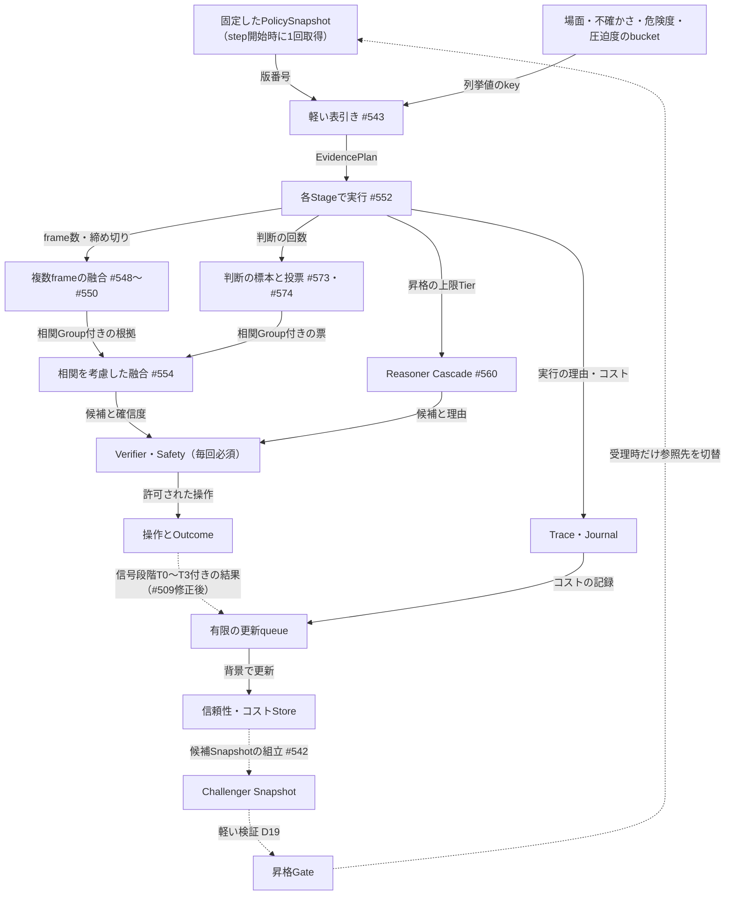

# 手法の信頼性・コストを学び、追加計算を配分する（適応計算と信頼性）

[動作と配置の見取り図へ戻る](README.md) ｜ [自己成長ループの全体設計](self_improvement_loop.md)

**状態：** 設計（未実装）。基準main `a6aaf85`、確認日2026-11-04。親Issueは[#800](https://github.com/tomiya7688/AI_game_player/issues/800)です。
正本のIssueは次のとおりです。
[#404](https://github.com/tomiya7688/AI_game_player/issues/404)（複数回の判断）、[#405](https://github.com/tomiya7688/AI_game_player/issues/405)（複数frame）、[#406](https://github.com/tomiya7688/AI_game_player/issues/406)（EvidencePlan）、[#407](https://github.com/tomiya7688/AI_game_player/issues/407)（手法別の信頼性と融合）、[#408](https://github.com/tomiya7688/AI_game_player/issues/408)（前段のHint）、[#409](https://github.com/tomiya7688/AI_game_player/issues/409)（コスト・品質・限界効用の推定）、[#411](https://github.com/tomiya7688/AI_game_player/issues/411)（PolicySnapshot）、[#425](https://github.com/tomiya7688/AI_game_player/issues/425)（資源予算）、[#439](https://github.com/tomiya7688/AI_game_player/issues/439)（Semantic Text Gate）、[#440](https://github.com/tomiya7688/AI_game_player/issues/440)（Reasoner Cascade）。

この文書は三つを区別して書きます。

- **実装済み（main）：** `src/` と `tests/` で確認したもの。
- **Issueで確定した設計：** Issue本文に採用手法として書かれているもの。未実装です。
- **本書で追加する設計提案：** 評価者Claudeが2026-11-04に加えたもので、設計者の承認待ちです。共通の提案は **[提案D番号]**（[全体設計](self_improvement_loop.md)と同じ番号）を付けます。本書だけの提案は **[提案AC番号]** を付けます。採否は#800で記録します。

## 1．何のため？

賢者ミスクは、普段は軽い1回の処理（1-pass）で進みます。怪しい場面でだけ、次の追加計算をします。

- 画面をもう数枚見る
- 判断をもう数回出させる
- 検査器や上位のReasonerを呼ぶ

そのためには、手法ごとに次の二つを、場面と機材の別に実測から知る必要があります。

- **どれだけ時間と資源を使うか（コスト）**
- **その結果がどれだけ当たるか（品質）**

今のIssue群では、この知識を持つ場所が三つに分かれる予定です。#540（判断の品質）、#553（融合の信頼性）、#773（評価関数の信頼性）です。分かれたままだと、同じ根拠を何度も数えてしまい、場面ごとの信頼度も食い違います（2026-11-04のIssue点検で判明）。本書では、**一つの信頼性・コストStore**と、**一つの相関の契約**を決めます。

## 2．実装済み（main）で確認したもの

| 部品 | 内容 | 本書との関係 |
|---|---|---|
| [decision_orchestrator.py](../../src/ai_game_player/decision_orchestrator.py) | 再観測を有限回に制限（既定は2回・3秒、上限は8回・30秒） | EvidencePlanの「追加frame」の最初の実行器。テストは[test_decision_orchestration.py](../../tests/test_decision_orchestration.py) |
| [decision_reliability.py](../../src/ai_game_player/decision_reliability.py)・[decision_verifier.py](../../src/ai_game_player/decision_verifier.py) | 判断1件をTRUST/CAUTION/VERIFY/REJECTに分類（#43） | 起動条件として使う。正しさの保証ではない（コードのコメントにも明記） |
| [ocr_provider.py](../../src/ai_game_player/ocr_provider.py)・[ui_recognition.py](../../src/ai_game_player/ui_recognition.py) | 同じ要素の根拠を `1 - Π(1 - conf×weight)`（noisy-OR）で統合 | 相関を無視しているので、#554で置き換える対象（第6節） |
| [outcome_fusion.py](../../src/ai_game_player/outcome_fusion.py) | 操作後の成功・失敗の根拠を決定的に統合 | 品質推定の入力。正しさは#509の修正が前提（第8節） |
| [shared_frame_producer.py](../../src/ai_game_player/shared_frame_producer.py) | 最新のframeを複数の購読者へ配る | #548のFrameWindowの取得元 |
| [light_adaptation_budget.py](../../src/ai_game_player/light_adaptation_budget.py) | 軽量更新の上限（1回20ms・8MiBなど） | 背景で推定器を更新するときの上限の型の手本 |
| [knowledge_promotion.py](../../src/ai_game_player/knowledge_promotion.py) | 不変の版をChampion/Challengerで比べてから参照先を切り替える（#532） | PolicySnapshotの昇格Gateで再利用する（[説明](knowledge_promotion.md)） |
| [self_check.py](../../src/ai_game_player/self_check.py) | 同じ操作の繰り返しなどを検出 | 品質推定ではT3扱い（第8節） |

OCRは、同じ `(source, model, preprocessing)` の根拠は最大値の1件にまとめます。そのため、完全に同じ根拠の二重計上は起きません。ただし、同じframeを別の前処理で読んだ根拠は独立票として掛け合わされます。UI側にはこのまとめ処理がありません。EvidencePlan・PolicySnapshot・信頼性Store・FrameWindow・Tier契約は、mainに**まだありません**（`src/`を検索して確認）。

## 3．何を受け取り、何を返す？

- **受け取るもの：** 各手法の実行記録（時間・資源・失敗）、操作後のOutcome、検査結果、利用者の訂正、前段のHint（#561）、資源の圧迫度（#545）。
- **返すもの：** stepごとのEvidencePlan（何枚見るか、何回判断するか、どの手法・Tierを使うか、締め切り）、融合用の手法別の重み、Reasonerの昇格指示、追跡用のTrace。
- **返さないもの：** 操作そのもの、座標、Safetyの許可。Safety KernelとVerifierは、EvidencePlanとは別に毎回必ず通ります（#543・#551）。

## 4．どの順番？

実線は、Issueで確定した設計の経路です。点線は、本書の提案と条件付きの経路です。

hot pathの処理（上半分）は、固定したSnapshotを読むだけです。DB、ファイル、モデル、ネットワークは呼びません（#543）。推定器の更新とSnapshotの組立は背景で行います。背景の処理は、#546のadmissionが許したときだけ動きます。

## 5．一つの信頼性・コストStore **[提案AC1]**

#409・#407・#773の推定を、同じkeyで一つのStoreに置きます。書き込む推定器は分けたままにし、読む側には版を固定した不変の表を渡します。

| 型 | 中身 | 型の持ち主 | 書く側 | 読む側 |
|---|---|---|---|---|
| `MethodProfileKey` | method ID・版・Provider/Backend × task種別 × scene bucket × hardware bucket。補助のbucketとしてrisk、Goal/phase（評価関数用）を任意で持つ | #553 | — | 全員 |
| `CostStats` | cold/warmを分けたwall時間・queue待ちのEWMAとp50/p95、CPU/RAM/VRAM/IO、timeoutと失敗の率、標本数、priorの出所（#222 Probe）、TTL | #539 | #539の推定器 | #541・#542・#545・#559 |
| `QualityStats` | 信号段階T0〜T3ごとの成功数・失敗数（Beta事後分布）、有効標本数、校正済み信頼度、**自己申告確信度の要約（別欄）**、出力の形式妥当率、校正の参照（#187） | #540 | #540の推定器 | #541・#542・#554・#574 |
| `MethodReliabilityProfile` | 上の二つを、ある版で固定した読み取り用の表。base（既定値）とmeasured（実測）の区別、未校正であることの印 | #553 | #542の組立時に作る | #554・#555・#549 |
| `CorrelationGroup` | 根拠の出所から作るGroupのIDと、Group内の相関係数ρの推定（第6節） | #553 | #540（ρの推定） | #549・#554・#574・#773 |

**#540と#553の分担（統合せず、明示的に分けます）：**

- **#539** はコストだけを書きます。
- **#540** は品質の推定器です。Outcomeから`QualityStats`を増分で更新し、遅れて来た実Outcomeでproxyの推定を補正します。
- **#553** は型の持ち主です。`MethodProfileKey`・`MethodReliabilityProfile`・`CorrelationGroup` のschemaと版を決めます。自分では推定しません。
- 「self confidenceと実測の区別」は、#540が別欄に書き、#553のschemaがその区別を必須にします。同じ仕事を二つのIssueで実装しないためです。
- **#773** の評価関数の信頼性は、method種別 `EVALUATOR` の行として同じStoreに入ります。これで「信頼性の仕組みが三つある」状態を避けます。#773の「評価器を自分の予測で採点しない」規則は、そのまま#540の更新規則にも適用します（第8節）。

**更新の規則 [提案AC2]：** コストはEWMAとrolling quantileで更新します（#539）。品質はBeta事後分布を使い、段階ごとに別のcountを持ちます。cold-startでは、#222のprobeやbaseを擬似標本数k₀件ぶんのpriorとして入れます。有効標本数がn_min未満のbucketは「未校正」とし、融合の重みにはbaseを使います。k₀とn_minは未測定で、設定値として始めます。Model・DSL・Goal・Sceneの版が変わったら新しいbucketを作り、古い支持はそのまま流用しません（#773の7）。

## 6．相関の契約と有効標本数 **[提案D17]**

同じframe、同じモデル、同じpromptから出た根拠は、独立した票ではありません。#549（複数frame）、#554（手法の融合）、#574（self-consistency）、#540（品質の標本）は、**同じ相関の部品**を使います。2026-11-04のIssue点検で得た「#549・#554・#574は型を共有する」という結論に合わせます。

- **GroupのID：** 出所の組 `(frame世代またはframe ID, model ID+版, 前処理, prompt/seed系列)` から決定的に作ります。
- **相関の扱い：** ρが分からない間は ρ=1 とし、n件を1件として扱います。これは#773の初期の保守式（同源n件に各1/nの重み）と同じです。
  ρは、replayの状態で出力の順位相関を測って推定します（**[提案D8]**）。別Groupでも、独立だと示されていなければ全面的には信頼しません。
- **有効標本数：** Group内のn件は `n_eff = n / (1 + (n-1)ρ)` として数えます。投票（#574）、存在の投票（#549）、品質のcount（#540）は、すべてn_effで重み付けします。
- **noisy-ORの置き換え：** 現在のOCR・UIの統合では、0.6の根拠が2件あると0.84になります（#554の例）。#554の集約器は、Group単位で統合してからGroup間で統合します。校正されていない値は「確率」と名乗りません。

## 7．EvidencePlanとPolicySnapshotの寿命

**EvidencePlan（型の持ち主は#551、表引きで作るのは#543、実行は#552）。** 次のものを持ちます。

- 起動の理由：認識の確信度の低さ、Unknownness、判断の不一致、VerifierのCAUTION/VERIFY、ActionSafetyのSUSPICIOUS、直近の失敗
- 量：frame数、判断の標本数、任意の検査器
- 手法：Method ID、Cascadeの上限Tier
- 上限：締め切り、最大の計算量class、早期終了の条件
- 本書で追加する項目：探索枠かどうかと選択確率（**[提案D16]**・**[提案D20]**）

決まらない場合は、決定的な1-passの既定Planへ戻ります。

**PolicySnapshot（#542）の寿命：**

1. 背景で、Storeと#425の予算と#441の登録情報から、少数のbucketごとの表を組み立てます。
2. 消えた手法、期限切れ、remote利用の同意がない手法を除外します。
3. 不変のChallengerとして保存します。
4. 昇格Gateで判定します（**[提案D19]**）。Gateは#532の`KnowledgePromotionGate`と同じ形にします。直近のreplayとholdoutのケースで、ChampionとChallengerのSnapshotを交互に比べます。誤判断率が悪化しないこと、p95がGateの範囲内であることを確かめ、そのうえで参照先だけを切り替えます。holdoutの消費は台帳に記録します（**[提案D2]**）。
5. step開始時に1回だけ取得して固定します。step中に版は変わりません（#552）。
6. 問題が出たら、過去の有効な版へ戻します。

Issue #542の「atomic swap」は、Gateを通ったあとの切り替えの方法です。Gateを省いてよいという意味ではありません。

## 8．学習信号の正しさと自己採点の防止

**[提案D18] 前提：** #509（終了文字の部分一致で勝敗を決める誤判定）と[#671](https://github.com/tomiya7688/AI_game_player/issues/671)（6軸への投影漏れ）が直るまでは、終局Outcome由来の更新を「T2未検証」として保留します。保留した更新は、Store本体ではなく別の欄に置きます。誤った勝敗を学習すると、品質も昇格判定も同じ誤りを引き継ぐからです。

**危険：** #540の入力には、VerifierのTRUST/REJECT、SelfCheck、replayのラベルが含まれます。これらは評価される側の仕組み自身が出したものです。そのままでは、「自分のVerifierを喜ばせる」ことを学んでしまいます（Issue点検）。

**[提案D3]による対策：**

| #540の入力 | 段階 | 使い道 |
|---|---|---|
| 利用者の訂正、信頼済みテスト | T0 | 校正済み信頼度を更新する |
| 検証済みの終局Goal | T1 | 校正済み信頼度を更新する |
| receipt付きの得点増などのproxy | T2 | 更新するが、遅れて来たT0/T1で上書き・補正する |
| Verifier REJECT（候補外、古い画面） | 形式の事実 | 「形式妥当率」の欄だけを更新する。決定的な検査なので数えてよいが、正しさの品質には混ぜない |
| Verifier TRUST、SelfCheck、標本間の合意、自己確信度 | T3 | 探索の優先度にだけ使う。融合の重みや昇格は動かさない |

さらに、PolicySnapshotの昇格判定には、推定に使っていないholdoutのepisodeを使います（**[提案D2]**）。

## 9．探索の予算 **[提案D16]**

cheap-firstで早期終了すると、高価な手法がほとんど試されません。そのため#540・#541は、高価な手法の本当の価値を学べません。

- **探索の枠：** bucketごとに、step数のε割合を上限とします。その中で、品質の事後分布からのThompson samplingと、コストの罰則を使って、普段は選ばれない手法・標本数・Tierを選びます。
- **使ってよい場面：** 資源classがLIGHTまたはMODERATEの場面、締め切りに余裕がある場面、ゲーム上の危険度が低い場面だけです（#206の予算内）。
- **記録：** 選択確率を記録し、off-policy評価（IPS）に使います（**[提案D20]**）。

**[提案AC3] 限界効用の測り方（#541）：** k回の標本を取ったstepでは、最初のj回（j<k）だけで集約した結果も同時に記録します。これで、同じstepで「1回→3回→5回」の改善を、追加のコストなしに対で比べられます。改善の正否は、後で届いたT0〜T2の結果で決めます。

## 10．Tier/Roleの契約（#559と#585）

#559と#585は、どちらも「登録したModelをTier/Roleへ置く」と書いています（Issue点検）。そこで、型を一つにして責務を分けます **[提案AC4]**。

- **#559 `ReasonerTierProfile`：** Tier0〜4の**意味**を、capability・コスト・roleで定義します。Modelの大きさでは決めません。あわせて、型付きのEscalationSignal（RESOLVE/ABSTAIN/ESCALATE/REQUEST_MORE_CONTEXT）を定義します。
  あるModelがどのTierに置けるかは、#539の実測コストと登録されたcapabilityで判定します。
- **#585 `ReasonerStackProfile`：** 利用者が組むstackです。roleごとに#441のentryを参照し、primary/fallback、上限、締め切り、remoteの同意を持ちます。保存する前に#559の契約で検証し、合わないものは理由付きで拒否します。
- **コンパイル先：** 検証したstackは、PolicySnapshotの「routing表」部分になります。#560はその表だけを読みます。#439のText Gateは、難しさ・曖昧さをEscalationSignalへ渡します。Text Gate自身も一つの手法として、Storeに行を持ちます。

## 11．資源予算のclass（#544〜#546）

- **#544** はprofileとpresetを定めます（Auto/Lightweight/Balanced/Performance）。
- **#545** は、実測の圧迫度からLIGHT/MODERATE/HEAVY/BLOCKEDを決めます。閾値の近くでは、hysteresisで値が振動しないようにします。
- **#546** は、5つのModeごとに、許可・保留・延期を返します。

本書では、次の三点を加えます **[提案AC5]**。

- #545のclassを、版付きの小さな値として公開します。hot pathはその値を列挙値のkeyとして読むだけで、自分では測りません。
- EvidencePlanの最大の計算量classは、現在のclassを超えられません。BLOCKEDのときは1-passの既定Planになります。
- 推定器の更新とSnapshotの組立は「Optional learning」の扱いです。推論の遅延が大きいときは、先に延期します。

数値はすべて**未測定**です。Issue #543は、表引きのp50/p95と割当量をCIの性能Gateに入れると定めていますが、目標値はまだありません。既存の上限には、再観測2回・3秒（orchestrator）、軽量更新1回20ms・8MiB（light adaptation）があります。

## 12．前段のHint（#561・#562）

前段で認識した場面やROIは、`MethodProfileKey`のscene bucketを選ぶ入力になります。ただし、確信度の低いHintはsoft priorとしてだけ使い、候補を確定的に除外しません（#561）。#562で候補を絞りすぎた場合は、絞らない経路へ戻ります。その発生率もTraceに記録します。

## 13．失敗したら？

| 状況 | 扱い |
|---|---|
| Snapshotがない、期限切れ、壊れている | 最後の有効な版を使う。それもなければ、決定的な1-passの既定Plan |
| 知らないMethod IDやbucket | 固定の既定値へ、ほぼO(1)で戻る（#543） |
| 締め切りに到達した | 残りのframe・標本・上位Tierを打ち切る。古いframe・Action世代は混ぜない（#552・#560・#573） |
| Storeへ書けない、queueがあふれた | 推論は続ける。更新を捨てたことと件数を記録し、学習のadmissionだけを閉じる（light adaptationと同じ方針） |
| ρが不明、標本が少ない | ρ=1、未校正のbaseを使う |
| 融合が使えない | 既存の独立したProviderの経路へ、有限の範囲で戻る（#555） |

## 14．自己成長への寄与

この領域は、[全体設計](self_improvement_loop.md)の「中間速度」のループにあたります。実測によって、「この場面では、この手法にどれだけ計算を使う価値があるか」を更新します。変更は、昇格Gateを通った不変のSnapshotとしてだけ判断に届きます（**[提案D19]**）。

一つのStore（第5節）は、#773の評価関数の信頼性と、**[提案D13]**のゲーム間ライブラリの「ゲームごとの信頼性」の置き場所にもなります。

## 15．Issue間の食い違いと、本書の解決案

| 食い違い（出所） | 解決案 |
|---|---|
| #540と#553が、どちらも手法別の実測信頼度を持つ（Issue点検） | 第5節。#540は推定器、#553はschemaの持ち主。Issueは統合しない |
| #407・#409・#773が別々に信頼性を推定する（Issue点検） | 一つのStoreに置く **[提案AC1]** |
| #559と#585がTier/Roleの配置で重なる（Issue点検） | 契約と利用者のstackに分ける **[提案AC4]** |
| #542のatomic swapが、#710・#769の昇格の規則を通らない | **[提案D19]** の昇格Gate |
| cheap-first（#543・#551・#560）では、高価な手法を学べない | **[提案D16]**・**[提案D20]** |
| #574・#549が、相関した票を独立に数える | **[提案D17]** の共通の部品 |
| #540がVerifierやSelfCheckで自己採点する | **[提案D3]** の段階分け |
| #541の測り方が決まっていない | **[提案AC3]** の前半j回の記録 |
| 現在のnoisy-OR（ocr_provider.py・ui_recognition.py）が同源の根拠を掛け合わせる | #554で、Group単位の統合へ置き換える |

## 16．残っている作業

| 項目 | Issue |
|---|---|
| D3・D16〜D20・AC1〜AC5の採否 | [#800](https://github.com/tomiya7688/AI_game_player/issues/800)（設計者） |
| 勝敗判定の修正（D18の前提） | [#509](https://github.com/tomiya7688/AI_game_player/issues/509)・[#671](https://github.com/tomiya7688/AI_game_player/issues/671) |
| コスト・品質・限界効用の推定器 | [#539](https://github.com/tomiya7688/AI_game_player/issues/539)・[#540](https://github.com/tomiya7688/AI_game_player/issues/540)・[#541](https://github.com/tomiya7688/AI_game_player/issues/541) |
| Snapshotと表引き | [#542](https://github.com/tomiya7688/AI_game_player/issues/542)・[#543](https://github.com/tomiya7688/AI_game_player/issues/543) |
| EvidencePlanとStageでの実行 | [#551](https://github.com/tomiya7688/AI_game_player/issues/551)・[#552](https://github.com/tomiya7688/AI_game_player/issues/552) |
| Profile・相関・融合・配線 | [#553](https://github.com/tomiya7688/AI_game_player/issues/553)・[#554](https://github.com/tomiya7688/AI_game_player/issues/554)・[#555](https://github.com/tomiya7688/AI_game_player/issues/555) |
| 複数frame | [#548](https://github.com/tomiya7688/AI_game_player/issues/548)・[#549](https://github.com/tomiya7688/AI_game_player/issues/549)・[#550](https://github.com/tomiya7688/AI_game_player/issues/550) |
| Self-consistency | [#573](https://github.com/tomiya7688/AI_game_player/issues/573)・[#574](https://github.com/tomiya7688/AI_game_player/issues/574) |
| Tier・Cascade・Stack | [#559](https://github.com/tomiya7688/AI_game_player/issues/559)・[#560](https://github.com/tomiya7688/AI_game_player/issues/560)・[#585](https://github.com/tomiya7688/AI_game_player/issues/585)・[#441](https://github.com/tomiya7688/AI_game_player/issues/441)・[#442](https://github.com/tomiya7688/AI_game_player/issues/442) |
| 資源予算とUI | [#544](https://github.com/tomiya7688/AI_game_player/issues/544)・[#545](https://github.com/tomiya7688/AI_game_player/issues/545)・[#546](https://github.com/tomiya7688/AI_game_player/issues/546)・[#547](https://github.com/tomiya7688/AI_game_player/issues/547) |
| 前段のHint | [#561](https://github.com/tomiya7688/AI_game_player/issues/561)・[#562](https://github.com/tomiya7688/AI_game_player/issues/562) |
| 評価関数の信頼性を同じStoreへ入れる | [#773](https://github.com/tomiya7688/AI_game_player/issues/773) |
| 探索の無作為性と選択確率 | [#428](https://github.com/tomiya7688/AI_game_player/issues/428) |

## 17．一つ具体例を追う

*以下は説明用の仮定です。測定結果ではありません。*

数字のOCRで得点を読む場面で、確信度が低かったとします。

1. 表引き（#543）は、`(数字OCR, 得点表示scene, この機材)` のbucketから、「frameを3枚、締め切り40ms」のPlanを返します。
2. 3枚とも同じOCRモデルなので、同じモデル系列のGroupに入ります。ρは未推定なので1として扱い、3件の一致は「1件ぶんの根拠」と数えます。
3. 確信度が足りないままなら、Planの許す範囲で別系統のOCRを1回呼びます。Groupが別なので、2件めの根拠として加わります。
4. Verifier・Safetyを通ったあと、receipt付きの得点変化（T2）で、両方の手法の`QualityStats`を更新します。
5. 後日、利用者が読み違いを訂正すれば（T0）、その結果で上書きします。
