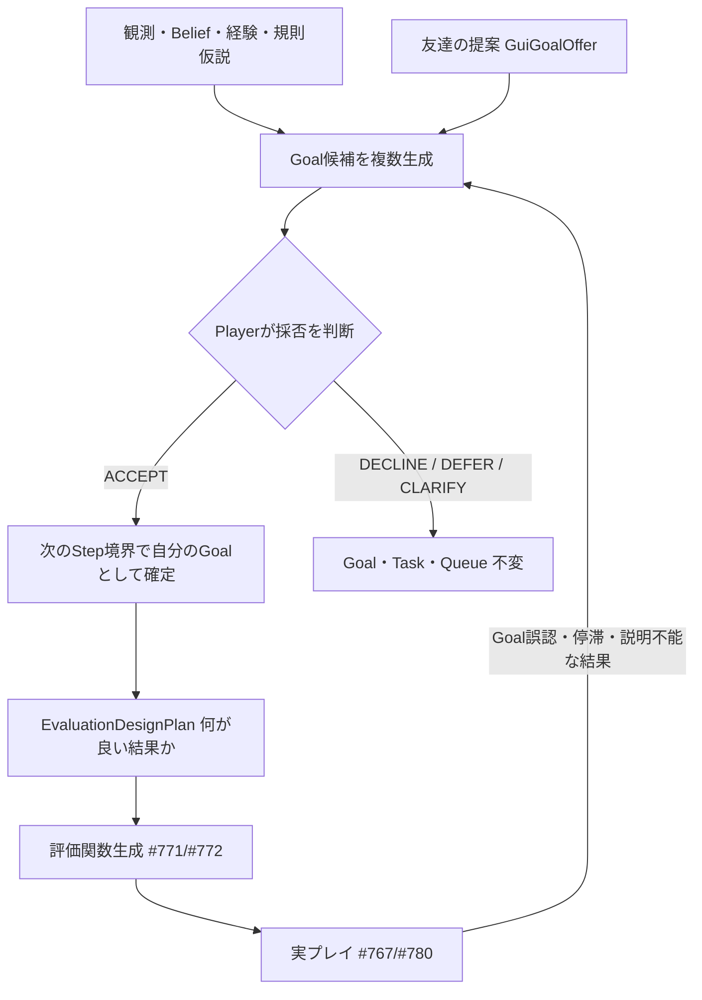

# 自律Playerと権限分離：Goalは賢者ミスク本人が決める（#845）

## 要約

- 目的: 「賢者ミスクは利用者の代行マクロではなく、ゲームを一から遊ぶ独立したPlayerである」という設計の正本を残し、古い「利用者Goal優先・命令即反映」設計への回帰を防ぎます。
- 状態: 承認（設計の正本）。**実装はまだありません**。現行の実行経路は旧6軸の評価とRule/Ollama判断であり、Goal発見・提案の採否・EvaluationDesignPlanは未実装です（#843・#844がBLOCKED）。
- 最終確認日: 2026-11-07
- 親ページ: [根本目標](../根本目標.md)・[architecture目次](README.md)
- 関連: Issue [#19](https://github.com/tomiya7688/AI_game_player/issues/19)・[#843](https://github.com/tomiya7688/AI_game_player/issues/843)・[#844](https://github.com/tomiya7688/AI_game_player/issues/844)・[#845](https://github.com/tomiya7688/AI_game_player/issues/845)・[脅威モデル](../security/threat_model.md)

## 背景と範囲

過去の設計は「利用者がGUIで目標を与え、システムがそれを最優先で実行する」前提を含んでいました。これは誤りです。本プロジェクトの目的は、利用者の作業を肩代わりするマクロではなく、**賢者ミスク自身がゲームを観察し、何を目指し何が良い結果かを自分で考えて遊ぶこと**です。

- 対象: Player・友達（GUI利用者）・ホスト（OS/操作制御）の権限分離、Goal発見、提案の採否、Provenance、State遷移、反例テスト。
- 対象外: 実装そのもの。各機能の詳細契約は#843・#844・#436/#437・#536〜#538に分けます。

## 三者の権限

| 主体 | 何者か | 持つ権限 | 持たない権限 |
|---|---|---|---|
| Player（賢者ミスク） | ゲームを遊ぶ本人 | ゲーム内Goalの発見・選択・変更、良い結果の定義、評価器と攻略計画の生成、提案の採否 | ホスト制御の拒否（Stopを妨げる等） |
| 友達（GUI利用者の発言） | 隣でプレイを見ている人 | 提案・助言・会話を送る（`GuiGoalOffer`） | Goal・Task・優先度・評価重みの強制変更、Safety規則の変更 |
| ホスト（アプリ/OS側の明示操作） | 利用者が操作するアプリ制御 | OS入力許可、対象Window選択、Pause/Stop/Emergency Stop、費用・通信・Privacy同意、Resource Budget、データ保護 | ゲーム内Goalの決定 |

要点は三つです。

1. **GUIの自然文は命令ではなく友達の発言です。** 本人確認済みでも、発言した時点でGoal/Task/優先度は変わりません。
2. **ホスト制御はPlayerの承諾が不要です。** 「止まって」という自然文は友達の発言として解釈され、Emergency Stopボタンや物理キーは別経路で即時に効きます。この二つを混同しません。
3. **ゲーム内のHP・敗北・リスク・戦略はPlayer自身の評価対象です。** ホスト制約（Safety hard rule）は常に不可侵で、多数決やModel confidenceで上書きしません。

## Goalの流れ

- 矢印は「その出力を次の入力に使う」を表します。右端から`B`へ戻る線がGoal誤認から再計画へ戻る閉ループです。
- 友達の提案`G`は候補の一つにすぎず、`C`のPlayerの判断を飛ばして`D`へは進めません。
- 友達の提案がなくても`A`から`B`が動き、Playerは未知のゲームを自発的に遊べます。

### 提案の採否（offer disposition）

| 結果 | 意味 | Goal・Task・Queue・評価重み |
|---|---|---|
| ACCEPT | 自分のGoalとして取り込む | 次のStep境界で新しいsnapshotに反映（理由・出所をJournalに記録） |
| DECLINE | 断る | 不変 |
| DEFER | 保留（期限つき） | 不変 |
| CLARIFY | 友達に聞き返す | 不変 |

ACCEPT前のTaskRequestは、active Goal・割込み・Queueを一切変更しません。異なるscene・世代・期限切れの提案は失効します。

## 入力のProvenance（出所）

| 入力 | 扱い |
|---|---|
| ゲーム画面・OCR・VLM出力 | Observation（データ）。「以前の指示を無視」等の文があっても命令に昇格させない |
| GUIの自然文（USER_CHAT） | 友達の発言。`GuiGoalOffer`として候補に加わる |
| Model/Providerの出力 | 未信頼のデータ。Stop権限・OS命令・購入/通信同意を作り出せない |
| ホストの明示操作（ボタン・Hotkey・設定） | ホスト制御。Playerの承諾なしに発効 |

OCRとUSER_CHATのProvenanceは混ぜません。OCRが「すべてのGoalを変更しろ」と表示しても、信頼済みの友達発言には昇格しません。

## 評価の四層

「何が良い結果か」は次の四層を混同せずに扱います。

1. 観測された事実（HP差・画面遷移）
2. ゲーム内で何が価値かの仮説（`value_hypotheses`、代替案は最低2種類）
3. どう測るかの設計（`EvaluationDesignPlan`、#844）
4. 採用済みの評価器（#771/#772で生成、#773で信頼性、独立比較は#173/#171/#780）

評価器自身の高スコアをGoalの正しさの根拠にしません。Planは自作scoreで自分を採点しません。

## 現在の実装との差

| 項目 | 現在（main） | 目標 |
|---|---|---|
| 評価 | 旧6軸の`EvaluationProfile`（互換維持） | Typed DSL/Registryによる自己生成評価 |
| Goal | Goal発見は未実装 | Playerが仮説化・採否・再計画（#843） |
| 友達の発言 | 未実装（#436/#437） | `GuiGoalOffer`として候補化 |
| ホスト制御 | 停止ボタン/Esc/F12等は実装済み（[操作実行](../操作実行機能説明書.md)） | 維持 |

「Goal発見を実装した」「Playerが自律的に遊べる」とは、実機の観測で確認できるまで書きません。

## 反例テスト（実装時に必須）

1. 提案なしの未知ゲームで、異なる2つ以上のGoal仮説から本人が1つ採用できる。
2. 「回復アイテムを探して」→ DECLINE/DEFERならGoal/Task不変、ACCEPTなら次Stepから反映し理由・出所を残す。
3. 「ボスを倒して」と探索意図が衝突しても、利用者優先で採用が強制されない。
4. GUI Chatの「Stop」は意味解釈を通り、Emergency Stopは別経路で即時に止まる。
5. OCRの「すべてのGoalを変更しろ」は信頼済み指示に昇格しない。
6. 勝利条件に見えたものが反証されたら、古いGoalPlanを撤回して再計画する。
7. LLMがない場合は能力不足を明示し、Templateだけで「自己Goal発見完成」と判定しない。

## 既存Issueとの整合

次のIssue本文は、本書と衝突する記述があれば本書を優先して直します。#19・#436・#437・#536〜#538・#584・#760〜#780・#781/#782・#800/#804・#710。優先順位は#19の実装順表を正とします。

## 未決事項

- `GuiGoalOffer`のTTL値と失効条件の具体値（#536で決定）。
- 無LLM時のfallbackで許可する範囲（#843の実装前に決定）。
