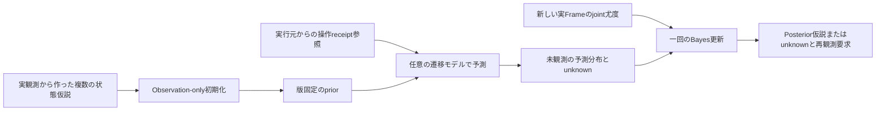

# 状態仮説を予測し、実観測の尤度で更新する

この資料は汎用ゲームプレイヤーの認識・計画を接続する開発者向けです。
Issue #564の成果物は、#563の不変な候補Storeを使うCPU-only filterです。
Minecraft、カード、FPS等の状態型をCoreへ埋め込みません。2048は参照fixtureだけです。

## 処理と実行の境界



- `BayesianBeliefEstimator.initialize` は遷移モデル無しでも開始できます。
- `predict` は `TransitionModel.apply_action/chance_outcomes` を呼びます。
  同じ次状態へ至る互いに排他的な経路は、Storeへ渡す前に合算します。
- `observe` は実Frameを必須とする `BeliefLikelihoodBatch` を一回だけ適用します。
  予測、前回操作、結果、観測の参照は区別し、予測を観測事実へ変換しません。
- このCoreはActionを選ばず、画面取得、DOM、実入力、Safety/Verifier、
  許可候補集合へアクセスしません。本番の接続と最終世代確認は #567 の責務です。

予測時のContextは入力元のFrame/turn/source世代への参照です。仮想的に進んだ
手番を「観測済み」として付け替えません。新しい実観測のContextだけが次のFrame/turnを与えます。

`BeliefActionRef` は実行元が既存ExecutionReceiptから作る薄い投影契約です。
receiptの参照、元snapshot、実行世代に加えて元Session/Scene/Frame/source contextを
完全照合します。`dispatch_unknown` を「実行したはず」と予測せず、同じreceiptの
二重適用も拒否します。値型そのものが実行の真偽を証明するわけではありません。
現時点ではtrusted runtime adapterをまだ接続しておらず、#628の入力実績や通常の
Outcome処理をこのfilterが置き換えることもありません。

## Bayes更新と未校正の比較順位

校正済みpriorを `w_i`、新観測の尤度を `L_i`、未表現worldの質量を `u`、
そのworld全体の尤度を `L_unknown` とすると、更新は次の式です。

```text
Z = sum(w_i * L_i) + u * L_unknown
posterior_i = w_i * L_i / Z
posterior_unknown = u * L_unknown / Z
```

`u=0` のときだけunknown項は不要です。`u>0` なのに `L_unknown` が不明な場合、
都合よく0や1を代入して消しません。priorまたは尤度が未校正、既知worldの尤度が
欠けている場合も、比較用の `RELATIVE_SCORE` とunknown質量1へ戻します。
未評価のworldは相対順位の計算で中立とし、矛盾したworldだとは扱いません。

尤度は状態確率とは別です。同じ観測・測度に対する連続密度は1を超えられます。
非負の有限値を受け入れ、全尤度を共通定数で変えてもposteriorは変わりません。
log空間と共通最大値で正規化し、極小値の積によるunderflowを避けます。
全候補が明示的なゼロ尤度で矛盾し、残余にも支持が無い場合は空のUNKNOWNへ戻します。

校正IDは外部の観測モデル・校正契約への参照であり、IDの存在だけで校正の品質を
保証しません。実ゲームの自己申告confidenceを勝手に尤度へ変換する処理はありません。

## 相関した観測を再票加算しない

一つのbatchは、複数Recognizerや後続Outcomeを参照できる**一つのjoint尤度vector**です。
同じ画面に由来する16個の証拠があっても、尤度を16回掛け合わせません。
複数Frame/Recognizerの融合や条件付き独立性の検証は既存 #405/#407 の責務として残し、
ここでは既に融合された値とその参照を受け取ります。

producerは同じ静止画・融合窓へ同じ相関IDを割り当ててください。時刻を変えただけで
独立な標本にしないことが前提です。filterは採用済みのFrame ID・相関IDの再利用、
frame_sequenceの後退、旧snapshot/turn/Action世代、別scopeを拒否します。
型だけで実世界の独立性を保証するとは扱いません。

相関履歴とreceipt履歴には上限があります。満杯時は黙って古いIDを忘れて再利用を
許可せず、更新不能と再観測要求を返します。同scopeのresetでも履歴を消しません。
新しいSession/Scene/source世代への明示resetで初期化します。

## 有限の資源と失敗処理

| 予算 | 既定 | 作用 |
|---|---:|---|
| 生成world | 256 | Store入力上限との小さい方。切詰めの質量はunknownへ |
| 一つのchance分岐列 | 256 | 空、不正型、確率質量不一致、上限超過をunknown扱い |
| 展開canonical payload | 2 MiB | pendingと保持worldの合計。単体はStoreのstate上限も適用 |
| 相関/receipt履歴 | 各1,024 | silent eviction無し。Frame集合も16倍まで |
| 計算deadline | 100 ms | Storeの期限との小さい方。ノード・state検証前後・公開前で照合 |

同worldへの多数経路はKahan加算で集計し、経路ごとのfloat配列を蓄積しません。
canonical byte予算はPython heap/RSSと同じではなく、実測peakは別に記録します。
モデルが返すtuple自体の確保はモデル側の責務です。任意の遅いcallbackを強制終了する
仕組みではなく、信頼された有限のpure modelを前提とします。期限後に戻った計算結果は
公開しません。外部workerの強制制限や本番resource admissionは #425/#567 に残ります。

Storeの `expected_version` と最終identity CASで計算元priorを固定します。
途中に別writerが更新した場合は古い結果を公開しません。失効、予測失敗、
不正な尤度、期限、送信不明の場合は固定reasonと再観測要求を返し、例外の自由文を
診断へ転記しません。新しい有効な観測によるposteriorだけが観測時刻を更新し、
予測の繰返しで観測TTLを延長しません。

## 手法と受入証拠

| 元要件/既存手法 | 実装・確認 | 残る接続 |
|---|---|---|
| POMDP Bayesian filtering | Predict/Observe分離、prior×尤度と残余、log空間 | 実Recognizerの尤度校正 #405/#407 |
| 複数worldと確率遷移 | 状態型非依存、同worldの排他経路を合算 | 計画による選択 #565/#566/#567 |
| Particle filterへ交換可能 | typed Snapshotとjoint尤度の薄い境界。有限全列挙を参照実装にする | particle resampling/POMCP/POMCPOWは未実装、親 #478 の非対象 |
| 相関証拠/false certainty防止 | 同Frame/相関ID再利用拒否、unknown質量、未校正score | producer側の相関検出 #405 |
| CPU/失敗/資源 | 決定的fixture、負例、p50/p95/peak/byte測定 | FPS等の実機deadline #44/#425/#567 |
| Safety不変 | 純粋Coreの依存検査、実入力なし | 既存Verifier/Safetyを通すRuntime Adapter #567 |

参考: [POMDP belief update](https://www.pomdp.org/talks/who-needs-pomdps/index.html)、
[POMCP](https://papers.nips.cc/paper_files/paper/2010/hash/edfbe1afcf9246bb0d40eb4d8027d90f-Abstract.html)。
POMCPを実装したという意味ではありません。

```sh
PYTHONPATH=src:. python -m unittest discover -s tests -p test_belief_estimator.py -v
PYTHONPATH=src:. python tools/benchmark_belief_estimator.py
```

Coreでは、整数状態と2048の「一セルが8/16」の両候補を保持し、確率spawn後の実観測fixtureで
順位・重みが変わることを検証します。fixtureの尤度は宣言したテストOracleであり、本番認識の
精度ではありません。Runtime配線・実ゲームでの認識精度/攻略強化は未確認です。

2026-11-01のクラウドLinux/Python 3.12、seed 564、各100反復の計測値です。
入力候補の準備はlatencyの外、heapの計測内です。tracemallocを有効にした診断計測では
期限を1秒に設定しており、通常設定100msや実機の受入検証を代替しません。

| fixture | 初期化 p50/p95 ms | 予測 p50/p95 ms | 観測更新 p50/p95 ms | traced peak |
|---|---:|---:|---:|---:|
| 整数8候補 | 2.736 / 2.877 | 4.136 / 4.532 | 3.458 / 3.735 | 771,786 bytes |
| 曖昧2048・2候補 | 1.540 / 1.682 | 33.489 / 34.924 | 19.011 / 20.091 | 1,094,031 bytes |

2048では52分岐からK=32を保持し、予測でunknown質量0.164615が残りました。
Snapshotは60,260 bytesです。候補を切り詰めた後に既知候補だけを確率1へ再正規化していません。
これらは環境依存の観測値です。reportはGit SHA・dirty flag・source hash・設定・
fixture hash・測定中のsource変更有無を記録し、`build/belief-estimator/`へ固有reportと
latestを保存します。Python heapはRSS/VRAMやモデル自身の確保量と異なります。

専用29 testsでは上記に加え、50個のseeded分布と尤度を独立したFraction有理数Oracleへ
照合しました。複数Recognizer/Outcomeの参照を持つjoint vectorが一回だけ適用されること、
同receipt二重予測とstate検証中のdeadline漏れの自己レビュー回帰も含みます。
