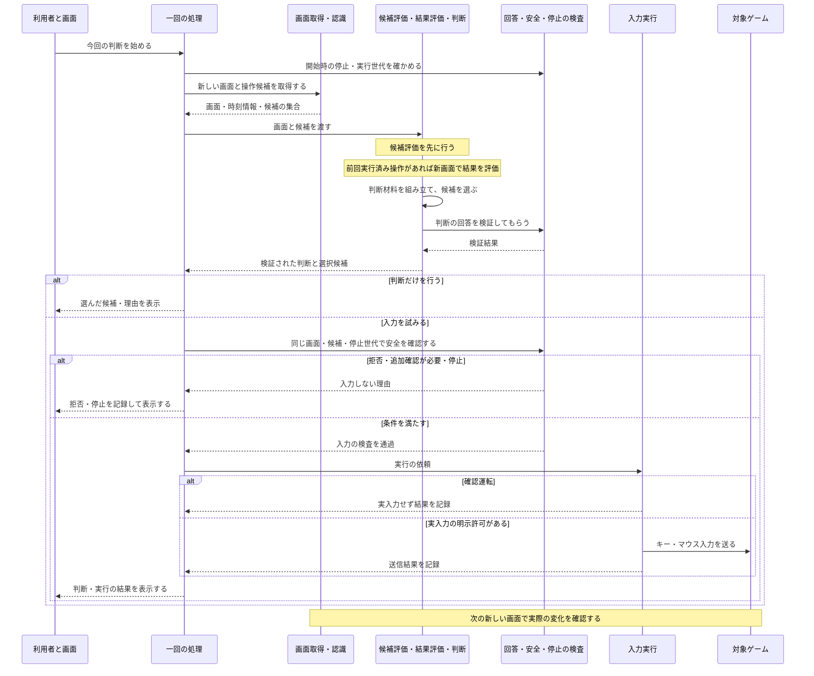
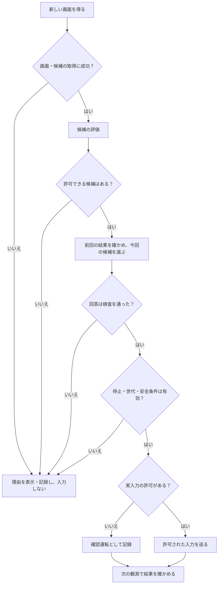

# 一回の判断と実行は、何をどの順番で行う？

[見取り図の索引へ戻る](README.md) ｜ [部品と実行場所を見る](runtime_map_for_readers.md)

**この図で確かめたいこと：** 新しい画面から候補を作り、前回操作の結果を含めて今回の判断をし、安全確認を通ってから必要に応じて入力する順番です。実入力がない判断だけの経路も区別します。

## 図1：通常の一回の流れ（現在の接続）

**線の読み方：** `->>` は処理を依頼する向き、`-->>` は情報・結果が戻る向きです。戻ってきた結果だけで「目的達成」を断定しません。必要な記録は履歴にも結び付きますが、説明を簡潔にするため、この図では保存先を独立した参加者として描いていません。

## 図2：続行できないときは？

- **最初の一回：** 前回の実行済み操作がなければ、前回操作の結果を作りません。
- **候補がない：** 利用可能な候補を捏造せず、選択や入力を中止する場合があります。
- **画面が古い・読み取れない：** 観測側の条件に従って失敗を伝えます。古い画面を新しい画面に見せかけません。
- **停止中・世代が古い：** 止める前に始まった判断が後から戻っても、そのまま実入力へ進ませません。
- **安全上の拒否：** 「モデルの回答がもっともらしい」だけでは入力を許しません。
- **時間切れ：** モデルや画面取得等の処理が時間切れになることと、ゲーム内で失敗することは別です。処理を再試行する保証はここでは宣言しません。
- **確認運転（dry-run）：** 入力しなかったことを実行成功と混ぜません。

## 「前回の結果」は、いつ調べる？

例えば、前回「開始」を押したという記録がある場合、次に取得した画面でメニューが消えたか、別画面へ進んだかなどを調べます。その結果を今回の判断に渡します。**キー入力APIの送信成功はゲーム画面の変化の証拠ではありません。**

具体的な結果の統合方法は [OutcomeDetectionFusion機能説明書](../OutcomeDetectionFusion機能説明書.md)、判断材料の作り方は [DecisionContext機能説明書](../DecisionContext機能説明書.md) にあります。

## 根拠と未確認の範囲

確認した主な場所（2026-10-31、main `4d8ae6f`）：

- [`pipeline.py`](../../src/ai_game_player/pipeline.py)：観測と候補の取得、判断・安全・実行の接続、停止状態の確認。
- [`engine.py`](../../src/ai_game_player/engine.py)：候補評価、前回結果、判断材料、回答検証、履歴。
- [`observation_service.py`](../../src/ai_game_player/observation_service.py)：観測と候補のための画面取得。
- [`decision_verifier.py`](../../src/ai_game_player/decision_verifier.py)：判断と画面・許可候補の照合。
- [`run_control.py`](../../src/ai_game_player/run_control.py)：停止や再開に関わる制御。
- [`action_safety.py`](../../src/ai_game_player/action_safety.py)、[`action_executor.py`](../../src/ai_game_player/action_executor.py)：入力前の評価と実行。

**確認したのは静的な処理順です。** Windows実機での操作成功、全失敗経路の試験実施、実在モデルの稼働、GUI幅ごとの表示検査はこのページで完了していません。局所的な正しさやテストの合否を図の存在だけで保証しません。残作業は [#608](https://github.com/tomiya7688/AI_game_player/issues/608)、安全は [#612](https://github.com/tomiya7688/AI_game_player/issues/612) で追います。