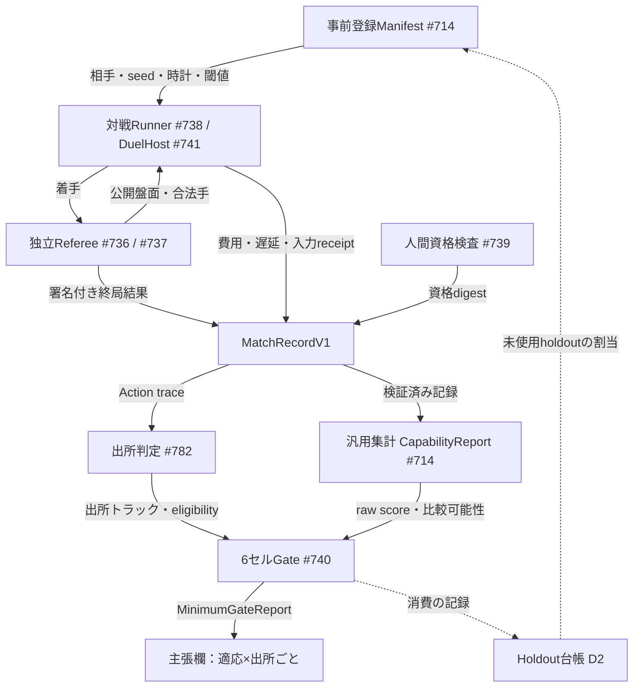
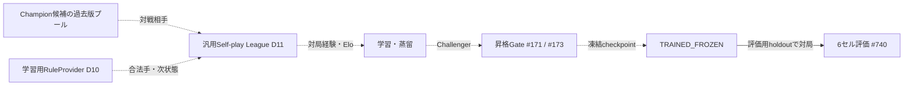

# 賢者ミスクの実力を測る（能力ベンチマークと最低実力Gate）

[動作と配置の見取り図へ戻る](README.md) ｜ [自己成長ループの全体設計](self_improvement_loop.md)

- **状態**：設計（未実装）。基準main `a6aaf85`。2026-11-04時点で、`src/`・`tools/`・`tests/`に`MatchRecord`、`CapabilityReport`、Referee、6セルGateの実装はありません。
- **親Issue**：[#800](https://github.com/tomiya7688/AI_game_player/issues/800)（自己成長の設計書索引）。
- **正本のIssue**：[#714](https://github.com/tomiya7688/AI_game_player/issues/714)（Manifestと集計器）、[#735](https://github.com/tomiya7688/AI_game_player/issues/735)（最低実力の親）、[#736](https://github.com/tomiya7688/AI_game_player/issues/736)〜[#741](https://github.com/tomiya7688/AI_game_player/issues/741)（審判・対戦Runner・人間資格・6セルGate・DuelHost）、[#782](https://github.com/tomiya7688/AI_game_player/issues/782)（勝利の出所の判定）、[#710](https://github.com/tomiya7688/AI_game_player/issues/710)（能力表CAP-1〜7）。

本書では記述を次の3種類に分けます。

| 区分 | 意味 |
|---|---|
| 実装済み(main) | `a6aaf85`のソースまたはテストで確認したもの。本書の対象では、[独立テストゲーム集](../../tools/test_games/README.md)（[#634](https://github.com/tomiya7688/AI_game_player/issues/634)、GPL隔離）だけが該当する |
| Issueで確定した設計 | Issue本文で`READY`・`BLOCKED`として決まっている仕様。未実装 |
| 本書で追加する設計提案 | 評価者Claude、2026-11-04、設計者承認待ち。**[提案D2]**のようにIDを付ける。IDは[#800](https://github.com/tomiya7688/AI_game_player/issues/800)の一覧と共通 |

## 何のため？

賢者ミスクは将棋・オセロ専用AIではありません（[#735](https://github.com/tomiya7688/AI_game_player/issues/735)冒頭、[#760](https://github.com/tomiya7688/AI_game_player/issues/760)）。オセロと将棋は、汎用ゲームプレイヤーが最低限の実力を持つかを**外部の相手で測る受入試験**です。製品の評価関数やCoreの構造を、この2ゲームに合わせて固定する理由にはなりません。

このベンチマークは次の3つの問いを分けて答えます。

1. **勝てたか？** 6セルで勝ち点率と95%区間下限が基準を満たすか（[#740](https://github.com/tomiya7688/AI_game_player/issues/740)）。
2. **いつから勝てたか？** 最初から勝てたか、学習後に勝てたか、評価中に学習しながら勝ったか（適応トラック）。
3. **誰の力で勝ったか？** 賢者ミスク自身の推論・生成・学習か、外部モデル・専門Solver・教師ラベルを借りたか（出所トラック、[#782](https://github.com/tomiya7688/AI_game_player/issues/782)）。

この3つを1bitの「合格」へ丸めると、専用エンジンの勝ちや評価用データの暗記を自己成長の証拠と取り違えます。

## 何を受け取り、何を返す？

| 型・成果物 | 中身の要約 | 担当Issue |
|---|---|---|
| `BenchmarkManifest`（`config/gameplay_capability_benchmark.schema.json`） | 評価前に固定する条件。HW・モデル・学習予算・観測/操作API、`split_by_game`、seed一覧、対戦相手slotと実model ID・effort・prompt hash、資格snapshot、opening pair、Referee版、時計、`training_artifact_digest`、`provenance`、判定閾値、`pre_registered_at` | [#714](https://github.com/tomiya7688/AI_game_player/issues/714) |
| `EpisodeRecord` | 汎用の1episode記録。return、達成、介入、timeout、資源、`failed_reason`。欠測はnullで、0として扱わない | [#714](https://github.com/tomiya7688/AI_game_player/issues/714) |
| `MatchRecordV1`（`schema=gameplay-match/v1`） | `EpisodeRecord`の任意拡張。相手種別とslot、`mist_checkpoint_sha`、`mist_mode`、先後、opening pair、`referee_record_digest`、`result`（WIN/DRAW/LOSS/INFRA_INVALID/UNRESOLVED）、再試行元、費用 | [#714](https://github.com/tomiya7688/AI_game_player/issues/714) |
| `MoveReceipt`・`MatchResult` | Refereeが署名した着手の受理/拒否と、終局の根拠 | [#736](https://github.com/tomiya7688/AI_game_player/issues/736)・[#737](https://github.com/tomiya7688/AI_game_player/issues/737) |
| `FrozenModelProfile` | 凍結LLMの実provider model ID、effort、tools、予算、`RESET_EACH_GAME` | [#738](https://github.com/tomiya7688/AI_game_player/issues/738) |
| `HumanBenchmarkReport` | 中級人間の資格・同意・偏り。結果は匿名統計だけ | [#739](https://github.com/tomiya7688/AI_game_player/issues/739) |
| `MatchTranscript` | 通常画面・通常OS入力で行った対局の入力receiptとUI障害 | [#741](https://github.com/tomiya7688/AI_game_player/issues/741) |
| `CapabilityReport` | 比較可能な条件、ゲーム別結果、paired差分、区間、欠損セル、`claim_status` | [#714](https://github.com/tomiya7688/AI_game_player/issues/714) |
| `StrategyOriginRecord` | 1局の全Actionについて、評価器・探索・遷移の出所と`eligibility` | [#782](https://github.com/tomiya7688/AI_game_player/issues/782) |
| `MinimumGateReport`（`schema=gameplay-minimum/v1`） | 6セルの`n_valid`・勝敗・点率・CI・状態（PASS/FAIL/INSUFFICIENT/NOT_EVALUATED/INCOMPARABLE）、学習の効果、総合状態 | [#740](https://github.com/tomiya7688/AI_game_player/issues/740) |
| Holdout消費台帳 | 評価局のdigest・seed・どの候補が見たか | **[提案D2]**。担当Issueはまだない |

## どの順番？

実線は確定設計、点線は提案または条件付きの経路です。点線は担当Issueがまだないか、設計者の承認を待っている箇所です。

1. 評価開始前にManifestを固定し、`pre_registered_at`を記録します。相手、model ID、opening pair、時計、統計方式、出所トラックは、後から変えられません。
2. Refereeが盤面・時計・勝敗の唯一の権威です。賢者ミスクには公開情報だけを渡します。UIトラックでは画面だけを渡します。
3. `MatchRecordV1`は、Referee digestが無ければ無効です。人間の識別にはopaque IDを使います。
4. #714は条件を検査してraw scoreを集計します。#782は各局の出所を判定します。#740は両方を読み、セル別・トラック別に合否を決めます。

## 6セルと閾値（Issueで確定した設計）

| ゲーム | 相手 | 局数の下限 | 再標本化の単位 |
|---|---|---|---|
| オセロ・将棋 | 中級アマチュア人間（[#739](https://github.com/tomiya7688/AI_game_player/issues/739)） | 10人以上・100局以上、1人の寄与20%以下、先後50:50±5% | 対戦相手 |
| オセロ・将棋 | 凍結LLM A（第一候補GPT Astra） | 200局以上（100 opening pair×先後） | opening pair |
| オセロ・将棋 | 凍結LLM B（第一候補Claude Opus 5.5、Aと別provider） | 同上 | opening pair |

- 勝ち点率は`p=(W+0.5D)/(W+D+L)`です。PASSには`p≥0.60`かつクラスターブートストラップ95%下限`>0.50`が必要です。6セル**全部**の合格を求めます。
- 時計切れ・違法手・投了・正規Sessionの停止はLossです。provider障害やOS障害は`INFRA_INVALID`とし、勝ちに数えません。
- 名前で指定したモデルがAPIで使えない場合、その枠は`NOT_EVALUATED`です。代替するには、評価前のユーザー明示承認、別providerであること、同等以上のクラスである根拠、実IDの固定が必要です。代替モデルに勝っても、元のモデルに勝ったとは表示しません。
- 時計の例：オセロは10分＋1手5秒、将棋は15分＋30秒の秒読みです。推論・認識・入力・通信の時間はすべて自分の持ち時間に含めます。
- PILOT（各20局程度）では審判と集計だけを確認し、勝利は主張しません。FORMALは上の局数を満たした場合だけです。

## 適応トラック × 出所トラック

**適応トラック**（[#735](https://github.com/tomiya7688/AI_game_player/issues/735)・[#740](https://github.com/tomiya7688/AI_game_player/issues/740)で確定）：

- `ZERO_ADAPTATION`：オセロ・将棋専用の経験を入れる前の状態。
- `TRAINED_FROZEN`：事前登録した学習予算で作り、holdoutを読む前に凍結した1つのcheckpoint。
- `ONLINE_ADAPTATION`：評価中もゲーム間で学習する別トラック。

**出所トラック**（[#769](https://github.com/tomiya7688/AI_game_player/issues/769)・[#782](https://github.com/tomiya7688/AI_game_player/issues/782)、名称の統一は本書の提案）：

- `SELF_DERIVED`：賢者ミスク自身の推論、または自分で生成・選択した評価器や`SearchProgram`で手を選んだもの。
- `MODEL_ASSISTED`：外部LLMや外部推論器が最良手を直接示したもの。
- `SOLVER_ASSISTED`：専用のAlphaBeta・USIエンジン・Edax等が最良手や評価値を返したもの。
- `TEACHER_TRAINED`：外部エンジンや人間の正解ラベルで学習・選抜した成果物を使ったもの。

各マスの意味は次のとおりです。

| 適応＼出所 | SELF_DERIVED | MODEL_ASSISTED | SOLVER_ASSISTED | TEACHER_TRAINED |
|---|---|---|---|---|
| ZERO_ADAPTATION | **「賢者ミスク自身の最低実力」を初手から達成**と言える唯一の欄。学習能力は別途に未実証と書く | 製品の総合力として報告する。自己実力には数えない | 参考欄。専用engineの勝利として開示する | 定義上は起こらない。教師由来の重みが残っていればManifestの不備でINCOMPARABLE |
| TRAINED_FROZEN | **「自己学習で最低実力に到達」**と言える欄。学習ON/OFFの改善`≥+0.05`とpaired 95%差分下限`>0`、Knowledgeを実際に参照したTraceが必要 | 総合力として報告する | 参考欄 | 総合力として報告する。`SELF_PLAY_ONLY`とは合算しない |
| ONLINE_ADAPTATION | 別表の参考値。評価相手やseedを学習に使ったことを開示する。Formal Frozenとは認定しない | 同左（参考） | 同左（参考） | 同左（参考） |

- 合否は**同じ1つの（適応, 出所）組**の中で6セル全部が揃った場合だけです。「Othelloはzero、Shogiはtrained」のような混在や、出所の違う局を足し合わせる方法は認めません。
- #782の補助ラベルは`eligibility`として残します。`GENERIC_BASELINE`は固定presetだけの勝ちで、自分で探索器を作った証拠がないものです。`UNVERIFIED`は出所の証拠が欠けたもの、`MIXED`は1手でも専門bestmoveを使ったものです。これらは`SELF_DERIVED`の勝ちには数えません（#782の定義）。ただし勝率の母数には、正式登録したセルの全試合を残し、失格（負け）として計上します（#782処理5：都合の悪い局だけを除外しない、fallbackした局は`MIXED`失格として計上）。**[提案D10]** 失格局は0点として扱い、母数から外しません。

**[提案D10] 出所の判定規則**：合法手・次状態・終局判定だけを、汎用の監査済みインタフェースで返す`RuleProvider`は`SELF_DERIVED`で使えます。どの`RuleProvider`を使ったかは出所として記録します。best moveや評価値を返すproviderを1度でも使えば`SOLVER_ASSISTED`です。教師ラベルで候補を選抜または学習した場合、そのlineageは`TEACHER_TRAINED`となり、子孫にも伝播します。正式評価用のRefereeのprivate state（未来の局面、内部履歴）を賢者ミスクに渡すことは、`RuleProvider`の経由であっても`UNVERIFIED`（Rule Leak）です。学習・探索用の`RuleProvider`は、評価用Refereeとは別のインスタンスにします。

**要件の固定（[#740](https://github.com/tomiya7688/AI_game_player/issues/740)へ反映する）**：現在の[#740](https://github.com/tomiya7688/AI_game_player/issues/740)本文と[#735](https://github.com/tomiya7688/AI_game_player/issues/735)の「初期の強さと学習後の強さ」第6項には、出所トラックの区分がありません。第6項は専用engineの利用を開示を条件に許すだけで、出所別の合否には触れていません。このまま実装すると、専用Solverの勝ちも6セルのPASSに数えられます。本書では次の要件を固定し、#740の新要件として追記します。(1) Manifestに`origin_track`を必須の軸として置く。(2) #740の`MinimumGateReport`は（適応×出所）ごとに6セルを出す。(3) 「賢者ミスク自身の最低実力」はSELF_DERIVED欄のPASSだけに許す。(4) `MatchRecordV1`に`strategy_origin_ref`を追加し、#782の判定結果を参照する。

## 統計の手順

**クラスターブートストラップ**（[#740](https://github.com/tomiya7688/AI_game_player/issues/740)で確定）：

1. セル内の有効局を、クラスタ（人間なら対戦相手ID、LLMならopening pair ID）ごとにまとめます。
2. 固定RNG（seed=20261104）で、クラスタを復元抽出します。1回の抽出では元と同じ数のクラスタを選び、これを10,000回繰り返します。
3. 各回で、選ばれたクラスタの合計点を合計局数で割ります。
4. ソートした値から、線形補間で2.5%点と97.5%点を取ります。クラスタが少ない場合や、全局が同じopeningの場合は`INSUFFICIENT`です。
5. 学習の効果は、同じ相手・同じopeningをpairにしたpaired bootstrapの差分下限で判定します。最低100 pairの独立holdoutを使います。

**事前登録**（[#714](https://github.com/tomiya7688/AI_game_player/issues/714)）：primary metric、閾値、予定の対局リスト（ID・順番・色・相手・opening）、出所トラック、許可するtool、学習予算は、結果を見る前に固定します。結果を見てからseedや指標を変えることは禁止です。

**除外規則**（[#738](https://github.com/tomiya7688/AI_game_player/issues/738)・[#740](https://github.com/tomiya7688/AI_game_player/issues/740)）：

- 違法手・時間切れ・応答不能はLossであり、除外しません。
- provider outage・rate limit・OS障害は`INFRA_INVALID`です。原因と再試行の記録を残します。
- 再試合は同じcondition IDで2回までです。どの試行を採用するかを選び直すことは禁止です。再試合を始められるのは、元の試行が`INFRA_INVALID`として記録された後だけです。元の試行の結果が後から届いた場合は元の試行を採用し、再試合の結果は参考記録にします。
- `INFRA_INVALID`が予定局数の5%を超えたセルは`NOT_EVALUATED`です。

**[提案D2] Holdout消費台帳**：holdoutは評価を始める前に台帳へ原子的に予約し（同じholdoutを二つのworkerへ割り当てない）、予約した時点で消費済みとします。評価が途中で止まっても予約は戻しません。正式評価に使った局は、digest・seed・opening・どのcheckpointが見たかを台帳に記録します。PILOTやvalidationで結果を見たcheckpointを作り直した場合、その後の評価は未使用のopeningとseedで行います。複数のTRAINED_FROZEN候補や複数の出所トラックで同じholdoutを比べる場合は、Holm–Bonferroni補正またはalpha-spendingを適用します。6セルの「全部合格」は積集合の検定なのでセル間の補正は不要ですが、候補checkpointの数に対しては補正が要ります。使い切ったholdoutは、新しいopeningや変種ルールで補充します。黙って再利用することはしません。

## 構造化状態トラックとGUI実プレイトラック

| トラック | 賢者ミスクへの入力 | 6セルでの扱い |
|---|---|---|
| Structured-Public-State | 両者に同じ公開盤面・持駒・合法手・手番・時計を渡す | LLM相手の4セルは必ずこのトラック |
| GUI実プレイ | 通常の画面取得と通常のOS入力（[#741](https://github.com/tomiya7688/AI_game_player/issues/741)） | 人間相手の2セルは必ずこのトラック |
| UI対LLM | 画像による対局 | 外部LLMに視覚が無ければ`NOT_EVALUATED`。他のトラックで代用しない |

同じゲームであっても、2つのトラックの結果を混ぜません（[#714](https://github.com/tomiya7688/AI_game_player/issues/714)）。Structured側で数値を満たしても、GUI側で誤認識・誤入力・timeoutが多ければ、製品としての合格ではありません。

## 汎用（盤面以外）能力の扱い

- [#710](https://github.com/tomiya7688/AI_game_player/issues/710)のCAP-6は、#691・#567・#250の結果がsmokeであり、強さの証明ではないと定めています。CAP-1〜7の各能力は、それぞれの担当Issueで受入が必要です。
- [#760](https://github.com/tomiya7688/AI_game_player/issues/760)の受入は、#735の勝率と**別ジャンルの目標達成率・介入率・実測資源**を併せて示すことを求めます。
- [#768](https://github.com/tomiya7688/AI_game_player/issues/768)は、盤面・RPG・Shooter・Puzzle・未知ゲームの5種類を、同じ汎用評価APIで検証します。CoreにゲームごとのIF分岐を足してはいけません。
- [#714](https://github.com/tomiya7688/AI_game_player/issues/714)手順7のcoverage表は、長期戦略・部分観測・リアルタイム・新ルール・複数目標・再学習を行に持ちます。評価していない行は`NOT_EVALUATED`と書き、別ゲーム間での忘却（A→B→A）も集計します。
- 6セルに合格しても、汎用ゲームプレイヤーとして合格したとは書きません。製品の最低実力の主張には、6セルのSELF_DERIVED欄と#768の報告の両方を並べます。

## 自己成長への接続：Self-play League（[提案D11]）

`TRAINED_FROZEN`の欄を埋めるには、学習で強くなる経路が必要です。しかし、オセロ・将棋の自己対戦学習を担当していた[#749](https://github.com/tomiya7688/AI_game_player/issues/749)と[#759](https://github.com/tomiya7688/AI_game_player/issues/759)は、`not_planned`でcloseされています。**現在、この経路の担当Issueはありません。**

- **提案内容**：2人ゲーム向けの汎用match runnerを作り、過去のChampionのプールと短い時計で対戦させ、Eloで強さを追跡します。curriculumは、易しい局面や変種から難しいものへ、学習の進み具合を見て選びます。ゲーム専用のコードは任意のpluginとし、Coreに依存させません（#760）。
- **出所**：自分の過去版とだけ対戦し、D10の`RuleProvider`だけを使った場合、lineageは`SELF_DERIVED`です。外部engineやLLMをスパーリング相手に含めた場合は、保守的に`TEACHER_TRAINED`とします。この線引きは設計者の判断が必要です。
- **データ分離**：Leagueで使うopeningとseedは台帳（D2）で評価用holdoutと分けます。昇格は既存のChampion/Challenger Gate（[knowledge_promotion.md](knowledge_promotion.md)）を通します。

## 信頼と安全の境界

- Refereeと対局fixtureはGPLで隔離します（[独立テストゲーム集](../独立テストゲーム集.md)）。MITの製品Runtimeはこれらをimportしません。付属CPUは弱いreferenceであり、正式な対戦相手にはしません。
- 人間の対局者には、同意・匿名化・opaque IDが必要です。公開レポートには個人名もチャット内容も載せません（[#739](https://github.com/tomiya7688/AI_game_player/issues/739)）。
- LLMの出力はschemaで検査し、合法手の自動補正やbest moveの推薦はしません。出力に含まれる指示文はschemaで拒否します（[#738](https://github.com/tomiya7688/AI_game_player/issues/738)）。
- 出所はEventJournalとhashから判定します。モデルの自己申告「SELF_DERIVEDです」は信用しません（[#782](https://github.com/tomiya7688/AI_game_player/issues/782)）。
- OSの安全とゲーム内のリスクは別の軸です（CAP-4）。GUI対局でもStop・Target・Leaseを迂回しません。

## 資源の見積もり

| 項目 | 状態 |
|---|---|
| FORMALの局数 | 人間200局＋LLM800局＝1,000局（Issueの下限の合計）。トラックや代替枠を追加すると増える |
| 1局の所要時間 | 未測定。持ち時間の規定から、オセロは最大で約20分強、将棋はそれより長くなる |
| LLMのAPI費用・token | 未測定。[#738](https://github.com/tomiya7688/AI_game_player/issues/738)のManifestで予算上限を固定する |
| ブートストラップ10,000回の計算量 | 未測定。局数が小さいため軽いと見込むが、測定値ではない |
| 賢者ミスク側のCPU/RAM/VRAM | 未測定。品質重視のprofileと標準の小型profileは別の表にする |

## 失敗したら？

| 状況 | 扱い |
|---|---|
| Referee digestが無い、署名が一致しない | 局を無効にし、`INCOMPARABLE`にする |
| モデルの実IDを検証できない | `NO_VERIFIED_MODEL`、セルは`NOT_EVALUATED` |
| 局数・人数・クラスタが不足 | `INSUFFICIENT`。0点やPASSで補完しない |
| infra障害が5%を超えた | `NOT_EVALUATED` |
| 評価データが学習に混入した | `INCOMPARABLE`。Formal Frozenとは認定しない |
| 出所の証拠が欠けている | `UNVERIFIED`。母数には残す |
| 将棋の入玉・持将棋が未対応 | `REPLAY_REQUIRED`または`UNRESOLVED`。勝ち負けに読み替えない（[#737](https://github.com/tomiya7688/AI_game_player/issues/737)）。`UNRESOLVED`の局は件数を報告し、セル内に1局でも残る間はそのセルをPASSにしない（解決済みの局だけで最低局数を満たしても同じ） |

## smokeと能力主張を分ける

[#691](https://github.com/tomiya7688/AI_game_player/issues/691)の`evidence_level`（CONTRACT/INTEGRATION/FIELD/CAPABILITY_COMPARISON）を、本書の報告でも共通の段階として使います。

| 既存の検証 | 段階 | 言えること | 言えないこと |
|---|---|---|---|
| #691：15fixture＋600秒稼働 | INTEGRATION（Windows実機ならFIELD） | 結果解釈の配線と安全性が動く | 未知ゲームでの強さ |
| [#567](https://github.com/tomiya7688/AI_game_player/issues/567)：2048で3seed×最大12判断attemptの短枠比較（[planner_runtime.md](planner_runtime.md)） | INTEGRATION | Plannerが安全に接続されている | n=3で打切りがあるため、統計的な改善は言えない |
| #634：独立テストゲーム10種 | CONTRACT/INTEGRATIONの資産 | 入出力のsmoke | 弱いCPUに勝っても棋力の証拠にならない |
| #714の固定fixture単体合格 | CONTRACT | 集計器が正しい | 実際の能力認定 |
| #740の6セルFORMAL | CAPABILITY_COMPARISON | 欄ごとの最低実力 | 「世界最高」や汎用での最高峰 |

## Issue間の矛盾と、本書が採る解決

1. **出所の区分が無い**：#740と#735第6項には出所の区分がありません。上の「要件の固定」で解決し、#740に追記します（2026-11-04のIssue点検 #740 NEEDS_REVIEW）。
2. **名称の揺れ**：#782のManifestは`SELF_DERIVED|ENGINE_ASSISTED|PRESET_ONLY|TEACHER_DISTILLATION`、Record側は`SPECIALIST_SOLVER_ASSISTED`等、#769は`ModelAssisted`を使っています。**[提案D10]** 出所トラックは4つの名称に統一します。`PRESET_ONLY`は`GENERIC_BASELINE`の`eligibility`へ寄せます。
3. **Rule Leakと「audited generic rules」の境界**（#782）：D10で、評価用Refereeのprivate stateは不可、汎用`RuleProvider`は可、と区別します。
4. **出所の欄が無い**：#714の`MatchRecordV1`に出所の欄がありません。`strategy_origin_ref`を追加します。一般のbenchmark recordでは任意ですが、**正式6セル評価では必須**とし、欠けた記録は`UNVERIFIED`としてSELF_DERIVEDの勝ちに数えません。#714の互換は、versioned contractで保ちます。
5. **学習経路の担当が無い**：#749と#759のcloseで、TRAINED_FROZENの学習経路に担当がいなくなりました。D11として新しいIssueが必要です。
6. **外部推論の出所の標識が無い**：外部推論器（[#443](https://github.com/tomiya7688/AI_game_player/issues/443)・[#445](https://github.com/tomiya7688/AI_game_player/issues/445)）の出力には出所の標識がありません。これらの経路で選んだ手は`MODEL_ASSISTED`とし、蒸留した成果物は`TEACHER_TRAINED`として扱います（2026-11-04のIssue点検）。
7. **#740の項番の重複**：#740の判定手順では「9」が2回出てきます。2つ目は「GUIとStructuredの別Tier」の項として読み替え、Issueを更新するときに番号を直します。
8. **勝敗信号の正しさ**：**[提案D18]** 対局の勝敗はReferee署名で決まるため、OCRの誤判定（[#509](https://github.com/tomiya7688/AI_game_player/issues/509)）の影響は受けません。ただしGUIトラックで賢者ミスクが自分で読んだ勝敗を学習に使う場合は、#509の修正を先に行います。

## 残る作業（Open Issue）

- [#714](https://github.com/tomiya7688/AI_game_player/issues/714)：Manifestと集計器の実装（READY）。`strategy_origin_ref`を追加する。
- [#736](https://github.com/tomiya7688/AI_game_player/issues/736)・[#737](https://github.com/tomiya7688/AI_game_player/issues/737)：オセロ・将棋の独立Referee（READY）。
- [#738](https://github.com/tomiya7688/AI_game_player/issues/738)・[#739](https://github.com/tomiya7688/AI_game_player/issues/739)・[#741](https://github.com/tomiya7688/AI_game_player/issues/741)：対戦Runner・人間資格・DuelHost（BLOCKED）。人間の募集とAPI契約はrepoの外で手配する。
- [#740](https://github.com/tomiya7688/AI_game_player/issues/740)：出所×適応の要件を追記してから実装する。
- [#782](https://github.com/tomiya7688/AI_game_player/issues/782)：名称の統一とD10の規則を反映する。
- [#768](https://github.com/tomiya7688/AI_game_player/issues/768)：汎用ジャンルの受入。
- 担当Issueなし：D2（Holdout台帳）とD11（Self-play League）。[#800](https://github.com/tomiya7688/AI_game_player/issues/800)で、設計者が採用するか判断した後に起票する。
