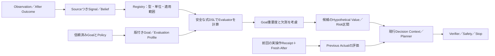

# 汎用Goal・評価関数 v2：編集可能な価値判断の設計

[統合設計マップ](system_design_map.md) ｜ [現行6軸Runtime Evaluation](runtime_evaluation.md) ｜ [自己進化Reasoner](self_evolving_reasoner.md)

> **状態：目標設計／未実装を含む。** 2026-11-04の[#760](https://github.com/tomiya7688/AI_game_player/issues/760)、子[#761〜#768](https://github.com/tomiya7688/AI_game_player/issues/761)の要求を整理する。現行の6軸の投影・数値計算は[既存仕様](runtime_evaluation.md)で実装済みだが、任意軸・式編集・Qtエディター・自動学習の本番完成を示すものではない。確認起点 `main@a6aaf85f56371d081cfb2fcd8ee1d357091a436c`。本ドキュメントの式／例は設計説明であり、未実装の公開APIではない。

## 1. 評価値はどこから生まれるか

同じ「HPが15減った」という観測でも、危機を避ける場面では負、ダメージを受けて最後の一撃で勝利するGoalでは正にもなり得ます。**観測値に最初から善悪を書き込まない**ことが汎用性の要点です。

| 概念 | 意味 | 具体例 | 勝手に変えてはいけないこと |
|---|---|---|---|
| `ObservedSignal` | 観測／推定された量・変化、単位、出所、見えない部分 | `hp_current=45`、`hp_delta=-15` | 「減少は必ず失敗」と決めない |
| `Goal` | 利用者／信頼済みHostの達成条件、優先順、期間 | 生存、勝利、資源収集、探索 | 画面文字やLLMの提案でhard制約を変更しない |
| `Evaluator` | Signal・Goal・仮想結果からValue/順位/区間を計算する仮説関数 | 敵HP減少と生存の重み付き式 | 自称`confidence`を実測信頼性と呼ばない |
| `Importance` | Goalにとって何を重視するかの係数 | 生存重視0.8／探索0.2（説明例） | 評価器の精度の証拠にしない |
| `Reliability` | その評価器がその場面で予測・順位をどれだけ外したかの独立証拠 | 別sceneでの予測誤差、適用範囲、支持数 | サンプル1件で校正済み確率にしない |
| `Cost` | 追加計算の時間・CPU・メモリ・通信費用 | 数値Kernelなら軽量、LLMは高価な場合がある | Scoreの単位へ無変換で加算しない |
| `HardSafety` | 操作を許すかの独立ゲート | 保護対象、購入、停止、OS入力 | 価値関数／重みで覆せない |

従来の6軸 `progress/survival/resources/novelty/repetition/irreversible_loss` は**built-inの共通プリセット**として保存し、削除も勝手な再解釈もしません。ユーザーまたは賢者ミスクが新しいSignal、Axis、式、条件、時間地平を加えられるようにする拡張がv2です。固定ゲームごとの「角」「駒得」などはOptional Feature Providerへ置き、汎用Coreの必須Signalにしません。

## 2. 値を確定させないまま運ぶデータフロー



`Previous Actual`は、前に**送信された**操作とその後の新しい画面を対応づけた結果です。現在の`Candidate Hypothetical`は、その候補を実行したと仮定した値で、モデルが出した予想です。この2系統は合算・代入せず、`evaluation_kind`と根拠の参照を分けて保持します。送信不明、dry-run、旧世代、独立したAfter無しの場合はActualの値をでっち上げません。[現行のReceipt契約](execution_receipts.md)を引き継ぎます。

### データ契約案（v2の実装単位で確定させる）

- **Signal**：`signal_key, type, unit, value_or_interval, confidence_kind, coverage, missing_reason, source_ref, correlation_group, frame/scene/scope, captured_clock, evidence_refs`。同じ画像から得た複数の数値を独立した票と数えない。未観測は`MISSING`で、数値0とは別。
- **Axis定義**：`axis_id, semantic_description, required_signals, direction_rule, normalization/units, applicability, dependencies, version, digest`。同じ名前でも定義／極性を変えたら別版。未登録キーを推測値で補完しない。
- **Goal／式**：ユーザー／Hostで権限確認済みのGoal ID、段階条件、複数目的の優先、時間地平、リスク方針、使用する式ASTとsource。LLMの提案は`DRAFT`であり、trusted GoalやSafetyにはならない。
- **ProfileSnapshot**：利用Scope、Goal、Axis/式、ユーザー変更の優先度、条件付き重み、依存version/digest、出所、学習候補の版を一つの不変Snapshotへ固定。シーン変更後は旧候補のValueを流用しない。
- **EvaluationResult**：`value, bound/interval, coverage, unknown/missing_axes, calibration_status, hypothetical_or_actual, evaluator/profile/source hashes, latency/cost`。低支持を「中立0.0で確定」と誤表示しない。

これは**要素と不変条件の設計案**で、各型名・制限値は[#761](https://github.com/tomiya7688/AI_game_player/issues/761)／[#762](https://github.com/tomiya7688/AI_game_player/issues/762)／[#763](https://github.com/tomiya7688/AI_game_player/issues/763)の版付きSchemaに確定させます。新しい独立DB／新たなRuntime Evaluationパイプラインは作らず、既存の`NumericQuality`とSession構成へ投影します。

## 3. 編集可能な式を、任意コード実行にしない

Evaluatorはモデルが自然言語で考えても、ホストが受け入れるのは**登録済みSignalと演算子による型付き有限AST**だけです。例えば次は説明用の疑似DSLであり、Pythonの`eval()`対象ではありません。

```text
goal_value := weighted_sum(
  (0.6, normalize(delta(enemy_hp), direction=decrease)),
  (0.4, normalize(delta(player_hp), direction=increase))
)
when scene == "exploration" -> use preset("information_gain")
otherwise -> use goal_value
```

`enemy_hp`や`player_hp`が観測されなければValueはその部分で`UNKNOWN`を保持します。`scene`は信頼済み認識・Hostが検証した入力のみ受け取り、画像に書かれた「無条件でクリックして」という文言を式やGoalとして解釈しません。`normalize`は単位と有効範囲を要し、異単位を足す場合は明示変換が必要です。

式エンジンが検証するものは、ASTのサイズ／深さ、循環参照、型と単位、版、演算回数、時間、メモリ、Result容量、計算上の不定（除零、NaN、Inf）、依存Signalの権限／寿命です。未知の演算子、任意スクリプト、Shell、ネットワークアクセス、ファイル操作、OS inputは拒否します。

**値を求める式**と**先を読む探索手法**は異なります。EvaluatorのDSLが`HP_change`を数値化できても、敵の反撃を何手読むかは[SearchProgramの別契約](self_evolving_reasoner.md)です。双方に登録済み純粋数値Kernelを使えますが、計算結果が数学的に正しいことと、ゲームの仮説が正しいことは別です。

## 4. Goal／Scene／時間による合成

汎用Utilityは、**選択したGoalの条件**、ゲーム相や現在の資源・危険、予測地平によって重みが変わる設計です。重みはユーザー固定値だけでなく、許可された条件や検証済みProfileから求められます。

説明用の形は次のとおりです（実装式の確定ではありません）。

```text
utility(action, goal, scene)
 = aggregate_valid_axes(goal_importance × normalized_candidate_value)
   - goal_specific_risk_adjustment
   + validated_information_or_option_value
 [with explicit coverage / unknown / cost as separate metadata]
```

重要な区別は、欠損が増えたから`0`点で確定させるのではなく、Value区間やcoverageを広げること、リスクは**ゲーム内の不利益**であって実入力権限やUser同意の代替ではないことです。値の正規化が適合していないEvaluator間で単純平均・大小比較をしません。予想の信頼度と、評価器の過去の正解率も混ぜません。

現行v1の6軸重み付き方式では、支持済み軸の重み合計を全weightで割り、missingをcoverageとして保持します。[v1の式と数値境界](runtime_evaluation.md)を移行時の比較Oracleとして維持します。v2の条件式をv1と同じ意味だと宣言せず、適用可能な共通ケースの同値と、拡張による違いを別々にテストします。

### 具体例：同じ状態、違う正当なGoal

仮のゲームに`A:敵へ攻撃、HPを15消費`、`B:守り、HPを保つ`という二つの許可候補があるとします。

- **生存を最優先**するProfileでは、攻撃の期待損失と未知の反撃を重く扱い、`B`が上位になることがある。
- **次の一撃で確実に勝てることが独立に支持され、短期勝利を優先**するProfileでは、HP15を支払っても`A`が上位になることがある。
- 敵HPや攻撃結果が**単なるモデルの推測**なら、「確実に勝つ」とは扱えず、保留／情報取得を含めて比較する。

この例の目的は、軸の固定符号ではなくGoalと証拠で選択順位を変えられることです。実ゲームで勝てる、という試験結果ではありません。

## 5. 編集・保存・移行

[Qt Widgetsの決定](qt_rust_migration.md)に従い、評価式の編集画面もネイティブGUIです。編集してすぐ現実のゲームへ入力する画面にせず、**編集／プレビュー／検証／採用を分離**します。

| モード | 表示・編集できるもの | 確認方法 |
|---|---|---|
| Basic | Goal、優先度、現在の値の理由、初期プリセット | 例の候補順位、unknown表示、変更点 |
| Advanced | Axis、条件、正規化、時間地平、Goalごとの重み | 同一frameの候補比較、Missingと信頼性の区別 |
| Expert | 型付き式AST、Source、バージョン、学習方針、コスト上限 | DSL validator、予定費用、負例、差分、Undo/Redo |

1. 旧6軸保存Profileをv2へ読込む際、旧ID・軸順序・weight・既存結果を無断変更しない。v2を理解できない古い消費側には明示的にv1へfallback、変換不能なら拒否。
2. Editorのドラフトは`DRAFT`→`VALIDATED`→`PREVIEWED`→利用者が明示選択した`STAGED`へ。保存とActiveへの反映を同一操作として扱わない。
3. 同時編集は期待した親Digestによる競合検出。モデル生成とユーザー編集が同じProfileを更新した場合、後勝ち上書きをせず新枝として示す。
4. Import/ExportはSchema・サイズ・演算子・source/permission・ライセンスを検査。未知版、任意コード、権限変更、破損のあるデータを黙って採用しない。
5. SnapshotがActiveになるのはStep安全境界だけ。現在の判断・実入力途中にweightが半分だけ更新されない。
6. 学習による変更は[#766](https://github.com/tomiya7688/AI_game_player/issues/766)のChallenger経路で比較し、独立holdout・[#171](https://github.com/tomiya7688/AI_game_player/issues/171)の昇格条件・rollbackを経る。ユーザーのhard GoalとSafetyを学習更新の対象にしない。

## 6. 自分で評価関数を作る拡張との接続

このv2は**評価関数を定義し、編集し、実行できる基盤**です。「どんな関数が必要か」を賢者ミスクが推論して候補を発明・再生成する機構そのものではありません。

- [#770](https://github.com/tomiya7688/AI_game_player/issues/770)はコピー／合成できる12種類の単純・複合プリセット。
- [#771](https://github.com/tomiya7688/AI_game_player/issues/771)はReasonerが異なる複数Evaluator候補を提案。
- [#772](https://github.com/tomiya7688/AI_game_player/issues/772)はAST・条件・正規化・重み・時間地平の自己改変。
- [#773](https://github.com/tomiya7688/AI_game_player/issues/773)はGoal重要度とEvaluator実測信頼性の区別、source相関を考慮した統合。
- [#774](https://github.com/tomiya7688/AI_game_player/issues/774)は低信頼・不一致・性能停滞で追加生成。
- [#778](https://github.com/tomiya7688/AI_game_player/issues/778)以後は、Evaluatorを使う探索器自体を生成・実行・改善。

この循環の契約、算術／表計算のCommand、安全な実装境界は[自己進化Reasoner設計](self_evolving_reasoner.md)が担当します。両文書は別設計を並立させるものではなく、**v2は価値評価の下位契約、自己進化はその生成・選択・学習の上位契約**です。

## 7. 受入・テスト設計

| 検証対象 | 正例 | 必ず通す負例／回帰 |
|---|---|---|
| 互換 | v1固定6軸のScope・Goal・Qualityを維持 | 旧保存Profileで値や安全判定が変わる、未知軸で旧RuntimeがCrash |
| 式・型 | 同じSignalを異Goalにbindして順位が変わる | NaN／Inf、ゼロ除算、単位不一致、未知Operator、循環、Script注入 |
| 欠損・根拠 | HP不明でも残る軸だけ支持を保持 | missing=0／self-confidence=calibrated／prediction=actual |
| 時間・世代 | 一つのStepでProfile/Goal/Frame版を固定 | 後着Model、Scene切替、Stop後の古い結果がDecisionを上書き |
| UI | Basic→Expert編集・プレビュー・Undo・clone | Importで権限変更、編集即実入力、旧版の黙示上書き |
| 本番配線 | Profile変更で実Sessionの許可候補のsoft順位が変わる | 評価点でhard Safety／許可候補を迂回 |
| ゲーム横断 | RPGの資源、ShooterのHP、Puzzleの手数、Boardの局面を汎用Signalで扱う | `if game == othello`をCoreへ追加しないと動かない |
| 学習 | Holdoutで改善したChallengerだけ次Stepへ公開 | 自分の評価点が上がっただけで採用、劣化後のrollback不能 |

対応する成果物と依存は [#761 Registry](https://github.com/tomiya7688/AI_game_player/issues/761) → [#762 DSL](https://github.com/tomiya7688/AI_game_player/issues/762) → [#763 Utility](https://github.com/tomiya7688/AI_game_player/issues/763) → [#764 Profile](https://github.com/tomiya7688/AI_game_player/issues/764) → [#767 Runtime](https://github.com/tomiya7688/AI_game_player/issues/767) が基本経路です。[#765 Qt編集](https://github.com/tomiya7688/AI_game_player/issues/765)、[#766 学習](https://github.com/tomiya7688/AI_game_player/issues/766)、[#768 実ゲーム検証](https://github.com/tomiya7688/AI_game_player/issues/768)は別の完了証拠を持ちます。現行Python Runtimeのテストは[既存評価文書](runtime_evaluation.md)を参照し、v2の合格に自動転用しません。
