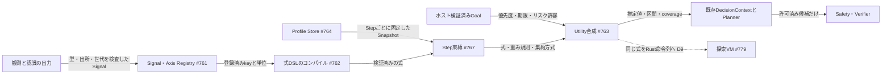
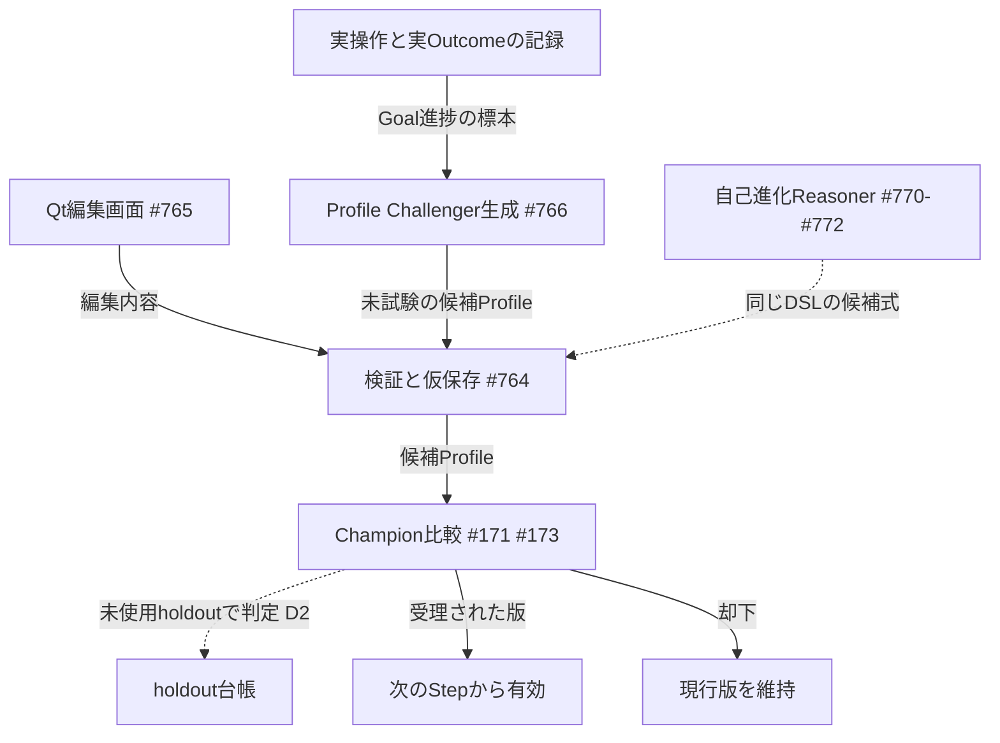

# 編集でき、学習で育つ汎用Goal・評価関数（汎用評価v2）

[動作と配置の見取り図へ戻る](README.md) ｜ [自己成長ループの全体設計](self_improvement_loop.md)

- **状態：** 設計（未実装）。基準main `a6aaf85`。
- **親Issue：** [#800](https://github.com/tomiya7688/AI_game_player/issues/800)。汎用評価の正本は [#760](https://github.com/tomiya7688/AI_game_player/issues/760) と子 [#761](https://github.com/tomiya7688/AI_game_player/issues/761)〜[#768](https://github.com/tomiya7688/AI_game_player/issues/768)。上位方針は [#710](https://github.com/tomiya7688/AI_game_player/issues/710)、[#769](https://github.com/tomiya7688/AI_game_player/issues/769)。
- **元仕様：** Closed済みの [#8](https://github.com/tomiya7688/AI_game_player/issues/8)（6軸評価プリミティブ）と [#491](https://github.com/tomiya7688/AI_game_player/issues/491)（6軸のRuntime接続）。v1の現行動作は [Runtime Evaluation](runtime_evaluation.md) と [評価指標機能説明書](../評価指標機能説明書.md) が正本です。本書はそれを再定義せず、v2の追加部分だけを扱います。

本書では記述を次の3種類に分けます。

| 区分 | 意味 |
|---|---|
| **実装済み(main)** | `a6aaf85` の `src/` と `tests/` で確認したもの |
| **Issueで確定した設計** | #760〜#768の本文で決まっているもの。まだコードはない |
| **本書で追加する設計提案** | 評価者Claudeが2026-11-04に追加したもの。設計者の承認待ち。**[提案D…]** や **[提案GE…]** の印を付ける |

## 何のため？

賢者ミスクはオセロや将棋の専用AIではありません。RPG、シューター、パズル、未知のUIでも、ユーザーの目標に合わせて「何を良い結果とみなすか」を変えられる必要があります。現行v1は6軸（progress / survival / resources / novelty / repetition / irreversible_loss）に固定されており、次のことができません。

- 新しい評価軸・特徴量・条件を、コードを変えずに追加する。
- 同じ観測（例：HP 60→45）を、目標によって良いとも悪いとも評価する。
- 場面ごとの重み、編集画面、Undo、経験による重みの改善。

v2はこれらを、**任意コードを実行しない型付き式（DSL）と版付きProfile**で実現します。自己進化Reasoner（#769〜#772）は、同じDSLで評価関数を生成・改変します。つまりv2は、AIが自分の評価基準を育てるときの共通の言語です。

## 実装済み(main)で確認したこと

- `src/ai_game_player/evaluation_primitives.py`：`PRIMITIVES` が6軸の固定タプル、`DEFAULT_WEIGHTS` が既定の重み。`EvaluationResult` は6軸以外を拒否します。
- `src/ai_game_player/evaluation_profile.py`：`EvaluationProfile` は6軸・固定順・重み0〜1000を検証し、`from_dict` は6軸以外のキーを拒否します。
- `src/ai_game_player/evaluation_prediction.py`、`evaluation_vector.py`：6軸に限った予測と、欠損のcoverage計算。
- `src/ai_game_player/runtime_evaluation_adapter.py`：前回の実結果（previous_actual）を6軸へ投影します。state_deltaの数値差から作る軸は **progressとresourcesだけ** で、HPの変化はsurvivalに届きません（[#671](https://github.com/tomiya7688/AI_game_player/issues/671) が指摘するバグ）。
- v2用のファイル（`evaluation_signals.py`、`evaluation_expression.py` など）はmainに存在しません。

## 何を受け取り、何を返す？

**入力：** 型付きSignal（観測値・推定値・予測値・未知）、ホストが検証したGoal、場面と時間の情報、候補ごとの予測、版付きProfile。

**出力：** 候補ごとの評価要約。推定値だけでなく、下限と上限（区間）、coverage（どれだけの重みが既知か）、足りない軸、根拠、使ったProfileのhashを含みます。既存の `NumericQuality` と `CandidateDecisionContext` へ射影しますが、区間と未知の情報は別の項目に残します。

**出さないもの：** 入力の許可、Safetyの変更、OSへの操作。評価値がどれだけ高くても、許可されていない候補は実行されません。

## どの順番？

次の図は1回の判断（Decision Step）での流れです。実線はIssueで確定した設計、点線は本書の提案または条件付きの経路です。

学習と編集は、次の図のように判断の外側で新しい版を作ります。現在のStepの値は途中で変わりません。

## Signalのkeyと利用可能性（#761）

**Issueで確定した設計：** `EvaluationSignalV2` は名前空間付きのkey（`[a-z][a-z0-9_.-]{1,127}`、例 `state.health`、`ui.dialog_open`、`motion.enemy_distance`、`quest.key_obtained`）、種類（NUMERIC / BOOLEAN / CATEGORY / VECTOR）、値、単位、出所と世代（source_generation、frame_sequence、clock）、信頼度の種類（UNASSESSED / HEURISTIC / CALIBRATED）を持ちます。

利用可能性（availability）は5種類です。

| 種類 | 意味 | 扱い |
|---|---|---|
| OBSERVED | 画面などから観測した | 観測事実。値0も「0が観測された」 |
| INFERRED | 観測から推測した | 観測済みの真値へ格上げしない |
| PREDICTED | 候補を選んだ場合の予測 | 実結果と同じIDに上書き・平均しない |
| UNKNOWN | 今は分からない | 値はNone。0とは別 |
| UNOBSERVABLE | 原理的に観測できない | 欠損として区間で扱う |

ゲーム固有の信号（オセロの角、将棋の駒得など）は任意プラグインのfeature providerとして登録するだけで、Coreに `if game ==` を書きません。v1の6軸は `builtin.progress` 〜 `builtin.irreversible_loss` としてv2へ投影します。

### semantic keyとaliasの唯一の表 **[提案GE1]**

2026-11-04のIssue点検で、意味keyの対応表が3つに分かれていることが見つかりました。

- [#645](https://github.com/tomiya7688/AI_game_player/issues/645)：`hp`、`health`、`lives` → RESOURCEカテゴリ。
- [#671](https://github.com/tomiya7688/AI_game_player/issues/671)：`hp`、`health`、`lives` → survival軸の候補。
- #761：`state.health` というSignal key。

**採用する解決：** #761のRegistryを、semantic keyとaliasの**唯一の正本**とします。#645と#671は独自の表を持たず、Registryを参照します。そのうえで、責任を次の2段に分けます。

1. **観測Signalは価値の方向を持たない。** `hp`、`health`、`lives` は、どれも `state.health`（単位health_points）またはlivesの別keyへ正規化するだけです。RESOURCEかsurvivalかを、Signalの段階では決めません。#645のcategoryは「数値の種類」の表示用として残し、価値判定（value_judgement）はGoalが明示されたときだけ付けます。
2. **どの軸へ写すかはGoal/Profileが決める。** v1互換Profileでは `state.health → builtin.survival` の写像を既定として持ちます。これにより#671のv1の修正（HPの変化をsurvivalへ届ける）は、この既定写像の最小パッチとして実装できます。「HPを消費して扉を開ける」Goalでは、別のProfileが同じSignalを別の重みで使います。

この方針で、#645と#671の食い違いは「どちらが正しいか」ではなく「層が違う」ことになります。#645・#671・#761の本文は、この表を参照するよう更新が必要です（下の「残る作業」）。

## 式DSL（#762）

**Issueで確定した設計：** 式はJSONのAST（タグ付きunion）で書き、登録済みの演算子とSignalだけを使います。

- 値の取得：`constant`、`signal(key, expected_unit)`、`difference(key, before, after)`
- 変換：`normalize(child, min, max, clip)`（[-1,1]の無次元値へ）、`negate`、`abs`、`clamp`
- 結合：`add`、`multiply`、`min`、`max`。式は出力の範囲を型として宣言し、Validatorは区間演算で範囲を検査します。宣言した範囲を超えうる式（正規化した軸2本の`add`など）は、`clamp`か`normalize`で囲まない限り拒否します。欠損軸の区間はこの宣言範囲から作るので、範囲外の値が出ることはありません
- 条件：`compare`、`if(condition, then, else)`、`select_unknown(first, explicit_fallback)`

**単位と次元の規則：** `signal` と `difference` は元の単位を保ちます。`add`・`min`・`max` は同じ単位同士か無次元同士に限ります。HPと秒を足す式は `INVALID_UNIT` で拒否します。欠損を暗黙に0にしません。条件がUNKNOWNなら結果もUNKNOWNで、両方の分岐が同じ値と証明できる場合だけその値を使います。`select_unknown` で代替値を使った場合は、そのことと低い証拠の状態を残します。

**資源の上限（初期値）：** 1式64ノード、深さ8、引数8、512命令、JSON 32KiB、1 Stepあたり128式。超えた場合は `CAPACITY` を返し、黙って切り捨てません。時間・CPUの実測値は**未測定**です。

**コードを実行しない：** ループ、正規表現、外部API、Python/JS/LLM生成コードのevalはありません。EMAや時間窓のような状態を持つ計算はDSLで書かず、#409/#713が計算した時系列Signalを読みます。コンパイルはProfileの保存・選択時に1回だけ行います。

**[提案D9]** 同じEvaluatorGraphを、SearchProgram（[#779](https://github.com/tomiya7688/AI_game_player/issues/779)）と同じRust VMの命令列へコンパイルします。探索の末端評価でPythonとのIPCが要らなくなります。PythonのDSL評価器は参照実装として残し、両者の一致を試験します。

## GoalSpecの出所と有効化の権限（#763）

**Issueで確定した設計：** `GoalSpecV2` の出所は USER / TRUSTED_PRESET / INFERRED / LEARNED です（本書ではTRUSTED_PRESETをTRUSTEDと略します）。INFERREDとLEARNEDは保留中の提案で、利用者の制約に反するGoalを勝手に有効にできません。画面の台詞、OCR、LLMの提案をGoalの権限へ直接昇格しません。

**[提案D4]** 誰が・いつ有効にするかが未定だったため、次の規則を加えます。

| 状態 | 条件 | 使える用途 |
|---|---|---|
| PROPOSED | 出所がINFERRED・LEARNEDで、観測や画面の指示から推定しただけ | 表示と提案のみ |
| PROVISIONAL | 独立した裏付けがk件以上あり、矛盾がない | 探索と代理指標の学習。能力の主張には使わない |
| TRUSTED | Trusted Chat（[#436](https://github.com/tomiya7688/AI_game_player/issues/436)/[#584](https://github.com/tomiya7688/AI_game_player/issues/584)）でユーザーが確認した | 通常のGoalとして使用 |

ユーザーの明示した制約とSafetyは常に優先します。kの値は未定です。

## Utilityの集約と、欠損の区間（#763）

**Issueで確定した設計：** 集約方式は3種類です。

- **NORMALIZED_SUM：** 重みの総和で正規化します。重みの合計が0なら利用不可です。欠損した軸の重みを消して「完全に分かった」ふりをしません。下限 = (既知の加重和 − 欠損重み) / 総重み、上限 = (既知の加重和 + 欠損重み) / 総重みです。例：progressの重み2で値+1、survivalの重み1が欠損なら、区間は[1/3, 1]、coverageは2/3です。
- **LEXICOGRAPHIC：** 優先する軸の証拠が十分なときだけ次の軸を比べます。足りなければ明示的にPartialです。
- **SOFT_MIN：** 最悪側を柔らかく重視します。Hard Safetyの代わりにはしません。

2つの候補の区間が重なる場合、中央値の小さな差を確定した順位と呼びません。不足する証拠と、追加観測（#406/#409）の期待価値を示します。初期上限は32軸・64候補・128 Signalです。

## Profileの範囲・版・Undo・v1移行（#764）

**Issueで確定した設計：**

- **範囲：** GLOBAL → GAME → SCENE → GOAL の順に具体的になり、合わなければ親の範囲を使います。ゲームの題名文字列やOCRで優先度が暗黙に上がることはありません。
- **出所の優先：** USERの明示 > TRUSTED_GAME > LEARNED_CHALLENGER > BUILTIN。学習した候補はユーザーの明示的な上書きより優先しません。
- **版：** 保存はcontent digest付きの不変Snapshotです。`expected_revision` が違う同時書き込みは片方をCONFLICTで拒否し、勝手に合成しません。既存の `atomic_json.py` の仕組みを再利用します。
- **Undo：** 前の版を直接戻すのではなく、前の版の内容を**新しいrevision**としてコミットします。履歴は最大32です。
- **v1移行：** 旧6軸を厳密に読む → v2の式へ写す → v1の20 fixtureを再計算し、差があれば移行不可。元のv1ファイルは消しません。
- **fallback：** v2 Profileがない・壊れている場合、[#767](https://github.com/tomiya7688/AI_game_player/issues/767) はv1の6軸既定へ明示的に戻ります。
- 外部からのImportはプレビューのみで、ユーザーの承認まで適用しません。

## Qt編集画面（#765）

**Issueで確定した設計：** Qt 6 Widgetsのネイティブ画面で、WebViewは使いません。[#693](https://github.com/tomiya7688/AI_game_player/issues/693)（Dock/Workspace）の取付け位置が必要なため、#693が先です。

- **Basic：** Goalの選択、何を重視しているかの説明、主要な4〜6軸の重みスライダー。
- **Advanced：** 軸の追加・削除、式のカード、正規化範囲、場面・Goalの条件、範囲の階層。
- **Expert：** 型付きASTの編集、版の差分、Import/Export。任意コードを貼って実行する機能は作りません。
- **Live Preview：** 記録済みの観測と候補で式を計算するだけで、実操作を出しません。結果をDecisionContextへ送りません。

## Stepごとの束縛（#767）

**Issueで確定した設計：** 各Decision Stepの開始時に、Profile・AxisRegistry・Goal・Signal源・Run epochを不変のSnapshotとして固定します。編集や学習で新しい版ができても、現在のStepの評価は変わらず、次のStepから新しい版を使います。Stopや対象変更では古い投影を捨てます。前回の実結果はSignalへ変換しますが、候補の予測へ転記しません。全て未知のときは無理に点数を作らず、#206の再観測・fallbackを使います。

## 学習によるProfile Challenger（#766）

**Issueで確定した設計：** 初期の方法は**制約付き座標探索**です。各軸の重みを±10%（0付近は±0.1）だけ変えた候補を、1候補で1軸だけ作ります。評価の正解はユーザーのGoalと実際の観測であり、評価関数が自分に付けた点数ではありません。ユーザーがロックした軸は変更しません。採否は既存の [#173](https://github.com/tomiya7688/AI_game_player/issues/173)（比較）と [#171](https://github.com/tomiya7688/AI_game_player/issues/171)（昇格）が決めます。

本書では、自己成長ループの共通規則をここへ適用します。

- **[提案D1]** 評価Profileの重みも、[#781](https://github.com/tomiya7688/AI_game_player/issues/781) のStrategySnapshotを唯一の昇格単位として扱います。1回の昇格では1種類の部品だけを変え、効果の帰属とrollbackを明確にします。[#422](https://github.com/tomiya7688/AI_game_player/issues/422) の軽量適応は有界な数値priorだけの別経路です。
- **[提案D2]** 昇格判定は、台帳に記録した未使用のholdoutで行います。holdoutの結果を見て作った候補は、別の未使用holdoutで確認します。多重比較はHolm–Bonferroniか逐次検定で補正します。
- **[提案D3]** 信号の段階はT0（ユーザー・信頼済み試験）、T1（検証済みの最終Goal結果）、T2（受領証付きの代理結果）、T3（予測誤差の減少などの内的信号）です。T3だけでProfileを昇格させません。
- **[提案D7]** 遅れて出る結果（例：60手後の勝敗）は、TD(λ)やモンテカルロ収益で各Stepの評価へ戻します。#713の短い帰属窓はUIの効果用に残します。

## 複数ジャンルでの検証（#768）

**Issueで確定した設計：** 盤面ゲーム、RPG（HPを犠牲にして鍵を取る）、シューター（時間制約の回避）、パズル（探索と進捗）、未登録Signalを持つ未知ゲームの5種類で、同じAPI・Registry・DSLを使い、違いはProfileとSignal providerとGoalだけにします。品質はSTRUCTURE / RUNTIME / FIELD / COMPETITIVEの4段階で、下の段だけ通って上の能力を完了と呼びません。[#735](https://github.com/tomiya7688/AI_game_player/issues/735) の将棋・オセロの勝率は、それだけで汎用対応を認めない別の受入です。

## 信頼と安全の境界

- 評価値でSafety、入力許可、同意、Stopを変えません。重みでHard Safetyを迂回できません。
- ゲーム内のリスク（不可逆な行動など）は、ユーザーが許可したリスク予算の中で候補として残せます。OS・同意・Stopの安全とは完全に分けます。
- 画面の文字やLLMの自由文は、Goalや権限を変えません。
- モデルの自己申告の信頼度を、校正済み（CALIBRATED）へ昇格しません。
- 実結果（ACTUAL）と予測（HYPOTHETICAL）を混ぜません。

## 失敗したら？

| 状況 | 扱い |
|---|---|
| 式の型・単位の誤り | INVALIDで保存不可。現行版のhashは変わらない |
| 欠損・未知 | 区間を広げ、coverageを下げる。0や成功を作らない |
| 容量超過 | CAPACITYと分割の提案。黙って軸を捨てない |
| 保存失敗・同時書き込み | 旧版のまま。CONFLICTを表示 |
| v2 Profileが壊れている | v1の6軸既定へ明示的に戻る |
| 全候補が未知 | 再観測か許可済みfallback（#206） |

## 時間とメモリ

全ての処理時間・メモリは**未測定**です。#763と#767はp50/p95・CPU・ピークメモリの測定を求めており、[#425](https://github.com/tomiya7688/AI_game_player/issues/425) の資源方針で上限を調整します。上記の上限は初期設計値で、製品能力の恒久的な上限ではありません。

## 自己改善にどうつながるか

- **共通言語：** 評価がデータ（DSL）になるので、ユーザーもAI（[#770](https://github.com/tomiya7688/AI_game_player/issues/770) プリセット、[#771](https://github.com/tomiya7688/AI_game_player/issues/771) 生成、[#772](https://github.com/tomiya7688/AI_game_player/issues/772) 改変）も、同じ検証器と同じ版管理で評価関数を作り直せます。
- **安全な試行：** 新しい評価関数は必ず仮保存 → Challenger比較 → 次Stepから有効、という経路を通ります。悪化すれば元に戻せます。
- **速さ：** **[提案D9]** で、生成した評価関数を探索の末端で直接使えます。
- **再利用：** **[提案D13]** 昇格した評価関数はゲーム間で使えるライブラリに入れ、ゲームごとの信頼度と忘却（A→B→A）を記録します。
- **状態の抽象化：** **[提案D15]** Signalの集合から抽象状態のkeyを作り、粒度はholdoutでの予測損失で選びます。

## 何が上限（天井）として残るか

- **Signalにない情報は評価できません。** 認識がHPバーを読めなければ、どんな式でもHPを使えません。評価の質は認識（#711など）の質を超えません。
- **DSLの表現力は意図して制限しています。** ループや任意コードがないため、複雑な盤面評価（例：深い読みが必要な形勢判断）は式だけでは書けず、探索（#779）や任意プラグインに頼ります。
- **学習信号が少ない：** 未知ゲームでは確定したGoal結果がまれで遅く、#766の座標探索は1回に1軸しか動かせないため、改善は遅くなります。T3の内的信号だけでは昇格できないことも、意図した制約です。
- **holdoutは有限です。** 使い切ったら新しいseedや配置が必要で、実ゲームでは用意できない場合があります。
- **Goalの推定には人の確認が要ります。** D4の規則では、ユーザーが確認するまでINFERREDのGoalで能力を主張できません。

## 一つ具体例を追う

*以下は説明用の仮定で、実測ではありません。* RPGでHPが60から45に減り、扉が開いたとします。Signalは `state.health` の差−15（OBSERVED）と `goal.door_opened = true` です。Goal「扉を開ける」のProfileでは、扉の軸（重み2、値+1）とHP損失の軸（重み1、`normalize(-15, -30, 30)` = −0.5）を合計し、(2 − 0.5) / 3 = +0.5 になります。ユーザーがGoalを「HP維持」に変えると、次のStepから扉を開けない候補が上位になります。変更前のStepの順位は変わりません。

## 残る作業

- 正本の更新：#645・#671・#761の本文に、[提案GE1]の「Registryが唯一の表」「方向はProfileが持つ」を反映する。#671はv1の最小修正に絞るか#767へ統合するかを決める。
- D4のk、D2のholdout台帳の担当Issueは未定。
- Qt編集画面は#693の完了待ち。
- 処理時間とメモリの測定は#763、#767、#768。
- 自己進化Reasonerとの昇格の調停は#781と [#780](https://github.com/tomiya7688/AI_game_player/issues/780)。
