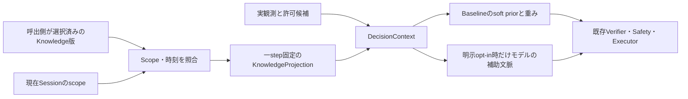

# Knowledgeを一回の判断へ固定してsoft evidenceとして使う

この文書は、ゲーム経験から得たKnowledgeを判断へ接続する開発者向けです。
Issue #531の成果物を説明します。通常利用者の操作はありません。ゲーム別の攻略規則や、
自動学習・自動昇格のUIを追加する変更ではありません。

## 入力と実行経路

`KnowledgeFeatureAdapter`は、Issue #529の検証済み`KnowledgeSnapshot`と
`KnowledgeScope`を使います。game、scene、profile、player、lineageの全項目が
現在のSession側のscopeと一致する場合だけ、その版を使います。scopeは信頼された
Sessionの設定から渡してください。OCR文字列やモデルの出力をscopeの決定権にしません。



`DecisionPipeline(..., knowledge_adapter=adapter)`が`GamePlayerEngine`へ投影器を渡し、
既存の候補評価で作った`DecisionContext`へ投影だけを追加します。元の観測、前回結果、
候補実体、`allowed_action_ids`を置き換えません。Snapshot取得は一stepに一回です。
取得元の選択版が推論中に変わっても、現在stepの版・hash・出所・priorは変わりません。
次stepが新しい版を取得します。昇格処理はここへ含めず、#532を正本にします。

## 既存手法とsoft evidenceの扱い

参照Snapshotのcandidate priorをそのまま絶対視せず、sample支持の縮小推定を使います。

```text
informative_count = success + no_effect + failure
trust(action) = (1 - uncertainty) * informative_count / (informative_count + 4)
                * candidate_reliability(action)
soft_prior(action) = candidate_prior(action) * trust(action)
```

action別統計が無い既存の校正済みpriorでは、Snapshotの`sample_count`を支持数として
使います。`unknown`しかないactionは支持数0となり、負のpriorを持っていても
penaltyへ変換しません。背景アニメーションの変化や受動的な得点増加から、Adapterが
クリックの効果を捏造する処理はありません。行動効果を増分集計する処理は#530です。

`BaselineDecisionProvider`は、stepに固定したsoft priorと、既存の`utility`、
`recognition`、`knowledge_prior`の3重みに対応するhintを使います。weight hintは
Snapshotの信頼度で静的重みと線形補間し、呼出し後もProviderの設定値を変更しません。
`recognition_minimum`、`decision_margin`、ROI、遷移、評価軸に関するhintは
参考情報として投影に保持します。これらを使って正当候補を削除したり、Safetyの
条件・認識最低値・停止条件を弱めたりしません。

候補priorとROI・遷移hintはそれぞれ最大64件、出所範囲は末尾8件へ制限します。
省略数を記録し、未掲載の情報が存在しないとは表現しません。完全な値と出所は、
Snapshotの版・hashから追跡します。Decisionのcritical pathでExperienceの全履歴を
読み直す処理はありません。

## 静的fallback

次の場合はKnowledgeを採用せず、reason codeと空の投影を記録します。

- 欠落、取得関数の障害、Snapshot以外の戻り値
- scopeのいずれかが不一致、または現在scopeが未確定
- `expires_at`を過ぎた版、任意の`max_age_seconds`を超えた版、作成時刻が未来の版
- timezone情報の無い時計
- 別stepの`context_snapshot_id`に結び付いた投影の再利用

Adapterを構成したstepで版が拒否された場合、古いlegacy辞書を代わりに採用しません。
Adapter自体を構成しない旧APIの`version/priors`辞書は従来互換として残ります。
新しい版付きKnowledgeには、scope・整合性を検査するSnapshot/Adapter経路を使ってください。
取得失敗の例外本文やパス、raw frameを投影やモデル文脈へ書きません。

## ローカルTraceとモデル公開を分ける

`KnowledgeProjection`はcanonical JSON bytesを保持する不変値です。`to_dict()`が返す
辞書を変更しても、元の投影は変わりません。ローカルTraceは投影の版・hash・出所を
`context.knowledge_projection`へ記録します。

モデルへの公開は`expose_to_models=False`が既定です。明示的にTrueにした場合だけ、
既存のcontext APIを使うProviderへ最大4KiBの圧縮済み投影を渡します。圧縮文脈には
`evidence_type=knowledge_soft_evidence`を付け、観測済みの事実と区別します。
出所は版・hash・更新規則で参照し、個々のExperience範囲はローカルTraceへ残します。
このフラグは、Remote Providerの有効化や同意、送信先の認証を変更しません。
Adapter自身は通信しません。既存のプライバシー・Provider送信境界を維持してください。

## 組立て例

呼出側は、評価・選択済みの版を取得する関数を渡してください。以下の`selected_version`
は例の変数であり、学習したChallengerを自動採用する実装ではありません。

```python
adapter = KnowledgeFeatureAdapter(
    snapshot_source=lambda scope: store.read(scope, selected_version).snapshot,
    scope_source=lambda observation: current_session_scope,
    max_age_seconds=3600,
)
pipeline = DecisionPipeline(source, game_directory, BaselineDecisionProvider(),
                            knowledge_adapter=adapter)
```

通常実入力の設定はこの組立て例から変更されず、Pipelineは既定のdry-runです。
失効・scope不一致の確認は各stepで行います。現在sceneを決められない場合は
`scope_source`からNoneを返して静的fallbackを選んでください。

## 指定手法、実装、検証と残件

| 指定・根拠 | 実装 | 検証と未達の追跡 |
|---|---|---|
| #419/#531: Knowledgeから判断入力・結果を変える | scope付きsoft prior、sample縮小、重み補間 | 同一画面・候補で実Pipelineの選択がscore-labelからmove-controlへ変化 |
| #530からの接続 | canonical ExperienceEventを既存Builderへ渡し、その出力Snapshotを消費 | verified no_effect 20件から得た版で、実Pipelineの次の選択が変化。候補2件は両方保持 |
| 不確実性と情報の出所を保つ | unknownを支持数から除外、Snapshot hashとprovenance | unknownのみ、低信頼度、範囲外候補の負例 |
| Step固定 | 不変投影とcontext snapshot参照 | 取得元の版更新、投影辞書変更、別step再利用の負例 |
| #418 Baselineへ接続 | 既存Provider、Engine、Pipelineの任意注入 | Verifierとdry-runを通る統合試験、旧API回帰 |
| モデルの任意入力 | 既定OFF、4KiB圧縮context、既存Provider API | context Providerの実Pipeline呼出しでopt-in/opt-outを確認 |
| #408 Refinement、#491評価へのhint | ROI/threshold/transition/評価weightをsoft projectionへ保持 | 各機能の本番consumerは#408/#491。ここで代替のrefinement/evaluatorを作っていない |
| 学習と昇格の分離 | 選択済み版の読取りだけ | Builderは#530、Promote/Reject/Rollbackは#532、通常Gameplay中の更新は#422 |

Pythonに配置しました。処理対象はboundedな構造化Knowledgeで、OS入力・native APIを
呼ばず、既存Pythonのcontext/Provider APIへ接続します。典型fixtureの1000回計測では
投影のp50が33.47µs、p95が46.901µsでした（クラウドLinux/Python 3.12.14の観測値）。
これはFPS向けの最悪時予算や回帰閾値ではありません。Nativeへ細かく渡す境界を増やす
利益は、この規模では実測されていません。

`tests/test_knowledge_feature_adapter.py`は、作成済みpriorを差し替える比較に加え、
canonicalな実行済みaction-effect証拠20件を#530のBuilderへ投入してから、実際の
Pipelineで判断が変わる経路も検証します。no-effectを学習してもscore-labelを禁止候補へ
変更しません。これは信頼済みの効果ラベルを使う統合fixtureであり、実ゲーム画面から
行動効果を正しく認識・帰属できたという証明とは区別します。

Coreと任意のRuntime経路への接続を試験しました。新しいAdapterを使ったWindows実入力、
自律的な実ゲーム学習で攻略性能が改善すること、#408/#491のconsumer、既定UIからの
設定は未確認・未実装であり、この統合試験をその達成証拠にしません。
