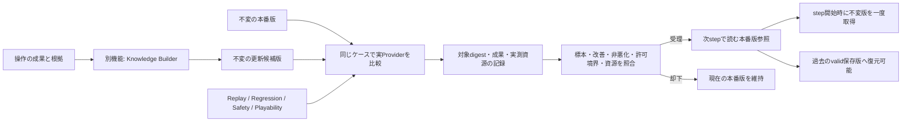

# 知識の更新候補を評価し、本番版の参照先を切り替える

この文書はKnowledgeを学習・公開する処理を実装する開発者向けです。
Issue #532の実装を説明します。通常利用者の操作やUI設定の追加はありません。

## 更新候補と本番版を分ける目的

得点表示をクリックする行動も、結果を確かめる探索になり得ます。その行動が役に立たない
という根拠が得られた場合、Knowledgeの候補priorを更新できます。ただし、一件の誤評価で
本番の知識を直接書き換えると、同じ失敗へ固定されたり、以前できた操作ができなくなったりします。

#529の`KnowledgeSnapshotStore`は内容hash付きの版を不変に保存します。
`KnowledgePromotionGate`はその保存版を評価し、Champion（本番）の参照先だけを切り替えます。
Challenger（更新候補）の作成は#530、判断へのsoft evidence反映は#531が担当します。
GateはSafetyルール、許可操作一覧、画像や入力座標を変更しません。



## 比較する内容と根拠

`KnowledgeEvaluationCase`は同じ`DecisionContext`、操作別の既知成果（-1〜1）、
ケース単位の根拠digest、scope、評価群を保持します。未知の成果に勝手に数値を付けません。
画像の変化や受動的な得点変化だけから、クリックが有効だったとは判断しません。
操作の成果ラベルは信頼済みの記録・評価処理が用意してください。根拠digestはそのラベルを
参照するための値であり、外部のラベルが正しいことを暗号学的に証明するものではありません。

`KnowledgeEvaluationRunner`は、信頼済みアプリ側の`provider_factory(snapshot)`から
実際のProviderを作り、同じケースで`choose_context`を呼びます。Providerへ渡すcontextは
コピーし、元のケースを変更させません。判断は既存`DecisionVerifier`へ通します。
許可一覧外の操作、別のsnapshotや画面を参照する判断、例外は測定上の失敗にします。
保留は操作を発行せず成果0として記録します。評価器自身は実入力を発行しません。

比較順をケースごとに変更前→変更後、変更後→変更前と交互にします。
判断器の初期化、判断、Verifierの時間を`perf_counter_ns`で計測し、
Pythonの割当peakを`tracemalloc`で計測します。GPU/Native/別processのRAMはこの数値に
含まれません。既存tracemalloc sessionがある場合は干渉を避けるため評価を拒否します。
同じprocessでの本評価も計測lockで排他し、同時実行の要求は待ち続けず拒否します。

測定記録には以下を保存します。

- Champion/Challengerの内容SHA、scope、全ケース・成果ラベルを含むsuite digest
- 各群の件数と変更前後の平均成果、Verifier違反件数、判断器例外件数
- 変更前後のp95ミリ秒、Python割当peak bytes
- 評価方式`offline_paired_decision_replay`、測定digest、実際に適用したPolicyの全閾値

記録と参照先は既存Artifact StoreのSHA検証で保護します。raw frame、自由文の画面状態、
操作ケースそのものは評価レポートへ複製せず、suite digestと不透明な出所参照で区別します。
呼出側から`passed=true`のような合格フラグを受け取るAPIはありません。

## 既定の採用条件

| 条件 | 既定値・扱い |
|---|---|
| scopeと対象版 | game/scene/profile/player/lineageが完全一致し、レポートの両SHAが保存版と一致 |
| 更新候補の標本 | 最低3件、uncertaintyは0.9以下 |
| 比較ケース | 最低12件、全4評価群に1件以上。最大512件。同じIDや同じ成果根拠digestの再投入は拒否 |
| 許可境界と失敗 | ChallengerのVerifier違反・例外は0件。比較元の判断が壊れた場合も拒否 |
| 回帰 | 全群で変更後の平均成果が変更前を下回らない |
| 目標改善 | replay群で平均成果が0.01以上改善 |
| 時間 | p95が1000ms以下、かつ変更前の5倍以下（比較元の下限0.1ms） |
| Python割当 | peakが16MiB以下、かつ変更前の5倍以下（比較元の下限1024bytes） |

資源閾値は用途に合わせた有限のPolicy値で変更できます。Safety/許可候補の違反を許す設定や、
回帰を許す閾値はありません。Policyの派生クラスで判定を差し替えることも受け付けません。
手法は対照Replay、保守的な非悪化条件、資源budget、世代付きの楽観的競合制御です。
小さな標本で未知ゲーム全体の性能改善を証明したとは扱いません。

## 公開、step固定、復元

1. `initialize_champion(scope, version)`で、構成側が選んだ最初のvalid保存版を登録します。
   初期化は既存Championを上書きしません。
2. `capture(scope)`をstep開始時に一度呼び、返された不変Snapshotをそのstep全体で使います。
   判断中に他の版が公開されても、取得済みの値は変わりません。#531のsnapshot sourceには
   `lambda scope: gate.capture(scope).snapshot`を渡せます。
3. `evaluate_and_promote(scope, version, cases, provider_factory, policy)`で更新候補を比較します。
   評価中は公開lockを保持しません。確定時に世代とChampionを再照合し、別の更新があれば
   `stale_evaluation`として却下します。長い評価の後には両保存版の期限・整合性も再検査します。
4. `rollback(scope, version=None)`は、履歴にある同scopeのvalid保存版へ戻します。
   対象が欠落・期限切れ・改ざんの場合、現行版を保持します。

pointer、世代、復元履歴、監査は一つのJSONを既存`stage_json_write`で原子的に置換します。
scopeごとの`cross_process_file_lock`で更新を直列化します。公開前に障害が起きた場合、
古いpointerと監査は同時に維持されます。状態が破損した場合はstatic fallbackへ戻し、
証拠を消すための自動上書きはしません。

復元可能な最近32版と最近128件の監査を保持します。評価Artifactは不変に残ります。
古いArtifactのretention/GCは既存#18/#164の責務で、本Gateが勝手に削除しません。

## 実装境界と未確認事項

Pythonに置く理由は、Knowledge、既存Provider、評価記録の型を同一processで扱う制御機能であり、
OS APIへの近さやpixel単位の反復が無いからです。昇格は毎frameの入力処理とは分離しています。
Native境界を追加せず、不変Snapshot単位で共有します。

- 本変更は#532のKnowledge専用の評価・公開・復元APIです。既存#171/#173はまだ汎用の
  Promotion/Evaluation engineを実装していません。共通化できる構造化測定を提供しますが、
  両Issue全体を完了扱いにしません。
- 自動学習job、バックグラウンド配線、画面から操作成果を推定する新しいモデル、UIは
  #422/#173/#491等の責務です。通常Sessionがこの追加だけで自動昇格するとは扱いません。
- 評価callbackには信頼済みで有限処理のローカルProviderを使ってください。ケース数と
  入力量は有界ですが、任意Python callbackを強制終了する隔離job機構は実装しません。
  時間・Python割当budgetは測定後の却下条件です。任意外部モデルのtimeout/隔離は#173/#183が必要です。
- offlineケースのplayability指標は、Windows実ゲームの長時間試験や未知ゲームへの一般化の
  達成証拠ではありません。Windows WGC/Win32/独立watchdogの実機検証は未確認です。

## 検証方法

開発者はリポジトリ直下から実行してください。

```sh
PYTHONPATH=src:. python -m unittest discover -s tests -p test_knowledge_promotion.py -v
```

得点表示のno-effectを低く評価するSnapshotで同じBaselineの判断が変わる対照ケース、
改善後の公開とstep中の旧版固定、意図的な悪更新の却下、新しいheld-outケースで回帰を検出した後の
復元、許可外操作、壊れた比較元、例外、scope混在、標本不足、重複根拠、資源超過、
公開途中障害、評価中の世代更新、状態破損、過去版の改ざん、履歴上限を検証します。
状態遷移の単体試験ではscheduler変動と機能判定を分離し、資源超過拒否は独立ケースで残します。

保存済みpointerはSnapshotと同じ通常ファイル限定の有界読込を使います。FIFOやsymlinkを拒否し、破損したpointerを初期状態として上書きしません。
