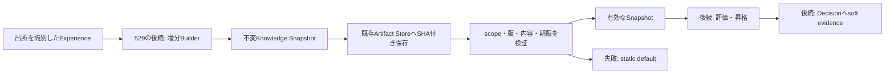

# version付きKnowledge Snapshotと安全な読取

この文書はKnowledge Builder・Decision Adapter・Promotion Gateの実装者向けです。
Issue #529は、Experienceから得た数値知識を保存・検証して読む契約を提供します。
通常利用者の操作はありません。この追加だけで自動学習や本番の判断反映は開始しません。

## 目的とデータの流れ

行動の効果を学習するとき、画面が変わったことだけを成功や失敗とみなすと、
背景アニメーションや受動的な得点増加を誤ってその行動へ帰属させます。
Snapshotは`success`、`no_effect`、`failure`、`unknown`を別の件数として保存します。
分類を決めるBuilderは#530、判断へ反映するAdapterは#531が正本です。



Model Artifactとは別のmedia type `application/vnd.kadoka.knowledge+json`と
artifact type `knowledge.snapshot`を使います。内容はデータだけで、コードを実行しません。

## schema v1

正本は[`config/knowledge_snapshot.schema.json`](../../config/knowledge_snapshot.schema.json)です。
[`snapshot-v1.json`](../../tests/fixtures/knowledge/snapshot-v1.json)に完全な例があります。

| 項目 | 意味と検査 |
|---|---|
| `schema_version` | 整数1。boolや未対応版を拒否します。 |
| `snapshot_id` / `version` | 不透明な識別子。内容が異なる同一scope・同一versionの再保存を拒否します。 |
| `scope` | game / scene / profile / Player instance / lineageの5識別子。全てが一致する場合だけ使用します。 |
| `sample_count` / `uncertainty` | 元Experience件数と0〜1の不確かさ。統計件数が証拠総数を超えないことを確認します。 |
| `action_outcome_stats` | action別の4分類件数、報酬平均・EWMA、Betaのalpha/beta。4分類の合計はcountと一致させます。 |
| `candidate_priors` / `candidate_reliability` | priorは-1〜1、reliabilityは0〜1の有限数。自由文や生の観測を保存しません。 |
| `transition_priors` | from/action/toの不透明な識別子、確率、観測件数。重複行や同じ条件の確率和が1を超える表を拒否します。 |
| `weight_hints` / `threshold_hints` | schemaに列挙した評価用の数値hintだけを許可します。Safety、入力許可、所有者、停止設定を格納できません。 |
| `roi_hints` | 正規化xywh。幅・高さは正で、矩形全体が0〜1の範囲に入る必要があります。画像やraw frameは保存しません。 |
| `source_experience_range` | source識別子、first/last sequence、件数、SHA-256。範囲重複を拒否し、全件数がsample_countと一致することを確認します。 |
| `builder_state` | 有界なsource/correlation watermark。opaque識別子とsequenceだけを保持し、後続Builderの重複投入排除に利用します。 |
| `update_rule` / `update_rule_version` | 数値更新則とその版の識別子です。実行コードや任意設定ではありません。 |
| `created_at` / `expires_at` | timezone付きUTC。任意のexpires_atは作成時刻より後にし、期限ちょうどから利用を拒否します。 |

全体は1MiB、候補・遷移表は各4096、source範囲・watermarkは各1024を上限とします。
NaN、Infinity、不正整数、JSON重複キー、余分なフィールド、パスや自由文の識別子、
既知のcredential prefixを拒否します。不透明IDへ任意の秘密を入れてよいという意味ではありません。
呼出側はPlayer名やOCR原文等をIDへ流用せず、登録済みIDや不透明なhash参照を渡してください。

## 不変性と保存

`KnowledgeSnapshot.from_dict(value)`は検証済みcanonical UTF-8 bytesを保持します。
入力辞書と`to_dict()`の戻り値を後から変更してもSnapshotは変わりません。
`to_bytes()`と`sha256`はArtifactや評価対象の内容を固定するために使います。

`KnowledgeSnapshotStore(root).save(snapshot)`は既存`FileSystemArtifactStore`を利用し、
SHA付きの`ArtifactReference`を返します。同一内容の保存は同じ参照を返します。
scopeとversionはhashにしてindex pathへ使い、他ゲームや他Playerのデータを探索しません。
版ごとの既存cross-process lockと`stage_json_write`を使ってindexを原子的に公開します。
既存の版を上書きせず、同じ版で異なる内容や破損indexを見つけた場合は保存を拒否します。

Artifact保存後にindex公開が失敗する場合、未参照objectが残ることがあります。
既存Artifact Storeのorphan検出とretention/GC（#18/#164）の対象にし、読込成功扱いにしません。
保存だけでactive/championを変更しません。昇格・却下・rollbackは#532の役割です。

## 読取APIとstatic fallback

```python
result = store.read(expected_scope, "1")
if result.snapshot is None:
    # 呼出側の静的な初期方針を維持する
    use_static_default(result.reason)
else:
    fixed_snapshot = result.snapshot
```

成功は`KnowledgeReadResult(snapshot, reference, "ok")`です。
欠落は`missing`、破損・未対応版・不正な参照は`invalid`、期限切れは`expired`、
scope不一致は`scope_mismatch`を返します。失敗時のSnapshotと参照はどちらもNoneです。
失敗したpayloadや内部ファイルパスは理由文へ含めません。

indexは最大4KiB、Artifact metadataは16KiB、Snapshot payloadは1MiBまで読みます。
このため既存Artifact Storeに`read_bounded`を追加し、上限+1byteを超えた時点で
JSON復元前に拒否します。通常のArtifact `read`の契約は変更していません。
既存の参照・metadata・サイズ・SHA照合は上限付き読込でも維持します。

## Privacy・retention・安全境界

Snapshotは集約数値とopaque provenanceだけを保存します。raw frame、OCR原文、秘密情報、
任意の本文やArtifact payloadを格納する拡張欄はありません。
期限後の利用を拒否しますが、期限切れファイル自体をこのAPIが自動削除するわけではありません。
物理削除・参照管理・storage budgetは既存retention/GCへ引き継ぎます。
明示したgame/scene/profile/Player lineageをまたぐ自動共有や暗黙のglobal fallbackはありません。

Knowledgeの数値をSafety hard ruleやallowed action集合の変更へ使わないでください。
低confidenceの扱い、step内の固定版、観測と予測の区別は#531、評価・昇格・rollbackは#532で検証します。

## 配置と検証

Pythonのcold-pathデータ検証・保存処理として実装しています。OS入力APIや高頻度の画像反復を
担当せず、既存のJSON・Artifact・lock実装と接続するため、この段階でC++/FFIを追加しません。
SnapshotをStepで固定して読むための契約であり、Decision hot pathでExperience全履歴をscanしません。

開発者は次を実行してください。

```sh
PYTHONPATH=src:. python -m unittest discover -s tests -p test_knowledge_snapshot.py -v
PYTHONPATH=src:. python -m unittest discover -s tests -p test_artifact_store.py -v
```

roundtrip、不変性、scope全5次元の分離、JSON重複/破損/過大入力、schema版違い、秘密・raw field、
数値・件数・確率・ROI境界、期限、同版衝突、並行保存、保存故障と静的fallbackを検証します。

| 段階 | 本Issueで確認する範囲 |
|---|---|
| Core | schema、検証、immutable data、Artifact Storeへの保存と読取 |
| Runtime | Builder/Adapter/Promotionの明示API。通常Gameplayへの自動接続は本Issueに含めません。 |
| Real-play | 本Issue単体では未実施。学習による実Action差は#530/#531、評価と復帰は#532に追跡します。 |
