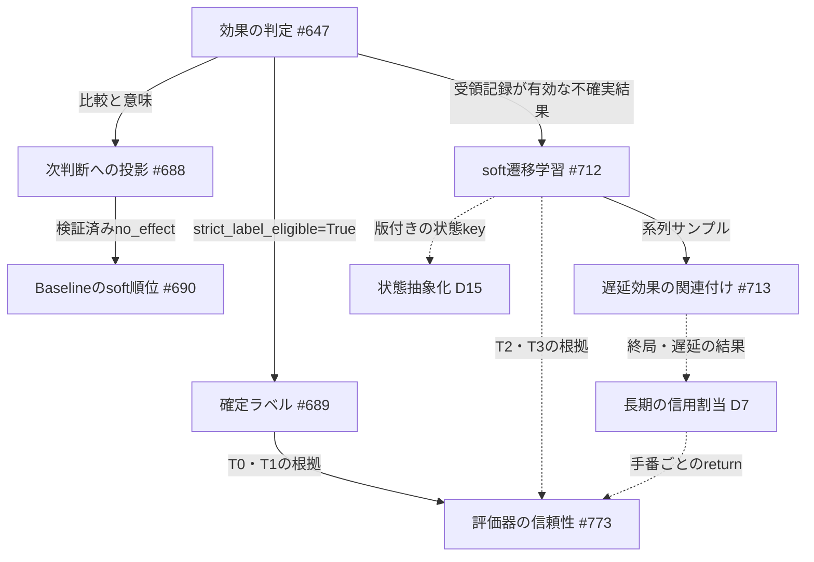

# 操作の結果を解釈し、次の判断と学習へ渡す（結果解釈）

[動作と配置の見取り図へ戻る](README.md) ｜ [自己成長ループの全体設計](self_improvement_loop.md)

| 項目 | 内容 |
|---|---|
| 状態 | 設計（未実装）。本書の型・ファイル名はすべてIssue上の仕様で、`src/` にはまだ存在しない |
| 基準main | `a6aaf85` |
| 親Issue | [#800](https://github.com/tomiya7688/AI_game_player/issues/800)（自己成長設計）、結果解釈の正本は [#643](https://github.com/tomiya7688/AI_game_player/issues/643) |
| 正本Issue | [#644](https://github.com/tomiya7688/AI_game_player/issues/644)–[#648](https://github.com/tomiya7688/AI_game_player/issues/648)、[#683](https://github.com/tomiya7688/AI_game_player/issues/683)–[#691](https://github.com/tomiya7688/AI_game_player/issues/691)、[#711](https://github.com/tomiya7688/AI_game_player/issues/711)–[#713](https://github.com/tomiya7688/AI_game_player/issues/713)、[#671](https://github.com/tomiya7688/AI_game_player/issues/671)、[#509](https://github.com/tomiya7688/AI_game_player/issues/509) |

本書では記述を三つに分けます。

- **実装済み(main)：** `a6aaf85` の `src/` と `tests/` で確認したもの。
- **Issueで確定した設計：** 上記Issue本文の仕様。未実装です。
- **本書で追加する設計提案：** 評価者Claudeが2026-11-04に追加したもの。設計者の承認待ちです。各提案に **[提案D18]** のようなIDを付けます。Dの番号は自己成長設計全体の共通番号です。

## 何のため？

「画面が変わった」だけでは、操作が成功したとは言えません。結果解釈は次の四つの事実を別々の欄に分けます（#643）。

1. **入力の事実：** Actionを本当に送ったか。担当は既存の `ExecutionReceipt`（#628）。
2. **観測の事実：** どの要素・領域・数値・Sceneが、何から何へ変わったか。
3. **期待との照合：** 操作**前**に固定した予測と、観測が一致・矛盾・未確認のどれか。
4. **効果の検証：** 独立した根拠がある場合に限り、検証済み効果として学習の正解ラベルにする。

自己成長ループは、ここで出る「何が起きたか」を評価器・遷移モデル・方針の学習材料にします。この段の誤りは、後段の学習すべてに引き継がれます。

## 実装済み(main)の土台

| 部品 | 現在の役割 | 結果解釈との関係 |
|---|---|---|
| [execution_receipt.py](../../src/ai_game_player/execution_receipt.py) | 送信事実。`action_generation`（Stop/rearm世代）と `eligible_for_learning`（正常送信かつ有効世代か）を持つ | すべての段の入口条件。詳細は[実行受領記録](execution_receipts.md) |
| [outcome_detectors.py](../../src/ai_game_player/outcome_detectors.py)・[outcome_fusion.py](../../src/ai_game_player/outcome_fusion.py) | 全画面差・state差・終端文字列を検出し、融合して `OutcomeEvent` を作る | 補助の根拠。位置や意味の代わりにはしない。[説明書](../OutcomeDetectionFusion機能説明書.md) |
| [light_execution_projection.py](../../src/ai_game_player/light_execution_projection.py) | `VerifiedActionEffect` と `VerifiedEffectSource`（DETERMINISTIC/CALIBRATED/HUMAN） | #647 の `to_verified` が作る唯一の出口型 |
| [runtime_evaluation_adapter.py](../../src/ai_game_player/runtime_evaluation_adapter.py) | 前回の実結果を6軸へ投影する | 現在は `progress` と `resources` だけを投影している（#671の欠落） |
| `engine.py`/`pipeline.py` の `complete_execution_observation` | 操作後観測の唯一の入口 | #687 はこの入口にhookを足す。Outcomeを二重に生成しない |

**既知の不具合：** `TerminalTextDetector.detect` は、OCR文字列の部分一致（例：`"CLEAR" in text`）で成功・失敗の根拠を作ります。`DeterministicOutcomeFusion.fuse` は `terminal_success > 0` だけで成功を返します。そのため「CLEAR CACHE」ボタンでも勝利と誤判定し得ます（#509、Open）。

## 何を受け取り、何を返す？

- **入力：** 操作前の観測（画面要素・数値・Scene）、選んだ操作候補、操作前に固定した予測、実行受領記録、操作後に新しく撮った観測。
- **出力：**
  - 次の判断へ渡す構造化された差分（`EffectContextProjection`）
  - 確定ラベル（検証済みのものだけ）
  - 不確実な学習サンプル
  - 遅延効果の関連候補
  - Journalへの監査記録

## 型の連鎖と担当Issue

| 順 | 型（ファイル） | 担当 | 運ぶもの |
|---:|---|---|---|
| 1 | `ObservationRef`／`ChangeSnapshot`（change_snapshot.py） | [#683](https://github.com/tomiya7688/AI_game_player/issues/683) | 不変の観測参照、要素・scalar・coverage。時刻やseqが分からなければNoneとして保持し、補完しない |
| 2 | `LocalizedChange`／`LocalizedChangeBatch`（localized_change.py） | [#684](https://github.com/tomiya7688/AI_game_player/issues/684) | MOVED/TEXT_CHANGED/VALUE_CHANGED/APPEARED/DISAPPEARED/SCENE_CHANGED/UNOBSERVABLE/UNKNOWN と前後bbox・値 |
| 3 | `SemanticChangeBatch`（semantic_change.py） | [#645](https://github.com/tomiya7688/AI_game_player/issues/645) BASELINE ＋ [#711](https://github.com/tomiya7688/AI_game_player/issues/711) PRODUCTION | category、semantic_key、delta、observed_fields（変化しなかった可視値）、unresolved_requests |
| 4 | `ExpectedEffectSnapshot`（expected_effect.py） | [#685](https://github.com/tomiya7688/AI_game_player/issues/685) | 操作前の予測。DNF（branch内はAND、branch間はOR）で表し、`content_digest` と forecast metadata を持つ |
| 5 | `EffectComparisonBatch`（effect_comparator.py） | [#686](https://github.com/tomiya7688/AI_game_player/issues/686) | 6状態の比較結果、各predicateの判定、unexpected_changes |
| 6 | `EffectAssessment`（action_effect_validation.py） | [#647](https://github.com/tomiya7688/AI_game_player/issues/647) | causal_status と `strict_label_eligible` |
| 7a | 確定ラベル（`to_verified` → `VerifiedActionEffect`） | #647 → [#689](https://github.com/tomiya7688/AI_game_player/issues/689) | Light更新のknown label、Journal |
| 7b | `ObservationLearningSample` → `SoftTransitionDelta` | [#712](https://github.com/tomiya7688/AI_game_player/issues/712) | 不確実な遷移統計のChallenger |
| 7c | `AttributionBatch`（episode_effect_attribution.py） | [#713](https://github.com/tomiya7688/AI_game_player/issues/713) | 遅延効果・複数行動への関連候補 |
| 8 | `EffectContextProjection` | [#688](https://github.com/tomiya7688/AI_game_player/issues/688) | 次の `DecisionContext.previous_effect_interpretation` |
| 9 | `EffectCandidateContribution` | [#690](https://github.com/tomiya7688/AI_game_player/issues/690) | Baselineのsoft順位への寄与（検証済みno_effectだけ、-0.05、1stepで最大-0.1） |

1〜6の一連の処理を、`InterpretationSnapshot`（#687）として受領記録ごとに一度だけ公開します。#643の古い名前 `ObservedChange`/`SemanticStateDelta` は、それぞれ子Issueの `LocalizedChange`/`SemanticChangeBatch` に置き換わりました。比較の型名は、#686の正式名 `EffectComparisonBatch` を使います。

## どの順番？

凡例：実線はIssueで確定した設計（未実装）、点線は本書の提案または条件付きの経路です。

```mermaid
flowchart LR
    B["操作前の観測"] -->|"不変Snapshot"| SN["観測の固定 #683"]
    SN -->|"Before参照"| EX["予測の固定 #685"]
    EX -->|"予測digest"| BD["一度限りの束縛 #687"]
    BD -->|"候補"| SF["Verifier・Safety"]
    SF -->|"実入力と受領記録"| FN["送信境界 dispatch fence"]
    FN -->|"入力完了時刻と最新seq"| AF["新しい操作後の観測"]
    AF -->|"After Snapshot"| LC["局所変化 #684"]
    LC -->|"変化の一覧"| SM["意味付け #645"]
    SM -.->|"未解決のkey・role"| GR["モデルによる意味推定 #711"]
    GR -.->|"意味の仮説"| SM
    SM -->|"意味付き差分"| CP["期待との比較 #686"]
    EX -->|"予測"| CP
    CP -->|"6状態の比較"| GT["効果の判定 #647"]
```

## 世代と時刻の規則

番号の種類が四つあるので、混同しないでください。

| 番号 | 意味 | 生成元 |
|---|---|---|
| `run_generation`（= 既存 `ExecutionReceipt.action_generation`） | Stop/Rearmの世代。操作の回数ではない | 既存RunController |
| `bind_ordinal` | Actionごとに単調増加する束縛番号。#689の `source_sequence` に使う | #687 |
| `correlation_sequence` | #422 projectorが付けるSession内の連番 | 既存 light_execution_projection.py |
| `frame_sequence` | `FramePacket.frame_id` の整数値をhostが渡したもの。文字列IDや画像hashから推測しない | #683 |

**送信境界（#687の `DispatchObservationFence`）：** 最後の入力APIが戻り、holdを解除し終えた時刻を `last_input_completed_ns` とします。押下を始めた時刻は使いません。fenceは信頼済みのhost/backendだけが作ります。時刻が確認できない場合、fenceはUNKNOWNとし、比較と因果学習の結果もUNKNOWNにします。

**新しいAfterの条件：** 次のすべてを満たす観測だけを「操作後の観測」として採用します。

- 同じclock・source・target・run世代である
- `captured_ns > last_input_completed_ns`
- `frame_sequence >` dispatch時点の既知最新番号
- 期限内である

「dispatchの後でqueueから取り出した」だけでは不可です。画像hashが前と同じでも、物理的に新しく取得したものなら比較できます。ただし、それは無効果の因果証明にはなりません。同じreceiptに別のAfterが届いた場合はALREADY_FINALIZEDとし、都合のよいAfterを選び直しません。

## 期待との比較：6状態の決定表（#686）

各predicateの判定はTRUE/FALSE/UNKNOWNです。UNKNOWNをFALSEに置き換えません。branch内はAND、branch間はORで評価し、別branchのTRUEを寄せ集めて合成しません。

| 状態 | 条件（上から順に判定） | 後段での意味 |
|---|---|---|
| UNKNOWN | 受領記録・世代・clock・署名の不一致、期限切れ、予測なし、dry-run、dispatch_unknown、関連sourceが曖昧 | 値の比較をしない |
| MATCH | いずれかのbranchがTRUE | 許容予測が一つ当たっただけ。因果・進行・終端の成功ではない |
| CONTRADICTED | すべてのbranchがFALSE | 予測誤差として記録する（D5で使う） |
| PARTIAL | TRUEのbranchがなく、FALSEでないbranchにTRUEとUNKNOWNが混在する | 再観測の候補 |
| UNRELATED_CHANGE | 期待対象は一つも観測できず、無関係な変化だけがある | 各predicateはUNOBSERVABLEのまま |
| UNOBSERVABLE | 上記以外 | 無効操作の正解にしない |

MATCHのときも、想定外の副作用は `unexpected_changes` に残します。例：A=(x=2 AND y=0)、B=(x=0 AND y=2) という予測に対して、実際が (2,2) なら CONTRADICTED です。(2,0) なら A の MATCH、(2, 未観測) なら PARTIAL です。

## 確定ラベルと受領記録の学習可否

二つの真偽値は意味が違います。名前が似ているので注意してください。

- **`ExecutionReceipt.eligible_for_learning`（実装済み）：** 正常に送信し、世代が有効だったか。意味は変えません。
- **`EffectAssessment.strict_label_eligible`（#647）：** success/no_effect/failure を確定ラベルとして採用してよいか。旧名 `eligible_for_learning` から改称されました。

判定の順序は次のとおりです。

1. receiptが不正なら、確定ラベルとsoft学習のどちらの経路も、そのActionについて学習0件にする。
2. receiptが有効でも、確定ラベルになるのは次の場合だけ：
   - 認証済みのHUMAN訂正
   - test_modeで登録済みの固定版TEST_ORACLE
3. CALIBRATEDは、独立validatorに受理されるまでSUPPORTEDに留め、確定ラベルにしない。
4. proofのないMATCHはEXPECTED_CONSISTENT、観測だけならOBSERVED_ONLY。どちらも確定ラベルにはしないが、#712のsoft経路では使える。

既存の `VerifiedEffectSource.CALIBRATED` は列挙値として存在します。しかし#647では、validatorを登録するまで `to_verified` がこのsourceを生成しません。

## BASELINEとPRODUCTIONの分担

| BASELINE（決定論・fallback） | PRODUCTION（本番能力） | 境界 |
|---|---|---|
| #645：host登録profileと既知keyだけで意味付けする。数値parseは厳格な正規表現のみ | #711：手動profileなしで、モデルが画面・履歴・目標から意味候補を推定する | #645だけで意味理解の完了とはしない。'1,000' や色だけのHPバーは#711の担当 |
| #647：確定ラベルの厳格なgate | #712：不確実な遷移のsoft学習。#713：遅延・複数行動の関連付け | 「確定ラベル0件」を誤学習防止の成功とは呼ばない。#691で両方の経路を検証する |
| #690：検証済みno_effectで-0.05する限定的な例 | #688投影を使う実Reasonerの理解（#691で独立採点） | Fakeのpromptに値が入ったことを理解の証拠にしない |

## 信頼と安全の境界

- OCR文字列とモデル出力は**データ**として扱います。命令（System/User instruction）に昇格させません（#688、#711）。
- fence・proof・profileは信頼済みhostだけが作ります。画面JSONやモデルの自己申告からは作りません。
- 新しい処理はSafety・許可候補集合・Verifierを変えません。#690が変えるのはsoft寄与の段だけです。
- 生画像は保存しません。外部送信はモデル送信の同意（data class）を前提とし、#688の既定は `expose_to_models=False` です。
- Stop中や旧epochで遅れて届いた結果は公開せず、学習にも使いません。結果の保存に失敗しても入力を再送しません（#687、#689）。

## 資源の上限

下表はIssueで固定した**契約上の上限**です。時間・CPU・RAMはすべて**未測定**です。

| 段 | 上限 | 超過時の扱い |
|---|---|---|
| #683 Snapshot | 要素・scalarは各128、表現全体は64KiB | PARTIAL/UNKNOWN（capacity）。不在とは断定しない |
| #684 対応付け | 片側128要素、pair 16384、changes 128 | PARTIAL |
| #645 意味付け | Delta 128、256文字、alternatives 4 | PARTIAL/unresolved |
| #685/#686 予測と比較 | predicate 16、branch 8、比較2048回、digest 64KiB | UNKNOWN（capacity） |
| #687 束縛 | pending 4、completed 32、各64KiB、合計2.25MiB | 新しいbindをCAPACITYで拒否する |
| #688 投影 | モデル向け4096byte | 件数を丸めtruncated=True。未知と矛盾は残す |
| #689 Journal | 1recordあたり16KiB・evidence 64、再投入は1回32event/512KiB | LEARNING_DEFERRED |
| #713 時間窓 | fixtureでは8 actions/5秒（versioned profile） | CENSORED。no_effectとは扱わない |

p50/p95・heap・コピー量は、各子Issueと#691で実測して報告します。

## 失敗したら？

| 状況 | 扱い |
|---|---|
| 時刻やseqが不明 | UNKNOWNにする。現在時刻や0で補完しない |
| 対応付けが曖昧（同名ボタンなど） | 競合したもの全体をUNKNOWNにし、IDだけで勝者を決めない |
| coverageが不明な状態での消失 | UNOBSERVABLE。DISAPPEAREDとはしない |
| 変化がない | 空のchangesと可視値の同値記録だけを残す。no_effectの因果証明にはしない |
| モデル精度が低い・能力がない | missing_capabilityを返すか、再観測・別手法を要求する（#711） |
| Journalへの保存とqueueの失敗 | DEFERRED。bindingを再度消費せず、保存済みのeventを再送する（#689） |
| proofが矛盾 | CONFLICT。確定ラベルにしない |

## 本書の設計提案

**[提案D18] 信号の正しさを最優先にする：** #509（終端文字列の部分一致）と #671（state差の6軸への投影欠落）を、#712・#713・#773・#540 が結果を学習に使い始める**前**に修正します。修正前のOutcomeから作った学習記録には、`outcome_signal_version` を付けて隔離します。修正後に独立ラベルのfixtureで再監査し、合格するまで評価器の昇格根拠にしません。終端（T1）の根拠には、#509修正後のcontext付き終端Evidenceだけを使います。

**[提案D3] 学習に使う根拠の階層を、結果解釈の出力に対応付ける：**

| 階層 | 根拠 | この段の出力 | 用途 |
|---|---|---|---|
| T0 | USER/TRUSTED_TEST | #647 VERIFIED（HUMAN/TEST_ORACLE） | 確定ラベル、昇格判定 |
| T1 | 検証済みの終端Goal | #509修正後の終端Evidence＋receipt | 昇格判定、D7のreturn |
| T2 | 検証済みproxy | receipt付きのOBSERVED_ONLY/EXPECTED_CONSISTENT（例：得点+10） | #712のsoft学習、#773の信頼性 |
| T3 | 内発的な根拠 | #686のCONTRADICTED率、予測誤差の減少、新規性 | 探索と仮説学習のみ |

T3だけで評価器や戦略を昇格させることはしません。評価器は、自分自身の予測に対する#686の一致では採点しません。

**[提案D7] 長い手数にまたがる信用割当：** #713の時間窓（fixtureでは8 actions/5秒）は、UIの効果（dialog、得点表示など）の関連付けにだけ使います。オセロや将棋のように約60手後に勝敗が出る場合は、終局・遅延の結果（T1）をTD(λ)またはMonte-Carlo returnで各手番の評価器予測へ逆伝播します。その結果はepisode単位のEvidenceとして#773に渡します。#713の窓切れはCENSOREDのままにし、この経路と二重に計上しません。

**[提案D15] 状態抽象化の担当を決める：** #712の `abstract_state_key` の担当は、Signal集合から抽象keyを作る状態抽象化部品とします。粒度はheld-outの次状態予測lossと記述長で選びます。keyには版を付け、版が変わったら統計を新しいChallengerとして作り直します。#711の意味Signalはこの部品の入力であって、key自体ではありません。

**[提案D5] 予測誤差を探索へ返す：** #686がCONTRADICTEDとした遷移の予測誤差を、#783の仮説遷移の信頼度へ返します。誤差の大きい遷移は、探索で下方修正するか除外します。

## Issue間の食い違いと採用した解決

1. **semantic keyの対応表が三つある（#645・#671・#761）：** 三者の分類は次のとおりです。
   - #645：hp/health/lives を RESOURCE category、score/progress/level を PROGRESS category に分ける。
   - #671：hp/health/lives を survival軸、resource/currency を resources軸に投影する。
   - #761：`state.health` のような名前空間付きkeyを使う。

   **解決：** [#761](https://github.com/tomiya7688/AI_game_player/issues/761) の Signal・Axis Registry を、key・alias・単位・軸対応の**唯一の表**にします。#645 の category と #671 の軸対応は、このRegistryから読みます。hpはkey `state.health` で、軸は `builtin.survival` です。#645のRESOURCE分類は、#761の表へ移すときに置き換えます。

   また、**観測Signalは値の向き（良い・悪い）を持ちません**（#761の「HP 60→45の良し悪しはSignalで決めない」）。そのため次のように扱います。
   - #645 の `value_judgement`（PROGRESS/LOSS）は、profileの版を参照する派生注釈とし、Signalへ投影するときには落とします。
   - 向きはGoalとAxisSpec（BENEFIT/COST、goal_dependent）が決めます。
   - #671 のv1最小修正も、profileがないmetricの向きはUnknown・低confidenceに留めます。
2. **#713の窓と長い手数の勝敗：** UIの効果は窓、勝敗はD7、と分担します。
3. **#712のkeyに担当がない：** D15を担当にします。
4. **#647のCALIBRATEDと既存の列挙値：** 前の節のとおり、validatorを登録するまで生成しません。
5. **#643の旧名と子Issueの型名：** 子Issueの名前を正本とします。

## 自己成長への接続

結果解釈は、自己成長ループの「観測→評価」の部分です。この段が出すものと、受け取る部品は次のとおりです。

- **確定ラベル（T0/T1）：** #422のLight更新、#173系のChampion/Challenger判定、#773の評価器信頼性。
- **不確実なサンプル（T2）：** #712のChallenger。採用は既存の評価・promote/rollback経路だけ。
- **予測誤差（T3）：** #783の仮説と探索の選択。

どの段も、Safetyや許可候補を学習で変更しません。

## 残る作業

- 実装：#683（READY）→ #684 → #645 → #685 → #686 → #647 → #687 → #688/#689 → #690 → #691。#711・#712・#713は本番能力。
- 先に直す信号：#509、#671（D18）。
- 本書の提案D3・D5・D7・D15・D18の正本Issueへの反映と、#761を唯一の表とする合意は、設計者の承認待ちです（#800）。
- 実モデルでの意味理解、Windows実機、性能は、すべて未確認です。
