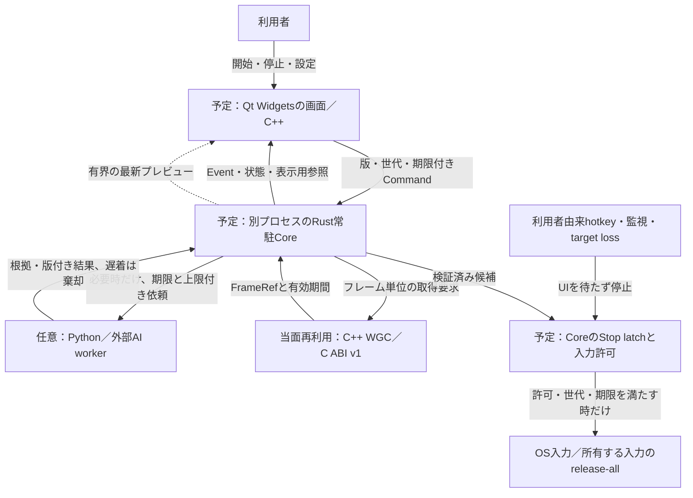

# Qtの画面とRustの常駐Coreへ移る設計

[全体案内](../guide/README.md) ｜ [完成形と現在](../guide/target_and_current.md) ｜ [配置の入口](README.md)

## 決定と、現在動いている構成

[Issue #661](https://github.com/tomiya7688/AI_game_player/issues/661) の決定により、恒久GUIは **Qt 6 Widgetsを使うC++のネイティブ画面**、常駐する実行・状態・操作許可の中心は **Rust Core** とします。Qt WebEngine、埋め込みWebView、WebView2、Chromium、Electron、Tauri、Wailsは使いません。Go GUIも今回は採用しません。外部のWebページはOSの既定ブラウザで開きます。

これは採用方針の確定です。**Qt Shell、Rust常駐プロセス、両者の接続、安全制御の移行は未実装**です。現在の画面はTkinter、主制御・認識・判断・評価はPython、任意のWGC取得・前処理・決定論的検証はC++です。既存C ABI v1、Python実装、Tkinter、Windows E2Eを移行中も維持します。現在の配布入口はPyInstallerと既存Native DLLであり、Qt DLLを配布済みとは扱いません。確認基準は `main@c634588` のソースと #661 コメント2件です。Qt/Rustの実機性能・配布適合は未確認です。

統合資料は親 `ba195cf9`（#662、#660 `3613b4`とmain `507d`を含む）へ同期しました。既存の数値Core・任意Planner・認識・Safety修正は維持し、アルゴリズムやGUIを変更するPRではありません。Windows比較の最終受入は検証中で、過去headの合格、Linux数値fixture、Chromium実画面、Windows OS入力を相互の合格証拠へ転用しません。[現在の実行・測定・未確認事項](planner_runtime.md)を参照してください。

Windowsのplanning通信には、旧readerを開いたままの公開20回とnative HANDLE経路30ケースの実OS証拠があります。この部分の解決を、残るscore/worker/gameplay全体の合格にはしません。親の評価専用Otsu panel、短比較だけのWGC待ちprofile、既存期限内の有界fresh再取得、決定的な最終checkpoint再読fixtureを保持し、新Windows結果で受入れを確認します。既存の実3秒再観測制約や通常600秒gateを広げた意味にも、Qt/Rustの実装証拠にも扱いません。

実験用の独立Chromiumが参照ゲームを開く場合も、製品GUIへブラウザエンジンを組み込む設計ではありません。これはゲーム側の検証環境で、恒久GUIのQt Widgets採用と区別します。

新しい親では、Sourceの取得要求より新しい物理Frameを要求するbarrier、厳密な空ABSTAIN通知、比較だけの有界保留継続、全foreground支持の数値ROIとraw engine/model診断を追加しています。既存の予算・guard・GUIは維持します。Windowsの0画像fixture失敗や各cohortの失敗は保持し、診断やLinux再生だけで解決済みにしません。

## 完成時の実行場所（全てtarget/planned）

Qtは画面の描画、選択、操作要求（Command）の生成と結果表示を担当します。Qtの操作時に呼ばれる処理（callback）にゲームの繰り返し実行、OS入力、最終Safety判定を置きません。Rustはフレーム・状態・判断の依頼先・時間予算・入力許可を管理します。AIや学習は必要時に動かす処理プロセス（worker）へ委譲し、Pythonが無い、モデルが止まる、UIが固まる場合でもCoreの状態照会と停止を成立させます。Rustプロセス自体の喪失に対する、期限付き入力権（lease）と独立監視（watchdog）も別途検証し、Rustを使うだけで安全としません。

Pythonの既存Planner/Evaluator等は移行中の参照実装として残ります。数学APIの「Core実装」とRustの「常駐Core」は異なります。数値JSON、版、出所、結果と予測の区別を保ち、GUI変更だけを理由に数学契約や判断手法を捨てません。対象ゲーム専用の簡易化もしません。

## 予定する境界と失敗時の責任

| 境界 | 受け取る情報と返す情報 | 失敗・上限・所有権 |
|---|---|---|
| Qt→Rust | versioned Command、session/target参照、source/action世代、単調の操作連番、期限。受理/拒否Eventを返す | 未知版・不正長・重複・古い世代・期限切れを拒否。ゲーム座標への無制限入力口を作らない |
| Rust→Qt | Event / Status、選択用の安定した参照、actual receiptと候補hypotheticalを分けた表示model | Qt UI threadへqueued delivery。通常eventに上限を設け、欠落件数を表示。未確認状態は成功に見せない |
| Stop | 通常仕事と別の優先制御路。latch、世代失効、release-all完了状態 | preview/AI/ディスクIO/通常queueの完了を待たない。StartはStopを解除しない。明示rearmを停止境界で検証 |
| Rust↔C++ | C ABIの版、構造体size/alignment、frameの幅/高さ/stride/format/byte長、opaque handle | owner/borrow/lease・close/release順を明記。Rustのsafe型だけでC++の寿命を保証しない。#115/#652/#233で並行解放を検査 |
| Frame preview | FrameRef＋lease、frame/source世代・時刻。共有メモリまたは必要なコピー | 有界latest-frame queueで古い未読frameを置換し、一度だけ解放。UI切断・target切替・resize時もleaseを回収。zero-copyは実測前に主張しない |
| 任意worker | observation/candidate-set/decision/batch単位の要求、予算、版、出所 | Python/AI停止時は期限で打切り、遅い結果を現世代へ再利用しない。pixel/token/候補一件ごとのIPCは禁止 |

Command/Event/Status/Stopのwire schemaとcodecは #665、bridgeとframe所有権は #666 で確定し、今は実在APIとしません。queueの件数・byte・時間の上限は初回実装のversioned設定に含め、起動時に検証します。Stop路の優先性はqueueを別にする宣言だけで証明せず、飽和・切断・worker crashを故障注入して確認します。大画像はFrameRefで識別し、共有メモリとコピーの速度・寿命・配布負荷を比較して選びます。

例えば得点欄をクリックした場合、入力受理Eventは「送信された」という事実です。ゲームが進んだという意味にはしません。操作後の新しい観測とreceiptを対応させ、結果が不明なら不明のまま表示・保存します。Qtへの表示イベントが遅れても、旧画面の入力権を復活させません。

## 時計の基準を混同しない

現互換のFailSafeRuntimeは既定`time.time`を使い、永続leaseと外部watchdogが同じwall clock（実日時の時計）を参照します。Frameの`captured_at`とPlannerはmonotonic/QPC（経過時間を測る時計）で、Source age検査はその領域内で行います。Safety callbackの完了時刻は既存の別clockで記録します。**既存の全deadlineがmonotonicへ統一済みとはしません。** #669は有限性・型の数値境界だけで、clock移行・rollback全般やRust安全停止の完成ではありません。[現FailSafeの時計前提](../FailSafeRuntime説明書.md)を維持します。

将来のRust `Instant`、Qt/C++ QPC、Python monotonicのraw値を、名前が同じというだけで跨いで比較しません。clock-domain、epoch、skew、量子化と不確かさを定義し、実測で共有を確認したclockか、配送遅延も含め親deadlineを延長しないCore受領基準の変換だけを使います。`BeliefContext.clock_id`/親deadlineとworker elapsedを分離し、不明・変換不能なら拒否します。これは #665/#666 の受入条件で、今回新clockを実装した意味ではありません。

具体的な負例として、Windows診断head `1d5192`・seed481では、両方QPC表記でもWGC生産時刻`793906250000ns`がhost受領`793905507500ns`より`742500ns`未来でした。時刻を書き換えたり、無根拠の許容幅を足して適合扱いにしません。現互換の対応は不適合WGCを破棄し同じ対象からGDIを新規取得する検証で、GDIにも通常のclock/barrier/age検査が必要です。[負例・fallback・最新Windows未確認事項](planner_runtime.md)と #666 に記録しました。QPCというmetadata名だけでepochや変換の正しさを証明できない例であり、Rust時計移行の完了証拠ではありません。

## 判断上の保留と、制御の停止を分ける

現Tkinter GUIのGameSessionは、ABSTAIN/withheldという非SELECT結果でSession全体を停止します。今回GUIは変更しません。新しいWindows短比較profileだけは最大12 decision attemptsとし、通常のABSTAINも1試行を消費します。NoInputを監査し、receiptや盤面変化を加算せず、同Run世代を確認して取得要求より新しい物理観測で次の外側試行へ進みます。これは操作を伴わない保留で、control Stopの解除ではありません。

Stop、rearmによる世代変更、ESCALATE、target loss、例外は終了条件で、保留を理由にstart/rearmしません。既存の内部再観測3秒、観測TTL、capture age、外側試行数、min3actual/score/Stop/staleの受入条件を維持します。厳密な空ABSTAIN通知は完成checkpointやSELECTの期限を緩める根拠ではありません。Rust Core #665の受入も、domainの保留とcontrol Stopを別の型として扱い、保留継続を有限quota/期限/世代/freshness付きに限定します。現GUIがこの継続方式へ移行済み、またはRustのStopが実装済みとは記しません。

## 4つの実装PRと既存Issueの接続

| 成果物（いずれも未実装） | 独立Issue | 完了の単位 |
|---|---|---|
| Qt Widgets IDE Shell＋Native UI smoke | [#664](https://github.com/tomiya7688/AI_game_player/issues/664) | ペイン、dock/resize、Workspace、Player Seat mount、IME/keyboard/high DPI/accessibility。#137は旧Tk Shellの完了。#138–#141は新mount/view-modelへ適合 |
| Rust常駐Core＋版付きCommand/Event/Status/Stop | [#665](https://github.com/tomiya7688/AI_game_player/issues/665) | Pythonなしのheadless起動、schema/世代/期限/queue、独立Stopのfake backend契約 |
| Qt⇔Rust bridge／FrameRef preview／旧GUI共存 | [#666](https://github.com/tomiya7688/AI_game_player/issues/666) | queued UI更新、frame lease、切断・resize・飽和、停止境界の切替。#115/#652のNative寿命検査と接続 |
| Safety・実入力権の移行＋Windows E2E | [#667](https://github.com/tomiya7688/AI_game_player/issues/667) | UI/worker故障時のStop/release-all、二重controller拒否、旧E2E保持、実測とrollback |

#664/#665→#666→#667の順に接続します。UI単体smoke、Core契約、bridge契約、実入力E2Eは別の証拠です。利用者にCargo/CMake/MSVC/Python/Node/SDKの手動導入を要求しない配布は #149、Qt実物のinventory/noticeは #228、DLL改変版の差替えは #663 です。資料入口と日本語図は #606 を再利用します。

## 今回の統合作業の監査（2026-11-01時点）

他担当のworktreeや未コミットファイルを変更せず、rootと担当へ本決定を通知しました。過去の実プレイ証拠の基準commitを未来のRust実装へ書き換えません。

| PR | 判定と維持する境界 |
|---|---|
| #640 | 独立テストゲーム集のTkinterは検証fixture。製品の恒久GUIの選定を代替しない。既存ゲーム/実入力検証を維持 |
| #654 | 現Python/Tkinter/C++の統合資料と歴史的根拠。今後の構成は本ページを正本とし、現状図をQt実装済みに書き換えない |
| #657 | Pythonの6軸評価参照API。actual/候補予測・NumericQuality・欠損/版/出所はUI非依存、移行契約へ保持 |
| #658 | Pythonの有界Expectimax/MPC参照API。数学/予算/worker結果契約を保持。Rust常駐Core実装と混同しない |
| #656 | PythonのVOI/下側リスク参照API。「Core」は数学参照実装。Qt/Rust未実装、将来optional workerの結果契約を維持 |
| #660 | Plannerの実行接続とplayability証拠は旧互換Runtime。UI非依存の判断・receipt・Safety契約を維持し、Qt切替で証拠を失わない |
| #662 | ROI/認識・Windows診断修正は旧互換側。認識成功を入力許可に変換せず、数値/画像の検証と最終Windows受入を区別。Rust化だけを理由に破棄しない |
| #651 / #655 / #669 | 現Native/Python Safetyの非有限値・型の境界修正。現在の実装として維持し、時計移行やRust安全停止の証明へ拡張しない |

この監査は採用方式との整合です。各PRのrequired CI/reviewを免除せず、実装済みとの主張も拡張しません。統合したExpectimax/Planning Riskの領域資料に「Python数値参照」と「Rust常駐Core」を区別する注記を加え、Planner Runtimeの旧互換表記と整合しました。元の数学・実行・測定根拠は保持します。

## 実機・性能の採用gate（全て未確認）

採用するのは、プロセス分離、版付きメッセージ、世代で古い要求を拒否する方式、有界producer/consumer queue、leaseによる寿命管理、故障注入による停止検証です。新しい学習モデルを導入する変更ではありません。既存の[`RunController`](../../src/ai_game_player/run_control.py)、[`ExecutionReceipt`](../../src/ai_game_player/execution_receipt.py)、[`SharedFrameProducer`](../../src/ai_game_player/shared_frame_producer.py)の実装を参照しつつ、Rust/Qtで同じ契約が成立するかを #665–#667 で改めて検証します。現Pythonのテスト合格をRustの証拠へ転用しません。Qt UI threadへの更新は[Qtのthread/queued connection規約](https://doc.qt.io/qt-6/threads-qobject.html)、C++との所有権境界は[Rust FFIの安全責務](https://doc.rust-lang.org/nomicon/ffi.html)に従い具体化します。

Qtが最小RAMとは仮定しません。同一Windows機材・OS・版・profile・seed・ゲーム・targetサイズ・preview設定を固定し、現Tk版とQt/Rust版を比較します。startupは起動要求から操作可能まで、idleは安定した観測期間のPrivate Bytes/Working SetとCPU、previewはoff/onの差とコピーbytes、frame配送は取得時刻からUI表示までを測ります。Stopは要求→latch→最後の送信→所有inputのrelease-allまでを分けます。全てsample数・p50/p95/p99・最大・失敗/欠損件数を保存します。

画面・常駐Core・必要時workerを個別と製品process-tree合計で記録し、ゲームや実験用browser、モデルの占有範囲も別に明示します。経過時間の測定と永続leaseのwall時刻を混ぜず、跨ぐ区間は検証したclock変換または不確かさ付きの測定条件を残します。

基準測定後、#664–#667で数値予算と許容差を採用前に固定します。未測定値を合格としません。UI freeze、worker kill、通常queue/preview飽和、target喪失、開始時Stop、古い世代、DLL欠損、不適合版、二重GUIを検査します。契約fixture、Windows実入力、実ゲームの攻略性能を分け、成功した例だけで比較しません。悪化時は原因と上限を修正し、入力権は旧構成へ停止境界で戻せるようにします。

## Qtの配布gate（未完了）

#661のライセンスコメントは一般的な組合せと文書の照合です。法的最終判断、実Qtバイナリの監査、release承認ではありません。first-party MITとthird-party QtのLGPL等を区別します。Qt Widgets採用によって配布物全体がMIT-onlyにはなりません。

- 動的Qt Core/Gui/Widgetsと必要pluginの版・source/hash/license/notice・対応ソース提供方法を実artifactから #228 で検査。GPL-only moduleを無断追加しない。
- #663で利用者の互換改変Qt DLLへの差替えと実起動、署名/更新/launcherが権利を妨げないことを確認。単にwindeployqtが成功しても適合完了としない。
- #149で移動可能なclean Windows bundleと必要runtime/pluginを確認。Qt GUI smokeの合格だけで配布可とせず、未確認gateがあればreleaseを止める。

公式参照：[Qt Widgetsのライセンス](https://doc.qt.io/qt-6/qtwidgets-index.html#licenses)、[LGPL義務](https://www.qt.io/development/open-source-lgpl-obligations)、[Windows配布](https://doc.qt.io/qt-6/windows-deployment.html)、[LGPLv3](https://www.gnu.org/licenses/lgpl-3.0.html)。適用版と実物の確認は配布時に行います。

## 機械向け宣言と検査の範囲

[`runtime_boundary.json`](../../config/runtime_boundary.json) の既存schema/contract_version/capabilities/componentsは現行ABIの宣言です。追加の`target_architecture`は別schemaの`planned`、配布は`unverified`で、Rust/Qt実装や新capabilityを偽装しません。旧v1 manifestは引き続き受理します。

[`runtime_target_check.py`](../../tools/runtime_target_check.py) を既存boundary checkerから呼び、Qt Widgets/非WebView、Rust別プロセス、任意Python、独立Stop、既存互換、未確認release gateの取り違えを検出します。これは宣言検査です。Rust起動・Qt描画・Windows Stop・RAM・Qt配布を実測した証拠にはなりません。
