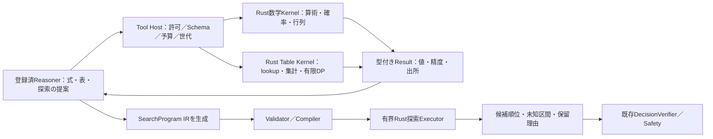

# Reasonerの計算コマンド・表計算・自己生成探索の実行設計

[自己進化Reasoner](self_evolving_reasoner.md) ｜ [汎用評価v2](generic_evaluation_v2.md) ｜ [統合設計マップ](system_design_map.md)

> **状態：目標設計／未実装を含む。** 仕様根拠は[#775 Calculator](https://github.com/tomiya7688/AI_game_player/issues/775)、[#776 Table](https://github.com/tomiya7688/AI_game_player/issues/776)、[#777 Tool Host](https://github.com/tomiya7688/AI_game_player/issues/777)、[#778 Search IR](https://github.com/tomiya7688/AI_game_player/issues/778)、[#779 Executor](https://github.com/tomiya7688/AI_game_player/issues/779)、[#781 Runtime接続](https://github.com/tomiya7688/AI_game_player/issues/781)。mainの確認起点は`a6aaf85f56371d081cfb2fcd8ee1d357091a436c`。ここに示すAPI形は実装予定の契約であり、配布済みインターフェースではありません。

## 1. 計算できることは、推論能力の一部

LLMに毎回暗算や確率の小数展開をさせるのは、速度・精度・費用の面で不利です。賢者ミスクは**式や仮説を考えるReasoner**と、**決定論的に数値を計算する小さなCompute Machine**を分けます（[コマンド指向の原設計](../コマンド指向.md)）。通常の単純計算には巨大なモデルもPython Runtimeも必要としない構成が目標です。



ホストがToolの結果を受け取って終わりではありません。**その結果が次のReasoningまたは候補順位へ実際に利用された証拠**が必要です。モデルが持ち込んだ未知の仮定を正しい算術で計算しても、ゲーム内の真実まで確定したことにはなりません。

## 2. 登録するCompute能力

| 能力／Schema | 操作例 | 入出力上の注意 |
|---|---|---|
| `math.compute/v1` | 四則演算、整数累乗、階乗／組合せ／順列、条件付き確率、Bayes、二項、期待値・分散、softmax、ベクトル／小行列 | `INTEGER/RATIONAL/DECIMAL/FLOAT64`、単位、丸め、`exact`、error boundまたは`UNVERIFIED` |
| `compute.table/v1` | typed filter、lookup／interpolate、join、group-by集計、分布期待値、有限遷移、Bellman backup | `table_id/revision/content_digest`、Source、missing、観測か仮説か、partial/capacity |
| ReasonerのTool Call | `compute.math`／`compute.table`の許可済Descriptorを呼ぶ | `call_id, payload_hash, task_id, scope/frame/epoch, consent, deadline, budget` |
| `SearchProgramV1` | 生成候補・仮想遷移・評価・分岐・pruning・root選択を有界グラフとして記述 | モデル文字列の`eval`でなく、検査済みOperator IRとSource ref |

### 計算例（仮想入力）

Reasonerが「`P(A∩B)=1/6`、`P(B)=1/3`なら`P(A|B)`は？」と要求したとします。

```text
ToolRequest: math.compute/v1
operation: conditional_probability
operands: RATIONAL(1,6), RATIONAL(1,3)
Result: RATIONAL(1,2), exact=true, source_inputs_digest=...
```

算術は厳密ですが、`1/6`と`1/3`がゲームの世界で校正済みかは別の問いです。Sourceがモデル自己申告なら、結果にもその由来を残します。`P(B)=0`、除零、NaN/Inf、単位不一致、期限切れは型付き失敗であり、確率0に変換しません。

表計算の例：`[{reward:1,p:0.2},{reward:0,p:0.8}]`に対する期待値は`0.2`。しかし`p`が単なる未校正Scoreなら、`0.2`を現実の期待報酬とは呼びません。lookupでキーが無いときは`UNKNOWN`、同じキーに異なる行があるときは`AMBIGUOUS`、範囲外の外挿は原則無効です。

## 3. 数値の意味・誤差・上限

Rust Kernelは型付き値のみを受け付け、直接Frame／モデル／OS／ファイルパスを扱わない。Reasonerの入力文字列をKernelの任意演算コードへ変換しません。

- `RATIONAL`は分子／分母と符号・桁上限を検査。整数・有理の厳密演算と、`FLOAT64`や非線形関数の近似を区別する。
- probabilityではsample space／条件付け／入力の出所を明示する。「独立だから掛けてよい」をモデルの雰囲気から自動判定しない。
- Tableの`observed`と`hypothetical`は別で、見えていないstateや仮想遷移を実入力Receiptと同等には扱わない。
- 未対応演算・負確率・合計0の正規化・Overflow・行列次元不一致・不定値は`INVALID/CAPACITY/UNSTABLE/UNKNOWN`など原因付きで返す。
- 初期工程の目安はMath要求64KiB・50ms、Table最大16,384行／32列・16MiB・query50msなど**有限のProfile**。実装の上限値は各子IssueとそのSchemaで確定し、負荷計測（p50/p95、RSS、CPU、失敗率）に従って調整する。上限超過を黙ってtruncateして全件処理済みとは言わない。

このKernelは**高速な基礎能力**ですが、その存在だけではReasonerが使っているとは言えません。Tool Hostで発行した本物のCall、数値検証、次Model入力とDecisionへの作用が[#777](https://github.com/tomiya7688/AI_game_player/issues/777)／[#781](https://github.com/tomiya7688/AI_game_player/issues/781)の受入です。

## 4. Reasoner Tool Hostと権限境界

Tool Hostは`ToolDescriptor`のallowlistと、Taskの`capability/schema/source/epoch/consent/resource_budget`を照合します。モデルの返信にある`shell`、`python.eval`、任意URL、ファイル書き込み、OS mouse/keyコマンドは**登録されていない**ため拒否。数値Toolの結果はRead-onlyのデータであり、実入力権に昇格しません。

呼出し中は`Task/Step/Frame/Goal/Run generation`と親deadlineを固定します。同じ`call_id + payload_hash`の再送には同一結果を返せますが、同IDで別payloadなら`CONFLICT`。Stop・Target変更・Scene変更・期限を過ぎて返ったTool結果は`STALE`で、今の判断に再利用しません。

Tool callの鎖・呼出し数・結果bytesには総予算が必要です。低価値の計算でモデルへ何度も再問い合わせせず、単純な計算はCore内Kernelだけで完了します。利用可能でないKernelには`UNAVAILABLE`を返し、ダミーの数値を実計算として捏造しません。従来のPython数値参照実装は互換テストに使用できますが、将来の常駐Rust Coreの成立を意味しません。

## 5. SearchProgramは評価式とは別のプログラム

「HPが減るほど悪い」という式はEvaluatorですが、「2手先で反撃されるなら今の攻撃を控える」は**探索方法**です。賢者ミスク自身が探索の演算子・順序・深さ・バックアップ法を組み立てられるようにします。

```text
GENERATE_ACTIONS(現在のAllowed Root候補)
  → APPLY_TRANSITION_HYPOTHESIS(Belief/世界仮説)
  → BRANCH_CHANCE(known chance / unknown residual)
  → SCORE_STATE(候補Evaluator)
  → AGGREGATE(MAX | MIN | EXPECTED | LOWER_BOUND | CVaR-like)
  → EXPAND(depth/beam/rollout/node budget)
  → PRUNE(証明済みbound or heuristicを区別)
  → SELECT(root ID | OBSERVE_MORE | ABSTAIN)
```

許可するIRは版付きの型付きDAGと有限LOOPだけです。Depth・branch・node・result bytes・時間・外部Worker呼出し回数を検証し、無限再帰・任意Sourceコード・OS入力を拒否。`one_step_greedy/minimax/expectimax/beam_search/rollout/MCTS/VOI/hybrid`は**登録済演算子の組合せ例**であり、Gameごとの固定bestmove関数をCoreに埋め込まない（[#778](https://github.com/tomiya7688/AI_game_player/issues/778)）。

### 探索結果の責務

`SearchExecutionResult`は`selected_root_candidate_id, rankings, intervals, unknown_mass, completed_depth, expanded_nodes, cost, program_hash, exit_status`を持つ**仮想的な候補評価**です。過去の仮想Stateを次の現実のFrameとして使わず、全ての根元候補を現行Allowed集合へ再対応づけます。Refereeの隠れた盤面・正解ルートを通常GUI AIへ渡さず、専門エンジンBestMoveとの混在は出所区分します（[#782](https://github.com/tomiya7688/AI_game_player/issues/782)）。

Rust Executor（[#779](https://github.com/tomiya7688/AI_game_player/issues/779)）は、初めに軽量なRoot評価を作り、残りの実時間で深さやbranchを更新する**anytime実行**を狙います。Partial結果の深さを完成済みと偽らず、unknown massと削ったbranchを監査する。高価なLLM leafは一つずつ呼ばずbounded batchへ。Cacheは`program/transition/model/goal/belief/epoch`をキーにし、旧Frameへ流用しません。

## 6. 自作探索の改善と適格性

例：初期仮説「攻撃Aで+1、守りBで0」なら1手のGreedyはAを選ぶ。しかしFresh Afterから相手反撃の規則を支持するEvidenceが増えた場合、Reasonerが相手の`MIN`分岐を追加した2手探索を新IRとして生成し、結果`A=-2,B=0`に変わる、というToy fixtureを用意します。

この**構造変更が実Programで動いた**ことと、**本当にゲームで強くなった**ことは別の証拠です。前者はIR/Executor/Session接続試験、後者は[#780](https://github.com/tomiya7688/AI_game_player/issues/780)の独立holdout・実Outcomeで比較します。Championより悪ければ棄却・旧版保持。全ての実操作は従来どおりVerifier/Safety/Stopを通し、探索Programから直接入力しない。

またオセロAlphaBetaや将棋USIを直接利用した場合は製品の`SPECIALIST_SOLVER_ASSISTED`能力として報告できますが、賢者ミスクが探索構造を自作した`SELF_DERIVED`には算入しません。詳細は[#782](https://github.com/tomiya7688/AI_game_player/issues/782)。

## 7. 実装・テスト・配布のGate

| 段階 | 完了条件 | 未完と判断する例 |
|---|---|---|
| #775 Math Core | 厳密/近似・誤差・異常値・容量・性能のRust単体試験 | Python/LLMの出力だけで数値を称する |
| #776 Table Core | lookup、集計、確率・有限DP、missing／sourceの型と境界 | SQL/任意Scriptを実行し、欠損を0補完する |
| #777 Tool Host | 本物のReasoner Call→Kernel→次Reasoning→候補順位への使用 | Toolが呼ばれず、JSONログだけ残る |
| #778 Search IR | 未知ゲームでReasonerが構造の異なるProgramを生成・検証 | 固定AlphaBeta/USIを選択するだけ |
| #779 Executor | IRが有界な仮想探索を実行、Stop・unknown・Partialを守る | 探索中にOS入力／無限呼出し、未完を成功扱い |
| #781 Runtime | 現行SessionのGoal/allowed/receipt/traceに接続 | 単体クラスだけ、専門Solverで代行 |
| #782 Intrinsic Gate | SELF_DERIVEDと手作り/外部Solver補助を全手で区分 | 借り物の勝率を自己学習の実力として計上 |

新しい数値クレートや依存ライブラリの版・ライセンスは[#228](https://github.com/tomiya7688/AI_game_player/issues/228)と[製品ライセンス意図](../../LICENSE_INTENT.md)で検証します。Core/GUIの恒久配置は[Qt Widgets＋Rust Core](qt_rust_migration.md)を優先し、配布時に多数の巨大モデル／別Office／ブラウザエンジンを必要としない。検証時は実行環境・データ・モデル・seed・費用・性能値・失敗例を保持し、設計を作っただけで実現済みと表示しません。
