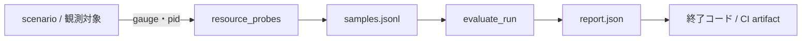

# Long-session Resource Stability Gate

最終確認日: 2026-11-07 / 状態: 実装済み（今回のスライス） / 関連: [設計書 #787](../design/issue-787-long-session-resource-stability-gate.md)・[Runtime Resource Lifecycle (#786)](runtime_resource_lifecycle.md)・Issue #250（実機30分run）

## 目的

長時間のSessionで資源量が単調増加し続けないことを、peakだけでなく「warmup後の傾き」「Session終了後の回収」「複数Session反復のbaseline」で判定します。測れない資源は成功扱いにせず、`unsupported`として一覧に残します。固定のRAM上限は主判定にしません。

## 構成

| 部品 | 役割 |
|---|---|
| `src/ai_game_player/runtime/resource_stability.py` | 判定core（純粋）。profile検証、統計、`evaluate_run`、report生成。I/Oなし |
| `src/ai_game_player/runtime/resource_probes.py` | OS probe。RSS/private/handle/GDI/USER、process tree、temp走査、nvidia-smi、tracemalloc、`ResourceLifecycleSnapshot` v1変換 |
| `config/resource_stability_profile.json` | 層×実行profile別の許容値・warmup・区間数。hard limitはコード側 |
| `config/resource_stability_{report,sample}.schema.json` | report v1 / samples行 v1 |
| `tools/run_resource_stability.py` | CLI `run` / `evaluate` / `list-scenarios` |
| `tools/resource_stability_scenarios.py` | fake資源世界、pass期待scenario、fail期待のcanary |

## 使い方

```text
# fast gate（決定論的。pass scenarioとcanaryを全て実行）
PYTHONPATH=src python tools/run_resource_stability.py run --layer fast --run-profile fast
# 既存commandのprocess treeを観測（integration層。Windowsのcampaign等）
python tools/run_resource_stability.py run --layer integration --run-profile pr -- COMMAND ...
# #250等が保存したsamples.jsonlを同じ判定関数で評価
python tools/run_resource_stability.py evaluate --samples S.jsonl --output R.json
```

終了コード: 2=不正入力（profile・層×profileの組合せ・header欠落）、1=観測対象commandの失敗／canary未検出／`enforcement`が`enforce`でfail、0=pass、または`enforcement.integration`が`observe`でfail（reportと`::warning`のみ）。緩和用の引数・環境変数は無く、`enforce`/`observe`はprofileの`enforcement.<layer>`だけで決まります。

## 判定の流れ



判定は、成長（区間中央値の差とTheil-Sen傾きの一致、または片方が許容の2倍超）、宣言した上限、Session終了後の回収（`declared_retained`差引後）、2番目以降のSessionのbaseline drift・階段状増加、欠測（5%超でunreliable）、孤児processです。1標本だけのspikeは成長ではなくpeak・p95と宣言ceilingで扱います。

## CI

- `.github/workflows/resource-stability-ci.yml`: fast gateを`ubuntu-latest`/`windows-latest`で常時。
- `.github/workflows/resource-stability-deep.yml`: deepは週次とdispatchのみ。PR・pushのcheck一覧にskippedとして現れ、マージgateを止めないよう別workflowに分けた。
- `language-ci.yml`の`windows-e2e`: 600秒campaignを`--layer integration`で包み、`build/resource-stability`をartifact保存。最初は`enforcement.integration: observe`。
- required checksの集合は変えません。候補job名は`Resource stability fast gate (ubuntu-latest)`・`Resource stability fast gate (windows-latest)`で、追加はownerの判断です。

## 範囲外・残件

実`SessionResourceRegistry`との結線（#786実装後）、#250の実機30分harnessとGPU実測、integrationの`enforce`切替（CI実測3回以上の後）、campaign `--profile release`の週次観測、Native counter公開、`storage.*`（#18）。
