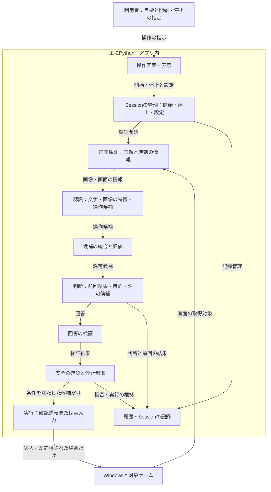
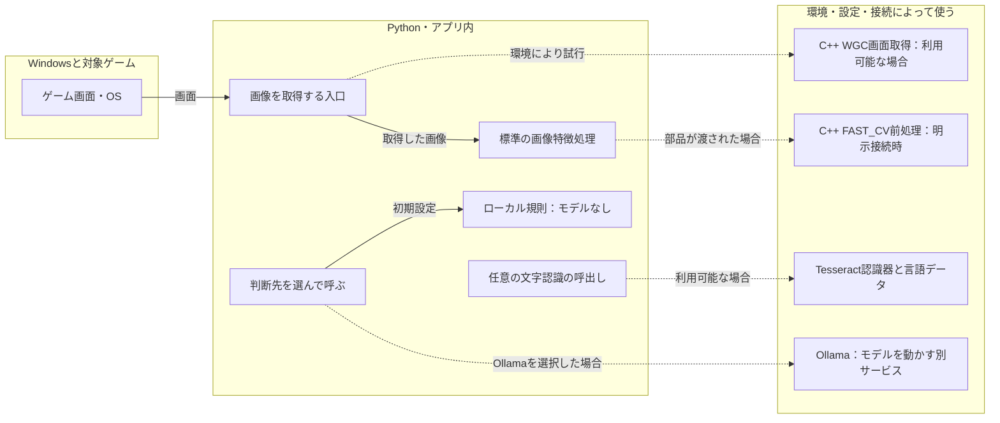
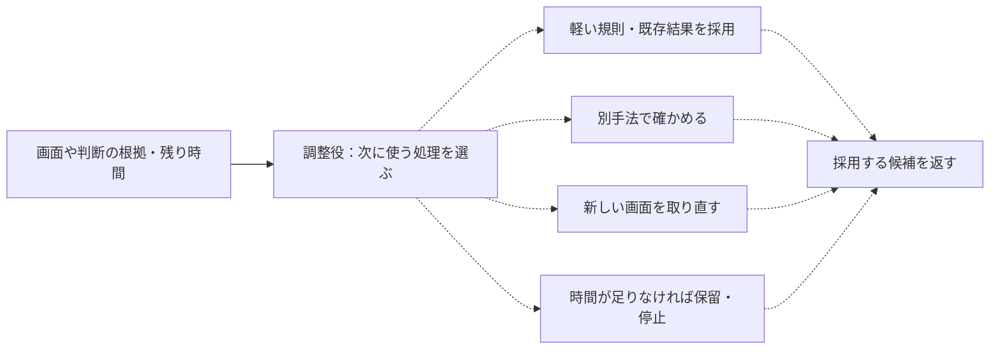

# どの部品がどこで動く？

[見取り図の索引へ戻る](README.md) ｜ [一回の流れを見る](flow_for_readers.md)

**最初に知ってほしいこと：** ゲームの画面を見て判断する部分、安全に入力する部分、結果を記録する部分は別の役割です。Pythonの部品、C++の任意処理、Ollamaのような別サービスも混同しません。

## 図1：現在の標準構成（部品の役割）

これは役割をまとめた図で、すべての関数呼出しを一対一に描くものではありません。とくに画面取得・候補の統合・候補評価は複数の部品が関係します。**安全確認を通らない、AIからゲーム入力への直通矢印はありません。** 文字や画像の認識が成功したことと、入力許可は別の判断です。

## 図2：基本経路と、条件付きで使う実行基盤

**実線は基本の経路、点線は条件付きの経路**です。図の上下や左右の位置はPCの物理的な設置位置を確定しません。Ollamaの接続先が同じPCか別PCかは、実際の設定・ネットワークに依存します。モデルの画像対応能力は、現行の判断APIが画素画像を送信していることの証拠ではありません。

画面取得のC++ WGC（Windowsの画面取得方式）と、画像前処理のC++ FAST_CVは**異なる処理**です。標準の画像前処理を「必ずC++」とは書きません。Tesseractは文字認識の任意依存で、存在を宣言しただけで言語データの版や動作成功が確定するわけではありません。

## 図3：処理を選ぶ調整役の目指す設計（未確認の拡張）

**この図は将来の調整方針の例であり、すべてが標準で動いているという説明ではありません。** 各場所の調整役には、複数手法の照合、処理時間と改善見込み、前段の結果を使った選択が求められています。重いモデルを常に大量に起動する設計ではありません。詳しい採用手法・接続・検査は [#611](https://github.com/tomiya7688/AI_game_player/issues/611) で対応させます。調整役が安全規則を飛ばすことはできません。

## 実装状態の読み分け

| 処理 | 部品の確認 | 標準接続の説明 | 実機確認 |
|---|---|---|---|
| Pythonの画像特徴・候補作成 | ソースあり | 標準の認識・候補作成経路を確認 | この資料では未実施 |
| ローカル規則の操作選択 | ソースあり | 既定の判断先に登録 | この資料では未実施 |
| Ollamaの操作選択 | 接続用部品あり | 利用者が選択した場合 | サーバー起動・モデル読込は未確認 |
| 任意のTesseract文字認識 | 呼出し部品あり | 依存が利用可能な場合 | 言語データと実動作は未確認 |
| C++ WGCによる画面取得 | 利用可能な実装を試すコードあり | 環境・条件依存の試行と代替経路 | DLL・Windows実機は未確認 |
| C++ FAST_CV画像前処理 | Native Runtime側の部品あり | 明示的に渡す場合 | この資料では未確認 |
| 重みや時間を更新して処理を選ぶ仕組み | 要求・部分的な関連部品あり | 統一された標準接続は未確認 | この資料では未確認 |

「未確認」は「存在しない」という断定ではありません。表は標準経路を中心に読み取った範囲で、あらゆる拡張・プラグイン・ゲーム固有部品を網羅した監査ではありません。静的な図で特定PCのGPU、VRAM、実モデルのハッシュ、推論時間を決められません。

## どのソースを見たか

2026-10-31、main `4d8ae6f` の読み取り：

- [`runtime/session_composition.py`](../../src/ai_game_player/runtime/session_composition.py)：標準の判断先を組み立てる部分。
- [`observation_service.py`](../../src/ai_game_player/observation_service.py)、[`frame_analyzer.py`](../../src/ai_game_player/frame_analyzer.py)、[`ocr_recognizer.py`](../../src/ai_game_player/ocr_recognizer.py)：観測と画像・文字。
- [`screen_capture.py`](../../src/ai_game_player/screen_capture.py)：画面取得方式と失敗時の切替。
- [`candidate_merger.py`](../../src/ai_game_player/candidate_merger.py)、[`engine.py`](../../src/ai_game_player/engine.py)：候補の統合と判断。
- [`provider.py`](../../src/ai_game_player/provider.py)、[`config.py`](../../src/ai_game_player/config.py)：ルール・Ollamaと設定。
- [`pipeline.py`](../../src/ai_game_player/pipeline.py)：実行と安全確認の接点。
- [Native Runtime境界の既存説明](native_runtime_boundary.md)：C++ ABIと速度の測定対象。

残作業は[#608](https://github.com/tomiya7688/AI_game_player/issues/608)、モデル版と来歴は [#609](https://github.com/tomiya7688/AI_game_player/issues/609) で管理します。