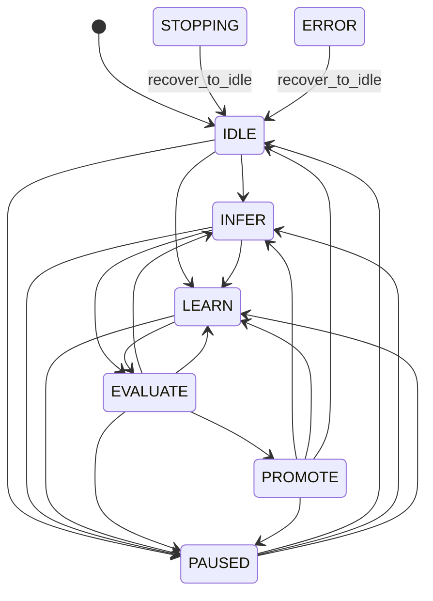

# Runtime Mode / Phase 契約

Issue #420 の基盤である #421 の実装契約です。Mode は利用者が選ぶ実行方針、Phase は現在の処理段階です。Mode の代わりに個別の学習 bool を持たず、宣言から Subsystem ごとの許可を導きます。既定は `INFERENCE_WITH_LIGHT_ADAPTATION`、起動直後の Phase は `IDLE` です。

## 正本と配置

- `runtime_mode_config.py`: 5 Mode・8 Phase・operation、Mode から導く能力、厳密な config 読取。
- `runtime_mode_controller.py`: Mode 予約、安全境界、Phase 遷移、Step 固定、Stop と世代 CAS。
- `runtime_mode_state.py`: 不変 Snapshot / Step token、64 KiB 以下の checkpoint 検証。
- `runtime_mode_recorder.py`: 有界 metadata queue と既存 Event Journal / atomic JSON への明示 flush。
- `config/runtime_mode.schema.json`: JSON Schema 2020-12。Mode / Phase enum と、Mode ごとの派生 flag 制約。
- `config/runtime_mode.default.json`: 全派生 flag を含む既定 config。
- `config/runtime_mode_operations.json`: 5 Mode × 8 Phase の機械可読 operation 表。テストでコードと一致を確認します。

この制御は Mode の選択時、Phase 境界、Step の開始・終了、学習結果の公開時に行います。画素処理・OS 入力・緊急解放ではないため、既存 Python の `RunController` / `GameSessionController` / `EventJournal` と同じ層に置きます。Native Runtime や既存 FailSafe の入力制御を置き換えません。学習計算や Journal IO は短い制御区間から分離します。

## Mode と能力

| Mode | 推論・操作・Experience 保存 | Knowledge 読取 | 軽量更新・Knowledge build | 重学習 | 学習 Artifact 評価・昇格 |
|---|---|---|---|---|---|
| INFERENCE_ONLY | 有効 | 有効 | 無効 | 無効 | 無効 |
| LEARNING_ONLY | 無効 | 有効 | 有効 | 有効 | 有効 |
| INFERENCE_WITH_LEARNING | 有効 | 有効 | 有効 | 有効 | 有効 |
| ALTERNATING_INFER_LEARN | 有効（INFER のみ） | 有効 | 有効（LEARN 等） | 有効（LEARN のみ） | 有効（対応 Phase のみ） |
| INFERENCE_WITH_LIGHT_ADAPTATION | 有効 | 有効 | 有効 | 無効 | 有効 |

全 Mode / Phase で Safety Core は必要です。`evaluation_enabled` / `RuntimeOperation.ARTIFACT_EVALUATION` は学習した Knowledge / Model Artifact の評価を指します。通常の推論ループの Outcome 判定、Verifier、Safety 評価はこの flag で停止しません。互換名 `RuntimeOperation.EVALUATION` は同じ enum 値です。`INFERENCE_ONLY` でも観測 → 判断 → 入力 → Outcome / Safety → 次の観測は継続します。

`RuntimeModeConfig.from_dict()` は `schema_version` / `mode` / `resource_policy_id` を必須にします。派生項目は省略できますが、記載した場合は Mode から導いた値と型が一致しなければ拒否します。未知フィールド、未知版、bool 代わりの整数、自由なパスや credential 形式の識別子も拒否します。不正な保存 config を扱う host は `load_runtime_mode_config()` の既定 Light と `invalid_config` を記録し、IDLE から明示開始します。

`auto_promotion_policy=evaluated_safe_boundary` は評価済み・安全境界でのみ昇格可能という契約です。自動で job や昇格を起動する意味はありません。推論専用では `disabled`。`degrade_policy` は Learning Only で `pause_learning`、それ以外は `learning_first` です。資源量の測定と予算選択は #425 が `resource_policy_id` を解決します。

## Phase と遷移



すべての Phase から Stop で `STOPPING`、失敗で `ERROR` に移れます。図の遷移に加え Mode の能力検証が必要です。推論専用は `LEARN/EVALUATE/PROMOTE` へ移れず、Learning Only は `INFER` へ移れません。ALTERNATING の `INFER` では学習操作を許可しません。Light / 並行学習の `INFER` では許可された軽量更新と Artifact 評価を準備できますが、昇格は `PROMOTE` でだけ許可します。

`IDLE/PAUSED/STOPPING/ERROR` は Safety のみ許可します。`LEARN` は gameplay を止め、`EVALUATE` は Artifact 評価、`PROMOTE` は昇格に絞ります。`PROMOTE` へ入る前に `EVALUATE` で対象版と合格を記録します。失敗した評価は昇格を許可しません。外部の Promotion Gate は評価対象版・champion 期待版・証拠を引き続き照合し、公開する短い CAS だけを `run_if_allowed()` に渡します。

## 実在する Session / FailSafe との接続

```python
mode = RuntimeModeController(
    RuntimeModeConfig(),
    run_control=session_run_control,  # GameSessionController と同じインスタンス
    held_input_probe=input_kernel.has_held_inputs,
    journal=session_journal,
    state_path=mode_checkpoint_path,
)
mode.transition(RuntimePhase.INFER)
token = mode.begin_step(current_champion.version)
try:
    decision_pipeline.run_and_execute(expected_rearm_token=token.run_generation)
finally:
    mode.finish_step(token)
# 同じ worker の安全境界で pending Mode を適用。IO worker 等で明示 flush。
mode.apply_pending_mode()
mode.flush()
```

`DecisionPipeline.run_and_execute()` の呼出し例です。Session の通常の Outcome / Verifier / Safety 処理は同じ Step 内で継続します。#421 は既存 Session の constructor に追加の自動処理を差し込まず、共有 `RunController` を渡す薄い契約を実装します。実在 API の接続テストは `GameSessionController(factory, step, run_control=...)` を使い、Session Stop / 再起動で旧 Mode の実行世代が失効することを確認します。既存 `InputLedger.snapshot()` の held key / mouse からも probe を構成できます。#628 以後は公開された入力状態 probe を使用します。

`begin_step(artifact_version)` は INFER の一つの Step に所有 token を発行します。token は Controller 所有 ID、単調 sequence、Mode epoch、既存 Run 世代、Artifact 版を固定します。他 Controller の token、二重開始、旧 token の二重完了を拒否します。`finish_step()` は Stop 後も所有を解放できますが、処理を再開しません。

`request_mode(config)` は利用者選択と pending を記録し、現在の Mode / epoch / Step Artifact を変更しません。`apply_pending_mode()` は Step がなく、held input が明示的にない `IDLE/INFER/PAUSED` の境界で適用し、IDLE に戻して epoch を進めます。LEARN / EVALUATE / PROMOTE の途中の切替は拒否します。入力 probe の欠落・例外・非 bool は不明として学習・Mode 変更・昇格を拒否します。通常 INFER の開始に学習用 probe は要求しません。

`degrade(reason_code)` は並行学習 / 交互実行 → Light → Inference Only の順に軽くする pending を作り、利用者が選んだ Mode を保持します。既により制限された利用者要求が pending なら上書きしません。読取後に別の Mode が適用された縮退要求は版 CAS で拒否します。Learning Only は学習を PAUSED にし、入力処理を追加しません。

## Stop 優先と公開境界

`request_stop()` は停止 latch を最初に立て、共有 `RunController.stop()`、`STOPPING` metadata の順に適用します。遅い入力 probe や Journal IO を待ちません。probe は lock 外で取得し、その後 `RunController → Mode` の順に短い lock を取得し、Stop latch、Run 世代、metadata 版、期待 epoch、Step 境界を再検証します。Stop が遅い probe と競合した場合は停止が優先されます。明示再開だけは短い signal lock で停止要求の版と処理中件数も照合し、Run lock を待つ新しい Stop の latch を消去しません。この signal lock 内に probe / Journal IO はありません。

`permits(operation)` は準備を始めるための一時点の照合です。公開の許可ではありません。計算開始時の `snapshot.epoch` を保持し、結果を公開するときに `run_if_allowed(operation, expected_epoch, short_commit)` を使います。callback は準備済みの短いメモリ公開のみです。学習、LLM、入力 probe、Journal、ファイル書込を callback に含めてはいけません。停止前に完了した公開を遡って取り消す API ではありません。Safety Core は既存の入力解放等を継続するため Stop gate の対象外です。

既存入力 Executor / FailSafe は実入力の許可・target 生存・入力世代・held 解放を引き続き検査します。Mode の ACTION flag だけで OS 入力を許可しません。Mode の Stop は held 入力を勝手に解放済みと記録せず、host の解放と active Step の drain 後に `recover_to_idle()` を呼びます。回復後も停止 latch を保ち、host が共有 `RunController.start()` を実行してから `resume_at_boundary()` で明示再開します。

## 永続化と復旧

Snapshot は selected / default / effective Mode、pending、Phase、version、epoch、Stop、Step、Artifact 版、評価版・合否、degrade reason を持ちます。Mode / Phase / 評価結果変更は既存 `EventJournal` の `runtime.mode_state` payload に固定 event code とともに記録します。モデル、画像、自由文を保存しません。

Recorder は既定 128 件（1〜4096 件）の有界 queue を持ち、`flush()` で Journal と atomic JSON を書きます。独自の worker は起動しません。host は安全境界・低優先 IO worker・終了 drain で明示 flush します。Step 開始 / 終了だけの変更は最新 checkpoint に反映し、毎 Step の Mode event は増やしません。

Journal が遅くても Stop lock を保持しません。通常 metadata の queue 超過と IO 失敗は ERROR / Stop へ縮退し、Artifact 参照を保持します。queue が満杯でも Stop / ERROR の状態適用を優先するため、その緊急 event が追加できない場合があります。既存 event を黙って上書きせず、host は保存失敗を報告し、最新 checkpoint の flush を再試行します。IO 失敗中の完全な監査履歴は保証しません。

`RuntimeModeController.restore(path, ...)` は上限 64 KiB、版、重複 JSON key、型、識別子、Phase の整合を検証します。正常な checkpoint でも `IDLE / stop_requested=True` へ戻し、active Step と評価合格を破棄します。LEARN / PROMOTE を再実行せず、champion を書き換えません。不正・欠落 checkpoint は既定 Light / 停止 IDLE と `invalid_checkpoint` に戻ります。明示再開が必要です。

## 要求と検証の対応

| #421 の要求 | 実装・証拠 | 完了区分 |
|---|---|---|
| 5 Mode / 8 Phase、既定 Light、派生 flag | enum / strict config / Schema / default / 40 組 matrix、矛盾 config negative test | Core |
| 安全境界での切替と Step 版固定 | pending、所有 token、ledger held probe、旧世代拒否 | Core + 既存 Session API 接続テスト |
| 全 Phase Stop、遅い学習処理より停止優先 | latch + Run 世代 CAS、40 組 Stop、遅い probe / Journal 競合、Stop 待ち中の明示 resume 競合 | Core |
| 失敗で champion を維持、誤昇格防止 | 外部 Artifact 非所有、評価不合格 / failure test、公開 gate | Core |
| config / Journal / crash recovery | 原子的 checkpoint、有界 queue、壊れた JSON / IO failure / crash negative test | Core |
| 通常 Outcome / Verifier / Safety の継続 | 実 DecisionPipeline と OutcomeDetector を使う Inference Only test | Core |
| 不正遷移と競合 | 固定 seed で 1500 回の state-machine 操作、stale epoch / Run 世代 / degrade CAS | Core |

#421単体では本番Runnerを実装しませんが、統合版では#422の[Light Adaptation Runner](light_adaptation.md)が実Sessionへ接続されています。既定は推論と軽量適応で、安定識別と検証済み効果がない場合は因果学習を保留します。#423の交互実行、#424の並行学習、#425の自動資源制御、#426の更新積極度、#188のUI、#183の重学習は後続です。Mode契約の存在をこれらの完成や実ゲームの精度改善に読み替えません。
