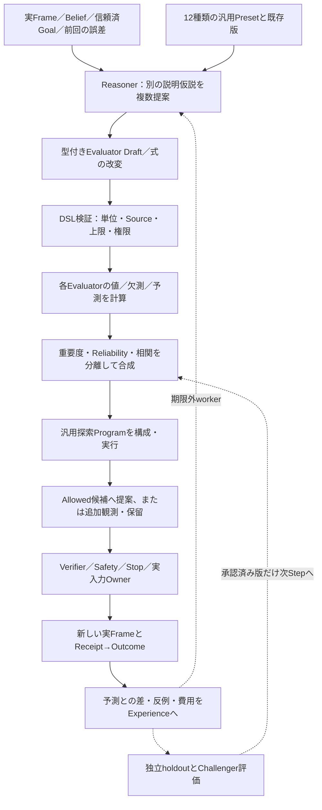

# 自己進化Reasoner：評価仮説の生成・改変・選抜

[統合設計マップ](system_design_map.md) ｜ [汎用評価v2](generic_evaluation_v2.md) ｜ [計算ツールと生成探索](reasoner_compute_and_search.md)

> **状態：目標設計。** 2026-11-04の[#769](https://github.com/tomiya7688/AI_game_player/issues/769)と実装子[#770〜#784](https://github.com/tomiya7688/AI_game_player/issues/770)を整理。mainの確認起点は`a6aaf85f56371d081cfb2fcd8ee1d357091a436c`。Reasonerの自動生成・信頼性学習・自己生成探索が既存Runtimeへ完成接続されたという証拠ではありません。

## 1. 何を「自分で考える」と呼ぶか

賢者ミスクの中心は、未知ゲームで「何が価値か」「操作すると何が起きるか」「どう探索するか」という**複数の仮説を立て、実結果から修正する能力**です。モデルに最良手を一回聞くことや、事前用意されたオセロ・将棋の探索器を呼ぶことだけを自己進化と呼びません。

- **Goal/Valueの方向**：ユーザーと信頼済みHostが決める達成条件。ReasonerのGoal変更提案はそのまま権限ある変更にならない。
- **Evaluator候補**：観測・Belief・候補未来からスコアや区間を計算する式。少なくとも内容の異なる2系統を生成・複製・改変できる設計。
- **ImportanceとReliability**：目標上の重要度と、評価器が実際の判断に役立つ度合いは異なる。Latency/Token/CPUはさらに別の費用。
- **SearchProgram**：Evaluatorと遷移仮説を使い、分岐や深さまでReasonerが構成する探索方法。Calculator/Tableはこの推論を助ける演算器であり、専門Solverの隠れた最良手と区別する。

評価の値を計算する下位契約は[汎用評価v2](generic_evaluation_v2.md)、数値ツールと探索IRの実行契約は[計算・探索設計](reasoner_compute_and_search.md)に分けます。

## 2. 生成・評価・学習の循環



これは**完成時の概念図**です。現行の`RuntimeEvaluationAdapter`が接続する6軸・Actual/Hypothetical・Context/Traceは[現行仕様](runtime_evaluation.md)に残し、新たなRuntimeを二重に作らない。既存の[Belief更新](belief_update.md)・[経験](canonical_experience_schema.md)・[Mode/Phase](runtime_modes.md)・[Planner](planner_runtime.md)・[#171/#173](https://github.com/tomiya7688/AI_game_player/issues/171)昇格を使います。

## 3. 作る機能と責務の割当

| Issue | 一つの仕事 | 実行しないこと |
|---|---|---|
| [#770 Presets](https://github.com/tomiya7688/AI_game_player/issues/770) | 汎用単純6種／複合6種のCatalog、clone、合成、親Digest | ゲーム固定HeuristicのCore化、Activeへの自動切替 |
| [#771 Hypothesis](https://github.com/tomiya7688/AI_game_player/issues/771) | Reasonerから異なる2〜8候補のAST・否定例・必要Signalを提案 | モデルの自由文を実コード／OS入力にする |
| [#772 Rewrite](https://github.com/tomiya7688/AI_game_player/issues/772) | 部分式／条件／正規化／重み／Axis／地平の改変を新版として保存 | 親版の破壊、User hard Goalの改変 |
| [#773 Reliability](https://github.com/tomiya7688/AI_game_player/issues/773) | 予測誤差・順位・Source相関・Goal相性による重み補正 | 同画像の多票化、モデル自称confidenceの校正済み扱い |
| [#774 Discovery](https://github.com/tomiya7688/AI_game_player/issues/774) | 低支持・不一致・停滞で再観測／再計算／改変／生成を選択 | 不明のたび無制限に新モデルを起動 |
| [#780 Evolution](https://github.com/tomiya7688/AI_game_player/issues/780) | 反例からStrategyを修正し、独立Replayとholdoutで比較 | 自己スコアの上昇だけで昇格 |
| [#781 Runtime](https://github.com/tomiya7688/AI_game_player/issues/781) | 評価・Tool・Search・Outcomeを既存Sessionへ循環接続 | Verifier/Safety/Inputを作り直す |

### 生成とコピーの出所

プリセットは完成した「ゲーム専用知識」でなく、再利用する数式部品です。初期例は進捗、資源、時間、生存、新規性、反復、さらにリスク・情報価値・機会費用・不可逆性・局面別重み・遅延報酬の複合です。利用時には`preset_id/version/source_hash`を保存し、派生物は新IDと`parent_digest`を持たせます。

Reasonerが「敵HPを減らす」「相手の行動を防ぐ」「罠を避ける」と提案したとき、各候補に`expected_goal_direction, required_signal_keys, expr_AST, applicability, counterexamples, model/source refs`を必須にする。存在しないSignalは`MISSING_CAPABILITY`、重複ASTは同じ系統と見なし、独立した2つの仮説に数えません。モデル不在なら既知Presetからの決定論的候補で継続できますが、`MODEL_GENERATED`と偽りません。

## 4. 信頼性・相関・低信頼時の処置

たとえば生存の**重要度**が0.8でも、あるEvaluatorの生存予測の**実測支持**が弱ければ、それを根拠に確実だと言えません。予測と実Outcomeの関係を、同じGoal/Scene/Phase/Source版ごとの`EvaluatorReliabilityState`として保持します。

- Ground truthは独立した実Game Goal、適格なUser correction、確認済み実Outcomeなどに限定。反実仮想で未実行の手を正解ラベルにしない。
- `n_effective, coverage, prediction_error, ranking_quality, calibration_status, drift, lower_bound`などを区別。1回の当たり、未校正の`0.99`、自身のスコアの高さを強いReliabilityにしない。
- 複数の認識器が**同じOCR・同じ画像や学習済み情報に依存**する場合は`correlation_group`を保持し、独立証拠2件として重みを増幅させない。
- Goal/Scene/Model versionが変わったら支持数を盲流用しない。足りない根拠は`UNKNOWN`として保守的な区間・coverageで示す。

全候補が低信頼、重要軸が欠測、順位が大きく食い違う、結果が何度も予想外、Goal進捗が停滞した時は[#774](https://github.com/tomiya7688/AI_game_player/issues/774)が`KEEP/REOBSERVE/RECALCULATE/REWEIGHT/REWRITE/GENERATE/ESCALATE/ABSTAIN`を選びます。**古いFrameならまず再観測、式・単位エラーなら再計算**であり、新評価関数生成が常に正解ではありません。生成失敗／時間切れは理由とcooldownを保存します。

既存の有効なChampionで許可Actionを選べる場合は、新候補の検証前にそれを優先して進められます。すべて不明なら入力を捏造せず、再観測・保留・信頼済みの探索方針へ。モデルを無制限に呼び続けない制御は[#409](https://github.com/tomiya7688/AI_game_player/issues/409)・[#425](https://github.com/tomiya7688/AI_game_player/issues/425)の予算と同じ体系で扱います。

## 5. 未知ゲームの操作ルールと多段Skill

未知GUIを理解するには、評価関数だけでなく「何が起こるか」という**WorldMechanicsHypothesis**が必要です（[#783](https://github.com/tomiya7688/AI_game_player/issues/783)）。ReceiptとFresh Afterから、「鍵がある場合だけ扉が開く」「ボタンを押すと会話が始まる」の前提・効果・遅延・代替結果を提案し、`PROPOSED/SUPPORTED/REFUTED/OUT_OF_SCOPE`を分けます。観測が少なければ複数仮説と未知質量を残し、時限イベントを入力の因果成果へ変換しません。

多段操作は[#784](https://github.com/tomiya7688/AI_game_player/issues/784)の有限`ActionSkillPlan`で表します。例えば`SELECT_CANDIDATE → OBSERVE → VERIFY_STATE → BRANCH_IF → SELECT_CANDIDATE`です。中間クリックごとに**新しい画面の現行候補**を取り、Verifier/Safety/Stopを再実行。前のFrame座標を使い回して続行しない、途中の状態変化を最終Goal達成にしない、曖昧なdispatchは自動再送しない。特定ゲーム用の多段クリックをCore既定へ埋め込まないことが目的です。

## 6. 版管理・昇格と実行時安全

```text
DRAFT → VALIDATED（DSL・Source・Budget） → CHALLENGER
 → INDEPENDENT_EVALUATION → PROMOTION_ELIGIBLE
 → ACTIVE（Step安全境界でimmutable参照を交換）
 → ROLLBACK（劣化・再現不能・破損）
```

これは設計上の状態遷移であり、現実の公開enumを増やしたという意味ではありません。学習・編集用データとholdoutを事前に分割し、実行しなかったActionの未来をReplay上の観測事実にしません。以前より自分のEvaluatorで高い点を取っただけでは採用せず、**Goal達成／実Outcome／独立誤差・順位／未知／費用／リスク**でChampion対Challengerを比較します。合格が不足する場合は旧Championを保持します。

一つのStepに`goal_hash, strategy_hash, evaluator_hashes, search_program_hash, frame/source/run_generation`を固定します。Reasonerや学習workerの結果が古いScene・Stop世代から来た場合、Activeへの反映も入力への適用も拒否します。後処理はゲーム時計が進んでいる推論と分離し、入力の解放・Stopを優先します（[Runtime Mode](runtime_modes.md)）。

## 7. 専用Solverとの区分と受入

オセロ／将棋の強い専用探索やUSIは**任意の専門Capability・教師・比較基準**として残します（[#742](https://github.com/tomiya7688/AI_game_player/issues/742)）。しかし現局面のbestmoveを直接受け取った一手を「自分でSearchProgramを構成して勝った」証拠へ合算してはいけません。

[#782 Strategy Origin Gate](https://github.com/tomiya7688/AI_game_player/issues/782)は、`SELF_DERIVED / GENERIC_BASELINE / TEACHER_TRAINED / SPECIALIST_SOLVER_ASSISTED / MIXED・UNVERIFIED`を全手の出所で区分します。合法手検査や純粋なCalculatorの利用だけは専門Solverの直接助言とは別ですが、教師学習済みArtifact・外部LLM助言・Model version・Program lineageは必ずTraceに残します。[#735](https://github.com/tomiya7688/AI_game_player/issues/735)の最低勝率6セルは、事前指定されたSELF_DERIVED trackと補助trackを分けて報告し、負けや途中fallbackを事後除外しません。

**必要な正負fixture**：未知ゲームで別Evaluator2種生成／同AST重複拒否、別Goalの順位反転、同Source相関割引、低支持から再観測と新規生成を適切に選択、独立反例で構造改変、旧版rollback、Stop・Goal変更・モデル故障の未反映、2段クリックの各段再観測、外部Solver bestmoveをSELF_DERIVEDへ誤算入しないこと。

実装の順序は[#761〜#764](https://github.com/tomiya7688/AI_game_player/issues/761)の基盤→[#770〜#774](https://github.com/tomiya7688/AI_game_player/issues/770)の生成と信頼性→[#780〜#781](https://github.com/tomiya7688/AI_game_player/issues/780)の改良・接続が基本で、数値Kernel/探索は[別文書](reasoner_compute_and_search.md)を参照。**設計書の存在だけを機能／強さの達成証拠にしません**。
