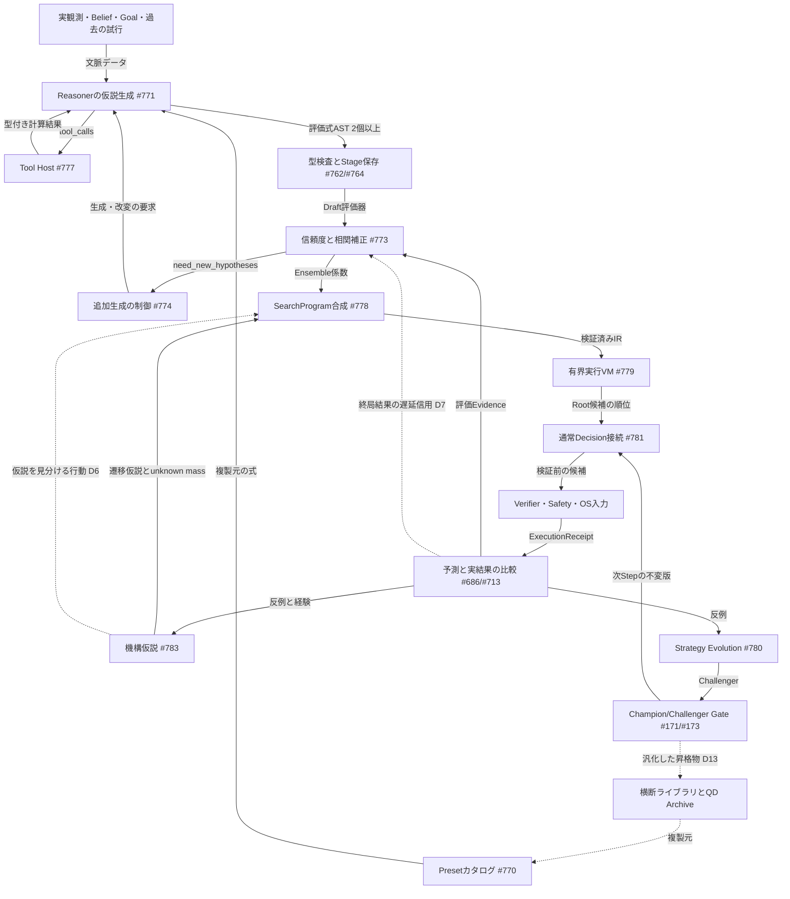
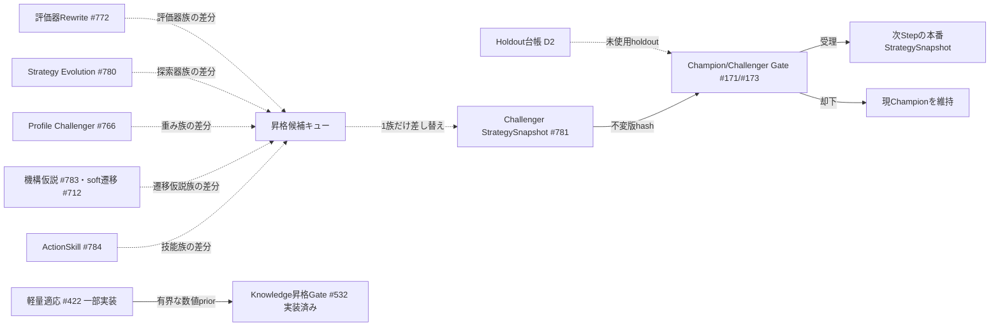

# 賢者ミスク自身が評価関数・計算・探索器を作り育てる（自己進化Reasoner）

[動作と配置の見取り図へ戻る](README.md) ｜ [自己成長ループの全体設計](self_improvement_loop.md)

**状態：** 設計（未実装）。基準main `a6aaf85`。親Issueは[#800](https://github.com/tomiya7688/AI_game_player/issues/800)、本領域の正本は親[#769](https://github.com/tomiya7688/AI_game_player/issues/769)と子[#770](https://github.com/tomiya7688/AI_game_player/issues/770)〜[#784](https://github.com/tomiya7688/AI_game_player/issues/784)です。上位方針は[#19](https://github.com/tomiya7688/AI_game_player/issues/19)（AGENTS.mdの要約）、[#710](https://github.com/tomiya7688/AI_game_player/issues/710)、[#760](https://github.com/tomiya7688/AI_game_player/issues/760)です。

本書は記述を三つに分けます。

| 区分 | 意味 | 本書での書き方 |
|---|---|---|
| 実装済み(main) | `a6aaf85`の`src/`・`tests/`で確認した部品 | ファイルへのリンク付きで「実装済み」と書く |
| Issueで確定した設計 | #769〜#784本文の決定。コードはまだ無い | Issue番号を付ける |
| 本書で追加する設計提案 | 評価者Claude、2026-11-04、**設計者承認待ち** | **[提案Dn]** を付ける。承認後に該当Issue本文へ反映する |

`a6aaf85`には#770〜#784の成果物（`evaluator_hypothesis_generator.py`、`search_program_ir.py`、`native/math_kernel/`、`native/generic_search/`など）は**一つも存在しません**。関係する既存部品は、固定2048向けの[有界Expectimax](../../src/ai_game_player/expectimax_search.py)（#565、[説明](expectimax_planning.md)）、[遷移モデル契約](../../src/ai_game_player/transition_model.py)（#479、[説明](transition_simulation.md)）、[Knowledge昇格Gate](../../src/ai_game_player/knowledge_promotion.py)（#532、[説明](knowledge_promotion.md)）、[軽量適応worker](../../src/ai_game_player/light_adaptation.py)（#422の一部、[説明](light_adaptation.md)）、固定6軸の[評価Profile](../../src/ai_game_player/evaluation_profile.py)だけです。

## 1. 何のため？

ユーザーは「専用探索器を用意すれば勝つのは当然で、賢者ミスク自身の強さではない」と明示しています（#769）。賢者ミスクは初見のゲームで、次のことを**自分で**行う汎用ゲームAIを目指します。

1. 「このゲームでは何が重要か」を推論し、評価関数の候補を2個以上つくる。既存の候補やPresetを複製・編集・合成することもできる。
2. 計算機と表計算をtool-callで呼び、暗算の代わりに正確な値を得る。
3. 遷移の仮説と評価器を組み合わせ、探索器そのもの（SearchProgram）を組み立てて実行する。
4. 実際の結果と比べて、評価器・探索器・機構仮説・操作スキルを改良する。改良した版を検証し、昇格させるか元に戻す。

#769は「評価関数」を4種に分けて扱います。**Value定義**（何を目指すか。User/信頼済みGoalが正本）、**Evaluator仮説**（状態から値を返す具体的な関数）、**Reliability**（実測でどれだけ当たるか）、**探索**（評価器を呼んで先読みする手法）です。本書もこの区別を守ります。重要度の重み（Goal由来）と信頼度の重み（実測由来）は混ぜません。

## 2. 何を受け取り、何を返す？

- **入力：** 実観測・Belief・Goal・Signal（#761）、過去の試行とOutcome（#712/#713/#686）、Presetカタログ（#770）、登録済みReasoner（#523）、資源予算（#425）、現在のChampion StrategySnapshot。
- **出力（通常Step）：** `DecisionProposal`（#781）。中身は選んだRoot候補ID、または追加観測・保留・エスカレーションです。順位付き候補、品質区間、使ったSearchProgramと評価器のhash、tool-callの結果IDも含みます。物理的な操作は必ず既存のVerifier/Safety/RunControllerを通ります。
- **出力（学習側）：** 新しいDraftの成果物（評価器・SearchProgram・機構仮説・ActionSkill）、信頼度Snapshot、Challenger StrategySnapshot、`self_evolving.strategy.v1` Journal event、#782の出所記録です。

## 3. 成長サイクル

実線はIssueで確定した経路、点線は本書の提案（または条件付き）の経路です。ノードの番号は担当Issueです。

一回の通常Stepで新しい成果物を作ることはありません。#774の生成と#780の改良はbackground workerで動きます。新しい版は、Gateを通った後の**次のStep**から使われます（#781 手順1）。

## 4. 成果物と系譜（lineage）

| 成果物 | 担当Issue | 親になれるもの | 系譜の規則 |
|---|---|---|---|
| `EvaluatorPreset` | #770 | なし（不変manifest、SHA付き） | 編集しても元IDを上書きしない。派生IDと親digestを持つ |
| `EvaluatorDraft`（Candidate） | #771生成、#772改変 | Preset、既存Draft（親は最大4） | origin=`NEW/CLONE/COMPOSE/MUTATE`。IDはhostが採番する。初期状態は`UNCALIBRATED` |
| `EvaluatorReliabilityState` | #773 | なし（Evidenceから計算） | keyは`eval_id/version`に加えてscope・goal・phaseを含む。親の信頼度を子へ継承しない |
| `SearchProgramV1` | #778合成、#780改良 | template、既存Program | origin=`SELF_SYNTHESIZED/TEMPLATE_CLONE/USER/REFERENCE`。構造差分とweight差分を区別して記録する |
| `MechanicsHypothesis` | #783 | 既存仮説（`parent_ref`） | provenance=`SELF_INFERRED/USER_HINT/TEST_REFERENCE`。`REFUTED`も削除せず残す |
| `ActionSkillPlanV1` | #784 | World仮説、経験 | origin=`SELF_INFERRED/PRESET/USER`。保存した座標は使わず、毎Step現在の候補へ再bindする |
| `ToolResult` | #777 | なし | 計算の出所であり、成果物の親にはならない。Truthへ昇格しない |
| `StrategySnapshot` | #781 | 上記成果物の参照の束 | 不変。Step開始時に一度だけ取得する |

**[提案D1]** 全ての成果物は`content_digest`、`parents`、`origin`、`teacher_refs`（D10）、生成に使ったholdoutの台帳ID（D2）を持ちます。子の`origin`の汚染（TEACHER_TRAINEDなど）は親から必ず継承し、子側で消すことはできません。

## 5. 昇格の単位はStrategySnapshotだけ（D1）と学習ループの並行

**[提案D1]** 戦略レベルの成果物を昇格させる単位は、#781の`StrategySnapshot`**だけ**です。対象は評価器Ensemble、SearchProgram、MechanicsHypothesis集合、評価Profileの重み、ActionSkillです。一回の昇格で差し替えるのは**一つの成分族**に限ります。こうすれば、効果をその族に帰属でき、rollbackの単位もはっきりします。どの昇格も既存の#171/#173/#532のChampion/Challenger Gateを通ります。

- 学習ループ（#772、#780、#766、#783、#712、#784、#427）は並行して候補を作ってかまいません。ただしGateに出す前に、上のキューで直列化します。同じscopeで評価中のChallengerは常に1個です。
- #422の軽量適応は別の高速経路として残します。対象は有界な数値priorに限り、KnowledgeSnapshot（#529/#532）だけを変えます。StrategySnapshotの成分は変えません。
- 評価中にChampionが変わった場合、Challengerは新Championとの差分で作り直します。古いChampionとの比較結果は流用しません。
- PolicySnapshot（#542）の切替も、少なくともlight検証のGateを通します（**[提案D19]**）。

## 6. Tool Hostの契約境界（#777）

原則は「**LLMは提案し、型付きKernelが実行する**」です。

- Reasonerは`STRUCTURED_REASONING`の結果に`tool_calls`を付けて返します。Hostは`tool_id/version/operation/schema/epoch/consent`を自分のallowlistと照合します。初期のtoolは`compute.math`（#775）と`compute.table`（#776）だけです。`evaluation.*`と`search.*`は、実装と登録が済んだ時点で同じ契約に載せます。
- 画面や自由文に書かれた`{tool:...}`は実行指示として扱いません。shell・`eval`・URL・file pathは常に拒否します。KernelにFrame・OS入力・secretは渡しません。
- `ToolResult`の値は**計算が正しい**ことしか示しません。モデルが作った遷移表で確率を厳密に計算しても、その表が実ゲームの遷移として正しいとは限りません。#647の因果verifiedへは昇格させません。
- ToolResultは**操作許可にならず**、Truthにもなりません。失敗・期限切れ・古いStepは型付きの`UNKNOWN/TIMEOUT/STALE`になります。どの状態もOS入力の許可へは変換されません。
- 上限は1Task当たり8 calls、chain depth 3、結果の合計64KiBです。重複呼出しは`call_id + payload_hash`で1回だけ計算します。Rust Kernelが無い環境では`UNAVAILABLE`と明示し、Pythonの参照値を本物の計算結果として扱いません。

## 7. SearchProgram IRと実行器の役割分担

**Operator集合（#778）：** `GENERATE_ACTIONS`（検証済み候補集合の参照）、`APPLY_TRANSITION_HYPOTHESIS`（仮想状態。出所とunknown massを持つ）、`BRANCH_CHANCE`、`SCORE_STATE`、`AGGREGATE`（MAX/MIN/EXPECTED/LOWER_BOUND/CVaR風/USER_UTILITY）、`EXPAND`（depth/beam/rollout/visit規則）、`PRUNE`（証明済みの境界ならsound、それ以外はheuristicで、捨てたmassを報告する）、`SELECT`、`LOOP`（唯一の巡回構造。有界）、`REQUEST_INFORMATION`（観測やtoolの要請だけ）。templateの`expectimax`、`alpha_beta`、`belief_MCTS/PUCT`などは、これらの組合せ例です。初期の上限は32 nodes、depth 16、branch 128、loop 1024回です。

| 部品 | 担当すること | 担当しないこと |
|---|---|---|
| #776 `FINITE_BELLMAN_BACKUP` | Reasonerやtemplate `table_backup`が明示的に作った**小さな有限表**（h≤16）での厳密DP。tool-callと、VMの葉の計算の両方から呼べる | 遷移関数を呼んで状態を展開する一般的な探索 |
| #779 Rust VM | 自己生成SearchProgramを**実行する唯一の経路**。TransitionProvider・評価器・toolを登録済み能力として呼ぶ。2-passの反復深化、memo、予算管理 | 固定アルゴリズムの直接選択、OS入力、Refereeの隠れ状態 |
| #480/#565 Expectimax（実装済み・Python） | 固定の参照plannerとして残す。#779の`expectimax` templateと同値かを確かめる参照oracleにする | 自己生成と見なすこと。この経路の勝ちは#782で`GENERIC_BASELINE`に分類する |

**[提案D9]** #762のEvaluatorGraphは、#779と同じRust VMの命令列へcompileします。こうすれば葉の評価でIPCが要りません。Pythonの#762評価器は参照oracleとして残し、固定fixtureで同値かを試験します。一致しない版はVM評価を`UNAVAILABLE`にします。Pythonへbatchで戻ることは許しますが、予算を縮めたうえで、traceに戻ったことを記録します。#779の32 leaf batchは、モデル呼出し専用として残します。

**[提案D5]** `APPLY_TRANSITION_HYPOTHESIS`で作った枝は、既定で下側信頼限界（LCB）を使ってbackupします。下側に寄せる幅はsupport数が増えるほど縮めます。#686で予測と実際のずれが大きかった遷移は、重みを下げるか除外します。こうして、学習した遷移の誤りを探索が「有利な手」として突く問題を防ぎます。`AGGREGATE`でLOWER_BOUNDを使うかどうかは、Programの任意選択にはしません。

## 8. 学習信号と統計

- **信号の階層 [提案D3]：** T0 USER/TRUSTED_TEST、T1 検証済みの終局Goal、T2 receipt付きの代理結果、T3 内的信号（予測誤差の減少、新規性、仮説の不一致）。#773の`feedback_source`はT0〜T2に対応させます。T3は探索と仮説の学習には使えますが、**T3だけで評価器や戦略を昇格させることはありません**。評価器を自分の予測で採点することも、自分が生成されたepisodeで検証することも禁じます。
- **Holdout台帳 [提案D2]：** 昇格の判定に使うholdoutは、digest・seed・どの候補が見たかを台帳に記録して消費します。holdoutの結果を見て作った候補は、未使用の別holdoutで確認します。#780の最大8候補×3ラウンドの比較は、Holm–Bonferroni補正か、alpha-spendingを使う逐次検定で行います。holdoutが尽きたら、新しいseed・layout・変種ルールを作ります。黙って使い回すことはしません。
- **能動実験 [提案D6]：** #783の仮説集合で予測が割れる行動を、情報価値（VOI）で選びます。行動は#206のゲーム内risk予算の範囲に限り、#778の`REQUEST_INFORMATION`/`value_of_information` templateで実行します。Safetyの外に出ることはありません。#774の`REOBSERVE`に加えて、行動による情報獲得もここから選べるようにします。
- **長期の信用割当 [提案D7]：** 終局や遅延した結果は、TD(λ)またはMonte-Carlo returnで各手番の評価器予測へ配分します。#713の短い窓（UI効果向け）はそのまま残します。episode単位のEvidenceは#773へ入ります。
- **挙動の相関 [提案D8]：** 評価器が独立か・多様かは、replay状態での出力の順位相関で測ります。AST digestや出所だけでは判定しません。#771のdedupと#773の相関割引は、この実測値を使います。構文が違っても挙動が同じ評価器は、独立した賛成票に数えません。

## 9. 出所の分類（#782の正本に従う）

**[提案D10]** RuleProviderが、合法手・次状態・終局判定**だけ**を汎用の監査済みインターフェースで返し、その出所を記録している場合は、`SELF_DERIVED`のままで使えます。最良手や評価値を返すproviderを使った結果は`SOLVER_ASSISTED`（#782の`SPECIALIST_SOLVER_ASSISTED`）です。教師ラベル（専用エンジンのbestmoveや人間の正解）を候補の選抜・学習・比較の採点に一度でも使った成果物は、系譜を`TEACHER_TRAINED`にし、子孫にもこのタグを継承します。

**[提案D12]** 探索結果を高速な評価器やpolicyへ蒸留する（expert iteration）のは、LEARN/ALTERNATINGの段階で行います。蒸留した成果物が`SELF_DERIVED`になるのは、教師にした探索が`SELF_DERIVED`だった場合だけです。

`MIXED`（専用エンジンのbestmoveを一度でも使った試合）と`UNVERIFIED`（出所の欠落）は、SELF_DERIVEDの勝ちには数えず（#782の定義）、#782処理5のとおり正式登録したセルの母数には残して失格（0点）として計上します。母数から外すと都合のよい局だけが残るからです。試合を消さず、詳細は別のtrackでも報告します（[能力ベンチマーク](gameplay_capability_benchmark.md)と同じ規則）。

## 10. ライブラリとアーカイブ

- **[提案D13]** 昇格した自作の評価器・SearchProgram・ActionSkillは、汎化した横断ライブラリ項目にします。項目にはゲームごとの信頼度を持たせ、#770のPresetと同じ複製・合成の入口から使えるようにします。A→B→Aの忘却（#714）は成果物ごとに追跡します。
- **[提案D14]** Champion一つだけでなく、場面やゲームの記述子をkeyにした分野別エリートのアーカイブ（MAP-Elites風）を持ちます。目的は、候補が一つの型へ収束するのを防ぎ、新しいゲームの初期候補を用意することです。アーカイブの項目は昇格候補の親になれますが、Gateを通らずにChampionになることはありません。

## 11. 資源予算

以下は全てIssueに書かれた**初期の工程値で、未測定**です。#425のprofileで測定してから更新します。

| 段階 | 経路 | 初期上限（出典Issue） |
|---|---|---|
| Tool-call | hot path | 8 calls・depth 3・64KiB/Task（#777）。real-timeでは2 calls/100ms（#781） |
| 数値計算 | hot path | 64KiB入力・50ms・BigInt 256bit（#775） |
| 表計算 | hot path | 16384行・16MiB・50ms・16 queries/Step（#776） |
| 探索VM | hot path | 既定100ms・最大2s・100000 nodes・4MiB TT・batch 32（#779） |
| 評価器生成 | background | K=4（最小2）・Draft 8個/128KiB（#771）。1 triggerに4 proposals・30s・provider 2回（#774） |
| 評価器改変 | background | 16 ops・depth 8・AST 64 nodes（#772） |
| 信頼度更新 | background | 128 eval×128 feedback/Step・履歴2000（#773） |
| 進化 | background | 8候補×3ラウンド・20 replay pilot・正式100 episodes相当（#780） |
| 機構仮説 | background | 1 contextに32仮説・50ms/update（#783） |
| ActionSkill | hot pathで検証 | depth 8・16 steps・4 branches（#784） |

backgroundの仕事は通常StepのDeadlineを延長しません。予算が足りない場合は、旧Championと許可済みのfallbackで動き続け、部分結果であることを明示します。

## 12. 失敗したら？

| 状況 | 扱い |
|---|---|
| Reasonerが登録されていない、または使えない | Presetの複製と純粋なtoolで動く。#771の出所`MODEL_GENERATED`とは偽らず、能力未達として記録する（#771/#781） |
| 全評価器の信頼度が低い | `need_new_hypotheses`。期限が短ければKEEPかABSTAINにし、生成はworkerへ回す（#773/#774） |
| 同じ式を繰り返し生成する | dedupとcooldown（4 decision steps）。`NO_NEW_HYPOTHESIS`と理由を残す（#774） |
| SearchProgramが出力を出せない、またはPARTIAL | 完成した浅い深さだけを使い、旧Champion Programを維持する（#779） |
| VMの評価器とPython oracleが一致しない | その版のVM評価を`UNAVAILABLE`にする（**[提案D9]**） |
| 遷移仮説の予測と実際のずれが大きい | 探索での重みを下げるか除外し、#783で反例として更新する（**[提案D5]**） |
| holdoutが尽きた | 昇格を保留し、新しいseed・layout・変種を生成する（**[提案D2]**） |
| Stop・Target変更・epoch変更の後に結果が届いた | `STALE`として全て却下する。旧Stepの成果物はStageへ入れない |
| 昇格後に成績が悪化した | 署名済みの旧Championへrollbackする（#780 手順6、#532の実装済み復元経路） |

## 13. Issue間の不整合と本書の解決

| 不整合 | 本書の解決 |
|---|---|
| #780 手順5は専用Engineのbestmoveを「補助GroundTruth」として許す。一方、#782は教師で学習したものを`TEACHER_TRAINED`とする | **D10**：教師ラベルを選抜・採点に使った成果物は`TEACHER_TRAINED`にし、子孫へ継承する。#780に明記する |
| #762の評価DSLはPythonで実装する予定。#779のVMはRust。葉の評価をIPCで呼ぶと遅い | **D9**：EvaluatorGraphをVMの命令列へcompileする。Python評価器は参照oracleにする |
| #783のSignalPredicate/ActionPatternでオセロや将棋の規則を観測から学ぶのは非現実的。#782は「監査済みの汎用規則」を許しつつ「Rule Leak」を禁じていて、線引きが曖昧 | **D10**：合法手・次状態・終局判定だけを返すRuleProviderは出所を記録すれば可。best-moveや評価値は不可。#783は初見の操作とUI機構を担当する |
| #422、#712、#766、#772/#780、#427、#783がそれぞれ#171/#173へChallengerを出す | **D1**：StrategySnapshotを唯一の昇格単位にし、1回の昇格は1成分族に限る。#422はKnowledgeの高速経路として分ける |
| #780は同じheldoutで最大24回比較する。新しいheldoutが要る条件が書かれていない | **D2**：holdout台帳、多重比較の補正、尽きたときの再生成 |
| #771はAST digestで、#773は出所で独立性を判定する | **D8**：replay上の出力順位相関で判定する |
| #778のLOWER_BOUNDは任意選択。学習した遷移の誤りを探索が突く | **D5**：仮説遷移の枝は既定でLCBを使う |
| #783の仮説集合と#778のVOI templateがつながっていない。#774は観測と生成しか選ばない | **D6**：仮説を見分ける行動を#206の予算内で選ぶ |
| #713の窓（8 actions/5秒）では約60手後の勝敗を配分できない | **D7**：TD(λ)・MC returnを使う。#713の窓はUI効果用として残す |
| #779は`EVALUATE`、#778は`SCORE_STATE`と、同じoperatorを別の名前で呼んでいる | #778の`SCORE_STATE`を正本にする。`EVALUATE`はcompile後のopcode名としてだけ使う |
| #781の`strategy_origin`（`PRESET_DERIVED/MODEL_ASSISTED`）、#782の分類、#769の`EXTERNAL_OR_HANDCRAFTED_SOLVER_ASSISTED`で用語が違う | #782を正本にする。AIによる改変のない`PRESET_DERIVED`は`GENERIC_BASELINE`へ対応させる。外部LLMにbestmoveを直接聞いた`MODEL_ASSISTED`は、SELF_DERIVEDに数えない別の値として#782に追加する |
| #770のPresetは固定12種だけで、昇格した自作評価器を再利用する経路がない | **D13**：横断ライブラリを作る |
| #769のサイクルにself-playが書かれているが、担当する子Issueがない | **[提案D11]**：汎用の対戦runner（過去Championのpool、Elo、短い持ち時間でのpilot）とcurriculumを持つ。新しいIssueとして起票が必要（未起票） |
| #735の第6項と#740は、#782のtrack分離を参照していない | #740にSELF_DERIVEDのtrackを前提とする記述を追加する（#740/#735側の改訂。本書では実施しない） |

## 14. 未決事項

- 設計者の承認待ち：本書の全ての**[提案Dn]**。承認後に、#769〜#784、#740、#735の本文へ反映します。
- 担当Issueが無いもの：D11（self-playとcurriculum）、D13/D14（ライブラリとアーカイブ）、D15（#712の状態抽象化部品。役割は[結果解釈](outcome_interpretation.md)で定義済み）。起票が必要です。
- 実装の順番：#775と#783はREADY、ほかはBLOCKEDです。#761→#762→#764→#770/#771が評価器系の前提、#775→#776→#777が計算系の前提です。
- 信頼度の格納先を一つにする件：#407/#409/#540/#553/#773で信頼度の格納先が分かれないよう、#773はadapter経由で既存の格納先へ参加します（#773の確定事項）。共有するcalibration storeの正本は、[適応計算と信頼性](adaptive_compute_reliability.md)の**[提案AC1]**（手法×task×scene×hardwareをkeyにする一つのStore）を設計者が承認するまで未確定です（#407）。
- 性能：計算・探索・生成の速度、棋力、モデル費用は全て**未測定**です。本書には測定値がありません。

## 根拠

- 実装済み(main `a6aaf85`)：[expectimax_search.py](../../src/ai_game_player/expectimax_search.py)と[test_expectimax_planner.py](../../tests/test_expectimax_planner.py)、[knowledge_promotion.py](../../src/ai_game_player/knowledge_promotion.py)と[test_knowledge_promotion.py](../../tests/test_knowledge_promotion.py)、[light_adaptation.py](../../src/ai_game_player/light_adaptation.py)と[test_light_adaptation.py](../../tests/test_light_adaptation.py)、[transition_model.py](../../src/ai_game_player/transition_model.py)、[world_state_hypothesis.py](../../src/ai_game_player/world_state_hypothesis.py)。テストファイルがあることを確認しただけで、本書の作成時にテストを実行して成功を確かめてはいません。
- 関連する設計文書：[有界Expectimax](expectimax_planning.md)、[仮想遷移](transition_simulation.md)、[Knowledge昇格](knowledge_promotion.md)、[軽量適応](light_adaptation.md)、[コマンド指向の原設計](../コマンド指向.md)、[提案メモ](../提案メモ.md)。
