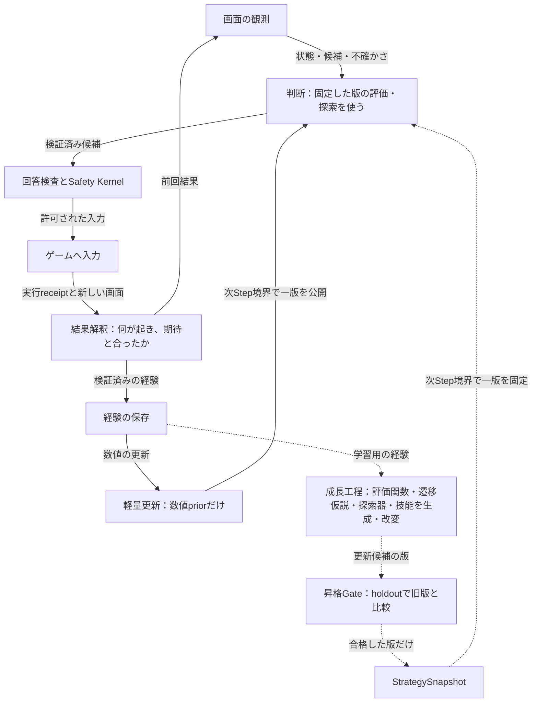

# 賢者ミスクが自分で賢くなる仕組み（自己成長ループの全体設計）

[動作と配置の見取り図へ戻る](README.md) ｜ [目指す完成形と現在](../guide/target_and_current.md)

**状態：** 設計（大部分は未実装）。基準main `a6aaf85f56371d081cfb2fcd8ee1d357091a436c`、確認日2026-11-04。親Issueは[#800](https://github.com/tomiya7688/AI_game_player/issues/800)、方針の正本は[#19](https://github.com/tomiya7688/AI_game_player/issues/19)・[#710](https://github.com/tomiya7688/AI_game_player/issues/710)・[#760](https://github.com/tomiya7688/AI_game_player/issues/760)・[#769](https://github.com/tomiya7688/AI_game_player/issues/769)です。

この文書は三つを区別して書きます。

- **実装済み（main）：** `src/` と `tests/` で確認したもの。
- **Issueで確定した設計：** Issue本文に採用手法として書かれているもの。未実装です。
- **本書で追加する設計提案：** 評価者（Claude、2026-11-04）がOpen Issue全件の点検から加えたものです。**[提案D番号]** を付けます。設計者（tomiya7688）の承認前は正本ではありません。採否は#800で記録します。

## 1．何を目指すか

賢者ミスクは、特定ゲーム専用のAIではありません。**初めて見るゲームでも、画面を観測し、目的を推定し、操作し、その結果から自分の評価・予測・探索の方法を作り替えて、だんだん上手くなる汎用のゲームプレイヤー**です（#710、#769）。

「上手くなった」と言えるのは、次の三つがそろった時だけです。

1. 経験から、判断に使う何か（知識・評価関数・遷移の仮説・探索手順・技能・モデル）が**新しい版として作られた**。
2. その版が、作るのに使っていない試合（holdout）で**旧版より良いと統計的に確かめられた**。
3. 確かめた版だけが、次の判断の境界で**実際に判断へ使われた**。

記録を保存しただけ、部品が登録されただけ、専用の探索エンジンが勝っただけでは、賢者ミスク自身の成長とは呼びません（#769、#782）。

## 2．二つの速さで回るループ

操作のたびに回る速いループと、操作の外で回る遅いループを分けます。重い学習を操作直前の処理（hot path）へ入れません（#19の5 Mode）。

実線は、mainに部品がある経路を含む確定設計です。点線は、Issueで設計され未実装の経路、または本書の提案です。**実線でも、全ゲームで動作確認済みという意味ではありません。** 軽量更新（#422）は実Sessionへ接続済みですが、既定の学習識別policyが無効のため、通常は因果学習を行いません（[Light Adaptation](light_adaptation.md)）。

## 3．何が育つのか

成長の対象は一つではありません。それぞれ速さ・担当・昇格方法が違います。

| 育つもの | 担当Issue | 速さ | 現在 | 昇格の方法 |
|---|---|---|---|---|
| 操作効果の数値prior（Beta・EWMA） | #419・#422・#530〜#532 | 速い（Step後） | **実装済み・接続済み**、既定では無効 | light-validationと[知識の昇格](knowledge_promotion.md) |
| 汎用評価Profileの重み・条件 | #760・#766 | 遅い | 未実装（v1の6軸は実装済み） | Challenger試験 |
| 評価関数そのもの（式・構造） | #770〜#774 | 遅い | 未実装 | **[提案D1]** StrategySnapshot |
| 未知ゲームの規則の仮説 | #783 | 中間 | 未実装 | 支持・反例の集計＋**[提案D1]** |
| 探索手順（SearchProgram） | #778〜#780 | 遅い | 未実装 | **[提案D1]** StrategySnapshot |
| 多段操作の技能 | #784 | 遅い | 未実装 | **[提案D1]**・**[提案D13]** |
| 手法の信頼性・処理時間 | #409・#539〜#541・#553 | 中間 | 一部の部品のみ | **[提案D19]** |
| 学習モデル本体 | #36・#180・学習能力契約 | 最も遅い | 契約のみ（[学習能力契約](learning_capability_contract.md)） | 既存のpromotion policy |

詳しい設計は分野ごとの設計書に分けます。

| 分野 | 設計書 |
|---|---|
| 評価関数・計算・探索器の自己生成 | [自己進化Reasoner](self_evolving_reasoner.md) |
| 編集・学習できるGoalと評価関数 | [汎用評価v2](generic_evaluation_v2.md) |
| 操作結果の解釈と学習への受け渡し | [結果解釈](outcome_interpretation.md) |
| 手法の信頼性・コストと追加計算の配分 | [適応計算と信頼性](adaptive_compute_reliability.md) |
| 実力の測り方と最低実力Gate | [能力ベンチマーク](gameplay_capability_benchmark.md) |

## 4．方針への適合の評価

Open Issue 294件を2026-11-04に点検しました（重複6件・完了済み16件をclose）。方針と明らかに矛盾するIssueはありませんでした。方向は方針に強く合っています。ただし、**「自分で賢くなる」ための回路が閉じていない箇所**があります。

| 観点 | 評価 | 根拠 | 対応 |
|---|---|---|---|
| 専用エンジンに頼らない | 適合 | #769・#782が自己由来の強さを分けて数える | **[提案D10]** で規則の提供と最善手の提供を区別 |
| 簡易実装を能力の上限にしない | 適合 | #710がCAP-1〜7で妥協点を列挙 | — |
| 評価関数を自分で作る | 設計は適合 | #770〜#774 | 信頼性の学び方に穴がある（下記） |
| 学習が実際に動く | **不足** | 既定の学習識別policyが無効。前提の#433（Player系譜）はP2 | **[提案D21]** |
| 探索して新しい手を試す | **不足** | #428 Exploration Randomizerは未実装。cheap-first方針は高コスト手法を試さない | **[提案D16]**・**[提案D20]** |
| 学習信号が正しい | **不足** | #509（終了文字の部分一致）と#671（6軸への投影漏れ）が未修正 | **[提案D18]** |
| 自分の判定で自分を採点しない | 部分 | #773は禁止しているが、#540はVerifier・SelfCheck由来のラベルで品質を学ぶ | **[提案D3]** |
| 使い回したholdoutで昇格しない | **不足** | #780は同じholdoutで最大8候補×3回を比較する | **[提案D2]** |
| 未知ゲームでの報酬 | **不足** | 推定Goalを誰がいつ有効にするか未定（#763） | **[提案D3]**・**[提案D4]** |
| 学習した規則の誤りを探索が突く | **不足** | #779に既定の悲観補正がない | **[提案D5]** |
| 仮説を見分ける実験をする | **不足** | #783は仮説を並べて持つが、見分ける行動を選ばない | **[提案D6]** |
| 勝敗が遅いゲームの信用割当 | **不足** | #713の窓は8操作・5秒。将棋の勝敗は約60手後 | **[提案D7]** |
| 自己対戦と段階的な練習 | **担当なし** | #749・#759はnot_plannedでclose済み | **[提案D11]** |
| 探索の速さ | **不足** | 評価式はPython、探索VMはRustで、葉ごとにIPCが要る | **[提案D9]** |
| 複数の学習ループの調停 | **不足** | #422・#712・#766・#772・#780・#783が別々に昇格を申請 | **[提案D1]** |
| 借りた強さの出所 | 部分 | 外部Reasoner（#443・#445）・遠隔モデル（#449）の出力に由来tagが無い | **[提案D10]** |

## 5．本書で追加する設計（提案D1〜D21）

各提案の詳細は、担当の設計書に書きます。ここでは何を・なぜ・どこで、を一覧にします。分野の中だけで閉じる提案は、各設計書に別の番号で書きます（[汎用評価v2](generic_evaluation_v2.md)のGE1、[適応計算と信頼性](adaptive_compute_reliability.md)のAC1〜AC5）。

### 昇格と評価を正しくする

- **[提案D1] 昇格の単位を一つにする。** 評価関数群・SearchProgram・規則の仮説・評価Profileの重み・技能は、#781のStrategySnapshotとしてだけ昇格させます。1回の昇格で変える成分の種類は一つまでです。どの変更が効いたかを分けられ、rollbackの単位も明確になります。#422の数値priorは別の速い経路のまま残します。昇格判定には既存の#171・#173・#532のChampion/Challenger Gateを使います。
- **[提案D2] holdoutの消費を台帳で管理する。** 昇格の判定ごとに、使ったholdoutの試合（digest・seed・見た候補）を台帳へ記録します。holdoutの結果を見て作り直した候補は、未使用のholdoutで再確認します。多重比較はHolm–Bonferroniか、alpha-spendingの逐次検定で補正します。holdoutが尽きたら新しいseed・配置・変則ルールを作ります。黙って再利用しません。
- **[提案D3] 学習信号を4段に分ける。** T0は利用者・信頼済みテスト、T1は検証済みの終局Goal、T2は検証済みのproxy（receipt付きの得点増など）、T3は内発報酬（予測誤差の減少・新しさ・仮説の不一致）です。T3は探索と仮説の学習に使えますが、**T3だけで評価関数や戦略を昇格させません**。評価関数は、自分の予測や、自分を作るのに使った試合では採点しません。
- **[提案D18] 学習信号の正しさを先に直す。** #509・#671を、信頼性の推定器や学習器が結果を読む前に修正します。誤った勝敗は下流の全ての学習へ伝わるからです。
- **[提案D19] 手法選択のPolicySnapshot（#542）も昇格Gateを通す。** 直接の差し替えをせず、最低でもlight-validationを通します。

### 未知ゲームで学べるようにする

- **[提案D4] 推定したGoalを段階的に有効にする。** INFERREDのGoalが、独立した支持k件以上・矛盾なしになったらPROVISIONALにします。PROVISIONALは探索とproxyの学習に使えますが、実力の主張には使いません。Trusted Chat（#436・#584）で利用者が確認するとTRUSTEDになります。利用者の明示制約とSafetyは常に優先します。
- **[提案D5] 学習した遷移の上では悲観的に探索する。** #783の仮説遷移を通る枝は、既定で下側信頼限界でbackupします。支持数が増えるほど補正を小さくします。予測と実際の差（#686）が大きい遷移は重みを下げるか除外します。探索が、学習した規則の誤りを「有利な手」と取り違えるのを防ぎます。
- **[提案D6] 仮説を見分ける実験を選ぶ。** #783の仮説集合の上で情報価値（VOI）が大きい行動を、#206のゲーム内risk budgetの範囲で選びます。#778の `REQUEST_INFORMATION` と `value_of_information` templateから接続します。Safetyの外へは出ません。
- **[提案D7] 遅い勝敗を各手へ戻す。** 終局・遅延の結果を、TD(λ)やMonte-Carlo returnで各Stepの評価関数の予測へ戻し、#773の信頼性の証拠にします。#713の短い窓はUIの効果用に残します。
- **[提案D15] 抽象状態のkeyを学ぶ。** #712の遷移統計は「同じ状態に同じkey」が前提です。Signal集合から抽象状態keyを作り、粒度はholdoutの予測損失か記述長で選びます。担当Issueが無いため新設を提案します。

### 試して、強くなり、速くなる

- **[提案D16] cheap-firstでも高コスト手法を試す。** #409・#411・#560の早期終了は、高コスト手法を使わないので価値を学べません。有限の探索予算（UCB・Thompson sampling）で時々試します。
- **[提案D20] 探索時の選択確率を記録する。** #428で無作為性を入れるなら、各候補を選んだ確率（propensity）を記録します。後からoff-policy評価やChallenger比較を偏りなく行うためです。
- **[提案D11] 汎用の自己対戦Leagueと練習課程を作る。** 2人ゲームでは過去のChampion群と対戦し、ratingを追跡します。短い持ち時間でpilotを回します。練習課程（curriculum）は、易しい場面・変則ルール・小目標から始め、学習の進み具合で次の課題を選びます。#735のTRAINED_FROZEN trackで学習による向上を示すために必要です。
- **[提案D12] 探索結果を速い評価関数へ蒸留する。** 探索・Reasonerの出力を、LEARN・ALTERNATINGのPhaseで速い評価関数・policyへ蒸留します（Expert Iteration）。学習で強くなるだけでなく、hot pathが速くなります。教師の探索がSELF_DERIVEDの時だけ、生徒もSELF_DERIVEDです。
- **[提案D9] 評価式をRust VMへコンパイルする。** #762のEvaluatorGraphを、#779のSearchProgramと同じRust VMの命令列へコンパイルします。葉の評価にIPCが要らなくなります。Pythonの評価器は、一致を確かめる参照実装として残します。
- **[提案D17] 相関した票を割り引く。** #573・#574のself-consistencyと融合では、同じモデル・同じframeの標本を、有効標本数で割り引きます。

### 積み上げて、他のゲームへ持っていく

- **[提案D8] 評価関数の独立性を出力の挙動で測る。** AST digestや出所ではなく、replay状態での出力の順位相関で相関・多様性を測ります。構文が違っても同じ挙動の評価関数を、独立した賛成票と数えません。
- **[提案D13] ゲームをまたぐLibraryを作る。** 昇格した自作の評価関数・SearchProgram・技能を、ゲーム別の信頼性付きで再利用できるLibraryへ登録します。忘却（A→B→A）は成果物ごとに追跡します。
- **[提案D14] 一つのChampionだけでなく多様な精鋭を保つ。** 場面・ゲームの特徴をkeyとする精鋭の保管庫（Quality-Diversity、MAP-Elites型）を持ちます。一つの方法への収束を防ぎ、新しいゲームの初期候補にします。

### 出所を正しく数える

- **[提案D10] 規則の提供と最善手の提供を区別する。** 合法手・次状態・終局判定だけを汎用の監査済みinterfaceで返すRuleProviderは、出所を記録すればSELF_DERIVEDで使えます。最善手や評価値を返すproviderを使った結果はSOLVER_ASSISTEDです。教師ラベルで選抜・学習した成果物の系譜はTEACHER_TRAINEDとし、子孫へ引き継ぎます。外部Reasoner・遠隔モデルの判断はMODEL_ASSISTEDです。オセロの反転や将棋の合法手を観測だけから学ぶのは現実的ではないため、この区別が無いとSELF_DERIVED trackが達成不能になるか、解釈で揺れます。
- **[提案D21] 学習を既定で動かせるようにする。** 学習識別policyが既定で無効なのは、#433（Player Template・Instance・系譜）が無いためです。#433をP1へ上げ、ゲーム別の系譜が確定した時に軽量更新を既定で有効にできるようにします。既定を切り替えること自体も、旧既定（無効）と比べて悪化しないことを**[提案D2]**のholdoutで確かめてから行います。

## 6．おすすめの順番

依存の少ない順、効果の大きい順です。

1. **信号を正す：** **[提案D18]**（#509・#671）。
2. **学習を動かす：** **[提案D21]**（#433）、**[提案D3]**・**[提案D2]**・**[提案D1]** の昇格規則。
3. **試す：** **[提案D16]**・**[提案D20]**（#428・#409）。
4. **出所を確定する：** **[提案D10]** を#740・#735・#782へ反映。
5. **未知ゲームで学ぶ：** **[提案D4]**・**[提案D5]**・**[提案D6]**・**[提案D7]**・**[提案D15]**。
6. **強く速くする：** **[提案D9]**・**[提案D11]**・**[提案D12]**。
7. **積み上げる：** **[提案D8]**・**[提案D13]**・**[提案D14]**・**[提案D17]**・**[提案D19]**。

## 7．変えない約束

どの提案も、次を変えません。

- Execution Safety Kernel（#434）はFlowの外にあり、削除・迂回できません。学習・多数決・再推論でSafetyのhard ruleを上書きしません。
- LLMやReasonerが作った式・規則・探索器は、型付きIRとして検証してから有界に実行します。任意のコード文字列をhostで実行しません（#769）。
- 学習で作った版は、OS入力の許可・利用者の資産・外部送信の許可を広げません。
- 追加の計算は回数・時間・メモリで上限を持ち、#425のResource Budgetで受け入れを決めます。
- 賢者ミスクは汎用Player作成機構の一つのProfileです。Coreにミスク専用の特権を持ち込みません（#19）。

## 8．具体例：初めて見るパズルで、鍵と扉の規則を学ぶ

*以下は説明のための仮定で、実測した結果ではありません。*

1. 扉の前で「開く」を押しても変化がない試行が2回、鍵を拾った後に扉が開いた試行が1回ありました。
2. 結果解釈は、それぞれの試行で期待と実際を比べ、検証済みの経験として保存します（[結果解釈](outcome_interpretation.md)）。
3. #783は「扉は鍵が要る」「扉は時間で開く」の二つの仮説を持ちます。支持はまだ少数です。
4. **[提案D6]** により、二つの仮説で結果が分かれる行動（鍵を持たずに時間を置いてから押す）の情報価値が高くなり、risk budget内で選ばれます。
5. 鍵なしでは開かなかったので、「時間で開く」はREFUTEDになります。
6. #771は「鍵の所持を高く評価する」評価関数の候補を作ります。holdoutの別配置で旧版より目標の達成が早いと確かめられた時だけ（**[提案D2]**）、StrategySnapshotとして昇格します（**[提案D1]**）。
7. 昇格した評価関数は、ゲーム別の信頼性付きでLibraryへ入り（**[提案D13]**）、別のゲームで「必要な道具を先に取る」初期候補になります。

## 9．残る判断と担当

| 判断すること | 担当 |
|---|---|
| D1〜D21の採否、採用した提案の実装Issueの作成 | [#800](https://github.com/tomiya7688/AI_game_player/issues/800)（設計者） |
| #740・#735へのorigin trackの反映 | [#740](https://github.com/tomiya7688/AI_game_player/issues/740)・[#735](https://github.com/tomiya7688/AI_game_player/issues/735) |
| #433の優先度の見直し | [#433](https://github.com/tomiya7688/AI_game_player/issues/433) |
| 学習信号の修正 | [#509](https://github.com/tomiya7688/AI_game_player/issues/509)・[#671](https://github.com/tomiya7688/AI_game_player/issues/671) |
| 自己進化Reasonerの全体 | [#769](https://github.com/tomiya7688/AI_game_player/issues/769) |
| 実力の正式な合否 | [#735](https://github.com/tomiya7688/AI_game_player/issues/735)・[#740](https://github.com/tomiya7688/AI_game_player/issues/740) |

**根拠：** この文書はIssue本文と、mainの `src/ai_game_player/light_adaptation.py`・`knowledge_promotion.py`・`knowledge_builder.py`・`evaluation_profile.py`・`expectimax_search.py` の存在、既存の設計書（[Light Adaptation](light_adaptation.md)・[知識の昇格](knowledge_promotion.md)・[bounded探索](expectimax_planning.md)・[Runtime Mode](runtime_modes.md)）を照合して書きました。テストは実行していません。実ゲームでの効果は未測定です。
