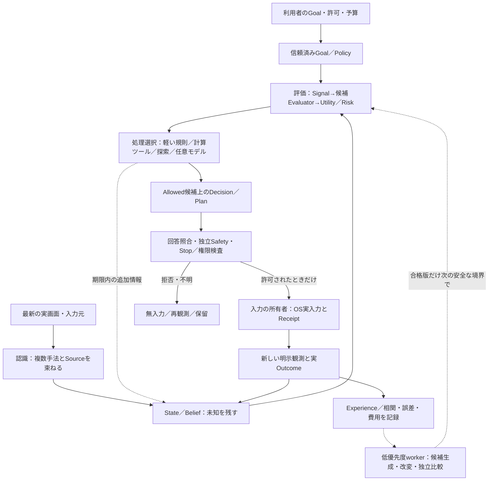

# 賢者ミスク／AI Game Player 統合設計マップ

[全体案内](../guide/README.md) ｜ [現状と完成図](../guide/target_and_current.md) ｜ [設計資料索引](README.md)

> **状態**：2026-11-04 の設計整理。静的照合の起点は `main@a6aaf85f56371d081cfb2fcd8ee1d357091a436c` と既存Issueの仕様です。本ページの「目標」は未実装の機能を含みます。記載したテストは受入条件であり、今回Windows実機・モデル推論・実ゲームを実行した証明ではありません。

## 1. 何を作るのか／何を作らないのか

賢者ミスクは、未知のGUIゲームを**画面から理解し、仮説を作り、評価方法と探索方法を自ら選び直し、実際の操作結果から改善する汎用プレイヤー**です。人間向けGUIを安全に操作できる製品であり、ゲーム一つの盤面AIや研究用のベンチマーク専用実装ではありません。

**製品の判断主体**は、観測から得た汎用Signal、ユーザー／信頼済みGoal、未知を残すBelief、編集可能なEvaluator、生成・改良可能なSearchProgramで構成します。オセロ／将棋の強い専用探索器は、有用な任意Capability、教師、比較基準として残しますが、汎用Coreへ特定ゲームの名前で分岐を増やす設計にはしません（[#760](https://github.com/tomiya7688/AI_game_player/issues/760)、[#769](https://github.com/tomiya7688/AI_game_player/issues/769)、[#742](https://github.com/tomiya7688/AI_game_player/issues/742)）。

この設計には、次の**混同禁止**があります。

- **画面に見えたこと ≠ 世界の真の状態**：認識の不一致・見えない情報・出所・時刻を残す。
- **候補の予想値 ≠ 実際の操作結果**：未来シミュレーション、未送信、dry-run、受理されたOS入力、ゲーム内成功を別の型・根拠として扱う。
- **価値の重要度 ≠ 評価器の信頼性 ≠ 推論費用**：Goalの優先度、予測の当たり具合、時間・CPU・GPU・tokenを別々に管理する。
- **モデルの提案 ≠ 権限あるコマンド**：LLMの文章・画像上の指示・生成式から安全停止やOS入力の許可を作らない。
- **部品実装 ≠ 標準Runtime接続 ≠ 実機での性能・安全合格**：成果物の段階を検証記録で区別する。
- **専門エンジンで勝った ≠ 自己生成／自己学習で勝った**：実行時の戦略出所を全手で保持する。

## 2. 現行Runtimeと目標配置

| 領域 | 現在コードで確認されている範囲 | 恒久設計と主な未達 | 詳細正本 |
|---|---|---|---|
| GUI | Tkinterで操作、候補・結果・許可を表示 | Qt 6 Widgets/C++のネイティブ画面。WebView/WebEngineを製品GUIに使わない | [Qt/Rust移行](qt_rust_migration.md)、[#664](https://github.com/tomiya7688/AI_game_player/issues/664) |
| Core／接続 | Python中心のSession/Engine、任意のC++処理 | 別プロセスRust常駐Core、版付きCommand/Event/Status/Stop、Pythonは任意worker | [実行層](runtime_layers.md)、[#665–#667](https://github.com/tomiya7688/AI_game_player/issues/665) |
| 認識 | Windows capture、画像特徴、任意OCR、候補統合 | 複数認識手法と外部画像AIの選択、Belief・未知・相関を失わない標準配線 | [認識の説明](../guide/recognition.md)、[#610](https://github.com/tomiya7688/AI_game_player/issues/610) |
| 判断／探索 | Rule/Ollama、6軸評価のSession投影、任意有界Planner | 任意Goal/評価式、複数自作Evaluatorの比較、自己生成SearchProgram | [Runtime評価v1](runtime_evaluation.md)、[汎用評価v2](generic_evaluation_v2.md)、[自己進化](self_evolving_reasoner.md) |
| 結果／経験 | Receiptと次の明示観測を照合、Journal、限定的軽量更新 | 遅延報酬・反例・未確定の学習、独立評価を経た策略の昇格 | [実行受領](execution_receipts.md)、[経験契約](canonical_experience_schema.md)、[#713](https://github.com/tomiya7688/AI_game_player/issues/713) |
| 安全と実入力 | Verifier/Safety/Stop/Windows InputとFailSafe | Rust InputBrokerと独立Guardian、所有入力の生存・解放と実機故障注入 | [移行境界](qt_rust_migration.md)、[脅威モデル](../security/threat_model.md)、[#705](https://github.com/tomiya7688/AI_game_player/issues/705) |
| 推論／通信 | RuleProviderとOllamaの構成、任意拡張の契約 | 外部AI／別PCのマルチモーダルTask・版・同意・費用・データ境界 | [Provider API](inference_provider_api.md)、[#447–#449](https://github.com/tomiya7688/AI_game_player/issues/447) |

現行コードの詳細な所在・機能単位の根拠は[Python実装索引](../../src/ai_game_player/README.md)と[実装状態一覧](../guide/implementation_status.md)に置きます。上表は全Issueを「完成」と見なす表ではありません。

## 3. 一回の判断と、長い改善サイクル

実線は**責任の流れ**、点線は必要時の追加処理／将来の改善経路です。これは完成形の概念図であり、すべてを現Runtimeで接続済みと示すものではありません。現在の逐次処理は[判断の流れ](flow_for_readers.md)、Plannerの実接続と制約は[Planner Runtime](planner_runtime.md)を参照してください。

### 一つのStepで固定するもの

開始時点で `run_generation / target / source / frame_ref / clock_domain / goal_ref / profile_hash / strategy_hash / allowed_candidate_set` を固定します。計算・Reasoner・外部Workerの返答には、要求元の版、deadline、データ分類、処理の出所、結果の種類（`ACTUAL`／`HYPOTHETICAL`／`UNKNOWN`）を付けます。到着時に一致しなければ拒否し、次の画面への入力に流用しません。

ユーザーが編集したGoal、学習した重み、探索Programの公開は、Step開始時のSnapshotを書き換えず、検証と[Mode／Phaseの安全境界](runtime_modes.md)で**次Stepからの版切替**にします。

### 各調整役の職務

1. **認識調整**：画面・OCR・画像認識・任意のモデルへ、同一frameの根拠・相関と費用を付ける。矛盾している手法を多数決だけで「確定」にしない。
2. **価値・判断調整**：GoalとEvaluatorで許可候補を比較する。安い計算・テーブルを優先して使い、必要ならReasonerや探索に予算を割り当てる。手法を選ぶオーケストレーターと価値を定義するEvaluatorを別にする。
3. **結果調整**：Receiptとその後の新画面から支持できる結果を出す。環境の自然変化・人間介入・遅延効果によって因果が不明ならそのまま保持する。
4. **学習／採用調整**：誤差、失敗例、所要時間、他候補との相関を確認し、評価関数・SearchProgramをChallengerとして比較する。新しい方が良いという自己採点では採用しない。

手法選択の精度／時間配分は[オーケストレーション解説](../guide/orchestration.md)、情報価値と損失の下側は[Planning Risk](planning_risk_information.md)に分冊化されています。

## 4. 誰が何を実行できるか

| 呼出し元 → 実行先 | 許される目的 | 失敗・禁止事項 |
|---|---|---|
| Qt GUI → Rust Core（予定） | 利用者の操作要求と表示用状態 | GUI callbackから直接OS入力、停止解除、未検証のモデル結果を実行しない |
| Core → 認識／推論worker | 登録済みTaskと期限、必要な最小データの読取／推論 | 無断の外部送信、古い結果の採用、WorkerにStop／入力権限を与えることは禁止 |
| Reasoner → 数値Tool Host（予定） | 登録済み純粋な算術・確率・表計算コマンド | `shell`／`eval`／任意ファイル／任意URL／OS入力をToolとして開かない |
| 評価／探索 → Decision | 版付き・根拠付きの候補順位、再観測・保留要求 | Allowed集合外の候補／専用Refereeの隠し正解を実操作へ変換しない |
| Decision → Input authority | Verifier／hard Safety／Stop／同意／ターゲット再検査を通過した一手 | 数値Utilityやモデルの確信でSafetyを迂回しない |
| 学習worker → Promotion Gate | 検証済みChallengerと独立評価証拠 | Active snapshotを上書きしない。評価不足・破損・Stop時は旧Champion保持 |

[コマンド指向の原則](../コマンド指向.md)は「責務ごとのMachineがCommandを受けて処理する」思想を示します。ここでのCommandは権限そのものではありません。特にReasonerの数値Commandと、OSに副作用を起こす入力Commandを同一権限にしてはいけません。実入力のBroker/Guardian設計は[#705](https://github.com/tomiya7688/AI_game_player/issues/705)を優先します。

## 5. 計算時間・モデル・費用の設計

「遅いモデルを毎回起動し、複数回答を集めれば高精度になる」とは設計しません。Cheap deterministic path（条件分岐、検証済み数値計算、lookup）を最初に使い、結果の不明さ・追加計算の見込み価値・残り期限が正当化する場合だけ高価な方法へ進みます。

- **測るものを分ける**：latency p50/p95、CPU、RAM、VRAM、モデルtoken／呼出し回数、追加認識による品質改善、操作結果を別指標にする。モデル呼出し料金も操作予算と分ける。
- **予算は有界**：TaskやStepの親deadlineを延長せず、探索深さ・Table規模・式演算数・結果bytes・同時Worker数をProfileへ明示する。固定数値を永久上限とせず、実測で変更する。
- **実時間と学習を分離**：長い生成・重学習はworkerへ延期。入力中／ゲーム時計進行中に停止できない重学習を割り込ませない（[Runtime Mode](runtime_modes.md)と[#759](https://github.com/tomiya7688/AI_game_player/issues/759)）。
- **APIは統一入口を目指す**：ローカル、別PC、外部サービス、LLM/VLMなどの能力をTaskとResourceRefで宣言し、Provider固有の通信をAdapterに隠す。設定済み／利用可能／実際に呼び出した、を区別する（[#447](https://github.com/tomiya7688/AI_game_player/issues/447)）。

## 6. 証拠レベルと受入の追跡

設計書・Issue・PRを増やしただけではプレイ能力になりません。変更ごとに次の証拠レベルと不合格例を記録します。

| レベル | 示せること | 示せないこと／次の検査 |
|---|---|---|
| L0: 設計・Schema | 目的、入力／出力、権限、失敗、依存を合意した | コードが動くとは言えない |
| L1: 単体・契約 | 型、境界値、偽データ、予算、拒否が動く | 標準Sessionで呼ばれるとは言えない |
| L2: Runtime接続 | 実Session／Trace／Decisionの順位や保留が変わる | 実画面認識とOS入力の品質は未確定 |
| L3: 対象OS／画面 | 所有対象へ実入力し、新画面とReceiptを照合できる | 未知ゲームへ一般化したとは言えない |
| L4: 独立ゲーム／holdout | Goal達成率、負け、Unknown、改善、CPU／メモリ、失敗例の分布を比較できる | 専門Solver-assistedをSELF_DERIVEDと合算できない |

最低実力の正式6セルと出所の区別は[#735](https://github.com/tomiya7688/AI_game_player/issues/735)／[#740](https://github.com/tomiya7688/AI_game_player/issues/740)／[#782](https://github.com/tomiya7688/AI_game_player/issues/782)。未知ゲームの汎用評価は[#768](https://github.com/tomiya7688/AI_game_player/issues/768)、自作戦略の本番接続は[#781](https://github.com/tomiya7688/AI_game_player/issues/781)。実機未評価なら `NOT_EVALUATED` と記載し、Mockによる成功を代用しません。

## 7. 設計変更の運用

1. **既存の正本を探す**：実装の契約はその領域の設計書・Schema・コード、未完の要求と実装順はIssueに置く。重複した新API、別Learning DB、別Orchestratorを提案する前に流用先を列挙する。
2. **差分の方法を省略しない**：誰が入力を作るか、順序、版、時計、上限、既定とfallback、Stop、正負fixture、費用、ライセンス、証拠の境界まで記述する。
3. **1PRの実装単位へ落とす**：大きすぎる課題は依存する子に分け、後回しの内容は理由と追跡Issueを残す。実装方針とMethod Fidelityのルールは[#19](https://github.com/tomiya7688/AI_game_player/issues/19)／[#680](https://github.com/tomiya7688/AI_game_player/issues/680)を参照。
4. **実装状態を上書きしない**：ページの「予定」はコードが本番に接続されるまで予定のまま。移行で旧Python/C++動作の受入根拠を破棄しない。追加のモデルや第三者コードは[ライセンスの意図](../../LICENSE_INTENT.md)と[#228](https://github.com/tomiya7688/AI_game_player/issues/228)の棚卸しを通す。
5. **資料の導線を保つ**：[案内](../guide/README.md)、[資料索引](README.md)、[実装状態](../guide/implementation_status.md)、対応テストとIssueを相互に結ぶ。見取り図とコードの接続図は別に更新する。

## 関連資料の読む順

初学者は[全体案内](../guide/README.md) → [現状と完成図](../guide/target_and_current.md) → 本ページ、実装者は本ページ → [汎用評価v2](generic_evaluation_v2.md) → [自己進化Reasoner](self_evolving_reasoner.md) → 各既存の詳細設計書へ進んでください。元の構想は[初見ゲーム構想メモ](../提案メモ.md)です。元メモは歴史的な要求であり、矛盾がある箇所では最新の版付き契約・入力Safety・Issue決定を優先します。
