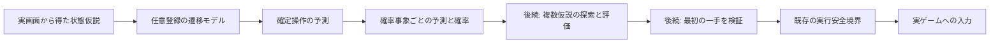

# 仮想操作と確率遷移を実入力から分離する

この文書は汎用ゲームプレイヤーの探索機能を実装する開発者向けです。
現在の成果物はIssue #479の参照モデルと共通契約です。通常利用者の操作はありません。

## 目的と境界

Minecraft、カードゲーム、FPSなどでは、観測の不確実性とゲーム規則が異なります。
汎用Coreへ2048の盤面や攻略法を埋め込まず、ゲームIDで明示登録する任意の
`TransitionModel`を状態型付きの`SimulationKey`で`SimulationProvider`から取得します。
一つのRegistryに異なるゲームの状態型を登録でき、呼出側でAnyやcastを使う必要はありません。
同じゲームIDでも状態型の違うキーは一致せず、同じキーの重複登録は拒否します。未知ゲーム・未登録では
`None`を返します。呼出側は既存の判断経路を維持してください。

汎用契約は`apply_action(state, action_id)`と`chance_outcomes(after_action)`です。
状態型はゲームごとに差し替え、`ActionTransition`で状態変化と報酬増分を返します。
盤面、4方向、tile生成は汎用契約の条件にしません。2048の参照実装だけが、
操作IDを4方向へ変換し、`apply_slide`と`spawn_outcomes`を提供します。



遷移モデルは実入力、画面取得、DOM、Engine、モデルサーバーを参照しません。
予測は観測済みの事実ではありません。`Game2048State`自体は盤面が観測由来かどうかを
証明しない値型です。実行経路へ接続する際は#478の仮説の出所・世代を保持し、
#567の期限・世代検証を通す必要があります。本変更だけではRuntime接続済みになりません。

## 既存手法との対応

| 手法・要求 | 実装 | 検証・後続 |
|---|---|---|
| Expectimaxのmax/chance分離 | `apply_slide`と`spawn_outcomes` | 単体試験、元ゲームJSとのparity。探索そのものは#565 |
| 状態の不変化 | frozen/slotsの`Game2048State`、tupleの防御的コピー | 外部list変更・不正値・型・形状の拒否 |
| 確率分布の全列挙 | 空セルごとの2/4 spawn、確率0.9/Nと0.1/N | 位置・値・全質量1を確認 |
| 再現可能な抽選 | 明示seedのローカル`random.Random` | 同一seed一致、global RNG非変更、独立したJS Oracleとの同一乱数列比較 |
| 参照実装を先行 | 読みやすい行列の圧縮・一手一合成 | bitboardやrow lookupは未導入。最適化の必要性は#565の探索実測で判断 |
| 任意のゲームモデル | `TransitionModel` Protocolと登録の写し | 非盤面のテストモデル、未知ゲームの利用不可。ゲーム対応を増やしたという意味ではない |

基準は既存lockのGabriele Cirulli版2048、commit
`478b6ec346e3787f589e4af751378d06ded4cbbc`です。
`js/game_manager.js`の`addRandomTile`で2=90%、4=10%、`js/grid.js`の
`availableCells`と`randomAvailableCell`で列優先の空セル一覧と均一抽選を確認しました。
Oracleはlock中の全ファイルのGit blob hash検証後にだけ実行します。
upstream JavaScriptのライセンスは同梱元のMITです。Oracleブリッジはテスト専用で、
upstreamコードを本番Pythonの依存にしません。

## 状態と終了条件

- `cells`は行優先の4×4です。0または2以上の整数の2の冪を許可し、bool・float・不正形状を拒否します。
- `score=None`は累積点が未認識であることを表し、合成点が分かっても累積点を捏造しません。
- `won`は2048を合成した履歴です。大きいtileの存在だけから勝利履歴を推測しません。
- 2048を生成した一手でも最後にspawnします。その後は`won and not keep_playing`ならslideを拒否します。
- `continue_game`は勝利停止を解除しますが、`over`は解除しません。
- 有効な移動のspawn後に、空セルも隣接同値tileも無ければ`over=True`にします。
- no-op・終了済み状態のchance分布は、同じ状態の確率1です。新しいtileは生成しません。
- `restart(seed)`は得点・フラグを初期化し二つのtileを生成する仮想操作です。実ゲームを再起動しません。

## 言語配置と計算量

初期実装はPythonです。16セルの参照規則を同じプロセスの状態型で扱い、OS APIや
AI/MLライブラリは不要です。ここだけをC++へ移すと、将来の探索ノードごとに細かなFFIを
増やすおそれがあります。まずCPU参照実装とparityを成立させ、#565で探索全体を測定します。
Native化が必要なら探索batch単位の境界を評価します。C++化率自体は目標にしません。

一回のslideは4行×4セル、chance展開は最大15空セル×2種の30状態です。
各変更状態に4行のtupleを作成します。画像コピーとFFIはありません。
測定ツールはslide・chance列挙・sampleを別々に測り、100出力を保持したheapの
残存割当数・バイト数・peakを記録します。残存割当数は一時割当の総回数ではなく、
tuple数は実際のメモリ転送量ではありません。列挙結果を無制限に保持しないでください。

## 再現手順と確認済み範囲

開発者はNode.jsとPythonを用意してリポジトリ直下から実行してください。
通常ゲームプレイにNode.jsは不要です。

```sh
PYTHONPATH=src:. python -m unittest discover -s tests -p test_game_2048_transition.py -v
PYTHONPATH=src:. python tools/check_2048_transition.py --boards 2000 --seed 479
```

ソース取得・hash検証・Oracle比較が失敗した場合は非ゼロで終了します。成功時のJSONは
`build/transition-2048/report.json`です。CIはPython 3.14の単体試験jobで250盤面と境界状態を
比較し、結果をartifactとして保存します。Windows campaignの既存条件は変更しません。

2026-11-01のクラウドLinux / Python 3.12.14で、2,000ランダム盤面と5境界盤面を使った
20,050ケース（全方向のslide・spawn付きmove・continue・restart）が一致しました。
1,000反復のp50/p95はslideが9.635/10.166µs、chance列挙が116.496/133.261µs、
sampleが10.846/11.347µsでした。環境依存の観測値で、回帰閾値ではありません。

| 段階 | 状態と証拠 |
|---|---|
| Core | 単体試験、20,050ケースのpinned JS parity、CPU/heap測定 |
| Runtime | 未接続。#478、#565、#566、#567で仮説・探索・情報価値・Decision接続を扱う |
| Real-play | Chromiumで3ゲーム404操作の遷移を照合。Windows CIで下記の600秒campaignを確認 |

未達のRuntimeと実プレイをCoreの成功で代用しません。多ゲーム対応の成立、FPSのリアルタイム
性能、未知規則の学習をこのモデル一つで達成したとは扱いません。

## 実画面からの遷移照合

開発者はPillow、PlaywrightとChromiumを用意し、次を実行してください。
通常利用者の依存には追加していません。このコマンドは隔離したローカル配信ページへ
入力し、画面PNGと試験レポートを明示的に保存します。

```sh
PYTHONPATH=src:. python tools/check_2048_screen_transition.py --chromium /usr/bin/chromium --episodes 3 --max-steps 150 --allow-live-input
```

画面スクリーンショットをBGRAへ変換し、既存RecognizerとAdapterが生成する候補を、
既存`CyclingDirectionProvider`、`DecisionPipeline`、Verifier、Safety評価、
`ActionExecutor`経由で実行します。Executorの既存差し替え口でChromiumの選択ページへ
arrow keyを送ります。予測モデルは入力を選ばず、操作後の実画面が予測分布に含まれるかだけを
検査します。非公開DOM盤面を判断へ渡しません。得点表示は試験終了後の計測にだけ読みます。

元ゲームのtile出現アニメーション中、認識確信度0.9375でも一つのcellが`None`となる
ケースを確認しました。`Game2048State`はその入力を拒否します。この試験では元ゲームの
200msアニメーションの完了を待つ350msの観測待ちを置き、unknownの補完や確信度条件の
緩和はしません。これは試験側のsettle条件であり、汎用のtemporal fusionの実装ではありません。
非同期・realtimeゲームの適応的観測は#405、#406、#402で扱います。

2026-11-01、同じ固定版ソースでの観測結果です。

| seed | 実操作数 | 経過秒 | 画面得点 | 最大tile | 結果 |
|---|---:|---:|---:|---:|---|
| 479 | 139 | 80.21 | 1332 | 128 | game over |
| 480 | 127 | 73.19 | 1140 | 128 | game over |
| 481 | 138 | 79.75 | 1256 | 128 | game over |

全404操作で次盤面が予測分布内にあり、3試行ともStop後の追加入力を拒否しました。
最新の結果は`build/transition-2048/screen/report.json`です。レポート内の
`evidence_directory`で指定する固有`run-*`フォルダーへ最終画面と個別レポートを残します。
同時実行でも個別レポートを保持し、最新レポートの別名は原子的に更新します。
このChromium試験だけではWindowsのWGC、Win32入力、独立watchdog、10分/30分campaignの達成証拠にはなりません。
既存の方向巡回を使ったため、攻略の強さが改善したという比較結果でもありません。

同じ実装head `09d05b81588cb352b57fe9de348b2fb55c13ab15` のWindows CI
[language-ci 41305360049](https://github.com/tomiya7688/AI_game_player/actions/runs/41305360049)
では、601.037秒の実入力campaignが成功しました。306操作、2 episode、再起動1回、
recovery 0回、最大tile 256、終了理由`duration_reached`、`live_input_verified=true`です。
成果物`kadoka-windows-e2e-trace`（artifact 13082503657）のreportで確認しています。
これは既存の巡回方策で継続実行できた証拠で、遷移モデルによる攻略改善や30分profileの
達成を示しません。新しいheadのCIは別に確認します。

## 汎用経路を別ゲームで試した結果

2048のAdapterやゲーム専用判断器を使わず、共通の`FrameAnalyzer`、Tesseract OCR、
`RuleProvider`、`DecisionPipeline`と同じExecutor差し替え口を使い、以下のMITゲームを
実ブラウザで起動しました。内部状態は終了後の指標だけに使い、候補を手で追加していません。
ゲームソースは変更していません。

再試験には`tools/probe_browser_game.py`を使ってください。検証済みのローカルcloneと
完全なcommit SHAを指定します。未commitの変更があるソースは拒否します。
供給元checkoutそのものはHTTP公開しません。指定commitのtracked regular fileから、
非hiddenのHTML/JS/CSS/画像/font/audioだけを一時配信先へexportします。`.git`、`.env`、
ignored/untracked file、symlink、JSONや任意の秘密ファイルは配信しません。対象ゲームが
追加形式のassetを必要とする場合は、内容を確認してallowlistを変更してください。
既定はdry-runです。隔離した試験ページへの実入力には`--allow-live-input`が必要です。
操作中にページURLが変わる場合、入力を拒否します。注入した試験Executorも送信直前に
Stopと実行世代を再確認します。既に送信中のブラウザAPIの取り消しは保証しません。

```sh
PYTHONPATH=src:. python tools/probe_browser_game.py --source /path/to/canvas-tetris --expected-commit 4e497d1c858914f0a1f0818698029d1c7dad090b --output build/transition-2048/tetris --width 400 --height 720 --allow-live-input
PYTHONPATH=src:. python tools/probe_browser_game.py --source /path/to/Breakout --expected-commit 4961fece5e9bfb21450b71d1bb8cb3efc8d19338 --output build/transition-2048/breakout --width 1180 --height 700 --allow-live-input
```

試験ページへのクリック以外を実行せず、ゲーム内部の変数を読みません。
開始・終了画面、候補、操作、認識・判断・実行全体の時間、停止理由をJSONへ保存します。
候補消失等は終了値1です。終了値0もゲームの勝利・制御品質を意味しません。

| ゲームと固定revision | 観測結果 | 成立していない能力・追跡 |
|---|---|---|
| [dionyziz/canvas-tetris](https://github.com/dionyziz/canvas-tetris/tree/4e497d1c858914f0a1f0818698029d1c7dad090b) | OCRからPlayをクリックして開始。その後は許可候補無しで停止。1操作、1.12秒 | 文字が消えた後に移動・回転・落下の操作候補が生成されない。認識#11、判断材料#12、typed provider#417の接続が必要 |
| [igameproject/Breakout](https://github.com/igameproject/Breakout/tree/4961fece5e9bfb21450b71d1bb8cb3efc8d19338) | 30操作、24.86秒、50点、残機2。候補はScore/Level等の文字が主体 | 追跡や適切な入力に結び付かず、パドル制御は未成立。#402の追跡、#408の段階別候補、#417、#391の時間付き入力へ接続が必要 |

この試験は、3ジャンルで汎用プレイが完成したという意味ではありません。テトリスの停止と
ブロック崩しの無関係なクリックは、現在の汎用経路の未達として扱います。ゲームごとの
巨大な規則分岐で埋めず、画面からの状態・操作可能性と、許可候補を選ぶ判断器の接続として
改善する必要があります。後続の証拠管理と複数ゲームの受入条件は#96と#19を正本にします。

## 試験ツールの終端・競合処理

勝利表示は画面のOCR（You win）で検出し、続行操作を勝手に発行せず終了します。
勝利overlayで盤面が読めない場合はセルを補完せず、`terminal_board_unverified=true`と
その操作の`prediction_matched=null`を記録します。OCR依存が利用できず認識が不完全な場合も
成功へ変換せず認識失敗として終了します。

Oracleの出力も固有の`report-*.json`を保持し、固定名は最新結果への原子的な別名です。
source cacheの同時構築では、先に公開されたdirectoryの全ファイルをlock hashで検証した
場合だけ再利用します。破損した先行cacheや無関係なrenameエラーは成功へ変換しません。
