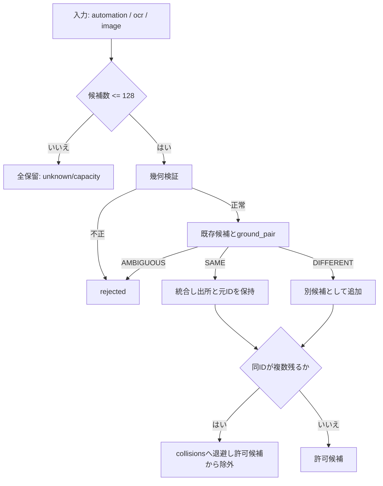

# 候補の同一性ガード（CandidateIdentityGuard）仕様（#495）

## 要約

- 目的: `CandidateMerger`が「同じIDなら同一対象」と無条件に統合する誤りを廃し、別の画面要素を同じ候補として実入力へ結び付けない。
- 状態: 実装済み（Spec-Status: READY を実装）。Trace・候補UIへの理由表示の接続は後続。
- 最終確認日: 2026-11-07
- 親ページ: [architecture目次](../architecture/README.md)
- 関連: Issue [#495](https://github.com/tomiya7688/AI_game_player/issues/495)・[権限分離の正本](../architecture/autonomous_player_goal_authority.md)（候補の出所と採否の境界）

## 仕様

- 新規`src/ai_game_player/candidate_identity.py`: `CandidateIdentity`・`MergeContext`・`CandidateMergeReport`・`ground_pair`。
- `CandidateMerger.merge_detailed(automation, ocr, image, context=None)`を追加する。既存の`merge`と`merge_with_sources`は、衝突と拒否を除いた候補だけを返す互換アダプタである。
- `ground_pair`は`SAME`・`DIFFERENT`・`AMBIGUOUS`を返し、IDは判定に使わない。
  - 座標系・Frame・世代が両方既知で食い違う場合は`AMBIGUOUS`。入力元の世代が違う候補は統合せず拒否する。
  - 種別が違えば`DIFFERENT`。
  - 矩形の重なり率が閾値（既定0.5）以上、または中心距離が既定20px以内で、両方に文字があれば正規化後に一致する場合だけ`SAME`。重なっても文字が食い違えば`DIFFERENT`。
  - 位置の証拠がない候補（キー操作など）は統合しない。
- 同じ`action_id`が異なる対象として複数残る場合は、全てを`collisions`へ退避し、最終許可候補を0件にする。別IDの自動生成はしない。
- 異IDで同一対象と判定した候補は統合し、出所（`sources`）と元ID（`origin_ids`）を全て保持する。
- 上限は128候補・16,384比較。超えると全候補を保留し`reason`を`unknown/capacity`とする。NaNなど不正な座標は`rejected`に理由付きで入れる。
- `reason`は固定語彙。
  - 統合可: `ok`
  - 衝突: `collision/same_id_different_target`
  - 不明: `unknown/ambiguous_identity`、`unknown/capacity`
  - 棄却: `rejected/invalid_geometry`

## 処理の流れ

## テスト

`tests/test_candidate_identity.py`と既存`tests/test_candidate_merger.py`で次を検証します。

- 同ID別位置・同ID別種別の衝突
- 別ID同対象の統合と元ID保持、同文字別位置の独立
- 世代・座標系不一致、文字衝突、座標なし候補、NaN
- 上限超過、比較回数の上限

## 制約と未決事項

- 呼び出し元（`application_workflow`・`pipeline`）は`context`をまだ渡さない。そのため世代・座標系の食い違い検出は、呼び出し元が渡すまで有効にならない。
- 衝突・拒否理由をTrace・候補UIへ表示する接続と、p50/p95の実測は後続で扱う。
- #853（一部実装）: 新しい候補は統合済みグループの全メンバーの証拠と照合する（比較回数はメンバー数だけ増える）。画像由来を含まず、両方に矩形があって重ならない候補は、中心が近くても統合しない。
- #853（未実装）: 呼出元からMergeContextを渡す接続、Trace・候補UIへの理由表示、ラベル空で矩形のない近接候補の扱いは後続で扱う。
