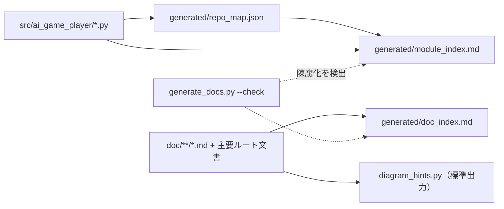

Spec-Status: READY
Parent: #19
Last-Checked: 2026-11-08

# Issue #895 読む時のトークンを減らす目次・責務表・依存図の自動生成

## 目的
設計書やソースを読む時に、探すためだけに読む量を減らす。コードや文書から導けるものは手で書かず自動生成し、導けないもの（設計の流れの図）は、書く前に事実を抽出する。

## 範囲
対象: モジュールの目次・責務表・グループ間の依存図、文書の目次、手書き図のヒント抽出、`generate_docs.py`への接続、入口文書（`AI_CONTEXT.md`、`AGENTS.md`、スキル）からのリンク。
対象外（#895の第2段）: PR作業の繰り返し手順（PR状態の要約、レビュースレッドの返信・解決、CI待ちの確認）のスクリプト化。責務コメントがないモジュールへのコメント追加。

## 責務表（このPRで追加した部品）
| 部品 | 責務 | 入力 | 出力 |
|---|---|---|---|
| `tools/generate_module_index.py` | モジュールの目次・責務表・依存図を作る | `generated/repo_map.json`、各ソースの構造化コメント「責務」 | `generated/module_index.md` |
| `tools/generate_doc_index.py` | 文書の題名・先頭の1文・親Issue・確認日の目次を作る | `doc/**/*.md`、主要ルート文書4件 | `generated/doc_index.md` |
| `tools/diagram_hints.py` | 手書き図の下書き材料（見出し・表の行・参照文書・Issue・コード上の名前）を出す | 指定した設計書 | 標準出力 |
| `tools/generate_docs.py` | 生成物を作る・陳腐化を`--check`で検出する（既存。上記2つを接続） | `tools/completion_config.json` | 各生成物 |

## データと処理の流れ

- 責務は、クラス・トップレベル関数の直前にある構造化コメント「責務」（1行形式と複数行形式）を、メソッドの責務より優先する。なければモジュールのdocstringの最初の行、それもなければ「(責務コメントなし)」とし、件数を目次の上に出す。
- グループは、サブパッケージと、直下のモジュールのファイル名の接頭辞（同じ接頭辞のモジュールが4つ以上）。それ以外は「その他の直下」。依存は`src/ai_game_player`内のimportだけを数える。
- 文書の要約は、見出しの後の最初の段落（折り返しは結合、リンクだけの行・表・リスト・フェンス内は除く）の最初の1文（100字まで）。メタデータ（`Parent`、`Spec-Status`、`Last-Checked`）は見出しより前の行を読む。
- `doc/`配下の symlink とリポジトリ外を指すファイルは索引に取り込まない。

## 制限と、採用しなかった指摘
- 更新日は載せない。ファイルの更新日をGitから取ると、コミットのたびに索引が変わり、`--check`が不安定になる。代わりに文書のメタデータ`Last-Checked`（確認日）を載せる。
- 生成物の書込みは既存の生成物（クラス図など）と同じ方式で、原子的な更新や同時実行の排他は行わない。再生成すれば同じ内容に戻る。
- 責務の1行目だけを載せる。意味の正本は各クラスの構造化コメントと設計書。
- 「責務コメントなし」は件数の表示にとどめ、コメントは追加していない。

## テスト
`tests/test_reading_indexes.py`: 責務の抽出（1行・複数行・トップレベル優先・docstring）、グループ化とアンカーの一意性、依存図の辺、文書の要約・symlink・空白を含むパス、ヒント抽出（フェンス内の除外）。`tests/test_generate_docs.py`: 生成と陳腐化の検出。

## 未決事項
- 第2段のスクリプトの形（PR状態の要約、スレッドの返信・解決、CI待ち）。
- 責務コメントなしの36件への追記の優先順位。
