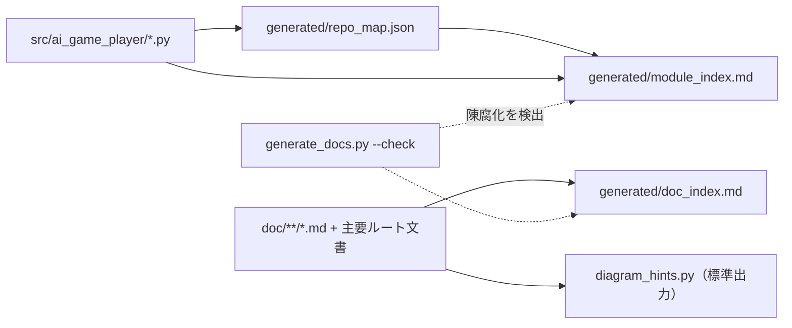

Spec-Status: READY
Parent: #19
Last-Checked: 2026-11-09

# Issue #895 読む時のトークンを減らす目次・責務表・依存図の自動生成

## 目的
設計書やソースを読む時に、探すためだけに読む量を減らす。コードや文書から導けるものは手で書かず自動生成し、導けないもの（設計の流れの図）は、書く前に事実を抽出する。

## 範囲
対象: モジュールの目次・責務表・グループ間の依存図、文書の目次、手書き図のヒント抽出、`generate_docs.py`への接続、入口文書（`AI_CONTEXT.md`、`AGENTS.md`、スキル）からのリンク。
対象外（#895にさらに残す）: 責務コメントがないモジュールへのコメント追加。
第2段（このPR）の範囲は後半の「PR作業の要約スクリプト」に書く。

## 責務表（このPRで追加した部品）
| 部品 | 責務 | 入力 | 出力 |
|---|---|---|---|
| `tools/generate_module_index.py` | モジュールの目次・責務表・依存図を作る | `generated/repo_map.json`、各ソースの構造化コメント「責務」 | `generated/module_index.md` |
| `tools/generate_doc_index.py` | 文書の題名・先頭の1文・親Issue・確認日の目次を作る | `doc/**/*.md`、主要ルート文書4件 | `generated/doc_index.md` |
| `tools/diagram_hints.py` | 手書き図の下書き材料（見出し・表の行・参照文書・Issue・コード上の名前）を出す | 指定した設計書 | 標準出力 |
| `tools/pr_digest.py` | PRの状態・CI件数・失敗チェック・botの指摘の見出し・未返信を1回で出す。`--rerun-failed`で、全runが完了し失敗かつ未再実行の時だけ失敗ジョブを1回再実行する | PR番号（GitHub REST） | 標準出力 |
| `tools/generate_docs.py` | 生成物を作る・陳腐化を`--check`で検出する（既存。上記2つを接続） | `tools/completion_config.json` | 各生成物 |

## データと処理の流れ

- 責務は、クラス・トップレベル関数の直前にある構造化コメント「責務」（1行形式と複数行形式）を、メソッドの責務より優先する。なければモジュールのdocstringの最初の行、それもなければ「(責務コメントなし)」とし、件数を目次の上に出す。
- グループは、サブパッケージと、直下のモジュールのファイル名の接頭辞（同じ接頭辞のモジュールが4つ以上）。それ以外は「その他の直下」。依存は`src/ai_game_player`内のimportだけを数える。
- 依存先・依存元は、「件数: モジュール名（最大5件、残りは「他N」）」の形で責務表に載せる。全件は`generated/repo_map.json`にある。
- 文書の要約は、見出しの後の最初の段落（折り返しは結合、リンクだけの行・表・リスト・フェンス内は除く）の最初の1文（100字まで）。メタデータ（`Parent`、`Spec-Status`、`Last-Checked`）は、見出しの前後を問わず、本文の最初の段落より前にある行を読み、要約からは除く（設計書には見出しの前に置くものと後に置くものが両方ある）。
- `doc/`配下の symlink とリポジトリ外を指すファイルは索引に取り込まない。

## 制限と、採用しなかった指摘
- 更新日は載せない。ファイルの更新日をGitから取ると、コミットのたびに索引が変わり、`--check`が不安定になる。代わりに文書のメタデータ`Last-Checked`（確認日）を載せる。
- 生成物の書込みは既存の生成物（クラス図など）と同じ方式で、原子的な更新や同時実行の排他は行わない。再生成すれば同じ内容に戻る。
- 責務の1行目だけを載せる。意味の正本は各クラスの構造化コメントと設計書。
- 「責務コメントなし」は件数の表示にとどめ、コメントは追加していない。

## PR作業の要約スクリプト（第2段）

PR作業のたびに繰り返していた確認（状態、CI件数、失敗チェック、botの指摘、未返信、失敗ジョブの再実行）を`python3 tools/pr_digest.py 番号 [--bots] [--rerun-failed]`にまとめた。長いbotの要約コメントやCIログを読まずに、次の一手を決めるための読み取り中心のツール。

- GraphQLが使えない環境(クラウド)があるため、RESTだけを使い、ページ番号を明示して全件取得する(`--paginate`は使わない)。
- `--rerun-failed`は、head SHAの全workflow runが完了していて、失敗したrunがあり、まだ再実行していない(`run_attempt=1`)時だけ、失敗ジョブを1回再実行する。実行中のrunがある間、再実行済み、失敗なしの場合は何もしない(再実行は最大1回の規則)。
- 再実行の対象は`failure`と`timed_out`のrun(`action_required`は人の承認待ちで再実行できず、表示だけ)。計画(`plan_rerun`、純粋関数)とPOST(`post_rerun`)を分けた。POSTが途中で失敗しても、実行済みの結果を残し、終了コードは1になる。PRを読めない場合も1。
- 再実行の対象は、このPRの`head_branch`と一致するrunだけ(同じSHAを持つ別ブランチ・別PRのrunは触らない・待たない)。runはidで重複を除く。POSTの直前に、PRのheadが読み取り時から変わっていないことと、計画が再取得でも同じであることを確かめる。
- 出力するPR由来の文字列(題名・チェック名・botの見出し・投稿者名)は端末制御文字を除く。削除されたアカウント(`user`がnull)は`ghost`と表示する。レビュー状態はレビュアーごとの最新だけを出す。`gh`が無い場合などの`OSError`も終了コード1で報告する。CIのチェックは`filter=latest`で、再実行で置き換わった古いattemptを数えない。
- **限界**: 2つの呼出しが同時に走る場合や、再実行の直後にGitHubがrunの状態を更新するまでの短い遅れの間は「1回だけ」を保証しきれない(GitHubに原子的な再実行APIは無い)。再実行したrunは待機状態になるため、実行中のrunがある間は何もしない条件とPOST直前の再確認で窓を狭めている。
- **限界**: コミットステータスAPIで報告されるCI(チェックランでないもの)は数えない。このリポジトリの必須CIはActionsのチェックランである。
- **限界**: 出すのはインラインの指摘だけで、botのレビュー本文(要約・nitpickの節など)は出さない。レビューを完了とする前に、`pull_request_read`の`get_reviews`で本文を、`get_comments`でPRの通常コメント(botが要約を通常コメントに投稿する場合がある)も読む。
- **限界**: レビュースレッドの解決状態(`is_resolved`)はGraphQLでしか取れないため出さない。スレッドの確認と解決はGitHub MCPの`pull_request_read`(`get_review_comments`)と`resolve_review_thread`で行う。マージ可否の最終判定は`tools/finish_pr_merge.py`が持ち、このツールは判定しない。

## テスト
`tests/test_reading_indexes.py`: 責務の抽出（1行・複数行・トップレベル優先・docstring）、グループ化とアンカーの一意性、依存図の辺、文書の要約・symlink・空白を含むパス、ヒント抽出（フェンス内の除外）。`tests/test_generate_docs.py`: 生成と陳腐化の検出。`tests/test_pr_digest.py`: 失敗チェックの集計、botの指摘の見出し抽出と返信の判定、`--rerun-failed`の4通り(実行中・失敗なし・再実行済み・再実行する)。

## 未決事項
- スレッドの返信・解決をスクリプト化するか(GraphQLが使えない環境では不可。MCPツールで行う)。
- 責務コメントなしの36件への追記の優先順位。
