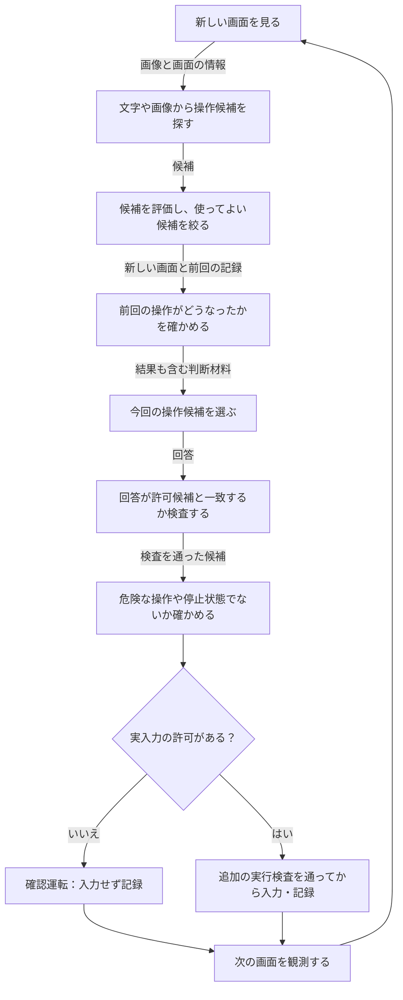
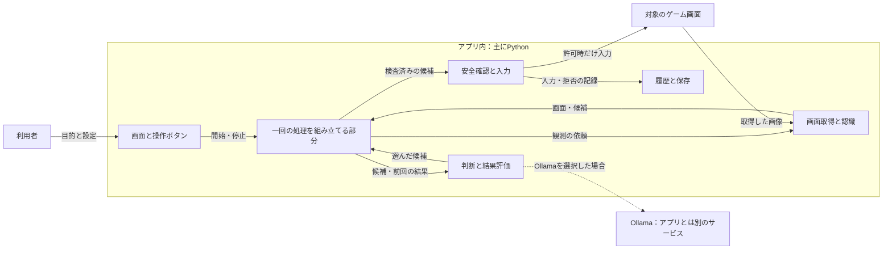
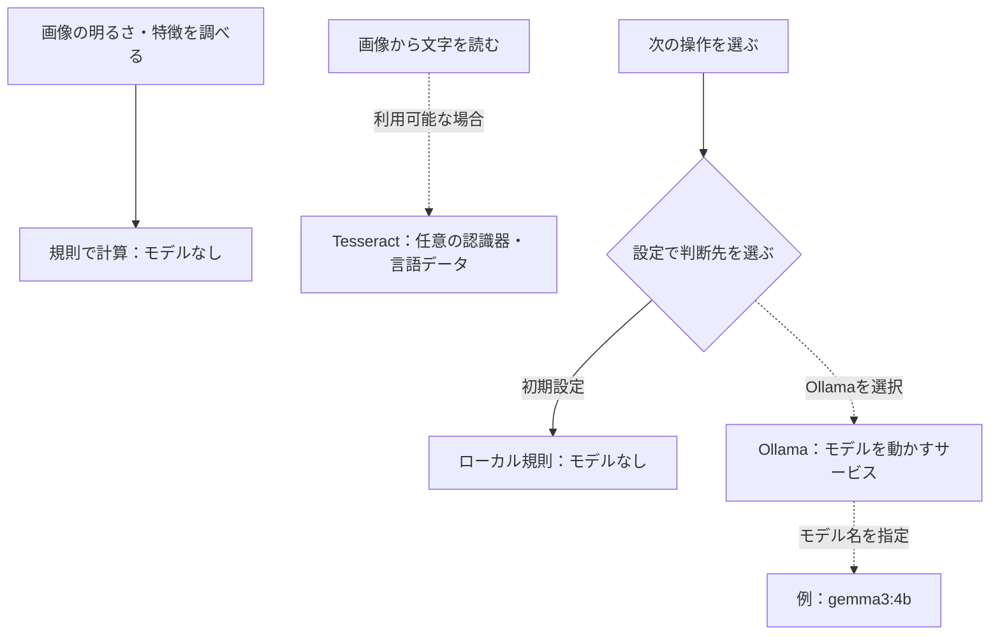

# AI Game Player：まず全体を知る

[READMEへ戻る](../../README.md) ｜ **[目指す完成図と現在の実装図](target_and_current.md)** ｜ [場所ごとの実装状況と根拠](implementation_status.md) ｜ [用語集](terms.md)

## このアプリは何をするもの？

ゲームの画面を見て、次にできそうな操作を探し、どれを選ぶか決め、その操作の後で画面がどう変わったかを確かめるアプリです。目指しているのは、必要な処理を選び、経験から遊び方を改善できるゲームプレイヤーです。

**現在の実装と目指す完成形は違います。** このページは現在の基本の流れを説明します。最初に[完成図と現状図の比較](target_and_current.md)を読むと、どこまでつながっていて、何が残っているかを把握できます。部品ごとのコードとテストは[実装状況](implementation_status.md)へ分けています。

**初期設定の実入力は無効です。** ただし、以前に許可して保存した状態は、次の起動時にも実入力のチェック欄へ復元されます。操作を始める前にチェック欄と状態表示を確認してください。確認運転（dry-run）では実際のキーやマウス入力を送らず、どう判断したかを記録します。実入力には明示的な許可と、独立した安全の検査が必要です。

> 確認日：2026-11-01。統合コードの基準は`f145c946685ae7361f8d3e6416b85c6fdf07e988`です。初版の`main@d31377e`から、実行受領記録・Mode・軽量知識更新を反映しました。ソースを読んだ説明と、モデル起動・Windows実機・実ゲームでの試験結果を区別しています。

## 図1：一回の操作は、どの順番で進む？

矢印の言葉が「何を渡すか」、ひし形が条件です。実行拒否・停止・候補なし・取得失敗では、図の通常経路を続行しません。最初の一回には前回の操作記録がありません。

**入力を送れたことと、ゲームの目標を達成できたことは別です。** 前回の記録を新しい画面と比べて結果を調べます。#628以後、送信確認できた同世代の実行受領記録へ入力後の観測を明示的に結び付け、判断だけ・確認運転・拒否を実操作結果へ混ぜません。これは入力の因果効果を保証するものではありません。[実装状況の注意点](implementation_status.md)を参照してください。

## 図2：部品はどこにある？

実線は基本のつながり、点線は条件付きの接続です。Ollamaの接続先が同じPCか別PCかは設定で変わります。外部の接続先へ送る場合は、画面由来の状態・候補・目的・履歴などがその相手に渡るため、送信先とデータの扱いを確認してください。HTTPの接続は暗号化されません。[脅威モデル](../security/threat_model.md)も参照してください。

C++による画面取得と画像前処理は別の機能です。C++の部品が存在することを、すべての標準処理が自動的にC++へ切り替わることと混同しません。

## 図3：どこで学習済みモデルを使う？

`gemma3:4b`はモデル欄の初期値です。常に読み込まれ、実行されているモデルという意味ではありません。モデルが画像対応でも、現在の操作判断の依頼が画像そのものを送ることにはなりません。GUIからの直接の状態評価と、処理中の条件付きの意味評価も[別経路として説明しています](implementation_status.md)。

## 具体例：「開始」という文字を見つけたとき

文字認識が「開始」と位置を返したとします。それだけで押せるボタンとは断定せず、候補を評価します。前回の記録と今回の画面から得た結果も含めて、規則または選択されたモデルが候補を提案します。その後に回答の検証と安全確認を通します。確認運転なら入力は送りません。実入力時も、送信結果だけでは成功と決めず次の画面を観測します。

これは説明例で、実ゲームで「開始」を検出してクリックした試験結果ではありません。

## 必要な場所だけ詳しく読む

| 知りたいこと | 最初に開く説明書 |
|---|---|
| 完成形と現在の差は？ | [完成図と現状図](target_and_current.md)・[実装状況と残作業](implementation_status.md) |
| 画面をどう取得する？ | [画面キャプチャ機能説明書](../画面キャプチャ機能説明書.md) |
| 文字や画像をどう見分ける？ | [OCR候補検出機能説明書](../OCR候補検出機能説明書.md)・[画像解析機能説明書](../画像解析機能説明書.md) |
| 複数の候補をどう整理する？ | [候補統合機能説明書](../候補統合機能説明書.md) |
| 判断には何を渡す？ | [DecisionContext機能説明書](../DecisionContext機能説明書.md)・[判断パイプライン機能説明書](../判断パイプライン機能説明書.md) |
| 操作の後をどう評価する？ | [OutcomeDetectionFusion機能説明書](../OutcomeDetectionFusion機能説明書.md) |
| 実行をどう安全に止める？ | [ActionSafetyEvaluator機能説明書](../ActionSafetyEvaluator機能説明書.md)・[FailSafeRuntime説明書](../FailSafeRuntime説明書.md) |
| 記録や学習用データは？ | [Experience Reader機能説明書](../Experience%20Reader機能説明書.md)・[学習データセット生成機能説明書](../学習データセット生成機能説明書.md) |
| 実行場所やC++との境界は？ | [実行の層](../architecture/runtime_layers.md)・[NativeRuntime接続機能説明書](../NativeRuntime接続機能説明書.md) |
| プログラムの入口は？ | [責務別のソース索引](../../src/ai_game_player/README.md) |

既存の機能説明書は細かな仕様の正本です。人が理解するための領域別資料は子Issue #608〜#613で整備し、統合後に入口を相互接続します。

## 資料の状態をどう読む？

「部品が存在する」「通常の実行経路につながる」「実際の環境で確かめた」は別の状態です。IssueやPRが閉じたことだけで実機確認済みとはしません。未確認の項目には理由と残作業を残します。

資料を更新する人は[執筆様式](writing_rules.md)を使ってください。親[Issue #606](https://github.com/tomiya7688/AI_game_player/issues/606)に資料整備の範囲と残作業を集約しています。
