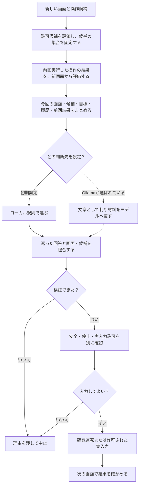
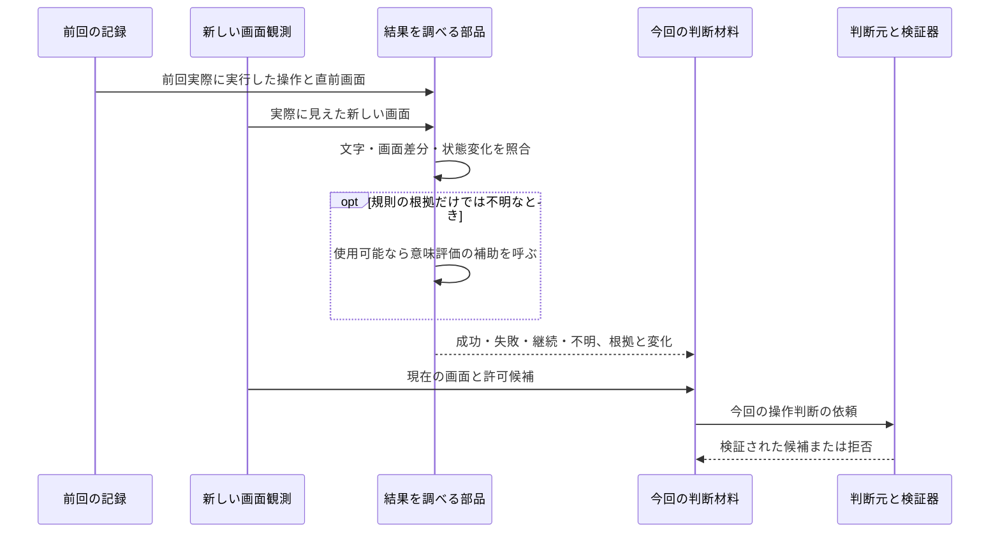

# 次の操作をどう決める？ 前回の結果をどう確かめる？

[リポジトリへ戻る](../../README.md) ｜ [処理を選ぶ調整役と時間配分](orchestration.md) ｜ [DecisionContextの詳しい説明](../DecisionContext機能説明書.md)

このページは、**候補を評価すること、前回の操作結果を調べること、今回の操作を選ぶこと、回答を検証すること**を別々の仕事として説明します。いずれも「高い点数だからそのままゲームへ入力する」という意味ではありません。

**確認範囲：** 2026-10-31、main `4d8ae6f515024b7ba8bed900b50735ab8cc07ea4` のコードと既存文書。Windows実機・モデル推論・ベンチマークはこの資料のために実施していません。

## 図1：実際の判断順と、別にある安全検査

**実線：** 基本の処理順。**点線：** 設定により使う判断先。候補が不正・存在しないときは、判断を続けて架空の候補を作りません。停止後に返った古い推論の結果も、実行世代の検査を通れません。安全や実入力許可はモデルに任せていません。

## 図2：前回の操作と今回の画面をつなぐ

**最初の一回**や**前回操作を送信しなかった場合**は、前回「実行した操作」が存在するかを区別します。実入力しなかった判断を、ゲームに与えた操作の成功として使いません。キーを送った記録だけでゲームの目標達成を確定しません。

## 手法カード J1：候補を使ってよいか評価する

- **目的と入力：** 新しい画面と候補を受け取り、判断に渡してよい候補を絞ります。
- **方法：** `ActionEvaluator`が候補の識別子の重複、確信度、必要な座標などを調べます。拒否理由も残せます。
- **出力：** 許可候補の集合、候補別の評価結果。評価を通過しても実入力の許可ではありません。
- **モデル：** 規則処理なので学習済みモデルなし。
- **失敗・負荷：** 許可候補がなければ選択を中止する場合があります。処理時間はこの資料では未測定。
- **根拠：** [evaluator.py](../../src/ai_game_player/evaluator.py)、[engine.py](../../src/ai_game_player/engine.py)、[テスト](../../tests/test_evaluator_explain.py)。

## 手法カード J2：判断材料に複数の評価根拠をまとめる

`DecisionContextBuilder` は候補の許可状態だけでなく、繰り返し操作の履歴、前回結果、必要な知識などを今回の判断材料に含めます。候補の評価には、規則に基づく安全寄りの評価や、同じ操作を繰り返して進展がない場合の減点があります。

`EvaluationFusion` は各評価器の点数を **評価の確かさ × 評価器の信頼度** で重み付けしてまとめ、支持・反対が食い違う場合は不一致も残します。これは学習済みモデルを使わない計算です。**計算結果を正解確率や安全の許可として扱いません。**

仮に評価器Aが点数 `+0.6`、確かさ `0.8`、信頼度 `0.8`、評価器Bが点数 `-0.4`、確かさ `0.5`、信頼度 `0.8` を返すと、各重みは `0.64` と `0.40`、重み付き点数は約 `0.215` です。**説明用の計算であり、実ゲームの測定・正答確率ではありません。**

採用しない条件は、評価の根拠が不足したとき、許可できない候補を重みで復活させようとするときです。根拠：[decision_context.py](../../src/ai_game_player/decision_context.py)、[既存詳細](../DecisionContext機能説明書.md)。

## 手法カード J3：前回操作の結果を照合する

結果を調べる部品は、画面に見える終了表示、状態や画面の差分、複数時点の変化などを根拠として集めます。強い根拠がある場合は先に扱い、根拠が割れたときは成功・失敗を無理に断定しません。**「画面が変化したか」と「ゲームで勝ったか」も別の結果**です。

モデルなしの検出・統合が基本ですが、結果が不明または確かさが基準より低く、意味評価に対応した判断先が使える場合は、追加の意味評価を呼ぶ経路があります。これを常時のモデル呼出しと描きません。

入力は前回の観測・実行済み候補・新しい観測、出力は結果・根拠・不確かさです。根拠不足時は不明を残します。負荷は本資料では未測定。根拠：[outcome_fusion.py](../../src/ai_game_player/outcome_fusion.py)、[結果評価の既存説明書](../OutcomeDetectionFusion機能説明書.md)。

## 手法カード J4：今回の操作を選ぶ

- **ローカル規則（初期設定）：** 許可候補の目的寄与の評価、見込みの確かさ、認識確信度などを順に比べます。学習済みモデルは不要です。
- **Ollama（選択時）：** JSONとして表した画面・許可候補・目標などを文章の判断材料として送り、候補IDと理由を返すよう依頼します。モデルや接続先は設定に依存します。モデルが画像認識対応でも、この標準の判断要求で画像そのものが送信されるとは言えません。
- **共通の検査：** 今の画面の識別情報に合うか、許可候補に実在する操作IDか、形式が正しいかを確かめます。不正なら拒否し、実行しません。
- **不明・失敗時：** 候補なし、通信・時間切れ、壊れた応答、古い推論、検証拒否を区別します。無条件の別モデルへの自動切替は主張しません。

根拠：[provider.py](../../src/ai_game_player/provider.py)、[decision_verifier.py](../../src/ai_game_player/decision_verifier.py)、[pipeline.py](../../src/ai_game_player/pipeline.py)。

## 次に読む資料

「複数の手法をいつ選ぶか」と「時間がどれだけあるか」は [調整役と時間配分](orchestration.md) に分けています。操作の安全については[#612](https://github.com/tomiya7688/AI_game_player/issues/612)、モデル名や実際の呼出し先については[#609](https://github.com/tomiya7688/AI_game_player/issues/609)を参照してください。