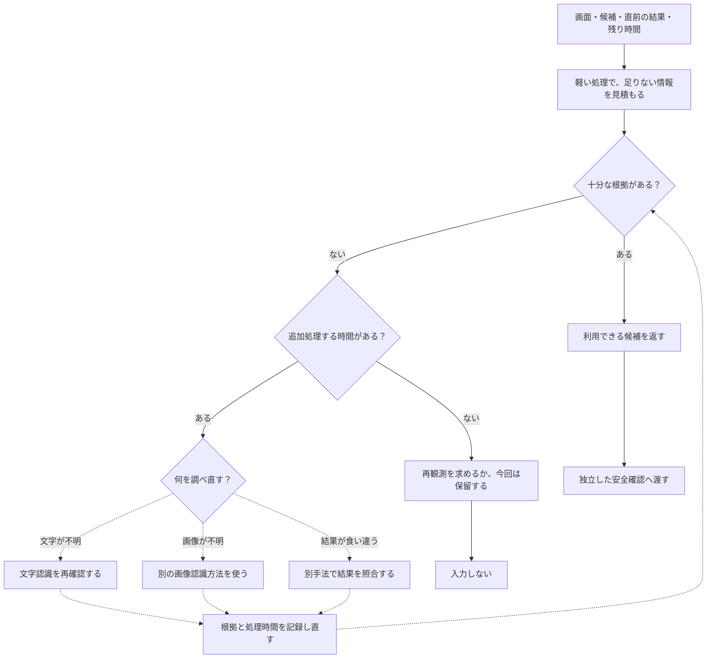

# 処理を選ぶ調整役と、精度・時間の配分

[判断の流れへ戻る](judgment.md) ｜ [親Issue #606](https://github.com/tomiya7688/AI_game_player/issues/606)

**オーケストレーター**は、複数の手法やモデルのうち、どれをいつ使うかを選ぶ「調整役」です。**調整役それ自体が高精度な認識モデルという意味ではありません。** このページは、すでにある部品と、実行経路へ接続しきれていない拡張の要求を分けて説明します。

## すでに確認した、軽い判断と統合

| 何を決める？ | 確認した仕組み | 状態 |
|---|---|---|
| この候補を判断に渡す？ | `ActionEvaluator`による拒否条件 | 実装と接続あり |
| 複数の評価をまとめる？ | `EvaluationFusion`の確かさ・評価器信頼度による重み付けと不一致 | 判断材料の構築に接続 |
| 前回操作が成功した？ | 画面の根拠を`DeterministicOutcomeFusion`で統合 | 結果検出に接続 |
| 追加の意味評価が必要？ | `OutcomeDetector`の低確信・判定保留時の条件分岐 | 対応Providerがあるときだけ |
| 軽量な知識更新を今公開できる？ | #421 Modeと#422のStep境界、保持入力・停止・版・予算の検査 | 実Sessionへ接続。効果不明や既定の識別無効時は因果学習を保留 |
| 未知・不確かな状態が続いた？ | `UnknownnessMonitor`が処理範囲ごとに不確かさを統合 | **コアAPIあり。標準ゲーム実行パイプラインへの自動接続は未確認** |

**重要：** 上の表にある重みは、評価器側に定義された信頼度などを使う計算です。「実行中に各手法の重みをすべて自動で学習更新し、最適なモデルを選ぶ」という機能を確認したわけではありません。学習済みモデルなしで動く条件分岐も重要です。

## 図：目指す処理選択の考え方（設計例・標準実装ではない）

**この図は要求されている拡張の説明例です。** すべての分岐・学習・再観測が標準パイプラインへ実装されていると断定しません。複数の画像、複数回の推論、多数決、各場面への重み付け、外部AI・別PCへの問い合わせは、個別に接続と検査が必要です。調整役は**安全確認を省略・緩和できません**。

## どの方法を選ぶ？ それぞれの得意・不得意

| 方法 | 使うと役立ちそうな状況 | 避ける・注意する条件 | 現在の確認 |
|---|---|---|---|
| 軽い規則で判断する | 候補や状態が明白で、速く決めたい | 見えていない内容を推測で埋めない | RuleProviderを確認 |
| 複数評価を重み付きで統合 | 根拠の強さが異なる判断をまとめたい | 同じ根拠の重複を独立した票と数えない | EvaluationFusionを確認 |
| 画面差分で結果を確かめる | 前回から変化があるか知りたい | 変化をゲームの勝利と同一視しない | OutcomeDetectorを確認 |
| 弱い結果に意味評価を追加する | 規則だけでは不明な結果を調べたい | 通信失敗・時間切れ・モデル未設定 | 条件付き経路を確認 |
| 別画像・別モデル・再観測を選ぶ | 認識結果が食い違い、確認する価値がある | 待ち時間が大きい・安全に関わる | 標準の自動選択全体は未確認 |
| 不確かさに応じて保留する | 根拠が少なく確信しきれない | 単一Providerの自己申告だけで決めない | Unknownness APIのみ。接続未確認 |

## 手法カード O1：見込まれる改善と必要時間の比較

実装したい調整役は、候補の処理時間を見積もり、追加したときに判断がどの程度改善しそうかを比較します。

1. 今ある情報で判断を続けると何が不明かを確認する。
2. 追加候補（再観測・別の認識器・意味評価）ごとに、所要時間と改善の見込みを考える。
3. 制限時間に収まり、効果が見込める処理を選ぶ。足りなければ追加推論せず、保留・停止を選ぶ。
4. 実際の時間と結果を次の見積りに反映する。ただしモデル自身の自己評価だけを「正解」として更新しない。
5. どの場合でも安全の検査は別に残す。

**数字を使った説明例（実測ではありません）：** 今回の残り時間が`80ms`で、軽い確認は`12ms`、重い追加推論は`110ms`と予想されたとします。重い処理は単独でも残り時間を超えるため、通常の自動選択対象にしません。軽い確認の結果も不確かなら、無理に決めず次の観測に回す方が適切な場面があります。

この時間予測と改善期待値の**自動更新まで実装済みとは言いません**。現行ソースで確認できたのは主に条件付きの意味評価や評価統合などの個別機能です。性能値を公開するときは、測定機材、画像サイズ、モデル・版、繰り返し回数、比較対象を必ず添えます。

## 手法カード O2：不確かな状態をどう扱う？

`UnknownnessMonitor`は、認識が弱い、評価器が食い違う、知識が見つからない、状態変化があいまい、といった検出器側の根拠を範囲ごとにまとめます。「一度だけ不明」と「何度も不明が続く」は別です。

これは**不確かさを測るAPI**です。APIがあることをもって、「見直す・待つ・操作する・停止する」を自動的に選ぶ統合調整機構が完成しているとは言えません。

- **入力：** 検出器が根拠の種類・値・信頼度・出所とともに作る値。
- **出力：** 処理範囲ごとの瞬間的・持続的な不確かさと根拠。
- **モデル：** 基本の融合計算は学習済みモデルなし。
- **選ぶ条件：** 呼出し側が検出結果を正規化し、APIに渡す場合。
- **失敗・制約：** Providerが自己申告した確信度だけを証拠としない。実際の認識器とつながる自動実行は未確認。
- **根拠：** [UnknownnessMonitor機能説明書](../UnknownnessMonitor機能説明書.md)、[実装](../../src/ai_game_player/unknownness.py)、[テスト](../../tests/test_unknownness.py)。

## 各層のオーケストレーションは、同じものではない

**認識の調整役**は、OCRか画像処理か、もう一度画面を見るかを選びます。**判断の調整役**は、候補を絞り、どの根拠と判断先を使うかを選びます。**結果評価の調整役**は、変化・終了表示・意味評価を使い分けます。全部を一つの重い言語モデルへ毎回投げる必要はありません。

複数回の推論を平均する場合も、評価器の信頼度が校正されていなければ「80%正しい」などと表示してはいけません。異なる手法が独立に見える場合でも、同じ画像や同じ訓練由来の間違いを共有することがあります。

## 根拠と残作業

確認ソース： [decision_context.py](../../src/ai_game_player/decision_context.py)、[outcome_fusion.py](../../src/ai_game_player/outcome_fusion.py)、[unknownness.py](../../src/ai_game_player/unknownness.py)、[provider.py](../../src/ai_game_player/provider.py)。既存の仕様・要望は [Issue #611](https://github.com/tomiya7688/AI_game_player/issues/611)、関連する認識詳細は[#610](https://github.com/tomiya7688/AI_game_player/issues/610)。

未確認：新しい調整役による自動モデル選択、実測に基づいた期待時間・改善効果のオンライン更新、あらゆる認識モデル・外部エージェントの接続、Windows実機での確認。これらは文書の作成だけでは解決しません。