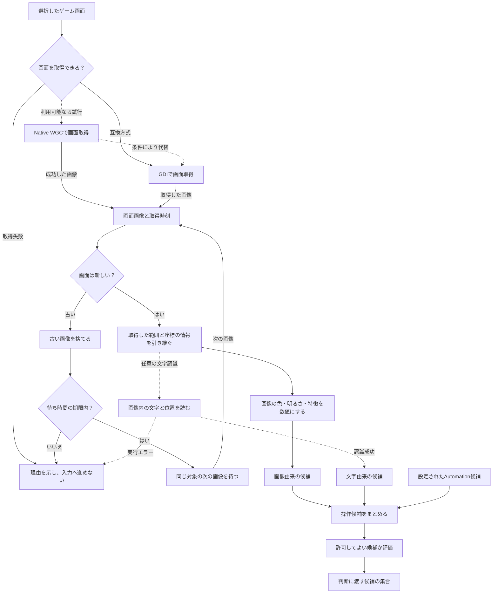
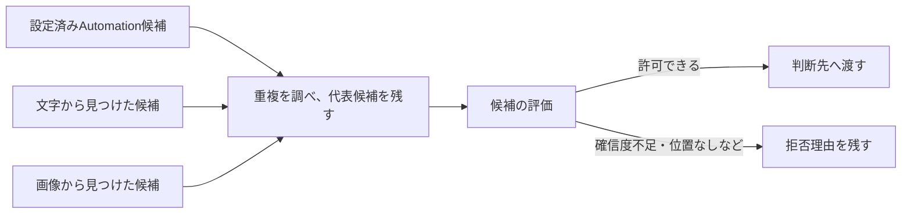

# 画面をどう読み取り、操作候補に変えるの？

[リポジトリのREADMEへ戻る](../../README.md) ｜ [画像解析の詳しい説明](../画像解析機能説明書.md) ｜ [候補統合の詳しい説明](../候補統合機能説明書.md)

**この資料の目的：** ゲーム画面を取得しただけで「押せるボタン」が分かるわけではありません。画像を取得し、数値や文字を調べ、候補を作り、使ってよいか評価するまでを、別々の仕事として説明します。

**確認した範囲：** 2026-11-01、main `d31377e42714f4d2e5ee1a402a4c42065d73bcd6` の標準経路。ソースと既存説明書を照合した静的調査であり、この資料の作成時にWindows実機やOCRの実測を行ったという意味ではありません。

## 図1：画面を受け取って、判断材料を作るまで

**実線：** 基本のつながり。**点線：** 任意の経路や条件付きの試行・代替。WGCはWindowsの画面取得方式で、C++の画像前処理とは別です。取得方式の切替には環境・失敗条件があり、すべての失敗で必ず正常なGDI画像を得られる保証はありません。

古い画像は捨て、待ち時間の期限まで新しい画像を待ちます。古い画像を一枚受け取っただけで直ちに失敗するのではありません。対象ウィンドウを変更した場合は取得元の世代を切り替えます。画像の切り出し範囲は取得前に設定され、画像と座標の情報を認識にも引き継ぎます。図は役割のつながりであり、切り出しを鮮度確認の後に行うという意味ではありません。

共有フレームには、未処理の画像を最新画像へ置き換える方式と、上限まで順番を保つ方式があります。この共有の仕組みだけで、動画の自動録画や複数画像の結果照合が実装されるわけではありません。

## 図2：複数の候補をまとめるとき

同じ場所に「開始」という文字候補と、明るい領域の画像候補が重なっていても、別々のボタンと決めつけません。位置の近さや重なり具合、識別子などから重複を調べます。**代表候補は単純に確信度が一番高い候補とは限りません。** 元の種類（Automation・文字・画像）にも優先順位があります。詳しい優先順位と条件は[候補統合機能説明書](../候補統合機能説明書.md)を正本として確認します。

## 手法カード R1：画面を取得し、古い画面を見分ける

| 項目 | 説明 |
|---|---|
| 目的 | 今の対象ウィンドウを、適切な画面範囲と時刻で取得する |
| 受け取り・返すもの | 選択ウィンドウ・範囲設定 → 画像、取得時刻、画面の識別情報 |
| 方法 | 利用可能なWGCを試し、条件によりGDIの互換方式を使う。共有フレームから新しい画像を取得 |
| 選ぶ条件 | 対象画面、取得方式の利用可否、取得範囲、時間の条件 |
| 古い画像の場合 | 捨てて期限まで次の画像を待つ。期限内に新しい画像を得られなければ失敗 |
| 失敗したら | 取得失敗や時間切れを理由付きで呼出し元へ知らせる。不完全な画像で成功扱いしない |
| モデル | 学習済みモデルなし |
| 時間・メモリ | この資料では未測定。画像サイズ、方式、連続取得条件が必要 |

実装：[screen_capture.py](../../src/ai_game_player/screen_capture.py)、[observation_service.py](../../src/ai_game_player/observation_service.py)、[shared_frame_producer.py](../../src/ai_game_player/shared_frame_producer.py)。テスト：[test_screen_capture.py](../../tests/test_screen_capture.py)、[test_observation_service.py](../../tests/test_observation_service.py)、[test_shared_frame_producer.py](../../tests/test_shared_frame_producer.py)。古い画像の後に新しい画像が届く経路は、`test_stale_frame_is_discarded_until_a_fresh_frame_arrives`が対象です。

## 手法カード R2：画像の特徴を数値にする

画像をそのまま「ボタン」と呼ばず、明るさ、色の平均、画像の特徴を表す値、明るい領域などに分けます。これにより文字が読めない場面でも画面の特徴を比較できます。ただし、光っている場所が必ず押してよい対象とは限りません。

- **入力：** 取得したBGRA形式の画像と、必要に応じた切り出し範囲。
- **出力：** 明るさ・色・画像の識別や比較に使う特徴、画像由来の領域候補。
- **標準の方法：** Pythonの画像前処理。Native FAST_CVは処理部品を明示的に渡した場合の別の選択肢です。
- **モデル：** この基本処理は学習済みモデルなし。
- **失敗・制約：** 画像データの長さや範囲が不正なら失敗を返します。領域の発見だけでは安全なボタンと証明できません。
- **負荷：** この資料では未測定。画像寸法、繰り返し回数、Python/Nativeの実際の接続を明記して測ります。

実装：[frame_analyzer.py](../../src/ai_game_player/frame_analyzer.py)、[frame_preprocessor.py](../../src/ai_game_player/frame_preprocessor.py)、[Native Runtimeのpreprocess](../../src/ai_game_player/runtime/native.py)。テスト：[test_frame_analyzer.py](../../tests/test_frame_analyzer.py)、[test_native_runtime.py](../../tests/test_native_runtime.py)。後者には`FrameAnalyzer(frame_preprocessor=runtime)`を使い、Python経路と比べる試験があります。これは標準GUIへの自動接続とは別です。

## 手法カード R3：画像から文字を読む

OCR（文字認識）は、画像に写る文字と位置を調べます。標準の任意接続にはTesseractの経路があります。`pytesseract`と`Pillow`が読み込めても、認識器本体・言語データの導入、文字認識の成功まで保証されるわけではありません。

- **入力：** 画面画像。必要な場合は選択ウィンドウや切り出し範囲の座標情報。
- **出力：** 読み取った文字・位置・候補の根拠。確信度は正答確率と同じとは限りません。
- **選ぶ条件：** 文字認識用の依存が使えるとき。文字がない画面には有効な出力がないこともあります。
- **苦手な状況：** 小さい文字、装飾的な書体、背景に重なった文字、言語データが合わない場合。
- **モデル：** Tesseractの言語データ。実際に使う版・言語・実行時状態はこの資料では未確認。
- **負荷：** 時間とメモリは未測定。画像サイズ・文字量・言語データを指定して測ります。

**使えない場合は二種類あります。** Python依存の読み込みが`ImportError`で失敗すると、`TesseractOcrRecognizer.optional()`は認識器なしを返します。この場合はOCRを省き、他の画像特徴・候補を扱えます。一方、依存を読み込めた後にTesseract本体・言語データなどの実行エラーが起きると、`FrameAnalyzer.analyze()`から`LiveObservationService.capture_observation()`へ例外が伝わり、観測全体が失敗します。「任意OCRだから、どんな失敗でも続行する」という保証はありません。

実装：[ocr_recognizer.py](../../src/ai_game_player/ocr_recognizer.py)、[ocr_detector.py](../../src/ai_game_player/ocr_detector.py)。テスト：[test_ocr_recognizer.py](../../tests/test_ocr_recognizer.py)、[test_ocr_detector.py](../../tests/test_ocr_detector.py)、[test_observation_service.py](../../tests/test_observation_service.py)。

## 手法カード R4：候補をまとめ、安全な判断候補へ絞る

複数の入力元から、位置・重なり・識別子などを照合して候補をまとめます。その後、候補評価は確信度や座標などを確認し、使うべきでない候補を拒否できます。例として、明るい領域だけから作られた確信度`0.0`の画像候補は、現在の評価条件では許可されません。

これは「AIが正しい候補を一つ選んだ」こととも、「実際のゲーム入力を許可した」こととも異なります。候補の評価を通過しても、判断回答の検証・停止・安全確認は別に残ります。

- **入力：** Automation・OCR・画像の候補。
- **出力：** 重複を整理した候補と評価結果・拒否理由。
- **手法：** 位置や領域の近さ、代表候補の優先順位、確信度・座標条件。
- **モデル：** 学習済みモデルなし。
- **失敗・制約：** 重複候補を別物と判断する誤り、違う対象を一つにする誤りがあり得ます。
- **負荷：** 未測定。候補数・画面の条件を指定して測定する必要があります。

実装：[candidate_merger.py](../../src/ai_game_player/candidate_merger.py)、[evaluator.py](../../src/ai_game_player/evaluator.py)。テスト：[test_candidate_merger.py](../../tests/test_candidate_merger.py)、[test_evaluator_explain.py](../../tests/test_evaluator_explain.py)。

## 位置がどう変わるか：数値を使った説明例

*以下の数字は説明のための仮定で、実際の画面を測ったものではありません。*

選択ウィンドウの中で、切り出した範囲の左上が`(100, 40)`だったとします。切り出し画像の中で文字の左上が`(20, 30)`、幅`60`、高さ`18`だった場合、ウィンドウ内の位置は左上`(120, 70)`、中心`(150, 79)`です。

`(100 + 20, 40 + 30) = (120, 70)`

この変換は、切り出し画像の位置と、元のウィンドウや画面での位置を混同しないために必要です。ただし、窓の位置・拡大縮小・座標の種類によって変換条件は変わります。実装では[座標変換](../../src/ai_game_player/capture_geometry.py)の契約に戻って確認します。

位置が合っていても、その対象を押してよいとは限りません。候補を判断へ渡した後、別の安全検査を通します。

## 複数画像・複数手法の照合はどうする？

共有フレームの仕組みには最新の画像を受ける方法と順番を保つ方法がありますが、**それだけで複数画像の結果を照合して判断精度を上げる仕組みが全経路で動いているとは言えません。** 複数の認識結果を照合する、場面に応じて重みを変える、必要時に再観測するなどの要求は、処理ごとに実装・接続・テストを分けて追跡します。

認識の説明は[#610](https://github.com/tomiya7688/AI_game_player/issues/610)、処理選択の説明は[#611](https://github.com/tomiya7688/AI_game_player/issues/611)、図・リンクの継続検査は[#614](https://github.com/tomiya7688/AI_game_player/issues/614)で整備します。製品側の動的な処理選択は[#13](https://github.com/tomiya7688/AI_game_player/issues/13)とその子Issueで追跡し、資料を書いたことを機能の実装完了とはしません。
