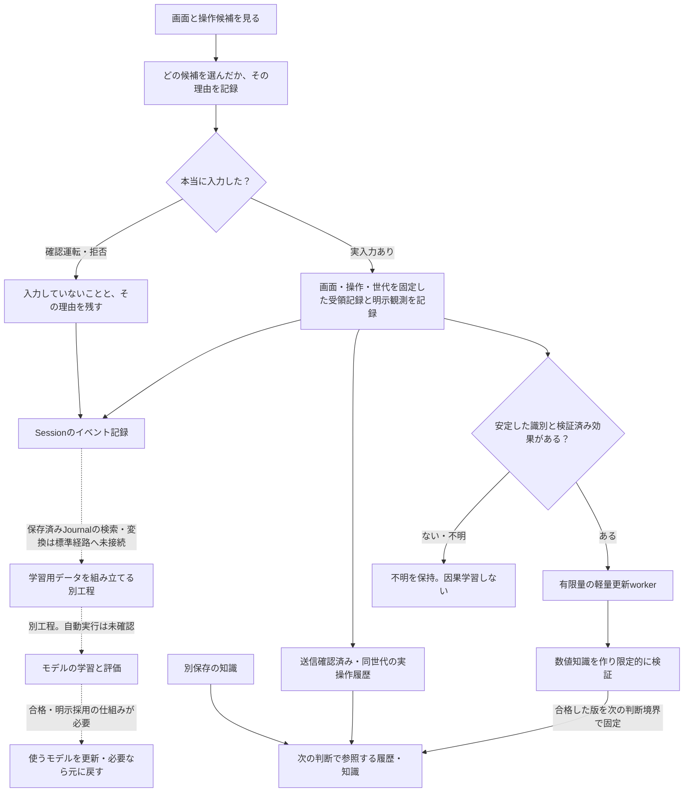
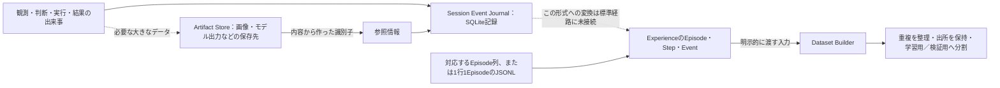

# ゲームを動かした記録は、どう残し、何に使う？

[リポジトリに戻る](../../README.md) ｜ [Session記録の既存仕様](../architecture/session_event_journal.md) ｜ [学習用データの既存説明](../学習データセット生成機能説明書.md)

このアプリは、画面を見て判断したことや入力の結果を、後で確かめられるように記録する仕組みを持っています。ただし、**記録すること・学習用データを作ること・モデルを学習すること・新しいモデルへ切り替えることは、すべて別の段階**です。

**統合確認：** 2026-11-01、feature `f145c946685ae7361f8d3e6416b85c6fdf07e988` とmainの資料7件を照合しました。初版の確認基準と現在の接続状態を区別し、実ゲームの効果は証拠がある範囲だけ記します。 初版は2026-10-31のmain `4d8ae6f`が基準でした。学習済みモデルの更新と軽量な数値知識の更新は別です。

## 図1：一回の操作から、次回の参考情報まで

**実線：** 基本の記録と履歴・知識の利用を示す。**点線：** 学習データへの変換、学習、評価、採用など、別工程の契約を含む接続。図が点線でも、関連する部品や契約が存在しないという意味ではありません。逆に、部品があるだけで製品の実行中に自動学習が走るとも言えません。

Engineは既存の知識と、受領記録で送信確認できた同世代の実操作履歴を判断材料へ渡します。Journal利用時も互換キャッシュから読み、保存済みSQLite Journal全体を検索する経路とは区別します。Journal横断検索は[#263](https://github.com/tomiya7688/AI_game_player/issues/263)の残件です。

#422では通常Sessionに軽量更新workerを接続しました。新しい実行観測から有限量の数値イベントを作り、#530の集計、#532の限定的な検証、#531の一判断中に固定した知識反映へ進みます。全Journalを自動でExperience Datasetへ変換する経路や、GPUでモデルを重学習する仕組みではありません。安定した操作識別の既定方針は無効で、検証済みの効果がない観測はunknownとして保留します。

## 図2：大きな画像と、短い記録を分ける

Sessionの記録には、どのSessionでいつ起きたか、画面・判断・操作などと結び付けるIDを持つイベントを残します。一方、画像・動画・大きな出力は、短いJSON本文へ直接埋め込む代わりに**別保存の参照情報**を使える契約です。**保存先の仕組みがあることと、全画面を自動録画することは別です。**

## 手法カード L1：何をしたか、順序と理由を残す

- **目的：** 後から「どの画面で何を選んだか」「許可されず実行しなかったか」を確認する。
- **入力と出力：** 判断・実行・安全結果などを受け取り、Session IDと順序・時刻・関連ID付きのイベントを残す。
- **手法：** 一Sessionにつき一つのSQLiteデータベースに、番号の連続するイベントを記録。旧形式JSONなどからの移行に対応する仕組みがある。
- **モデル：** 学習済みモデルなし。保存のためにモデル推論を実行しない。
- **失敗したら：** 保存・読込時の破損や不正な形式を黙って成功扱いせず、契約に沿って失敗を返す。
- **負荷：** この資料では未測定。書き込む頻度、イベント件数、記録先ディスクを指定して測定する必要がある。

実装：[event_journal.py](../../src/ai_game_player/event_journal.py)、[history.py](../../src/ai_game_player/history.py)、[runtime/session_composition.py](../../src/ai_game_player/runtime/session_composition.py)、[test_event_journal.py](../../tests/test_event_journal.py)。

## 手法カード L2：経験と知識を再利用できる形にする

経験（Experience）には、まとまったプレイの単位であるEpisode、途中のStep、各時点のEventを表す契約があります。何を根拠にしたかを示す**出所（provenance）**、任意のモデルの識別子・版、画像などへの参照も区別できます。

知識の保存には`KnowledgeStore`があり、分類・対象・説明・確信度をJSONへ保存して検索できます。 現行の追加処理は読込・追記・置換を一括でロックしないため、同じ保存先への更新は一つの書込元に直列化してください。同時更新を行うと一方の追記が失われる可能性があります。判断材料を作る側は、候補と関係する知識を必要に応じて参照できます。しかし**知識に書かれた説明が正しいことや、別ゲームでも同じように有効であることは保証されません**。

大きな成果物の保存契約は`ArtifactStore`であり、内容のSHA-256識別子を使って整合性を確認できます。ただし、暗号化・保持期間・削除・アクセス制限を、この保存契約だけで実装済みと断定しません。

モデル：これらの保存・検索・整合性確認には基本的に学習済みモデルなし。負荷は未測定。

根拠：[experience.py](../../src/ai_game_player/experience.py)、[knowledge.py](../../src/ai_game_player/knowledge.py)、[artifact_store.py](../../src/ai_game_player/artifact_store.py)、[Experience Readerの説明](../Experience%20Reader機能説明書.md)、[test_experience.py](../../tests/test_experience.py)、[test_artifact_store.py](../../tests/test_artifact_store.py)。

## 手法カード L3：学習用のデータを作る

`ExperienceDatasetBuilder` は、対応するEventから学習用の入力・目標を取り出し、同じ内容の重複を整理し、**学習用（train）と評価・確認用（validation）**に分けます。どの元Episode/Step/Eventを参照したかという情報も保持します。

Builderは型付きEpisodeの列か`ExperienceReader`を受け取ります。既存の`JsonlExperienceReader`は1行に1Episodeを置くJSONLを読むため、SQLite Journalそのものを渡すことはできません。Journalから対応形式への変換・収集と標準ゲーム実行への接続を、ReaderやBuilderが存在することだけで完了扱いにしません。

- **入力：** 学習対象となるExperience、対象モデルのDataset契約、分割の設定。
- **出力：** 元情報をたどれる学習用データセット。モデル本体は変更しません。
- **手法：** 内容の識別値による重複整理、出所の保持、種と分割割合に基づく再現可能な分割。
- **モデル：** Datasetの変換処理には学習済みモデルなし。
- **失敗・制限：** 不正な入力・型・版、対応外のEvent、出所が不明なラベルに注意する。自動ラベルや結果根拠を、人が確認した正解として勝手に格上げしない。
- **個人情報など：** 機密性がある成果物の参照は既定で除外する仕組みがある。これは保存・外部送信・アクセスを自動で全面保護する保証ではありません。
- **負荷：** この資料では未測定。イベント数、重複率、ファイル容量で変わる。

根拠：[learning_dataset.py](../../src/ai_game_player/learning_dataset.py)、[学習データセット生成機能説明書](../学習データセット生成機能説明書.md)、[test_learning_dataset.py](../../tests/test_learning_dataset.py)。

## 手法カード L4：モデルの学習と、採用・元に戻すこと

`LearningCapabilityManifest` は「このモデルにどんな学習方式を使えるか」「どのデータ形式・学習器・出力・評価・元に戻す先を必要とするか」を宣言する契約です。互換性を検証するコードが存在しても、それだけでGPU上の学習・評価・本番モデルへの昇格が自動実行された証拠にはなりません。

設計上は、次の各段階にそれぞれの成功条件が必要です。

1. データが使える形式で、必要な同意や権利条件を満たす。
2. 指定した学習器を実行し、新しい成果物を作る。
3. 評価用のデータやゲームで、旧モデルと改善・悪化を比べる。
4. 採用してよいかを判定し、モデルの版や出所を記録する。
5. 悪化したら以前のモデルへ戻せるようにする。

**上の5段階は設計上の確認項目であり、標準ゲーム実行の自動学習ループが完成したという宣言ではありません。**

根拠：[learning.py](../../src/ai_game_player/learning.py)、[Learning Capability Contract](../architecture/learning_capability_contract.md)、[test_learning_contract.py](../../tests/test_learning_contract.py)。

## 手法カード L5：軽量な数値知識だけを操作中に更新する

#529は数値知識の不変保存、#530は検証済み効果の増分集計、#531は一回の判断へ版を固定した補助情報の反映、#532は候補比較・公開・復帰を担当します。#422はこれらを通常Sessionへ接続し、停止・保持入力・実行中の境界を確認して、合格版だけを次の判断へ公開します。

集計には成功率の縮小推定と新しい値を重視する移動平均を使い、更新幅を制限します。候補を削除せず補助的な優先度を変え、安全規則・停止・入力権限は変更しません。有限queueが満杯なら待たずに理由を記録し、未知の効果を失敗の正解へ置き換えません。モデル推論・GPU学習を追加する処理ではありません。

信頼済みprofileが安定した操作識別を保証し、入力前後と実行世代が一致する効果証拠を渡す必要があります。得点欄のクリック自体は禁止しません。検証済みno_effectを使った結合試験では、両候補を許可したまま次判断が移動候補へ変わりました。一般の画面変化・変化なし・モデルの成功主張だけから因果効果を作るproviderは未接続で、全ゲームで無意味なクリックを学べるとは主張しません。

入力・出力・採用条件・故障時の動作と計測値は[Light Adaptationの詳細](../architecture/light_adaptation.md)、実装は[light_session.py](../../src/ai_game_player/light_session.py)、検証は[test_light_adaptation.py](../../tests/test_light_adaptation.py)を参照してください。静的fallback、保存故障後の学習保留、停止時の事実退避も実装範囲です。Windows実ゲームでの性能改善は未検証です。

## 具体例：「開始」を選んだが入力しなかった／実際に押した

| 状況 | 残すべき事実 | 記録や学習での扱い |
|---|---|---|
| 候補に「開始」があり選んだが、確認運転だった | 選択候補・理由・実入力なし | **実際に押した成功例にはしない** |
| 安全確認が拒否した | 拒否した候補・拒否理由・実入力なし | 入力に伴うゲーム変化を捏造しない |
| 実際に入力を送り、次の画面を取得した | 同世代の正常送信receipt・明示観測・結果の根拠 | 画面変化と目的達成を別に評価し、因果学習にはさらにverified効果が必要 |
| 送信開始後に例外、または次の画面が取れなかった | dispatch_unknownまたは正常送信receipt・観測失敗 | 結果不明のまま残す。正負の学習ラベルへ混ぜない |

この表は**説明用の状況**であり、特定のゲームにおける再現実測や、全項目が同一の保存先で自動収集される保証ではありません。

## 保存対象と外部送信についての注意

ゲーム画面にはユーザー名・個人情報・チャットなどが映ることがあります。画像やモデルへの問い合わせを保存・外部送信する場合は、利用者の同意、機密性、保存期間、削除方針、共有範囲を個別に確認する必要があります。`ArtifactMetadata.sensitive`のフラグがあるだけで画像が暗号化されるわけではありません。モデルが別PCや外部サービスにある場合、データがどこまで送られるかは接続設定と要求内容に依存します。

## 未完了を実装済みにしないために

本ページで確認したのは、Session記録、経験と出所、保存先、学習データ変換、モデル学習の互換契約と、限定的な数値知識更新の通常Session接続です。**自動録画、学習器の実行、実ゲームに基づく評価、モデルの自動採用、完全なロールバック、データ保護・保存期間の保証**は、それぞれ別に接続・確認が必要です。

残作業：[Issue #613](https://github.com/tomiya7688/AI_game_player/issues/613)（この領域の説明）、[Issue #614](https://github.com/tomiya7688/AI_game_player/issues/614)（図と根拠の維持）、[Issue #277](https://github.com/tomiya7688/AI_game_player/issues/277)（モデルの来歴情報）。
