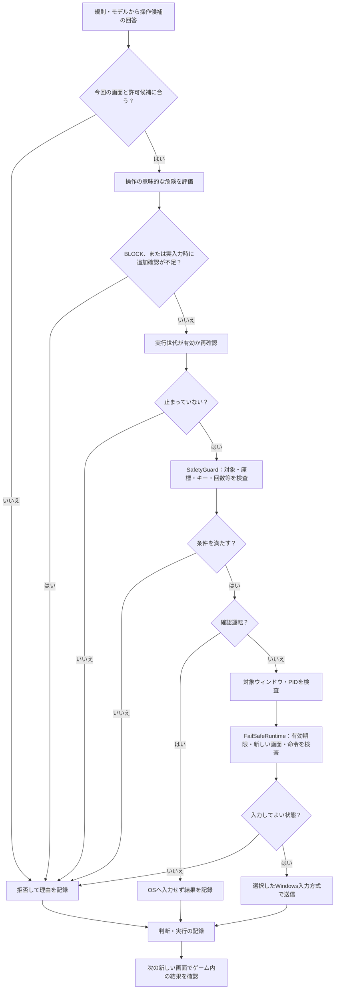
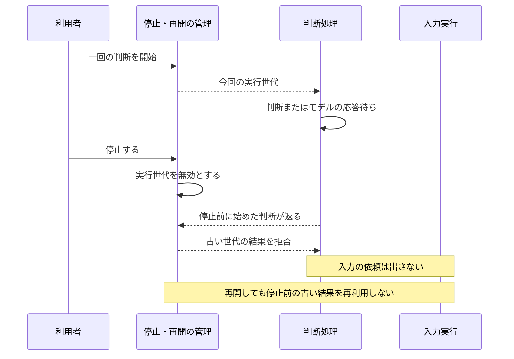

# モデルが「押す」と答えたら、すぐゲームに入力される？

[リポジトリに戻る](../../README.md) ｜ [Action Safetyの詳しい説明](../ActionSafetyEvaluator機能説明書.md) ｜ [FailSafe Runtimeの詳しい説明](../FailSafeRuntime説明書.md)

**いいえ。** モデルや規則が「この操作を選ぶ」と答えることと、OSへ本当にキー・マウス入力を送ることの間に、独立した検証と停止条件があります。

このページは、操作の**許可・拒否・確認運転・停止・記録**を説明します。安全を「AIが気を付けているから大丈夫」といったあいまいな一文で片付けません。

**統合確認：** 2026-11-01、feature `f145c946685ae7361f8d3e6416b85c6fdf07e988` とmainの資料7件を照合しました。初版の確認基準と現在の接続状態を区別し、実ゲームの効果は証拠がある範囲だけ記します。 実機での全条件の試験や、OSのあらゆる入力失敗からの復旧保証を行ったものではありません。

## 図1：実際の入力までに通る境界

*説明を分かりやすくするため検査を箱でまとめています。実際には停止状態などを処理途中でも繰り返し確認します。ただし、最終停止確認とOS入力送信は不可分ではなく、確認直後に停止要求が来る競合や、既に進行中の入力を完全に取り消せるとは保証しません。図の存在をその保証と読み替えないでください。*

## 四つの「許可」を混ぜない

| 判断の段階 | 何を確かめる？ | 通過すると何ができる？ |
|---|---|---|
| 1．候補の評価 | 画面や候補の条件を満たすか | 判断材料に候補を入れられる |
| 2．回答の検証 | 今回の許可候補から選んだか、画面IDが一致するか | 判断回答を採用する準備ができる |
| 3．意味的な安全評価 | 危険な意図・高リスク・予測の矛盾がないか | 安全上の次段階へ進む |
| 4．実行直前の制御 | 停止、対象、座標、実入力許可、命令の期限が有効か | 条件を満たすときのみ送信を試みる |

**点数が高いことと、許可されたことは別です。** 例えば高評価の候補でも画面外の位置や危険な操作なら拒否できます。実入力を明示的に許可しなければ、確認運転として入力しない経路を選びます。

## それぞれ何を担当する？

**回答の検証（DecisionVerifier）** は、モデルの答えが今の画面や使ってよい候補と一致するか確認します。LLMが候補一覧にない操作を返した場合は、その操作を勝手に実行しません。

**ActionSafetyEvaluator** は操作の意味や危険度を、`SAFE / SUSPICIOUS / BLOCK` の状態で評価します。`BLOCK`は送信しません。`SUSPICIOUS`には確認が必要な理由を残し、確認運転では記録可能でも、未完了の確認を残したまま実入力へ進めません。認識の確信度・目的への寄与・安全評価は異なる値です。

現在の意味的な危険語の検査は、候補IDと表示名に含まれる既知の英語固定句を主に使います。日本語、未知の表現、アイコンだけの表示や誤認識では、危険を見逃す可能性があります。`SAFE`は安全の証明ではありません。多言語・構造化された根拠を使う改善は[#504](https://github.com/tomiya7688/AI_game_player/issues/504)で追跡し、文書だけで対応済みにしません。

**SafetyGuard** は、Windows対象の状態、座標、危険キー、入力頻度、停止要求などの決定的な規則を検査します。これは判断モデルによる多数決では解除できない条件です。

**FailSafeRuntime** は、制御権限の期限、画面の新しさ、対象プロセス、命令の時刻や世代などを確認します。上位のAIが止まった場合に備える監視と入力解放の仕組みを備えています。ただし、監視の成立や障害からの復旧は、使用環境で別途試験が必要です。

**WindowsInputExecutor** が実際の入力を送ります。対象ウィンドウとそのプロセスの整合性も確認します。OSに命令を渡せたことと、ゲームがその入力に従ったことは異なります。

## 図2：停止した後に古い回答が届いたら？

停止ボタンと`Esc`、F12緊急停止、手動のマウス移動など、停止の入り口は複数あります。`Esc`は本アプリにフォーカスがある場合だけで、ゲーム側にフォーカスがある間のEscを本アプリが検出する保証はありません。手動のマウス移動による検出は連続実行中だけです。GUIの`Application._poll_global_stop()`はTkの`root.after`でF12とマウス移動を確認するため、UIイベントループが止まると、このGUI側の検出は進みません。これとは別に、実入力の`ActionExecutor`は`EmergencyStopMonitor`の背景スレッドを起動する経路を持ちます。後者の成立は、利用する停止状態との接続や実行環境も含めて確認してください。GUI監視を独立スレッドの監視と混同しません。詳細は[SafetyGuard説明書](../SafetyGuard説明書.md)、入力状態の解放は[FailSafeRuntime説明書](../FailSafeRuntime説明書.md)を参照してください。「どのOS・停止経路でも同じ保証が成立する」とは断定しません。

## 具体例1：候補外の操作をモデルが答える

候補一覧が `start_button` だけだったと仮定します。モデルが `delete_save` と答えた場合、その候補は一覧にありません。**回答の検証で拒否**し、モデルの文章がもっともらしいという理由で新しい操作を実行してはいけません。

これは説明例であり、実在モデルを実際に試した結果ではありません。

## 具体例2：確認運転と実入力を区別する

同じ `start_button` が評価と検証を通った場合でも、確認運転なら `ExecutionResult` は実入力なしとして記録します。利用者が実入力を有効にした場合は、安全と対象の検査を改めて経由して送信を試みます。**次の画面を観測しない限り、ゲーム内の成功と断定しません。**

## 具体例3：画面が古い・送信に失敗した

- **画面が古い場合：** 画面の時刻を新しいものに書き換えず、FailSafeの条件に従い入力を拒否する場合があります。何を再確認するべきかはエラー理由を見て判断します。
- **OS入力前の失敗：** Windows入力器は実行開始時に送信開始フラグを戻し、対象・座標・保持入力の前処理を終えてから、最初のOS入力API呼出し直前にフラグを立てます。前処理で失敗した場合は入力前失敗として記録し、過去の実操作の受領記録を上書きしません（[#628の契約](../architecture/execution_receipts.md)）。
- **送信に入った後の失敗：** 入力API後の例外や、送信開始を確認できない独自入力器は`dispatch_unknown`として残します。未送信へ戻さず、成功・失敗の学習へ混ぜません。停止前の旧世代記録も監査用に残し、学習には使いません。必要なら新しい画面を取り直します。
- **停止後に推論が返る：** 古い実行世代の結果をそのまま送信しないようにします。

## 何に負荷が掛かる？ モデルは？

操作を選ぶ判断や、`OutcomeDetector`が結果判定を補う意味評価は、選択したモデルによって処理時間が変わります。一方、このページの意味的な安全評価`ActionSafetyEvaluator`は、危険語・座標・目標等を規則で検査し、学習済みモデルを呼びません。停止状態、対象確認、危険操作の拒否も**学習済みモデルなし**の処理です。特定の実行時間・停止応答時間を保証するには、対象Windows機材での測定が必要です。この資料には実測値はありません。

## 実装、テスト、残作業

| 役割 | 実装 | 参照するテスト |
|---|---|---|
| 画面・候補の検証 | [decision_verifier.py](../../src/ai_game_player/decision_verifier.py) | [test_decision_verifier.py](../../tests/test_decision_verifier.py) |
| 意味的リスク | [action_safety.py](../../src/ai_game_player/action_safety.py) | [test_action_safety.py](../../tests/test_action_safety.py) |
| 実行の接続 | [pipeline.py](../../src/ai_game_player/pipeline.py) | [test_pipeline_execute.py](../../tests/test_pipeline_execute.py) |
| 決定的な拒否と緊急停止 | [safety_guard.py](../../src/ai_game_player/safety_guard.py) | [test_safety_guard.py](../../tests/test_safety_guard.py) |
| 実行世代・停止 | [run_control.py](../../src/ai_game_player/run_control.py) | [test_run_control.py](../../tests/test_run_control.py) |
| 期限付きの実入力許可 | [fail_safe_runtime.py](../../src/ai_game_player/fail_safe_runtime.py) | [test_fail_safe_runtime.py](../../tests/test_fail_safe_runtime.py) |
| 実際のOS入力 | [windows_input.py](../../src/ai_game_player/windows_input.py) | [test_windows_input.py](../../tests/test_windows_input.py) |

読み物として詳しい規則と検証条件は[操作実行機能説明書](../操作実行機能説明書.md)、[ActionSafetyEvaluator機能説明書](../ActionSafetyEvaluator機能説明書.md)、[SafetyGuard説明書](../SafetyGuard説明書.md)、[FailSafeRuntime説明書](../FailSafeRuntime説明書.md)を優先します。残る試験・文章の整備は[#612](https://github.com/tomiya7688/AI_game_player/issues/612)、図とリンクの自動検査は[#614](https://github.com/tomiya7688/AI_game_player/issues/614)で追跡します。
