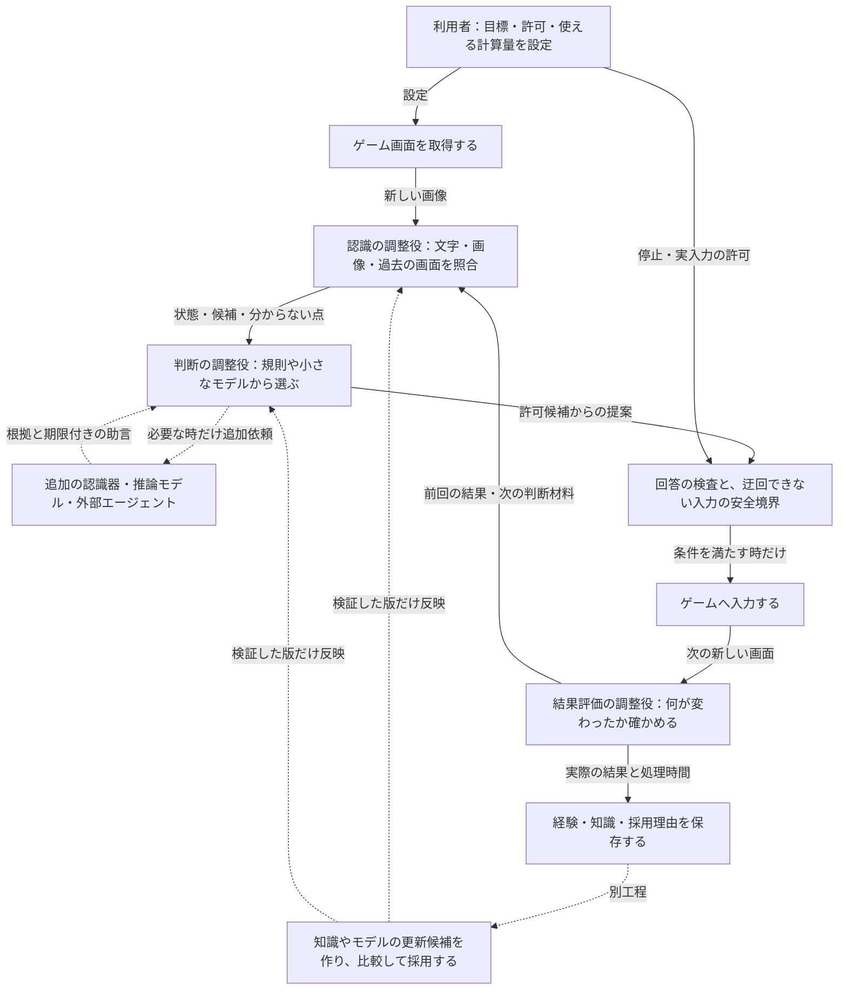
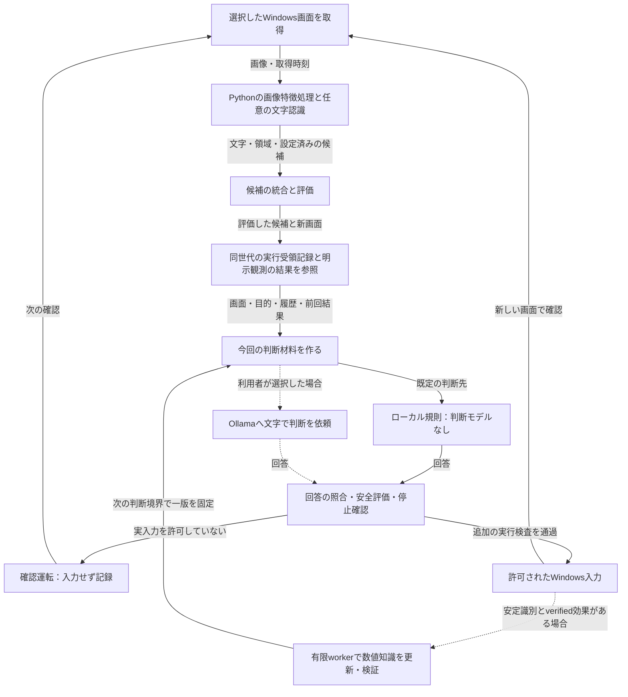

# 目指す完成形と、いま動く仕組み

[全体案内へ戻る](README.md) ｜ [場所ごとの実装状況と根拠](implementation_status.md)

**目指すのは、画面を見て自分で操作候補を探し、結果を確かめながら遊び方を改善するゲームプレイヤーです。** 一つの大きなAIに全部を任せるのではなく、認識・判断・結果評価の各場所で、必要な処理を選びます。難しい設定をしなくても基本機能が使え、詳しい利用者は処理やモデルを差し替えられる形を目指します。

**現在は、画面取得・候補評価・規則またはOllamaによる判断・安全な入力・受領記録に基づく結果評価・記録に加え、条件付きの軽量知識更新を接続しています。** 状況別の自動モデル選択、処理時間と効果を学び直す調整、モデルの学習・評価・採用までが全部つながった完成品ではありません。

以下の二つの図は、**同じ完成度を表しません**。完成図は実現すべき設計、現状図はコードで確認した接続です。詳しい根拠は別ページへ分けています。確認日：2026-11-01。統合実装の基準：`77a8995e92c59c2fe3610840dfbe7438297ba44e`。初版の`main@d31377e`からの変更は[実装状況](implementation_status.md)へ記します。

## 1．目指す完成図 — まだ全機能は接続されていない

実線は基本の情報と操作の流れ、点線は条件付きの追加処理・更新です。**この図では、実線でも現在の実装済みを意味しません。** 重いモデルを常時並列で起動する図ではありません。追加処理には回数・時間・メモリの上限を設け、分からないままなら再観測・保留・停止を選びます。

「調整役」は、オーケストレーターとも呼ぶ、**処理やモデルを選ぶ部分**です。各操作で使うのは、事前に整理した規則や表を使う速い条件分岐です。時間の実測値や改善効果の集計、重い推論、学習は操作直前の処理から分けます。遅れて届いた助言を、そのまま古い画面への入力に変えてはいけません。

## 2．現在の実装図 — 標準経路で確認した範囲

実線は標準経路の概略、点線は設定次第の経路です。拒否・取得失敗・停止時は入力へ進みません。これは関数の全呼び出しを並べた図ではなく、役割の見取り図です。確認運転の記録を実入力した事実と混同しないこと、前回結果と実行状態の厳密な対応は、[実装状況の注意点](implementation_status.md)も読んでください。

## 3．完成形に近づけるために残っていること

| 場所 | 現在あるもの | 完成形との差 |
|---|---|---|
| 画面を理解する | 画像の数値処理、任意の文字認識、候補統合 | 場面ごとの認識器選択、複数画像・手法の使い分けを標準経路へ接続する |
| 操作を考える | 許可候補の評価、重み付き評価、規則／Ollamaの選択 | 所要時間と判断改善の見込みで処理を選び、その見込みを更新する |
| 分からない時に止まる | 不確かさを集計する部品、安全・停止の処理 | 不確かさから再観測・保留を選ぶ方針を接続する |
| 経験から改善する | 実Sessionの有限な数値知識更新・検証・公開、学習用データとモデル互換契約 | 一般の安定識別・因果効果の検証、Windows実プレイの改善、モデル重学習を接続・検証する |
| 別PCや外部AIを使う | Ollamaへの接続、拡張用の境界 | 共通契約と登録、画像を含む入力、外部エージェント、来歴の記録を整える |
| 普通に使える製品にする | GUI、確認運転、安全な入力、参照ゲーム用の試験 | 配布物・対象機材・対象ゲームごとの受入条件を満たす |

## 4．「どのモデルが動くか」も、現在と目標を分ける

現在の判断の初期設定は**ローカル規則**です。`gemma3:4b`はモデル欄の初期値であり、常時動いているモデルではありません。Ollamaはモデルを動かすサービスです。現在の判断依頼は文字で表した判断材料で、モデルが画像対応というだけでは画像入力経路になりません。

完成形では、文字認識、画像認識、文章の意味の整理、候補の分類・選択、結果評価などの役割ごとに、規則・小さなモデル・必要時の詳しい推論を選びます。**全役割のモデル名はまだ確定していません。** Codexを最初の外部エージェントの参照実装とする方針と、開発にCodexを使うことも別です。

## 5．完成の判定は「資料がある」ではなく「実際につながって動く」

部品を作るだけでなく、通常の操作から呼ばれ、対象のゲームと機材で、認識・入力・結果確認まで試せることが必要です。学習済みモデルを使わない運転でも、経験から知識や設定を更新し、改善を比較できる設計を目指します。重い学習を通常プレイの必須処理にはしません。

設計全体と初回リリースの必須範囲は同じではありません。優先順位・リリース条件は [Issue #19](https://github.com/tomiya7688/AI_game_player/issues/19)、各場所の現在地と残作業は [実装状況](implementation_status.md) を参照してください。完成率を根拠のない割合で示す代わりに、部品・接続・実環境の証拠を分けて更新します。
