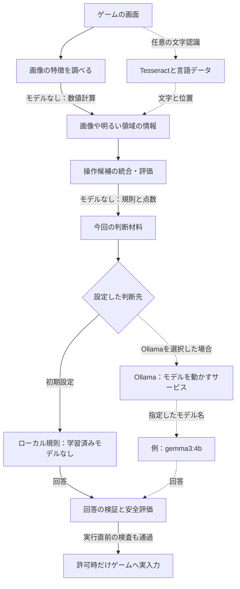
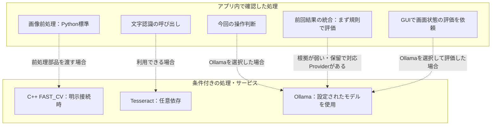

# どこで、どのモデルや手法を使う？

[リポジトリへ戻る](../../README.md) ｜ [実際に動いたモデルを確認する方法](evidence.md)

## まず区別する四つのもの

- **手法**：どう処理するか。文字を探す、画像の特徴を数える、規則で選ぶ、など。
- **学習済みモデル**：学習によって作られた推論用データ。モデルを使わない処理もたくさんあります。
- **実行基盤**：モデルや処理を動かすソフトウェアや機器。Ollamaは実行基盤であってモデル名ではありません。
- **接続用の部品**：このアプリと処理・サービスの間で情報を渡すコード。接続用の部品があるだけでは、いつも起動していることになりません。

**重要：** この資料は2026-11-01、main `d31377e42714f4d2e5ee1a402a4c42065d73bcd6` の標準構成を中心に読んだ説明用の一覧です。利用者のPCでの実行モデルを特定した実測記録でも、全プラグインの完全なモデル登録簿でもありません。モデルの正式な来歴・ライセンス・版などの登録仕様は[#277](https://github.com/tomiya7688/AI_game_player/issues/277)、実行時の事実を記録・表示する実装は[#627](https://github.com/tomiya7688/AI_game_player/issues/627)が担当します。

## 図1：基本構成でのモデル配置

実線は標準のつながり、点線は条件付きのつながりです。`gemma3:4b`は設定欄の初期値であり、Ollamaを選んでいなければ通常の判断でそのモデルを使いません。Ollamaを選択した場合でも、サーバーが起動しているか、モデルが導入済みか、読み込まれたか、実際に返答したかは別の確認が必要です。

## 図2：同じモデルでも、呼び出す理由が違う

**結果評価には二つの経路があります。** `OutcomeDetector`は規則の結果が弱い場合などに、対応するProviderへ意味評価を追加します。一方、GUIから呼ぶ`RuntimeComposition.assess_outcome()`はOllamaが選ばれていれば直接そのProviderへ要求します。GUIの経路に「規則の確信度が低い場合だけ」という条件はありません。操作判断も含め、呼び出し種別を別々に記録する必要があります。

C++の高速画像前処理は学習済みモデルではなく、Windows画面取得に使うNative WGCとも別です。どの経路でも、モデルが画像対応だから自動的に画像入力になるという意味ではありません。

## 標準経路から追った手法・モデルの対応

| ID | 何をする場所？ | 手法 | 学習済みモデル | 実行場所・接続 | 状態と条件 |
|---|---|---|---|---|---|
| M01 | 画像の特徴や明るい領域を調べる | 画像の数値計算・特徴量 | なし | Pythonの画像前処理 | 標準の前処理部品 |
| M02 | 画像の文字を読む | OCR（文字認識） | Tesseractの言語データ。厳密な版は未確認 | TesseractOcrRecognizer／認識器本体 | 依存環境が利用できる場合 |
| M03 | 操作候補を整理・評価 | 候補の統合、規則と評価点 | なし | CandidateMerger／評価器 | 標準の候補処理 |
| M04 | 次の操作を選ぶ | ローカル規則 | なし | RuleProvider | 初期の判断先 |
| M05 | 次の操作をモデルに選ばせる | 文字で表した判断材料を用いる生成 | 指定モデル。初期の欄は`gemma3:4b` | OllamaProvider→Ollama | Ollama選択時。要求の成功は別確認 |
| M06 | 操作後の変化や成功を調べる | 複数の根拠を統合する規則 | なし | OutcomeDetector／DeterministicOutcomeFusion | 基本の結果評価 |
| M07 | 結果の根拠が弱い場合の補助 | 意味評価の追加要求 | 対応Providerで使うモデル。版は未確認 | OutcomeDetector→意味評価対応Provider | 保留または基準未満の確信度で、Providerがある場合 |
| M08 | 画像前処理をC++側で行う | FAST_CVの前処理 | なし | Native Runtime | 明示的に部品を渡す場合 |
| M09 | GUIから現在の画面状態を評価する | 指定Providerへ直接依頼 | Ollama選択時は指定モデル。それ以外は規則 | ApplicationWorkflowService→RuntimeComposition.assess_outcome | Ollama選択時は規則の確信度によらず要求 |

「モデルなし」は学習済みモデルを使用しないという意味です。「未確認」は調査で断定できていないという意味です。「条件付き」は選択・導入・接続などの条件があるという意味です。確信度を正答確率とは断定しません。

この表は役割を理解するための索引です。モデルの識別子・ハッシュ・出典・ライセンスを二重管理する登録簿は作らず、正式な登録情報は[#277](https://github.com/tomiya7688/AI_game_player/issues/277)を参照します。

## 具体例：同じ画面でも、設定で使うものが変わる

「開始」という文字が見え、候補として認識されたと仮定します。画像の特徴を調べるM01はモデルなしで計算し、任意のM02が文字と位置を加えます。M03で候補を評価した後、初期設定ならM04の規則で選びます。Ollamaを選択していればM05へ判断材料を渡します。どちらの回答も検証前の値で、その回答だけでは実入力を許可しません。

GUIの画面状態評価を実行した場合はM09です。これをM07の低確信時の補助評価と混ぜません。以上は説明用の仮定で、実モデルを起動して成功したという実測ではありません。

## 別PCのOllamaへ送る場合の注意

接続先は設定で変更できます。別PC・外部ホストを指定すると、**画面由来の状態、候補、目標、履歴などを含む判断材料が、その相手へ送られます。** 「Ollama」という名前だけで、必ず自分のPC内で完結するとは考えないでください。

送信先の管理者、保存期間、再利用の方針、認証と通信の保護を確認してください。`http://`の接続では内容は暗号化されません。このアプリが外部サービスの保存・利用まで制御する保証もありません。[セキュリティ脅威モデル](../security/threat_model.md)を参照し、秘密情報や個人情報が含まれる画面・目標・履歴の送信を避けてください。

## 実際の呼び出し元に戻って確認する

| ID | 最初に読む実装 |
|---|---|
| M01 / M08 | [frame_analyzer.py](../../src/ai_game_player/frame_analyzer.py)・[frame_preprocessor.py](../../src/ai_game_player/frame_preprocessor.py)・[runtime/native.py](../../src/ai_game_player/runtime/native.py) |
| M02 | [ocr_recognizer.py](../../src/ai_game_player/ocr_recognizer.py)・[observation_service.py](../../src/ai_game_player/observation_service.py) |
| M03 | [candidate_merger.py](../../src/ai_game_player/candidate_merger.py)・[evaluator.py](../../src/ai_game_player/evaluator.py) |
| M04 / M05 | [config.py](../../src/ai_game_player/config.py)・[session_composition.py](../../src/ai_game_player/runtime/session_composition.py)・[provider.py](../../src/ai_game_player/provider.py) |
| M06 / M07 | [engine.py](../../src/ai_game_player/engine.py)・[outcome_fusion.py](../../src/ai_game_player/outcome_fusion.py) |
| M09 | [app.py](../../src/ai_game_player/app.py)・[application_workflow.py](../../src/ai_game_player/application_workflow.py)・[session_composition.py](../../src/ai_game_player/runtime/session_composition.py) |
| Native実装の境界 | [native_runtime_boundary.md](../architecture/native_runtime_boundary.md) |

**確認済みのソース事実：** 標準のProvider生成は`RuleProvider`または`OllamaProvider`です。`OllamaProvider`の判断要求は、JSONに変換した判断材料を`/api/generate`へテキストとして送ります。画像対応モデルの指定だけでは、この判断要求が直接画像を送ることにはなりません。

**未調査の範囲：** 全拡張Provider、別PC・外部エージェントの標準API、モデル登録の完全性、実GPU/VRAM、量子化、実負荷、全実行経路の動作。未確認を実装済みにはしません。実際に使ったものの見分け方は[実行証拠の読み方](evidence.md)、実行時の自動記録・表示の残作業は[#627](https://github.com/tomiya7688/AI_game_player/issues/627)を参照してください。
