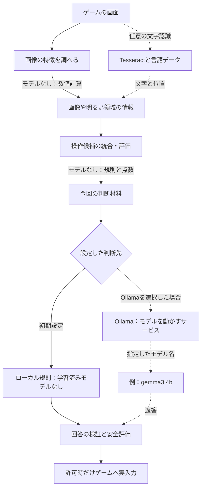
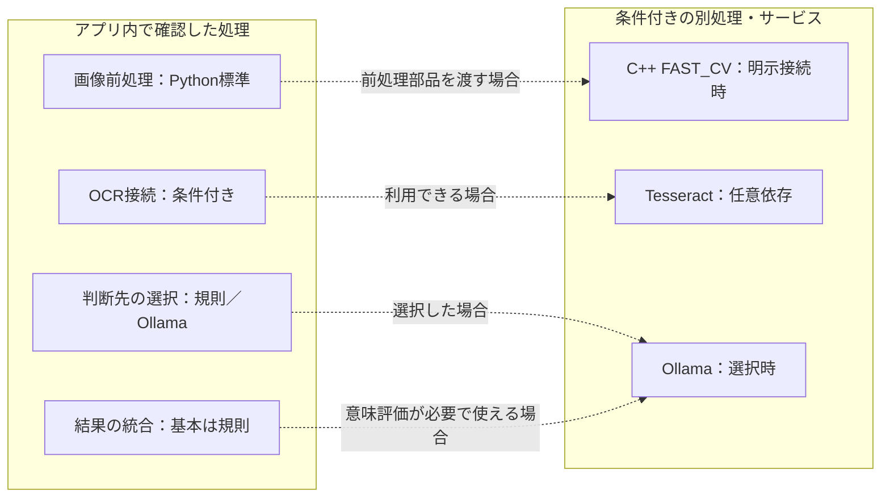

# どこで、どのモデルや手法を使う？

[リポジトリへ戻る](../../README.md) ｜ [実際に動いたモデルを確認する方法](evidence.md)

## まず区別する四つのもの

- **手法**：どう処理するか。文字を探す、画像の特徴を数える、規則で選ぶ、など。
- **学習済みモデル**：学習によって作られた推論用データ。モデルを使わない処理もたくさんあります。
- **実行基盤**：モデルや処理を動かすソフトウェアや機器。Ollamaは実行基盤であってモデル名ではありません。
- **接続用の部品**：このアプリと処理・サービスの間で情報を渡すコード。接続用の部品があるだけでは、いつも起動していることになりません。

**重要：** この資料は2026-10-31、main `4d8ae6f515024b7ba8bed900b50735ab8cc07ea4` の標準構成を中心に読んだ説明用の一覧です。利用者のPCでの実行モデルを特定した実測記録でも、全プラグインの完全なモデル登録簿でもありません。モデルの正式な来歴・ライセンス・版などの登録仕様は [#277](https://github.com/tomiya7688/AI_game_player/issues/277) が担当します。

## 図1：基本構成でのモデル配置

**実線は標準のつながり、点線は条件付きのつながりです。** `gemma3:4b` は設定欄の初期値であり、Ollamaを選んでいなければ通常の判断でそのモデルを使いません。Ollamaを選択した場合でも、サーバーが起動しているか、モデルが導入済みか、読み込まれたか、実際に返答したかは別の確認が必要です。

## 図2：現在の処理と、未接続の候補を混同しない

C++の高速画像前処理は学習済みモデルではありません。Windows画面取得に使うNative WGCとも別の処理です。結果評価では、画面の変化などを規則で確かめた後、追加の意味評価が必要なときに選択済みProviderを使う経路があります。常に同じモデルで全画像を解析するという意味ではありません。

## 標準経路から追った手法・モデルの対応

| ID | 何をする場所？ | 手法 | 学習済みモデル | 実行場所・接続 | 状態と条件 |
|---|---|---|---|---|---|
| M01 | 画像の特徴や明るい領域を調べる | 画像の数値計算・特徴量 | なし | Pythonの画像前処理 | 標準の前処理部品 |
| M02 | 画像の文字を読む | OCR（文字認識） | Tesseractの言語データ。厳密な版は未確認 | TesseractOcrRecognizer／外部認識器 | 依存環境が利用できる場合 |
| M03 | 操作候補を整理・評価 | 候補の統合、規則と評価点 | なし | CandidateMerger／評価器 | 標準の候補処理 |
| M04 | 次の操作を選ぶ | ローカル規則 | なし | RuleProvider | 初期の判断先 |
| M05 | 次の操作をモデルに選ばせる | 文字で表した判断材料を用いる生成 | 指定モデル。初期の欄は `gemma3:4b` | OllamaProvider→Ollama | Ollama選択・接続成功時 |
| M06 | 操作後の変化や成功を調べる | 複数の根拠を統合する規則 | なし | OutcomeDetector／DeterministicOutcomeFusion | 基本の結果評価 |
| M07 | 結果の根拠が弱い場合の補助 | 意味評価の追加要求 | 選択された判断先で使えるモデル。版は未確認 | 意味評価対応Provider | 条件付き。常時ではない |
| M08 | 画像前処理をC++側で行う | FAST_CVの前処理 | なし | Native Runtime | 明示的に部品を渡す場合 |

「モデルなし」は機械学習が必要ないという意味です。「未確認」は調査で断定できていないという意味です。「条件付き」は実際に選択・導入・接続する必要があるという意味です。確信度を「正解する確率」とは断定しません。

この表はモデル登録の正式な正本ではありません。役割を理解するための索引です。実際のモデルの識別子・ハッシュ・出典・ライセンスなどを管理する作業と二重管理にならないよう、詳細は [#277](https://github.com/tomiya7688/AI_game_player/issues/277) を参照します。

## 具体例：同じ画面でも、設定で使うものが変わる

「開始」という文字が見え、候補として認識されたと仮定します。

1. 画像の特徴を調べる部分（M01）は、学習済みモデルがなくても数値を計算できます。
2. 文字認識が利用可能なら（M02）、「開始」という文字とその場所の情報が加わることがあります。
3. 候補を評価する部分（M03）は、使ってよい候補を選別します。
4. 初期設定のローカル規則（M04）なら、モデルへの外部通信なしで候補を選びます。
5. 利用者がOllamaを選んでおり必要な環境がそろえば（M05）、文章としてまとめた判断材料を指定モデルへ送れます。ただし回答は検証前の値です。
6. どちらの経路でも、その回答だけで実入力は許可されません。

この例は**説明用の仮定**で、TesseractやOllamaを起動して成功したという実測ではありません。

## 実際の呼び出し元に戻って確認する

| ID | 最初に読む実装 |
|---|---|
| M01 / M08 | [frame_analyzer.py](../../src/ai_game_player/frame_analyzer.py)・[frame_preprocessor.py](../../src/ai_game_player/frame_preprocessor.py) |
| M02 | [ocr_recognizer.py](../../src/ai_game_player/ocr_recognizer.py)・[observation_service.py](../../src/ai_game_player/observation_service.py) |
| M03 | [candidate_merger.py](../../src/ai_game_player/candidate_merger.py)・[evaluator.py](../../src/ai_game_player/evaluator.py) |
| M04 / M05 | [config.py](../../src/ai_game_player/config.py)・[session_composition.py](../../src/ai_game_player/runtime/session_composition.py)・[provider.py](../../src/ai_game_player/provider.py) |
| M06 / M07 | [engine.py](../../src/ai_game_player/engine.py)・[outcome_fusion.py](../../src/ai_game_player/outcome_fusion.py) |
| Native実装の境界 | [native_runtime_boundary.md](../architecture/native_runtime_boundary.md) |

**確認済みのソース事実：** 標準のProvider生成は`RuleProvider`または`OllamaProvider`です。`OllamaProvider`の確認した判断要求は、JSONに変換した判断材料を`/api/generate`へテキストとして送ります。画像対応モデルを指定しただけで、この判断要求が直接画像を送ることにはなりません。

**未調査の範囲：** すべての拡張Provider、別PC・外部エージェントの標準API、モデル登録の完全性、実GPU/VRAM、量子化、実負荷、全実行経路の動作。これらの未完了を「実装済み」と書き換えません。実際に何を使ったかの見分け方は [実行証拠の読み方](evidence.md) を参照してください。