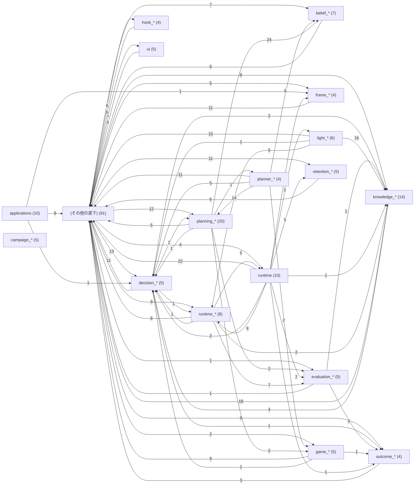

<!-- 自動生成: tools/generate_module_index.py。手で編集しない。 -->
# モジュール目次・責務表・依存図

ソースを探す前にここを読みます。責務は各クラス直前の構造化コメント「責務」（なければモジュールの説明）の1行目です。
依存先・依存元は`src/ai_game_player`内のimportだけを数えます。

責務コメントなし: 36件（読む前に、先に構造化コメントの追加を検討する）。

## 目次

| グループ | モジュール数 | 内容 |
|---|---|---|
| [applications](#group-pkg-applications) | 10 | `applications/` |
| [belief_*](#group-pfx-belief) | 7 | 直下の`belief_`で始まるモジュール |
| [campaign_*](#group-pfx-campaign) | 5 | 直下の`campaign_`で始まるモジュール |
| [decision_*](#group-pfx-decision) | 5 | 直下の`decision_`で始まるモジュール |
| [evaluation_*](#group-pfx-evaluation) | 5 | 直下の`evaluation_`で始まるモジュール |
| [frame_*](#group-pfx-frame) | 4 | 直下の`frame_`で始まるモジュール |
| [game_*](#group-pfx-game) | 5 | 直下の`game_`で始まるモジュール |
| [hook_*](#group-pfx-hook) | 4 | 直下の`hook_`で始まるモジュール |
| [knowledge_*](#group-pfx-knowledge) | 14 | 直下の`knowledge_`で始まるモジュール |
| [light_*](#group-pfx-light) | 6 | 直下の`light_`で始まるモジュール |
| [outcome_*](#group-pfx-outcome) | 4 | 直下の`outcome_`で始まるモジュール |
| [planner_*](#group-pfx-planner) | 4 | 直下の`planner_`で始まるモジュール |
| [planning_*](#group-pfx-planning) | 20 | 直下の`planning_`で始まるモジュール |
| [retention_*](#group-pfx-retention) | 5 | 直下の`retention_`で始まるモジュール |
| [runtime](#group-pkg-runtime) | 10 | `runtime/` |
| [runtime_*](#group-pfx-runtime) | 8 | 直下の`runtime_`で始まるモジュール |
| [ui](#group-pkg-ui) | 5 | `ui/` |
| [(その他の直下)](#group-misc-top) | 91 | 接頭辞で束ねられない直下のモジュール |

## 最初に読む場所（依存元が多いモジュール）

| モジュール | 依存元の数 | 責務 |
|---|---|---|
| [`ai_game_player.models`](../src/ai_game_player/models.py) | 51 | 判断元が選んだ操作、その理由、回答が基づいた画面状態を実行前検証へ渡す |
| [`ai_game_player.knowledge_scope`](../src/ai_game_player/knowledge_scope.py) | 21 | 自由文やパスを含まない有界の不透明識別子だけを受理する |
| [`ai_game_player.belief_contract`](../src/ai_game_player/belief_contract.py) | 20 | 確率と比較score、確率が分からない状態を区別する |
| [`ai_game_player.experience`](../src/ai_game_player/experience.py) | 18 | (責務コメントなし) |
| [`ai_game_player.belief_validation`](../src/ai_game_player/belief_validation.py) | 16 | 自由文・パスを含まない有界の参照IDを検証する |
| [`ai_game_player.decision_context`](../src/ai_game_player/decision_context.py) | 15 | 1つの評価器が1候補について出した点数・根拠・確信度をまとめる |
| [`ai_game_player.planning_outcome`](../src/ai_game_player/planning_outcome.py) | 15 | 操作選択、再観測、保留、追加判断要求を共通の語彙で表す |
| [`ai_game_player.screen_capture`](../src/ai_game_player/screen_capture.py) | 15 | BGRA画素、取得時刻、screen/window mapping、適用済みROI変換を保持する |
| [`ai_game_player.atomic_json`](../src/ai_game_player/atomic_json.py) | 14 | JSON内容を一時ファイルへ準備し、呼出側の確定時に置換する |
| [`ai_game_player.decision_withheld`](../src/ai_game_player/decision_withheld.py) | 12 | 入力を提案しなかった判断をSessionへ伝える |
| [`ai_game_player.outcome`](../src/ai_game_player/outcome.py) | 12 | (責務コメントなし) |
| [`ai_game_player.belief_snapshot`](../src/ai_game_player/belief_snapshot.py) | 11 | 更新コストと切詰め・相関の件数を有界metadataへ固定する |
| [`ai_game_player.run_control`](../src/ai_game_player/run_control.py) | 11 | 停止または再開で失効した実行を表す |
| [`ai_game_player.artifact_store`](../src/ai_game_player/artifact_store.py) | 9 | 既存Store契約を壊さず容量上限・型照合の読込能力を追加する |
| [`ai_game_player.bounded_file`](../src/ai_game_player/bounded_file.py) | 9 | 非通常ファイルや途中の差し替えを検査し、上限付きbytesだけを読む |

## グループ間の依存図

## applications

| モジュール | 主なクラス | 責務 | 依存先 | 依存元 |
|---|---|---|---|---|
| [`applications.quality`](../src/ai_game_player/applications/quality/__init__.py) | - | (責務コメントなし) | 0 | 4 |
| [`applications.quality.data`](../src/ai_game_player/applications/quality/data/__init__.py) | - | (責務コメントなし) | 0 | 3 |
| [`applications.quality.data.quality_commander`](../src/ai_game_player/applications/quality/data/quality_commander.py) | - | (責務コメントなし) | 4 | 1 |
| [`applications.quality.data.quality_messenger`](../src/ai_game_player/applications/quality/data/quality_messenger.py) | - | (責務コメントなし) | 4 | 1 |
| [`applications.quality.data.report_processing`](../src/ai_game_player/applications/quality/data/report_processing.py) | - | (責務コメントなし) | 0 | 1 |
| [`applications.quality.process`](../src/ai_game_player/applications/quality/process/__init__.py) | - | (責務コメントなし) | 0 | 1 |
| [`applications.quality.process.bug_processing`](../src/ai_game_player/applications/quality/process/bug_processing.py) | - | (責務コメントなし) | 0 | 1 |
| [`applications.quality.process.performance_processing`](../src/ai_game_player/applications/quality/process/performance_processing.py) | - | (責務コメントなし) | 6 | 1 |
| [`applications.quality.process.quality_commander`](../src/ai_game_player/applications/quality/process/quality_commander.py) | - | (責務コメントなし) | 6 | 0 |
| [`applications.quality.process.quality_messenger`](../src/ai_game_player/applications/quality/process/quality_messenger.py) | - | (責務コメントなし) | 4 | 1 |

## belief_*

| モジュール | 主なクラス | 責務 | 依存先 | 依存元 |
|---|---|---|---|---|
| [`belief_candidate_store`](../src/ai_game_player/belief_candidate_store.py) | `BeliefStoreError`, `BeliefStorePolicy`, `BeliefCandidateStore` | 旧Snapshotを変更せず更新を拒否した理由を固定codeで伝える | 4 | 2 |
| [`belief_contract`](../src/ai_game_player/belief_contract.py) | `BeliefWeightKind`, `BeliefEvidenceKind`, `BeliefContext` | 確率と比較score、確率が分からない状態を区別する | 1 | 20 |
| [`belief_estimator`](../src/ai_game_player/belief_estimator.py) | `BeliefEstimateResult`, `BayesianBeliefEstimator` | 更新した仮説か、採用しない理由を既存判断へ返す | 8 | 0 |
| [`belief_likelihood`](../src/ai_game_player/belief_likelihood.py) | `BeliefActionRef`, `BeliefLikelihoodBatch`, `BeliefEstimatorPolicy` | 実行元が確認した直前操作と仮説の世代を照合する | 2 | 4 |
| [`belief_prediction`](../src/ai_game_player/belief_prediction.py) | - | 確定操作とchanceを分離して排他経路の確率だけを合算する | 5 | 1 |
| [`belief_snapshot`](../src/ai_game_player/belief_snapshot.py) | `BeliefDiagnostics`, `BeliefSnapshot` | 更新コストと切詰め・相関の件数を有界metadataへ固定する | 3 | 11 |
| [`belief_validation`](../src/ai_game_player/belief_validation.py) | - | 自由文・パスを含まない有界の参照IDを検証する | 0 | 16 |

## campaign_*

| モジュール | 主なクラス | 責務 | 依存先 | 依存元 |
|---|---|---|---|---|
| [`campaign_artifacts`](../src/ai_game_player/campaign_artifacts.py) | - | campaign eventを1行のUTF-8 JSONLとして追記する | 1 | 3 |
| [`campaign_contract`](../src/ai_game_player/campaign_contract.py) | `CampaignState`, `CampaignActionResult`, `CampaignConfig` | 1回のscreen observationから得た状態照合値、終了状態、score、最大tileを保持する | 0 | 4 |
| [`campaign_execution`](../src/ai_game_player/campaign_execution.py) | `CampaignRunner` | Level固有episodeをdeadlineまで実行しfailure分類とJSON artifactsを生成する | 3 | 1 |
| [`campaign_loop`](../src/ai_game_player/campaign_loop.py) | `CampaignProgress`, `CampaignLoop` | 1回のcampaignで変化するepisode、状態、action、停止、metricを集約する | 2 | 1 |
| [`campaign_runner`](../src/ai_game_player/campaign_runner.py) | - | Public imports for the reusable campaign contract and deadline runner. | 3 | 0 |

## decision_*

| モジュール | 主なクラス | 責務 | 依存先 | 依存元 |
|---|---|---|---|---|
| [`decision_context`](../src/ai_game_player/decision_context.py) | `EvaluatorEvidence`, `KnowledgeEvidence`, `CandidateDecisionContext` | 1つの評価器が1候補について出した点数・根拠・確信度をまとめる | 11 | 15 |
| [`decision_orchestrator`](../src/ai_game_player/decision_orchestrator.py) | `DecisionOrchestrator` | 非操作結果を保ちながら、有限回だけ実Sourceへ再取得を依頼する | 5 | 1 |
| [`decision_reliability`](../src/ai_game_player/decision_reliability.py) | `ReliabilityStatus`, `ReliabilityEvidence`, `ReliabilityResult` | 候補選択の検査結果を、後続処理が実行・確認・拒否のどれに扱うかを4段階で示す | 1 | 2 |
| [`decision_verifier`](../src/ai_game_player/decision_verifier.py) | `DecisionVerifier` | 判断元の選択が現在の画面で許可された候補に基づくか、実行規則だけで照合する | 3 | 3 |
| [`decision_withheld`](../src/ai_game_player/decision_withheld.py) | `DecisionDisposition`, `DecisionWithheld` | 入力を提案しなかった判断をSessionへ伝える | 1 | 12 |

## evaluation_*

| モジュール | 主なクラス | 責務 | 依存先 | 依存元 |
|---|---|---|---|---|
| [`evaluation_prediction`](../src/ai_game_player/evaluation_prediction.py) | `AxisPrediction`, `CandidatePrediction`, `EvaluationPredictionBatch` | 観測済みと主張しない一軸の数値仮説と出所を保持する | 3 | 3 |
| [`evaluation_primitives`](../src/ai_game_player/evaluation_primitives.py) | `EvaluationAxis`, `EvaluationResult`, `PrimitiveEvaluator` | (責務コメントなし) | 2 | 4 |
| [`evaluation_profile`](../src/ai_game_player/evaluation_profile.py) | `EvaluationProfile` | 価値基準とその適用範囲をimmutableに保持する | 2 | 4 |
| [`evaluation_quality`](../src/ai_game_player/evaluation_quality.py) | `NumericQuality` | 観測/候補の意味を外側に保ったまま有限の品質と不確かさを渡す | 0 | 5 |
| [`evaluation_vector`](../src/ai_game_player/evaluation_vector.py) | - | typed数値根拠だけを既存6軸と不確かさ付き品質へ変換する | 5 | 2 |

## frame_*

| モジュール | 主なクラス | 責務 | 依存先 | 依存元 |
|---|---|---|---|---|
| [`frame_analyzer`](../src/ai_game_player/frame_analyzer.py) | `FrameAnalyzer` | ROI-local検出矩形を選択windowまたはscreenの候補座標へ移す | 7 | 3 |
| [`frame_preprocessor`](../src/ai_game_player/frame_preprocessor.py) | `FramePrimitiveBatch`, `FramePreprocessor`, `PythonFramePreprocessor` | Batch contracts and the dependency-free Python frame preprocessing path. | 4 | 2 |
| [`frame_stream`](../src/ai_game_player/frame_stream.py) | `FrameCapture`, `FrameDeliveryMode`, `FramePacket` | 1枚の画面Frameを取得するcapture backend契約を定義する | 1 | 3 |
| [`frame_subscriber`](../src/ai_game_player/frame_subscriber.py) | `FrameSubscriber` | 1 consumer分のbounded frame queueと破棄数を保持する | 1 | 1 |

## game_*

| モジュール | 主なクラス | 責務 | 依存先 | 依存元 |
|---|---|---|---|---|
| [`game_2048_adapter`](../src/ai_game_player/game_2048_adapter.py) | `ReferenceGame2048Adapter` | Observationと対応するraw frameから2048 stateと確信度条件を通過したArrow key候補を生成する | 4 | 0 |
| [`game_2048_board`](../src/ai_game_player/game_2048_board.py) | `BoardRegion`, `BoardRecognition`, `Game2048BoardRecognizer` | 縦方向に並ぶ盤面色の帯を、短い検出欠落だけを橋渡ししてgroupへ分ける | 1 | 1 |
| [`game_2048_state`](../src/ai_game_player/game_2048_state.py) | `Game2048State` | 画面由来の盤面仮説または予測盤面を、外部から変更できない値として保持する | 0 | 3 |
| [`game_2048_transition`](../src/ai_game_player/game_2048_transition.py) | `ReferenceGame2048TransitionModel` | 2048の盤面仮説を純粋な仮想操作と確率spawnで展開する | 2 | 2 |
| [`game_session`](../src/ai_game_player/game_session.py) | `SessionRuntime`, `SessionScheduler`, `SessionStatus` | GameSessionControllerが操作するPipelineとsession-scoped Providerの公開契約 | 6 | 2 |

## hook_*

| モジュール | 主なクラス | 責務 | 依存先 | 依存元 |
|---|---|---|---|---|
| [`hook_dispatch_result`](../src/ai_game_player/hook_dispatch_result.py) | `HookExecutionRecord`, `HookDispatchResult` | 1つのHookを1回呼んだ結果を、payloadを含まない監査用の値として保持する | 1 | 2 |
| [`hook_envelope`](../src/ai_game_player/hook_envelope.py) | - | 入力Envelopeから、Hook出力として必要なprovenanceを付けた新しい検証済みEnvelopeを作る | 2 | 0 |
| [`hook_registration`](../src/ai_game_player/hook_registration.py) | `HookMode`, `HookFailurePolicy`, `HookRegistration` | Hookがstage境界のEnvelopeへ行える操作の種類を列挙する | 1 | 5 |
| [`hook_runtime`](../src/ai_game_player/hook_runtime.py) | `HookAccessPolicy`, `_HookContractViolation`, `_HookCapabilityDenied` | Hookの登録・入力・出力を権限の宣言と照合する判定の形を定める（#152 PluginCapabilityPolicyが実装する） | 4 | 2 |

## knowledge_*

| モジュール | 主なクラス | 責務 | 依存先 | 依存元 |
|---|---|---|---|---|
| [`knowledge`](../src/ai_game_player/knowledge.py) | `KnowledgeStore` | ゲーム知識項目をJSON配列で永続化し検索する | 1 | 2 |
| [`knowledge_builder`](../src/ai_game_player/knowledge_builder.py) | `KnowledgeBuildResult`, `KnowledgeBuilder` | 更新候補と、入力を採用・重複排除・無視した件数を呼出側へ返す | 6 | 2 |
| [`knowledge_builder_policy`](../src/ai_game_player/knowledge_builder_policy.py) | `KnowledgeBuilderPolicy` | 一件の経験と一回の更新がKnowledgeを過大に変更しない上限を保持する | 1 | 4 |
| [`knowledge_evaluation`](../src/ai_game_player/knowledge_evaluation.py) | `KnowledgeEvaluationCase`, `KnowledgeEvaluationReport`, `KnowledgeEvaluationRunner` | 根拠付きの同一観測・許可候補・操作成果を対照評価へ渡す | 7 | 2 |
| [`knowledge_feature_adapter`](../src/ai_game_player/knowledge_feature_adapter.py) | `KnowledgeFeatureAdapter` | 選択済みKnowledgeの版・scope・期限を照合して一回の判断へ固定する | 6 | 3 |
| [`knowledge_light_validation`](../src/ai_game_player/knowledge_light_validation.py) | `KnowledgeLightValidationPolicy`, `PreparedKnowledgePublication` | 再構築に必要な数値canonical根拠を自由文・秘密なしで保持する | 3 | 3 |
| [`knowledge_projection`](../src/ai_game_player/knowledge_projection.py) | `KnowledgeProjection` | 参照Knowledgeの版・出所・soft hintを一回の判断へ固定する | 0 | 2 |
| [`knowledge_promotion`](../src/ai_game_player/knowledge_promotion.py) | `KnowledgePromotionResult`, `KnowledgePromotionGate` | 昇格・却下・復元の結論と確定した世代を返す | 12 | 1 |
| [`knowledge_promotion_policy`](../src/ai_game_player/knowledge_promotion_policy.py) | `KnowledgePromotionPolicy` | 知識の小標本・悪化・資源超過を昇格前に拒否する | 2 | 1 |
| [`knowledge_scope`](../src/ai_game_player/knowledge_scope.py) | `KnowledgeScope` | 自由文やパスを含まない有界の不透明識別子だけを受理する | 0 | 21 |
| [`knowledge_snapshot`](../src/ai_game_player/knowledge_snapshot.py) | `KnowledgeSnapshot` | 検証済み数値知識とその出所を、変更不能な正規化JSONとして保持する | 1 | 9 |
| [`knowledge_snapshot_store`](../src/ai_game_player/knowledge_snapshot_store.py) | `KnowledgeReadResult`, `KnowledgeSnapshotStore` | 有効Snapshotかstatic defaultへ戻す理由を明示する | 7 | 2 |
| [`knowledge_update_sample`](../src/ai_game_player/knowledge_update_sample.py) | `KnowledgeUpdateSample` | 操作との対応と証拠の出所を保持する、変更不能な集計用投影 | 3 | 7 |
| [`knowledge_update_statistics`](../src/ai_game_player/knowledge_update_statistics.py) | - | 一つの独立した経験から分類件数・報酬・Beta推定・soft priorを更新する | 2 | 1 |

## light_*

| モジュール | 主なクラス | 責務 | 依存先 | 依存元 |
|---|---|---|---|---|
| [`light_adaptation`](../src/ai_game_player/light_adaptation.py) | `LightAdaptationMetrics`, `LightAdaptationRunner` | 有限workerの仕事量と遅延・却下理由を読み取る | 17 | 1 |
| [`light_adaptation_budget`](../src/ai_game_player/light_adaptation_budget.py) | `LightAdaptationBudget`, `LightResourceSample` | queue・一回の仕事・永続書込の上限を宣言する | 0 | 3 |
| [`light_execution_projection`](../src/ai_game_player/light_execution_projection.py) | `VerifiedEffectSource`, `VerifiedActionEffect`, `LightExecutionProjector` | アプリが明示登録する因果証拠の種類を制限する | 5 | 2 |
| [`light_pending_store`](../src/ai_game_player/light_pending_store.py) | - | scope/digestを照合し有限のcanonical事実を読む | 8 | 1 |
| [`light_session`](../src/ai_game_player/light_session.py) | `SessionLightAdaptation` | production SessionのStep境界へModeとlight workerを接続する | 13 | 1 |
| [`light_utility`](../src/ai_game_player/light_utility.py) | `UtilityMeasurement`, `UtilityEstimate` | 推論経路から数値だけを取り込むversioned sample | 1 | 2 |

## outcome_*

| モジュール | 主なクラス | 責務 | 依存先 | 依存元 |
|---|---|---|---|---|
| [`outcome`](../src/ai_game_player/outcome.py) | `OutcomeAssessment`, `OutcomeEvaluator` | (責務コメントなし) | 1 | 12 |
| [`outcome_detectors`](../src/ai_game_player/outcome_detectors.py) | `TerminalTextDetector`, `StateDeltaDetector`, `ScreenDiffDetector` | (責務コメントなし) | 2 | 1 |
| [`outcome_fusion`](../src/ai_game_player/outcome_fusion.py) | `SemanticOutcomeProvider`, `DeterministicOutcomeFusion`, `OutcomeDetector` | 画面解析器と任意の意味評価器が返した根拠を統合し、成功・失敗・状態変化を不確実性とともに判定する | 4 | 1 |
| [`outcome_models`](../src/ai_game_player/outcome_models.py) | `OutcomeEvidence`, `OutcomeEvent` | 操作後に推定したゲーム結果と、画面状態が変化したかを別々に記録する | 1 | 6 |

## planner_*

| モジュール | 主なクラス | 責務 | 依存先 | 依存元 |
|---|---|---|---|---|
| [`planner_2048_observation`](../src/ai_game_player/planner_2048_observation.py) | `Reference2048PlanningObservation` | 既存画面認識を任意の純粋modelへ接続する | 11 | 1 |
| [`planner_factory`](../src/ai_game_player/planner_factory.py) | - | 純粋2048登録と実画面sensorを任意profileで組み立てる | 10 | 0 |
| [`planner_observation`](../src/ai_game_player/planner_observation.py) | `PlannerObservationInput`, `PlannerObservationAdapter` | 観測由来Beliefと実行直前照合用semantic参照を束ねる | 5 | 3 |
| [`planner_provider`](../src/ai_game_player/planner_provider.py) | `PlannerDecisionProvider` | 最初の一手または非SELECTを既存判断境界へ渡す | 16 | 1 |

## planning_*

| モジュール | 主なクラス | 責務 | 依存先 | 依存元 |
|---|---|---|---|---|
| [`planning_2048`](../src/ai_game_player/planning_2048.py) | `Reference2048Quality` | 観測済みと仮定した仮想盤面へ明示heuristicを適用する | 4 | 2 |
| [`planning_contract`](../src/ai_game_player/planning_contract.py) | `StateQualityEvaluator`, `PlanningDomain`, `PlanningRegistration` | 予測stateのnormalized qualityを純粋に評価する | 3 | 7 |
| [`planning_file_publisher`](../src/ai_game_player/planning_file_publisher.py) | `_RenameInfoEx` | Windows FILE_RENAME_INFOの可変長尾部位置を定義 | 1 | 1 |
| [`planning_file_reader`](../src/ai_game_player/planning_file_reader.py) | - | JSONとraw checkpoint検査で同じ有界readerを使う | 0 | 3 |
| [`planning_information`](../src/ai_game_player/planning_information.py) | `PlanningObservationModel`, `PlanningInformationValue` | 再観測で得るsignalの校正済み条件付き確率を固定する | 3 | 5 |
| [`planning_observation_policy`](../src/ai_game_player/planning_observation_policy.py) | `PlanningObservationPolicyGain` | 観測後mappingの改善と全体riskを一対で保持する | 5 | 1 |
| [`planning_outcome`](../src/ai_game_player/planning_outcome.py) | `PlanningOutcome` | 操作選択、再観測、保留、追加判断要求を共通の語彙で表す | 0 | 15 |
| [`planning_policy_authority`](../src/ai_game_player/planning_policy_authority.py) | - | 現在の候補と不可侵vetoを数値評価の前に適用する | 7 | 1 |
| [`planning_policy_contract`](../src/ai_game_player/planning_policy_contract.py) | `PlanningRiskPolicyConfig`, `PlanningComputationEstimate`, `PlanningActionRisk` | 利益の下振れを許容するsoft objectiveとpolicy処理上限を固定する | 5 | 6 |
| [`planning_policy_projection`](../src/ai_game_player/planning_policy_projection.py) | - | interval leafの両端で下側riskを包絡する | 5 | 2 |
| [`planning_readiness`](../src/ai_game_player/planning_readiness.py) | `PlannerNotReady` | 起動待ち期限内にworker往復が通常予算へ収まらなかったことを示す | 2 | 1 |
| [`planning_reobservation`](../src/ai_game_player/planning_reobservation.py) | `PlanningObservationBudget`, `PlanningDecisionEpisode` | 一つのGoal episodeに使える追加観測を制限する | 4 | 2 |
| [`planning_result`](../src/ai_game_player/planning_result.py) | `WeightedValue`, `HypothesisActionValue`, `PlanningActionValue` | 排他的な仮想leafの絶対または明示条件付きchance質量を保持する | 3 | 9 |
| [`planning_risk`](../src/ai_game_player/planning_risk.py) | `PlanningTailRisk` | 未表現質量も含む利益分布の保守的な下振れ指標を保持する | 0 | 5 |
| [`planning_risk_policy`](../src/ai_game_player/planning_risk_policy.py) | `PlanningRiskPolicy` | 許可/鮮度のhard境界を維持し、soft riskとVOIで次の提案を選ぶ | 12 | 1 |
| [`planning_selection_guard`](../src/ai_game_player/planning_selection_guard.py) | `PlanningSelectionGuard` | 元planと選択候補を同じRun世代・実画面へ束縛する | 6 | 1 |
| [`planning_wire`](../src/ai_game_player/planning_wire.py) | - | 一時IPCのJSONを一度だけ同一UTF-8 byte列へ固定する | 6 | 4 |
| [`planning_worker`](../src/ai_game_player/planning_worker.py) | - | factoryをimportする前にOS予算を設定し、一requestだけを処理する | 12 | 1 |
| [`planning_worker_diagnostic`](../src/ai_game_player/planning_worker_diagnostic.py) | `WorkerPhase`, `WorkerDiagnostic` | trusted wrapperの段階を固定enumで限定する | 1 | 4 |
| [`planning_worker_limits`](../src/ai_game_player/planning_worker_limits.py) | - | model/factory import前にworkerのOS資源上限を設定する | 0 | 1 |

## retention_*

| モジュール | 主なクラス | 責務 | 依存先 | 依存元 |
|---|---|---|---|---|
| [`retention_collector`](../src/ai_game_player/retention_collector.py) | `RetentionSafetyError`, `RetentionCapacityError`, `RetentionFileSystem` | 削除先が管理root外・symlink経由・想定外の配置であるため処理を止めたことを通知する | 9 | 5 |
| [`retention_index`](../src/ai_game_player/retention_index.py) | `RetentionIndexError`, `RetentionEntry` | 保持索引が契約外で、GCを安全に判断できないことを呼出側へ通知する | 0 | 7 |
| [`retention_planner`](../src/ai_game_player/retention_planner.py) | `RemovedEntry`, `BlockedEntry`, `RetentionPlan` | 計画で索引から外す1記録と、その理由を呼出側へ示す | 2 | 2 |
| [`retention_policy`](../src/ai_game_player/retention_policy.py) | `RetentionPolicyError`, `RetentionPolicy` | retention policyが契約外で、GCや受入判断に使えないことを通知する | 1 | 3 |
| [`retention_root_lock`](../src/ai_game_player/retention_root_lock.py) | `RetentionRootUnsafeError`, `RetentionLockTimeoutError`, `_RootLockState` | root・lock fileがsymlink/junction等で、lockも変更も始めずに止めたことを通知する | 1 | 6 |

## runtime

| モジュール | 主なクラス | 責務 | 依存先 | 依存元 |
|---|---|---|---|---|
| [`runtime.composition`](../src/ai_game_player/runtime/composition.py) | `ResolutionFailure`, `LifecycleHandle`, `ResolvedFeature` | (責務コメントなし) | 2 | 1 |
| [`runtime.contracts`](../src/ai_game_player/runtime/contracts.py) | `RuntimeCapability`, `RuntimeDescriptor`, `RuntimeBackend` | (責務コメントなし) | 0 | 4 |
| [`runtime.manifest`](../src/ai_game_player/runtime/manifest.py) | `FeatureLifecycle`, `CapabilityManifest`, `CapabilityManifestRegistry` | (責務コメントなし) | 2 | 2 |
| [`runtime.native`](../src/ai_game_player/runtime/native.py) | `NativeStatus`, `NativeBatchKind`, `NativeLoadStatus` | C ABIから受け取るWindows Graphics Capture frame metadataを表す | 6 | 3 |
| [`runtime.registry`](../src/ai_game_player/runtime/registry.py) | `RuntimeRegistry` | (責務コメントなし) | 2 | 1 |
| [`runtime.resource_lifecycle`](../src/ai_game_player/runtime/resource_lifecycle.py) | `ResourceScope`, `ResourceState`, `ResourceLifecycleError` | resourceの所有範囲を表す固定語彙 | 0 | 1 |
| [`runtime.resource_probes`](../src/ai_game_player/runtime/resource_probes.py) | `Support`, `_MemCounters`, `_ProcessEntry` | 観測側processの優先度を下げ, 観測対象へ負荷を掛けない | 0 | 0 |
| [`runtime.resource_stability`](../src/ai_game_player/runtime/resource_stability.py) | `ProfileError`, `_Run` | profileまたは入力samplesの不正(CLIの終了コード2・profile_invalid) | 0 | 0 |
| [`runtime.retention_adapter`](../src/ai_game_player/runtime/retention_adapter.py) | `RetentionReferenceError`, `RetentionTrigger`, `RetentionTriggerPolicy` | 参照を書く条件（gate内・object存在）を満たさず、Journal/Experienceへ書かせなかったことを通知する | 8 | 1 |
| [`runtime.session_composition`](../src/ai_game_player/runtime/session_composition.py) | `SessionRetentionConfig`, `SessionRuntimeConfiguration`, `_PipelineResourceTrace` | 複数プロセスによる同時legacy移行をOS file lockで直列化する | 31 | 2 |

## runtime_*

| モジュール | 主なクラス | 責務 | 依存先 | 依存元 |
|---|---|---|---|---|
| [`runtime`](../src/ai_game_player/runtime/__init__.py) | - | (責務コメントなし) | 5 | 9 |
| [`runtime_evaluation_adapter`](../src/ai_game_player/runtime_evaluation_adapter.py) | `RuntimeEvaluationAdapter` | 同stepの価値基準・actual・hypotheticalを限定量で固定する | 8 | 3 |
| [`runtime_evaluation_projection`](../src/ai_game_player/runtime_evaluation_projection.py) | `RuntimeEvaluationProjection` | 実Outcomeと候補仮説を分離したstep不変JSONを保持する | 5 | 2 |
| [`runtime_log`](../src/ai_game_player/runtime_log.py) | `RuntimeLog` | application logを追記JSONLへ保存し、active SessionのeventをJournalにも記録する | 2 | 4 |
| [`runtime_mode_config`](../src/ai_game_player/runtime_mode_config.py) | `RuntimeMode`, `RuntimePhase`, `RuntimeOperation` | 推論と学習の実行方針を互いに排他的な5種類で表す | 0 | 5 |
| [`runtime_mode_controller`](../src/ai_game_player/runtime_mode_controller.py) | `RuntimeModeTransitionError`, `RuntimeModePersistenceError`, `RuntimeModeController` | Mode/PhaseやStep世代が要求操作を許さないことを表す | 5 | 2 |
| [`runtime_mode_recorder`](../src/ai_game_player/runtime_mode_recorder.py) | `RuntimeModeRecorder` | Mode/Phase metadataの有界記録待ちとJournal/checkpoint IOを所有する | 3 | 1 |
| [`runtime_mode_state`](../src/ai_game_player/runtime_mode_state.py) | `RuntimeModeSnapshot`, `RuntimeStepToken` | 利用者選択、実効Mode、Phaseと現在の操作世代を固定してSubsystemへ渡す | 1 | 3 |

## ui

| モジュール | 主なクラス | 責務 | 依存先 | 依存元 |
|---|---|---|---|---|
| [`ui.player_seat`](../src/ai_game_player/ui/player_seat.py) | `PlayerSeat` | dot-art画像をnearest-neighborの整数倍率で目標サイズへ変換したPhotoImageを返す | 3 | 1 |
| [`ui.shell`](../src/ai_game_player/ui/shell.py) | `ShellState`, `ShellStateStore`, `ShellController` | 共通Workspace配置、全画面共通の停止操作、現在のSession状態、およびPlay Workspaceの直近Actionを表示する | 4 | 1 |
| [`ui.stop_help_hint`](../src/ai_game_player/ui/stop_help_hint.py) | `StopHelpHint` | 全OSで共通の停止方法を表示し、割り当てられた画面幅で文章を折り返すLabel | 0 | 1 |
| [`ui.theme`](../src/ai_game_player/ui/theme.py) | - | 既定UIフォントのfamilyを保ったまま、大きさと太さだけを変えたフォント指定を返す | 0 | 3 |
| [`ui.tooltip`](../src/ai_game_player/ui/tooltip.py) | `ToolTip` | 一つのTkウィジェットに、ホバーまたはキーボードフォーカスで補足説明を表示する | 2 | 2 |

## (その他の直下)

| モジュール | 主なクラス | 責務 | 依存先 | 依存元 |
|---|---|---|---|---|
| [`__main__`](../src/ai_game_player/__main__.py) | - | 配布bundleの自己検査を実行し、指定pathへJSON reportを書く | 4 | 0 |
| [`action_executor`](../src/ai_game_player/action_executor.py) | `ExecutionResult`, `LiveExecutor`, `ActionExecutor` | 候補の安全評価とOS入力への到達を制御する | 4 | 8 |
| [`action_safety`](../src/ai_game_player/action_safety.py) | `SafetyStatus`, `SafetyEvidence`, `SafetyEvaluationContext` | 操作が危険かを調べるため、ゲーム目標・操作後の予測・候補選択の検査結果を評価器へ渡す | 2 | 1 |
| [`admission_pending_store`](../src/ai_game_player/admission_pending_store.py) | `AdmissionRecordError`, `PendingAdmission`, `PendingAdmissionStore` | pending recordが契約外で、回収を安全に判断できないことを通知する | 3 | 2 |
| [`app`](../src/ai_game_player/app.py) | `TkAfterScheduler`, `Application` | Application scheduling constants: Tkイベントポーリングと連続実行間隔を明示する | 22 | 1 |
| [`application_workflow`](../src/ai_game_player/application_workflow.py) | `MemorySource`, `ApplicationSettings`, `PreparedObservation` | 同じSession Runtimeへ最新の画面観測と操作候補を渡す | 11 | 1 |
| [`applications`](../src/ai_game_player/applications/__init__.py) | - | (責務コメントなし) | 0 | 4 |
| [`artifact_admission`](../src/ai_game_player/artifact_admission.py) | `ArtifactAdmissionError`, `ArtifactAdmissionRequest`, `AdmissionTraceEvent` | put以降の失敗を、補償結果付きで呼出側へ通知する（silent successにしない） | 6 | 3 |
| [`artifact_store`](../src/ai_game_player/artifact_store.py) | `ArtifactIntegrityError`, `ArtifactMetadata`, `IntegrityIssue` | 既存Store契約を壊さず容量上限・型照合の読込能力を追加する | 2 | 9 |
| [`artifact_trash`](../src/ai_game_player/artifact_trash.py) | `TrashIntentError`, `TrashIntent`, `TrashSweepReport` | trash intent recordが契約外で、安全に判断できないことを通知する | 5 | 2 |
| [`atomic_json`](../src/ai_game_player/atomic_json.py) | `StagedJsonWrite` | JSON内容を一時ファイルへ準備し、呼出側の確定時に置換する | 0 | 14 |
| [`baseline_provider`](../src/ai_game_player/baseline_provider.py) | `BaselineProviderProfile`, `BaselineDecision`, `BaselineWithheld` | 学習Model・GPU・通信なしで動く判断元が、満たす条件と対応する判断能力を機械可読に宣言する | 4 | 4 |
| [`bounded_file`](../src/ai_game_player/bounded_file.py) | - | 非通常ファイルや途中の差し替えを検査し、上限付きbytesだけを読む | 0 | 9 |
| [`bounded_planner`](../src/ai_game_player/bounded_planner.py) | `BoundedExpectimaxPlanner` | 純粋な探索callbackを親の停止/観測/メモリ境界から分離する | 11 | 1 |
| [`bright_region_detector`](../src/ai_game_player/bright_region_detector.py) | `BrightRegionDetector` | 輝度が高い連結領域を検出し、UI要素かどうかは未確認の要素として返す | 2 | 3 |
| [`bundle_self_check`](../src/ai_game_player/bundle_self_check.py) | `BundleCheckResult` | 自己検査1項目の合否と、失敗時に原因を特定できる説明を保持する | 3 | 1 |
| [`candidate_identity`](../src/ai_game_player/candidate_identity.py) | `Grounding`, `CandidateIdentity`, `MergeContext` | 統合前の1候補が「どの画面のどの要素か」を比較するための証拠を保持する | 1 | 1 |
| [`candidate_merger`](../src/ai_game_player/candidate_merger.py) | `CandidateMerger` | 自動操作・認識文字・画像由来の候補を重複排除して判断一覧へ統合する | 2 | 3 |
| [`capture_geometry`](../src/ai_game_player/capture_geometry.py) | `CaptureGeometry` | packed BGRA frameの1pixelを構成するbyte数を定義する | 1 | 4 |
| [`capture_region`](../src/ai_game_player/capture_region.py) | `CaptureRegionMode`, `PixelRect`, `NormalizedRect` | 利用者が明示した矩形の解決成功を記録するconfidence値を定義する | 1 | 8 |
| [`captured_source`](../src/ai_game_player/captured_source.py) | `CapturedObservationSource` | 一つの実capture sourceから認識結果と新Frame参照を生成する | 3 | 0 |
| [`challenger_update`](../src/ai_game_player/challenger_update.py) | - | 診断報告のcandidate targetから型付き更新提案を作り、仮説targetを観測要求へ分ける | 5 | 0 |
| [`challenger_update_models`](../src/ai_game_player/challenger_update_models.py) | `ChallengerUpdateError`, `Prototype`, `ComponentParameters` | 更新提案・Challenger生成・読込の拒否を固定codeで伝える | 4 | 1 |
| [`challenger_update_policy`](../src/ai_game_player/challenger_update_policy.py) | `ChallengerUpdatePolicy` | 更新提案のstrategy選択・更新量・件数上限を一つの指紋へ固定する | 0 | 2 |
| [`config`](../src/ai_game_player/config.py) | `AppConfig`, `ConfigStore` | 判断・実行設定と永続化可能なcapture regionを保持する | 1 | 2 |
| [`cross_process_lock`](../src/ai_game_player/cross_process_lock.py) | - | (責務コメントなし) | 0 | 5 |
| [`data_class_policy`](../src/ai_game_player/data_class_policy.py) | `DataClassPolicyError`, `DataClassPolicy` | data class policyが契約外で、保存・送信判断に使えないことを通知する | 0 | 1 |
| [`data_inventory`](../src/ai_game_player/data_inventory.py) | `DataInventoryError`, `DataInventory` | data inventoryが契約外、または問合せ対象が未登録であることを通知する | 2 | 2 |
| [`deferred_trace_append`](../src/ai_game_player/deferred_trace_append.py) | `DeferredTraceAppend` | 計画準備後に追記された実行auditを失わず判断traceを公開する | 0 | 2 |
| [`e2e_runner`](../src/ai_game_player/e2e_runner.py) | - | 操作・観測・完了確認を繰り返し、停止理由と実入力の有無をJSONLへ記録する | 5 | 0 |
| [`engine`](../src/ai_game_player/engine.py) | `GamePlayerEngine` | 許可候補の判断・信頼性検査・実操作Outcome追跡とJournal保存を管理する | 18 | 1 |
| [`evaluator`](../src/ai_game_player/evaluator.py) | `ActionEvaluator` | 候補ごとの許可・拒否理由を監査可能な形式で返す | 1 | 3 |
| [`event_journal`](../src/ai_game_player/event_journal.py) | `EventJournalError`, `EventJournalCorruptionError`, `EventJournalClosedError` | access・resource failureとして扱うSQLite primary result codeを列挙する | 1 | 8 |
| [`execution_history`](../src/ai_game_player/execution_history.py) | `ExecutionHistory` | 実行結果を旧JSON互換readerまたはSession Event Journalで管理する | 3 | 1 |
| [`execution_mode`](../src/ai_game_player/execution_mode.py) | - | (責務コメントなし) | 0 | 1 |
| [`execution_receipt`](../src/ai_game_player/execution_receipt.py) | `ExecutionReceipt`, `ExecutionObservation` | 実行境界から得た送信事実を元のsnapshot・操作・世代へ固定する | 1 | 8 |
| [`expectimax_search`](../src/ai_game_player/expectimax_search.py) | `SearchFailure`, `SearchCutoff`, `SequenceInfeasible` | 不正な登録model/quality結果を固定codeで拒否する | 7 | 1 |
| [`experience`](../src/ai_game_player/experience.py) | `ArtifactReference`, `ExperienceProvenance`, `ExperienceEvent` | (責務コメントなし) | 0 | 18 |
| [`experience_reader`](../src/ai_game_player/experience_reader.py) | `RecoveryNotice`, `ExperienceRecoveryError`, `JsonlExperienceReader` | (責務コメントなし) | 2 | 1 |
| [`fail_safe_runtime`](../src/ai_game_player/fail_safe_runtime.py) | `FailSafeState`, `FailSafeConfig`, `FailSafeCommand` | 外部数値を比較する前に有限の実数へ限定する | 2 | 4 |
| [`heartbeat_diagnostic`](../src/ai_game_player/heartbeat_diagnostic.py) | `_Entry`, `HeartbeatDiagnostics` | 診断専用の同一process内monotonic nsを取得する | 0 | 1 |
| [`history`](../src/ai_game_player/history.py) | `HistoryStore` | 画面観測と選択判断を追記形式のJSON履歴として管理する | 3 | 1 |
| [`journal_adapters`](../src/ai_game_player/journal_adapters.py) | `StagedJournalAppend`, `LegacyEventAdapter` | 旧JSON storeの公開時点を保ちながらSession Journal appendを遅延する | 1 | 7 |
| [`learning`](../src/ai_game_player/learning.py) | `LearningCapabilityManifest`, `LearningArtifactProvenance`, `LearningCapabilityRegistry` | (責務コメントなし) | 0 | 1 |
| [`learning_dataset`](../src/ai_game_player/learning_dataset.py) | `DatasetSource`, `TrainingSample`, `ExperienceTrainingDataset` | (責務コメントなし) | 2 | 4 |
| [`learning_identity`](../src/ai_game_player/learning_identity.py) | `LearningIdentityKind`, `LearningIdentityPolicy` | 未実装の意味追跡を仮定せず、profileが保証する再対応だけを区別する | 2 | 5 |
| [`loop_guard`](../src/ai_game_player/loop_guard.py) | `LoopGuard` | (責務コメントなし) | 2 | 2 |
| [`metrics`](../src/ai_game_player/metrics.py) | `ExecutionMetrics`, `MetricsCalculator` | (責務コメントなし) | 1 | 1 |
| [`models`](../src/ai_game_player/models.py) | `ScreenObservation`, `DetectedElement`, `ActionCandidate` | 判断元が選んだ操作、その理由、回答が基づいた画面状態を実行前検証へ渡す | 0 | 51 |
| [`no_allowed_candidates_error`](../src/ai_game_player/no_allowed_candidates_error.py) | `NoAllowedCandidatesError` | 許可候補が空で、入力実行前の意思決定を中止した状態を表すValueErrorの派生型 | 0 | 2 |
| [`noisy_provider`](../src/ai_game_player/noisy_provider.py) | `NoisyLanguageProvider` | 固定seedで許可候補を擬似ランダム選択し、意味を持たない理由と低確信Outcomeを返す | 3 | 0 |
| [`observation_freshness`](../src/ai_game_player/observation_freshness.py) | `ObservationFreshness` | 実capture metadataの有界な順序参照を固定する | 1 | 5 |
| [`observation_service`](../src/ai_game_player/observation_service.py) | `WindowCaptureSource`, `FrameAnalyzerFactory`, `FrameAnalyzer` | 1つのWindows window handleからSharedFrameProducerが使う画面frameを取得する | 7 | 1 |
| [`observation_source`](../src/ai_game_player/observation_source.py) | `ObservationSource`, `JsonObservationSource` | (責務コメントなし) | 1 | 2 |
| [`ocr_detector`](../src/ai_game_player/ocr_detector.py) | `OcrTextCandidateDetector` | (責務コメントなし) | 1 | 2 |
| [`ocr_provider`](../src/ai_game_player/ocr_provider.py) | `OcrResult`, `OcrProvider`, `RecognizerOcrProvider` | (責務コメントなし) | 2 | 0 |
| [`ocr_recognizer`](../src/ai_game_player/ocr_recognizer.py) | `TesseractOcrRecognizer` | 同じ画素からOCR文字と矩形・確信度を返す | 1 | 1 |
| [`orphan_reconciler`](../src/ai_game_player/orphan_reconciler.py) | `LiveReferenceSnapshot`, `LiveReferenceSource`, `OrphanReconcilerConfig` | 1つの保持者が1時点で返す、生きているArtifact参照の集合 | 12 | 0 |
| [`perception_hook_boundary`](../src/ai_game_player/perception_hook_boundary.py) | `PerceptionHookBoundary` | 統合済み操作候補を座標なしのStageEnvelopeにしてread/inject Hookへ渡し、失敗時方針に従って判断を止める | 7 | 1 |
| [`perceptual_hasher`](../src/ai_game_player/perceptual_hasher.py) | `PerceptualHasher` | (責務コメントなし) | 1 | 3 |
| [`pipeline`](../src/ai_game_player/pipeline.py) | `DecisionPipeline` | 画面観測から検証済み判断、安全評価、世代guard付き実行までを接続する | 23 | 3 |
| [`player_character`](../src/ai_game_player/player_character.py) | `PlayerState`, `PlayerAssetPack` | Player Seatが表示するPlayer Characterの状態を、描画方法から独立した値として定義する | 0 | 3 |
| [`plugin_capability_manifest`](../src/ai_game_player/plugin_capability_manifest.py) | `PluginManifestError`, `PayloadSchemaGrant`, `InjectTarget` | Manifestの復号・検証・登録が失敗した理由を機械判定できるcodeと一緒に伝える | 3 | 1 |
| [`plugin_capability_policy`](../src/ai_game_player/plugin_capability_policy.py) | `PluginCapabilityDenied`, `PluginCapabilityDecision`, `_Grant` | Hookの登録・入力・出力が宣言された権限の外にあることを、機械判定できるcodeで伝える | 3 | 0 |
| [`provider`](../src/ai_game_player/provider.py) | `RuleProvider`, `OllamaProvider` | 外部通信なしで許可候補を規則に従って選び、必要なら画面参照を添えて返す | 5 | 2 |
| [`recovery_controller`](../src/ai_game_player/recovery_controller.py) | `_RecoveryEpisode`, `RecoveryController` | 1つのSelf-Check異常に対するRecoveryの進行をController内部で保持する | 2 | 1 |
| [`recovery_models`](../src/ai_game_player/recovery_models.py) | `RecoveryAction`, `RecoveryState`, `RecoveryReason` | Recovery Controllerが呼出側へ要求する次の行動を表す | 0 | 2 |
| [`recovery_session_adapter`](../src/ai_game_player/recovery_session_adapter.py) | `RecoveryJournal`, `RecoverySessionAdapter` | Recovery記録に必要なEvent Journalのappend契約を表す | 3 | 0 |
| [`region_detector`](../src/ai_game_player/region_detector.py) | `ConfiguredRegionDetector` | (責務コメントなし) | 1 | 0 |
| [`run_control`](../src/ai_game_player/run_control.py) | `ExecutionCancelled`, `RunController` | 停止または再開で失効した実行を表す | 1 | 11 |
| [`safety_guard`](../src/ai_game_player/safety_guard.py) | `SafetyState`, `SafetyGuardConfig`, `TargetState` | (責務コメントなし) | 1 | 5 |
| [`screen_capture`](../src/ai_game_player/screen_capture.py) | `BitmapInfoHeader`, `BitmapInfo`, `ScreenFrame` | BGRA画素、取得時刻、screen/window mapping、適用済みROI変換を保持する | 5 | 15 |
| [`screen_similarity`](../src/ai_game_player/screen_similarity.py) | `ScreenSimilarity` | (責務コメントなし) | 2 | 1 |
| [`self_check`](../src/ai_game_player/self_check.py) | `SelfCheckMonitor` | ゲーム固有presetに依存せず、step履歴から異常兆候を検出する | 1 | 0 |
| [`self_check_models`](../src/ai_game_player/self_check_models.py) | `SelfCheckCategory`, `SelfCheckSeverity`, `SelfCheckConfig` | deterministicなSelf-Check検出項目を識別する | 2 | 3 |
| [`shared_frame_producer`](../src/ai_game_player/shared_frame_producer.py) | `SharedFrameProducer` | 1 capture backendを周期実行し、同じFramePacketをbounded subscriber queueへ配る | 3 | 1 |
| [`simulation_provider`](../src/ai_game_player/simulation_provider.py) | `SimulationKey`, `SimulationProvider` | 異なる状態型を同じRegistryで混ぜずに参照する型付きキー | 1 | 0 |
| [`stage_envelope`](../src/ai_game_player/stage_envelope.py) | `StageEnvelopeError`, `StageEnvelope` | session・trace・envelope等の外部生成IDとして受け付ける文字列を制限する | 1 | 8 |
| [`stage_envelope_codec`](../src/ai_game_player/stage_envelope_codec.py) | - | 検証済みEnvelopeを、言語をまたいで同じ値として読めるcanonical JSONのUTF-8 bytesへ変換する | 1 | 2 |
| [`training_diagnosis`](../src/ai_game_player/training_diagnosis.py) | - | Experience episode群からcaseを抽出し、診断報告を作る | 5 | 0 |
| [`training_diagnosis_models`](../src/ai_game_player/training_diagnosis_models.py) | `DiagnosisCase`, `ComponentAttribution`, `CaseDiagnosis` | 一つの実行操作について診断に使う型付き信号を保持する | 4 | 3 |
| [`training_diagnosis_policy`](../src/ai_game_player/training_diagnosis_policy.py) | `TrainingDiagnosisPolicy` | 二つの確定度のうち弱い方を返し、文脈eventによる格上げを防ぐ | 0 | 2 |
| [`transition_model`](../src/ai_game_player/transition_model.py) | `ActionTransition`, `ChanceOutcome`, `TransitionModel` | 確定操作の結果を確率遷移前の値として表す | 0 | 6 |
| [`ui`](../src/ai_game_player/ui/__init__.py) | - | Presentation components for the desktop application. | 0 | 4 |
| [`ui_embedding`](../src/ai_game_player/ui_embedding.py) | `EmbeddingVector`, `EmbeddingProvider`, `GridVisualEmbeddingProvider` | (責務コメントなし) | 3 | 0 |
| [`ui_recognition`](../src/ai_game_player/ui_recognition.py) | `UiDetectorProvider`, `DetectorProviderAdapter`, `UiProviderConfig` | (責務コメントなし) | 2 | 1 |
| [`unknownness`](../src/ai_game_player/unknownness.py) | `UnknownnessType`, `UnknownnessScope`, `UnknownnessEvidence` | 判断の不確かさを示す観測原因を、保存・集計で共通の名前にする | 0 | 0 |
| [`window_selector`](../src/ai_game_player/window_selector.py) | `WindowInfo`, `WindowsWindowSelector` | 対象ウィンドウをHWNDと所有PIDで識別する | 1 | 1 |
| [`windows_abi`](../src/ai_game_player/windows_abi.py) | - | ctypesがC intと解釈しないようWin32関数の引数・戻り値を宣言する | 0 | 3 |
| [`windows_input`](../src/ai_game_player/windows_input.py) | `WindowsInputExecutor` | 入力送信に使うuser32関数を取得し、Windows ABIの型を設定する | 4 | 2 |
| [`world_state_hypothesis`](../src/ai_game_player/world_state_hypothesis.py) | `HypothesisOrigin`, `TypedStateRef`, `WorldStateHypothesis` | 観測から作る仮説、未観測の予測、後続のposteriorを区別する | 2 | 8 |
